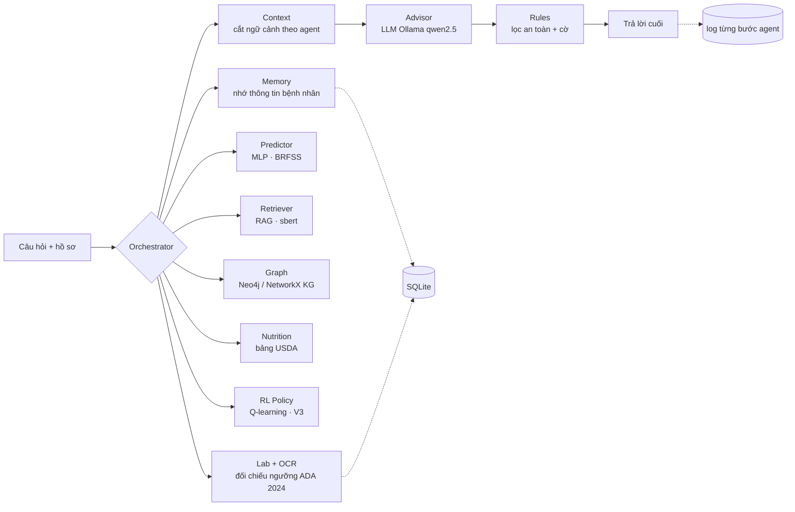

# DiaCare-MAS: hệ đa agent hỗ trợ tư vấn phòng ngừa tiểu đường

Đồ án học tập. **Không thay thế bác sĩ**: mọi câu trả lời đều kèm lời nhắc tham khảo ý kiến chuyên môn,
kết quả xét nghiệm chỉ được *đối chiếu ngưỡng*, không phải chẩn đoán.

Hệ thống kết hợp bốn khối theo sơ đồ ý tưởng ban đầu:

1. **Học sâu dự đoán nguy cơ**: MLP (PyTorch) huấn luyện trên CDC BRFSS 2015 (253.680 mẫu, 21 chỉ số).
2. **Tri thức + RAG + Đồ thị tri thức (KG) + LLM**: truy xuất tài liệu (MedlinePlus, WHO) và đồ thị tri thức 5 loại cạnh rồi để LLM chạy cục bộ qua Ollama viết câu trả lời.
3. **Học tăng cường (RL - V3)**: chính sách Q-learning tuyến tính chọn trọng tâm can thiệp cá nhân hóa từ hồ sơ, xét nghiệm và lịch sử hội thoại.
4. **Luật an toàn**: chặn lời khuyên đổi thuốc, chuyển khám khi có triệu chứng, cấp cứu, xét nghiệm vượt ngưỡng.

## Kiến trúc



Orchestrator gọi các agent **tuần tự theo thứ tự cố định**. Mỗi agent chỉ nhận lát ngữ cảnh mình cần
(`build_context`), bộ nhớ đứng trước xét nghiệm, rồi đến dinh dưỡng, đồ thị tri thức, định hướng RL và tài liệu khi cắt theo ngân sách token.

| Agent / Module | File | Vai trò |
|---|---|---|
| Orchestrator | `src/diacare/orchestrator.py` | Điều phối, bắt câu chào hỏi, ghi trace từng bước |
| Memory | `src/diacare/memory.py` | Trích và nhớ thông tin bệnh nhân (dị ứng, thuốc, chẩn đoán), tóm tắt lịch sử dài |
| Lab + OCR | `src/diacare/labs.py`, `ocr.py` | Đọc HbA1c, đường huyết lúc đói, OGTT 2 giờ, đường huyết bất kỳ (từ chữ, PDF scan, ảnh chụp); đổi đơn vị; xếp mức |
| Predictor | `src/diacare/predictor.py` | MLP dự đoán xác suất tiểu đường từ 21 chỉ số hồ sơ |
| Retriever | `src/diacare/retriever.py` | Truy xuất dense (sbert), tuỳ chọn lai BM25 + RRF |
| Graph (KG) | `src/diacare/kg.py` | Đồ thị tri thức 5 loại cạnh (ADA 2024, luật, USDA, thống kê BRFSS, khẳng định KB đã kiểm chứng) trên Neo4j hoặc NetworkX |
| Nutrition | `src/diacare/nutrition.py` | Nhận món ăn Việt, tra USDA FoodData Central, xử lý từ đa nghĩa |
| RL (V3) | `src/diacare/rl.py` | Chính sách Q-learning chọn trọng tâm tư vấn cá nhân hóa từ trạng thái bệnh nhân |
| Advisor | `src/diacare/advisor.py`, `llm.py` | Gọi Ollama `/api/chat`, hỗ trợ stream |
| Rules | `src/diacare/rules.py` | Chặn lời khuyên đổi thuốc, gắn cờ chuyển khám / cấp cứu / xét nghiệm |

## Tính năng

- **Giao diện chat** (Streamlit). Ô chat ghim dưới đáy màn hình. Câu trả lời **hiện dần theo từng câu** khi LLM
  đang viết: mỗi câu phải qua bộ lọc an toàn trước khi hiện, nên lời khuyên đổi thuốc không bao giờ lọt lên màn hình.
- **Nhập kết quả xét nghiệm (kèm OCR cho PDF scan & ảnh chụp)**: tải `.txt`, `.csv`, `.json`, `.pdf` (có lớp chữ hoặc PDF scan),
  ảnh `.png`, `.jpg`, `.jpeg`, dán nội dung phiếu, hoặc gõ thẳng trong chat ("HbA1c của tôi 6.8%"). Tự đổi mmol/L sang mg/dL,
  mmol/mol sang %, tự sửa lỗi OCR đơn vị phổ biến (`0/0` -> `%`, `mg/d1` -> `mg/dL`). File mẫu: `docs/samples/xet_nghiem_mau.txt`.

  | Chỉ số | Bình thường | Tiền tiểu đường | Ngưỡng tiểu đường |
  |---|---|---|---|
  | HbA1c | < 5.7% | 5.7–6.4% | ≥ 6.5% |
  | Đường huyết lúc đói | < 100 mg/dL | 100–125 | ≥ 126 |
  | OGTT 2 giờ | < 140 | 140–199 | ≥ 200 |
  | Đường huyết bất kỳ | | | ≥ 200 kèm triệu chứng |

  Dưới 70 mg/dL được đánh dấu hạ đường huyết, kèm lời nhắc gọi 115.
- **Xem agent hoạt động**: dưới mỗi câu trả lời có mục "Agent đã làm gì" (agent nào, làm gì, bao nhiêu ms).
  Trang **Hoạt động agent** có **sơ đồ động phát lại** đúng lượt chạy từ log, bảng từng bước, và biểu đồ thời gian
  trung bình mỗi agent. Log lưu trong SQLite (`runs.trace_json`) và `logs/runs.jsonl`.
- **Hồ sơ bệnh nhân, phiên hội thoại, lịch sử, thống kê** lưu trong SQLite.
- **Câu chào hỏi** được trả lời ngay, không dự đoán nguy cơ và không gọi LLM. Lời nhắc nguy cơ cao chỉ hiện một lần mỗi phiên,
  trừ khi người dùng hỏi thẳng.

## Cài đặt

```bash
pip install -r requirements.txt
```

Ollama: cài từ https://ollama.com/download, rồi tải model:

```bash
ollama pull qwen2.5:7b
```

Model 3B (`qwen2.5:3b`) nhẹ hơn, đủ để thử luồng. Lần chạy đầu sẽ tự tải model embedding (khoảng 470 MB).

**Huấn luyện Predictor** (file model không nằm trong repo). Script tự tải dữ liệu BRFSS từ UCI (id 891) và ghi vào `models/`:

```bash
python src/train_predictor.py
```

## Chạy

**Trên Windows, một cú bấm:** bấm đúp `chay_local.bat`. Script tự bật Ollama nếu chưa chạy, tải model nếu chưa có,
nạp sẵn model vào GPU, đặt các biến môi trường rồi mở giao diện ở `http://localhost:8501`. Mặc định dùng `qwen2.5:3b`
(vừa GPU 4 GB, mỗi câu khoảng 5–10 giây); muốn dùng 7B thì chạy `chay_local.bat qwen2.5:7b`. Thư mục model lấy từ
biến môi trường `OLLAMA_MODELS` (ví dụ `D:\ollama\models` để không đầy ổ C).

**Chat ngay trong terminal** (không mở trình duyệt): bấm đúp `chay_cli.bat`. Mặc định dùng hồ sơ
`docs/samples/hoso_nguy_co_cao.json`; hồ sơ khác: `chay_cli.bat docs\samples\hoso_nguy_co_thap.json`. Trong lúc chat
gõ `/patients`, `/history`, `/stats`, hoặc `q` để thoát.

Lần gọi model đầu tiên sau khi bật máy có thể mất gần một phút vì Ollama khởi tạo GPU; script đã làm bước này trước
khi mở giao diện.

Giao diện web (chạy tay):

```bash
streamlit run src/app.py
```

CLI:

```bash
python src/cli.py --name "An" --profile hoso.json
```

Chế độ demo (LLM giả + embedding băm, không cần Ollama, chỉ để thử giao diện):

```powershell
$env:DIACARE_LLM="demo"; $env:DIACARE_EMBED="hash"; streamlit run src/app.py
```

### Chạy trên Kaggle (GPU miễn phí)

`kaggle/build_app_notebook.py` đóng gói code thành notebook. Notebook cài Ollama, tải `qwen2.5:7b`, chạy Streamlit và
mở đường hầm Cloudflare (`*.trycloudflare.com`), giữ phiên khoảng 6 giờ. Trên Kaggle: bật GPU và Internet, bấm
**Run All**, rồi mở link mà notebook in ra.

```bash
python kaggle/build_app_notebook.py
kaggle kernels push -p kaggle/app_kernel
```

`kaggle/build_notebook.py` tạo notebook benchmark tương tự.

## Biến môi trường

| Biến | Mặc định | Ý nghĩa |
|---|---|---|
| `DIACARE_LLM` | `ollama` | `ollama` hoặc `demo` |
| `DIACARE_MODEL` | `qwen2.5:3b` | tên model Ollama |
| `DIACARE_NUM_CTX` | `4096` | cửa sổ context gửi cho Ollama |
| `DIACARE_EMBED` | `sbert` | `sbert` hoặc `hash` (demo) |
| `DIACARE_MIN_SCORE` | `0.2` (sbert), `0` (hash) | ngưỡng điểm truy xuất |
| `DIACARE_KB` | `kb/` | thư mục tài liệu tri thức |
| `DIACARE_DB` | `data/diacare.db` | file SQLite |
| `DIACARE_LOG` | `logs/runs.jsonl` | log JSONL từng lượt chạy |
| `DIACARE_FEATURES` | `v2` | `v2` = nutrition, memory, labs; `all`/`v3` = thêm hybrid, kg, rl; `v1` = tắt hết; hoặc danh sách `nutrition,memory,labs,hybrid,kg,rl` |
| `DIACARE_KG` | `memory` | `memory` (networkx trong bộ nhớ) hoặc `neo4j` (đọc từ Neo4j trên Docker) |

## Đồ thị tri thức (Knowledge Graph)

`src/diacare/kg.py` dựng một đồ thị tri thức về tiểu đường từ chính dữ liệu của dự án. Cạnh **có kiểu và tách
theo nguồn gốc**, vì ba nguồn có độ tin cậy khác nhau:

| Loại cạnh | Nối | Nguồn | Độ tin cậy |
|---|---|---|---|
| `indicates` | LabTest → Condition | ngưỡng ADA 2024 (`labs.THRESHOLDS`) | tra cứu |
| `requires` | Symptom → Action | luật chuyển khám, cấp cứu (`rules.py`) | tra cứu |
| `contains` | Food → Nutrient | USDA FoodData Central (`vn_foods.json`) | tra cứu |
| `associated_with` | RiskFactor → Condition | BRFSS 2015, odds ratio khi xét riêng và khi hiệu chỉnh 21 chỉ số | đo được, là liên hệ chứ không phải nhân quả |
| `claims_risk` | RiskFactor → Condition | câu trong `kb/` (MedlinePlus, WHO) | lời khẳng định, đem đối chiếu |

Mỗi cạnh `claims_risk` được đối chiếu với cạnh `associated_with` cùng yếu tố: **nhất quán**, **mâu thuẫn**,
**không đủ bằng chứng**, hoặc **không kiểm chứng được** khi BRFSS không đo yếu tố đó. Trên `kb/` hiện tại:
28 khẳng định, 15 nhất quán, 13 không kiểm chứng được (tiền sử gia đình, chủng tộc, thai kỳ, PCOS...),
0 mâu thuẫn. Hai điểm dữ liệu cho thấy mà tài liệu không nói: hút thuốc có OR 1,42 khi xét riêng nhưng 0,99
khi hiệu chỉnh; vận động có OR 0,49 khi xét riêng nhưng 0,95 khi hiệu chỉnh.

```bash
python tools/build_kg_stats.py     # tính lại kb/graph/brfss_associations.json từ CSV BRFSS (không tự tải)
python tools/kg_neo4j.py           # nạp vào Neo4j trong Docker, chạy 6 truy vấn Cypher
```

`kg_neo4j.py` dùng container riêng `diacare-neo4j` trên cổng **7475** (Browser) và **7688** (bolt), mật khẩu
sinh ngẫu nhiên lưu trong `neo4j.local.json` (đã gitignore). Dữ liệu Neo4j được gắn ra thư mục
**`neo4j_data/`** ở gốc repo (đã gitignore): tệp lưu nút, cạnh nằm ở `neo4j_data/data/databases/neo4j/`.

**Graph agent** đọc đồ thị khi trả lời, đứng sau Retriever: nối câu hỏi tiếng Việt vào nút yếu tố nguy cơ rồi
đưa cho LLM một khối "tài liệu nói gì, dữ liệu BRFSS đo được gì" (tối đa 250 token). Bật bằng
`DIACARE_FEATURES=v2,kg`, mặc định **tắt** và chưa được đo lại trên benchmark. `DIACARE_KG=neo4j` cho agent
truy vấn Neo4j bằng Cypher; mặc định (`memory`) hoặc khi không kết nối được Neo4j thì dùng networkx trong bộ nhớ,
nên test, chế độ demo và Kaggle không cần Docker. Một cú bấm: **`chay_kg.bat`** bật Neo4j, nạp đồ thị, mở giao
diện với Graph agent đọc từ Neo4j. Hướng dẫn trình bày và bản đồ code: [`docs/kg_demo.md`](docs/kg_demo.md).

## Học tăng cường (Reinforcement Learning - V3)

`src/diacare/rl.py` cài đặt `RLAgent` theo mô hình Q-learning xấp xỉ tuyến tính ($Q(s, a) = w_a^\top \phi(s)$) trên
vector đặc trưng trạng thái bệnh nhân 12 chiều (mức nguy cơ MLP, mức xét nghiệm ADA, trạng thái đã chẩn đoán,
các yếu tố nguy cơ có thể thay đổi như BMI/ít vận động/tim mạch-hút thuốc, và chủ đề câu hỏi) để chọn 1 trong 6
chiến lược tư vấn trọng tâm (`urgent_eval`, `glycemic_followup`, `weight_diet`, `physical_activity`, `cardio_control`,
`preventive_habit`) đưa vào ngữ cảnh Advisor (ngân sách `RL_TOKEN_BUDGET = 120` token). Bật bằng `DIACARE_FEATURES=v2,rl`
hoặc `DIACARE_FEATURES=v3`.

```bash
python tools/train_rl.py           # huấn luyện lại models/rl_policy.json và đánh giá so với chính sách ngẫu nhiên
```

## Đánh giá

**Predictor** (tập kiểm tra 20%, khoảng 50.736 mẫu, xem `models/metrics.json`):

| Mô hình | AUC | F1 | Recall |
|---|---|---|---|
| Logistic Regression | 0.820 | 0.441 | 0.761 |
| MLP | 0.827 | 0.443 | 0.803 |

**Benchmark hội thoại** (`eval/cases.json`, hiện có 50 ca thuộc 11 nhóm). Mỗi ca chạy k lần và chấm trên bản nháp thật
của LLM: có trích nguồn đã truy xuất, không khuyên đổi thuốc, nhắc bác sĩ, đúng các cờ.

- **Pass@k**: ca đạt ít nhất 1/k lần.
- **Pass^k**: ca đạt cả k lần, tức độ tin cậy lặp lại.

Lần chạy ablation trên Kaggle (T4, `qwen2.5:7b`, 46 ca × 3 lượt), đã chấm lại bằng bộ chấm đã sửa:

| Cấu hình | Pass@3 | Pass^3 | Đạt từng lượt (Wilson 95%) |
|---|---|---|---|
| v1 | 0.85 | 0.72 | 0.80 [0.72; 0.86] |
| v2 | 0.93 | 0.76 | 0.86 [0.79; 0.91] |
| all | 0.93 | 0.83 | 0.88 [0.82; 0.93] |

Nhóm `memory` tăng từ 0.25 lên 1.00. Mức chung tăng nhưng khoảng tin cậy còn chồng nhau. Phân tích đầy đủ ở
`docs/results/2026-11-05_kaggle_run3_ablation/README.md`. Bản sửa Nutrition agent và 4 ca xét nghiệm mới chưa được đo lại.

```bash
python eval/benchmark.py --models qwen2.5:7b --k 3 --num-ctx 4096
python eval/rescore.py docs/results/2026-11-05_kaggle_run3_ablation
python -m pytest -q
```

## Cấu trúc thư mục

```
src/app.py              giao diện Streamlit
src/cli.py              giao diện dòng lệnh
src/train_predictor.py  huấn luyện MLP trên BRFSS
src/diacare/            các agent (memory, labs, ocr, kg, nutrition, rl, advisor, rules), context, DB, sơ đồ động (flowviz.py)
kb/                     tài liệu tri thức (MedlinePlus, WHO) + thống kê đồ thị (kb/graph/brfss_associations.json)
data/nutrition/         bảng dinh dưỡng món Việt (từ USDA FDC)
tools/                  công cụ tạo thống kê KG (build_kg_stats.py), nạp Neo4j (kg_neo4j.py), huấn luyện RL (train_rl.py)
eval/                   bộ ca benchmark, chấm điểm, đánh giá truy xuất
kaggle/                 sinh notebook Kaggle (giao diện và benchmark)
docs/results/           kết quả các lần chạy benchmark
tests/                  test (pytest)
```

## Hạn chế đã biết

- Mức nguy cơ chỉ tính từ 21 câu hỏi lối sống trong hồ sơ, không dùng xét nghiệm hay triệu chứng (hai thứ này được xét
  riêng bằng cờ). Xác suất của MLP chưa được hiệu chỉnh.
- Luật triệu chứng và lọc thuốc dựa trên chữ tiếng Việt có dấu; câu gõ không dấu có thể không kích hoạt.
- Benchmark chấm an toàn, trích nguồn và định dạng, không chấm độ đúng y khoa của nội dung.
- Nhóm câu ngoài chủ đề (`out_of_scope`) mới đạt 0.50: model vẫn làm thơ hoặc chỉ cách nấu ăn thay vì từ chối.

## Nguồn dữ liệu

- CDC BRFSS 2015 Diabetes Health Indicators (UCI Machine Learning Repository, id 891).
- MedlinePlus (U.S. National Library of Medicine), WHO Diabetes fact sheet: trích để học tập, giữ ghi nguồn.
- USDA FoodData Central.
- Ngưỡng xét nghiệm: American Diabetes Association, Standards of Care in Diabetes 2024.
