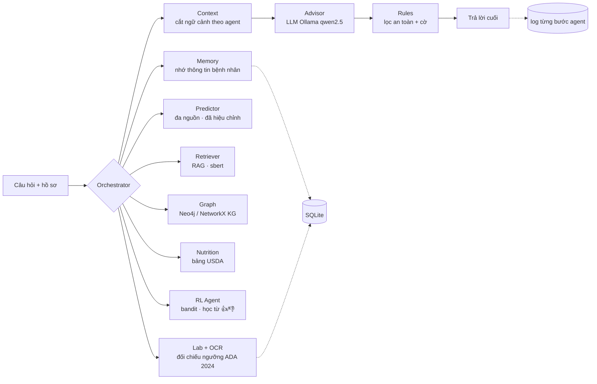

# DiaCare-MAS: hệ đa agent hỗ trợ tư vấn phòng ngừa tiểu đường

Đồ án học tập. **Không thay thế bác sĩ**: mọi câu trả lời đều kèm lời nhắc tham khảo ý kiến chuyên môn,
kết quả xét nghiệm chỉ được *đối chiếu ngưỡng*, không phải chẩn đoán.

Hệ thống kết hợp bốn khối theo sơ đồ ý tưởng ban đầu:

1. **Dự đoán nguy cơ từ nhiều nguồn**: mô hình học trên CDC BRFSS 2015, BRFSS 2023 và NHANES 2013–2020 (khoảng 535 nghìn người, 21 chỉ số), xác suất đã hiệu chỉnh; kiểm tra ngoài trên Pima (NIDDK); mô hình triệu chứng từ UCI 529.
2. **Tri thức + RAG + Đồ thị tri thức (KG) + LLM**: truy xuất tài liệu (MedlinePlus, WHO) và đồ thị tri thức 5 loại cạnh rồi để LLM chạy cục bộ qua Ollama viết câu trả lời.
3. **Học tăng cường (RL)**: contextual bandit chọn trọng tâm can thiệp cá nhân hoá và học từ phản hồi 👍/👎 của người dùng, có mặt nạ an toàn.
4. **Luật an toàn**: chặn lời khuyên đổi thuốc, chuyển khám khi có triệu chứng, cấp cứu, xét nghiệm vượt ngưỡng.

## Kiến trúc



Orchestrator gọi các agent **tuần tự theo thứ tự cố định**. Mỗi agent chỉ nhận lát ngữ cảnh mình cần
(`build_context`), bộ nhớ đứng trước xét nghiệm, rồi đến dinh dưỡng, đồ thị tri thức, định hướng RL và tài liệu khi cắt theo ngân sách token.

| Agent / Module | File | Vai trò |
|---|---|---|
| Orchestrator | `src/diacare/orchestrator.py` | Điều phối, bắt câu chào hỏi, ghi trace từng bước |
| Memory | `src/diacare/memory.py` | Trích và nhớ thông tin bệnh nhân (dị ứng, thuốc, chẩn đoán), tóm tắt lịch sử dài |
| Lab + OCR | `src/diacare/labs.py`, `ocr.py` | Đọc HbA1c, đường huyết lúc đói, OGTT 2 giờ, đường huyết bất kỳ (từ chữ, PDF scan, ảnh chụp); đổi đơn vị; xếp mức |
| Predictor | `src/diacare/predictor.py` | Dự đoán xác suất tiểu đường (đã hiệu chỉnh) từ 21 chỉ số hồ sơ; học trên 3 nguồn CDC |
| Retriever | `src/diacare/retriever.py` | Truy xuất dense (sbert), tuỳ chọn lai BM25 + RRF |
| Graph (KG) | `src/diacare/kg.py` | Đồ thị tri thức 5 loại cạnh (ADA 2024, luật, USDA, thống kê BRFSS, khẳng định KB đã kiểm chứng) trên Neo4j hoặc NetworkX |
| Nutrition | `src/diacare/nutrition.py` | Nhận món ăn Việt, tra USDA FoodData Central, xử lý từ đa nghĩa |
| RL | `src/diacare/rl.py` | Contextual bandit chọn trọng tâm tư vấn, học từ phản hồi người dùng (bảng `rl_events`, `rl_model`) |
| Advisor | `src/diacare/advisor.py`, `llm.py` | Gọi Ollama `/api/chat`, hỗ trợ stream |
| Rules | `src/diacare/rules.py` | Chặn lời khuyên đổi thuốc, gắn cờ chuyển khám / cấp cứu / xét nghiệm |

## Tính năng

- **Tự theo dõi giữa hai lần tái khám** (cho người đã chẩn đoán ĐTĐ típ 2). Ba trang Hôm nay, Nhật ký, Tái khám:
  - ghi đường huyết, huyết áp, cân nặng;
  - so với mục tiêu điều trị ADA 2024 (trước ăn 4,4–7,2 mmol/L, sau ăn < 10,0, huyết áp < 130/80), không so với ngưỡng
    chẩn đoán;
  - cảnh báo hạ đường huyết hoặc chỉ số rất cao, nhắc chưa đo hôm nay hay sắp tới lịch khám;
  - lập bản tóm tắt PDF một trang mang đi khám.

  Giao diện mặc định là chế độ người dùng. Log agent, đồ thị tri thức và thống kê chỉ hiện khi bật **Chế độ nhà phát
  triển** (nút gạt ở thanh bên, hoặc `DIACARE_DEV=1`).
- **Dịch vụ API (FastAPI)** để giao diện web hoặc điện thoại gọi vào. Xem mục [Dịch vụ API](#dịch-vụ-api).
- **Giao diện chat** (Streamlit). Ô chat ghim dưới đáy màn hình. Câu trả lời **hiện dần theo từng câu** khi LLM
  đang viết: mỗi câu phải qua bộ lọc an toàn trước khi hiện, nên lời khuyên đổi thuốc không bao giờ lọt lên màn hình.
- **Nhập kết quả xét nghiệm (kèm OCR cho PDF scan & ảnh chụp)**: tải `.txt`, `.csv`, `.json`, `.pdf` (có lớp chữ hoặc PDF scan),
  ảnh `.png`, `.jpg`, `.jpeg`, dán nội dung phiếu, hoặc gõ thẳng trong chat ("HbA1c của tôi 6.8%"). Tự đổi mmol/L sang mg/dL,
  mmol/mol sang %, tự sửa lỗi OCR đơn vị phổ biến (`0/0` -> `%`, `mg/d1` -> `mg/dL`). File mẫu: `docs/samples/xet_nghiem_mau.txt`.

  | Chỉ số | Bình thường | Tiền tiểu đường | Ngưỡng tiểu đường |
  |---|---|---|---|
  | HbA1c | < 5.7% | 5.7–6.4% | ≥ 6.5% |
  | Đường huyết lúc đói | < 100 mg/dL | 100–125 | ≥ 126 |
  | OGTT 2 giờ | < 140 | 140–199 | ≥ 200 |
  | Đường huyết bất kỳ | | | ≥ 200 kèm triệu chứng |

  Dưới 70 mg/dL được đánh dấu hạ đường huyết, kèm lời nhắc gọi 115.
- **Xem agent hoạt động**: dưới mỗi câu trả lời có mục "Agent đã làm gì" (agent nào, làm gì, bao nhiêu ms).
  Trang **Hoạt động agent** có **sơ đồ động phát lại** đúng lượt chạy từ log, bảng từng bước, và biểu đồ thời gian
  trung bình mỗi agent. Log lưu trong SQLite (`runs.trace_json`) và `logs/runs.jsonl`.
- **Hồ sơ bệnh nhân, phiên hội thoại, lịch sử, thống kê** lưu trong SQLite.
- **Câu chào hỏi** được trả lời ngay, không dự đoán nguy cơ và không gọi LLM. Lời nhắc nguy cơ cao chỉ hiện một lần mỗi phiên,
  trừ khi người dùng hỏi thẳng.

## Cài đặt

```bash
pip install -r requirements.txt
```

Ollama: cài từ https://ollama.com/download, rồi tải model:

```bash
ollama pull qwen2.5:7b
```

Model 3B (`qwen2.5:3b`) nhẹ hơn, đủ để thử luồng. Lần chạy đầu sẽ tự tải model embedding (khoảng 470 MB).

**Huấn luyện lại Predictor** (mô hình đã có sẵn trong `models/`). Tải dữ liệu theo `../diacare_datasets/LINK_DATASET.md`
(BRFSS 2015, BRFSS 2023, NHANES, Pima, UCI 529), rồi:

```bash
python tools/build_multisource.py   # gộp về 21 chỉ số -> data/multisource/*.parquet
python tools/train_multisource.py   # huấn luyện, so với mô hình cũ, hiệu chỉnh -> models/predictor_ms.joblib
python tools/train_aux_models.py    # kiểm tra ngoài trên Pima, mô hình triệu chứng UCI 529
```

Bản cũ chỉ học BRFSS 2015 (`python src/train_predictor.py`) vẫn dùng được bằng `DIACARE_PREDICTOR=v1`.

## Chạy

**Trên Windows, một cú bấm:** bấm đúp `chay_local.bat`. Script tự bật Ollama nếu chưa chạy, tải model nếu chưa có,
nạp sẵn model vào GPU, đặt các biến môi trường rồi mở giao diện ở `http://localhost:8501`. Mặc định dùng `qwen2.5:3b`
(vừa GPU 4 GB, mỗi câu khoảng 5–10 giây); muốn dùng 7B thì chạy `chay_local.bat qwen2.5:7b`. Thư mục model lấy từ
biến môi trường `OLLAMA_MODELS` (ví dụ `D:\ollama\models` để không đầy ổ C).

`chay_local.bat` bật đủ đồ thị tri thức và agent học tăng cường (`DIACARE_FEATURES=v2,kg,rl`, không bật hybrid);
đồ thị chạy bằng networkx trong bộ nhớ nên không cần Docker. `chay_v3.bat` giữ lại cho quen tay, giờ giống hệt.
Muốn đồ thị đọc từ Neo4j thì dùng `chay_kg.bat` (cần Docker Desktop). Trong Git Bash gọi bằng `./chay_kg.bat`.

**Chat ngay trong terminal** (không mở trình duyệt): bấm đúp `chay_cli.bat`. Mặc định dùng hồ sơ
`docs/samples/hoso_nguy_co_cao.json`; hồ sơ khác: `chay_cli.bat docs\samples\hoso_nguy_co_thap.json`. Trong lúc chat
gõ `/patients`, `/history`, `/stats`, hoặc `q` để thoát.

Lần gọi model đầu tiên sau khi bật máy có thể mất gần một phút vì Ollama khởi tạo GPU; script đã làm bước này trước
khi mở giao diện.

Giao diện web (chạy tay):

```bash
streamlit run src/app.py
```

CLI:

```bash
python src/cli.py --name "An" --profile hoso.json
```

Chế độ demo (LLM giả + embedding băm, không cần Ollama, chỉ để thử giao diện):

```powershell
$env:DIACARE_LLM="demo"; $env:DIACARE_EMBED="hash"; streamlit run src/app.py
```

### Dịch vụ API

```bash
uvicorn api.main:app --app-dir src --port 8000
```

Mở `http://localhost:8000/docs` để xem và thử mọi endpoint. Bấm **Authorize**, nhập email và mật khẩu đã đăng ký.

| Nhóm | Endpoint chính |
|---|---|
| Tài khoản | `POST /auth/register`, `POST /auth/token` (OAuth2 password flow, trả JWT), `GET /me` |
| Hồ sơ | `GET/POST /patients`, `GET/PATCH /patients/{id}`, `GET/DELETE /patients/{id}/memories` |
| Nhật ký | `POST /patients/{id}/readings/glucose`, `.../bp`, `.../weight`; `GET .../readings`, `DELETE .../readings/{rid}`, `GET .../today`, `GET .../summary?days=14` |
| Xét nghiệm | `GET/POST /patients/{id}/labs` (gõ chữ), `POST .../labs/file` (ảnh, PDF; tối đa 10 MB) |
| Tái khám | `GET/PUT .../appointment`, `GET/POST .../questions`, `POST .../questions/{qid}/done`, `GET .../visit-report.pdf` |
| Tư vấn | `POST /patients/{id}/chat` (JSON, hoặc `"stream": true` để nhận luồng SSE), `GET .../sessions`, `GET .../sessions/{sid}/messages`, `POST /feedback/{event_id}` (👍/👎 cho agent RL) |

Luồng SSE của `/chat` gửi lần lượt các sự kiện:

- `session`: mã phiên.
- `step`: từng agent vừa chạy xong.
- `token`: phần chữ mới, đã qua bộ lọc an toàn.
- `done`: kết quả cuối. Giao diện phải thay phần chữ đang hiện bằng `answer`, vì Rules có thể sửa bản nháp.

Bảo mật:

- Mật khẩu băm bằng scrypt.
- Token là JWT HS256, hạn 7 ngày. Khoá ký lấy từ `DIACARE_API_SECRET`; nếu không đặt, hệ tự sinh một lần vào
  `data/api_secret.key` (không lên git).
- Mỗi tài khoản chỉ thấy hồ sơ của mình. Tài nguyên của người khác trả 404.
- CORS chỉ mở cho các origin trong `DIACARE_CORS` (mặc định `http://localhost:3000`).

Cách chạy:

- Phần AI nặng (Predictor, Retriever, LLM, KG) dựng một lần khi khởi động.
- Mỗi request mở một kết nối SQLite riêng, chế độ WAL.
- Các lượt tư vấn chạy lần lượt từng lượt một, vì Ollama cũng chỉ trả lời từng câu một.

### Giao diện web (Next.js)

Trong `web/` có giao diện cho người bệnh, ưu tiên màn hình điện thoại, gọi vào dịch vụ API ở trên. Gồm các trang:

- Đăng nhập, đăng ký.
- Tạo hồ sơ theo dõi. Một tài khoản theo dõi được cho nhiều người thân.
- **Hôm nay**: cảnh báo, ghi đường huyết, số liệu và biểu đồ 14 ngày.
- **Nhật ký**: đường huyết; huyết áp và cân nặng; xét nghiệm, có chụp ảnh phiếu.
- **Tư vấn**: chữ hiện dần qua SSE, có nút 👍/👎 cho agent RL.
- **Tái khám**: lịch hẹn, câu hỏi cho bác sĩ, tải PDF.

```bash
uvicorn api.main:app --app-dir src --port 8000   # cửa sổ 1: API (mất khoảng 30 giây để nạp mô hình)
cd web
npm install                                       # lần đầu, khoảng 370 MB
npm run dev                                       # cửa sổ 2: http://localhost:3000
```

API đặt ở cổng khác thì chép `web/.env.example` thành `web/.env.local` và sửa `NEXT_PUBLIC_API_URL`. Phiên bản dùng:
Next.js 16.4, React 19.3, TypeScript 5.9. Ngoài các gói đó không cài thêm thư viện nào; biểu đồ tự vẽ bằng SVG.
Token đăng nhập lưu trong `localStorage` của trình duyệt. Cách này đủ cho đồ án; bản chạy thật nên chuyển sang
cookie `HttpOnly`.

### Giọng nói

Người dùng nói thay vì gõ. Có hai chỗ dùng:

- **Trang Hôm nay, nút "Nói số đo".** Ví dụ nói "đường huyết lúc đói sáu phẩy tám" hoặc "huyết áp một trăm hai mươi lăm
  trên tám mươi". App hiện chữ nghe được kèm số đo đề xuất, người dùng bấm xác nhận mới lưu. Câu không nói đơn vị như
  "sáu tám" có thể là 68 mg/dL (đang hạ đường huyết) hoặc 6,8 mmol/L, nên app đưa cả hai lựa chọn và không tự đoán.
- **Trang Tư vấn, nút micro.** Chữ nghe được hiện vào ô nhập để sửa trước khi gửi. Nút "Đọc to" đọc câu trả lời bằng
  giọng tiếng Việt có sẵn của máy, và chỉ đọc câu trả lời cuối đã qua Rules, không đọc bản nháp.

Cách làm:

- Trình duyệt tự ghi âm thành WAV 16 kHz, nên máy chủ không cần ffmpeg.
- API nhận dạng bằng [PhoWhisper-small](https://huggingface.co/vinai/PhoWhisper-small) của VinAI (BSD-3), chạy CPU:
  khoảng 2–3 giây cho một câu ngắn, lần đầu mất khoảng 30 giây để nạp mô hình.
- Âm thanh không được lưu; endpoint là `POST /transcribe`.
- Đọc số tiếng Việt nằm trong `src/diacare/speech.py`: "một trăm linh năm", "bảy rưỡi", "sáu phẩy tám".

```bash
# tải mô hình một lần (khoảng 970 MB); đặt HF_HOME để chọn thư mục lưu
HF_HOME=D:/hf_cache python -c "from huggingface_hub import snapshot_download; snapshot_download('vinai/PhoWhisper-small')"
HF_HOME=D:/hf_cache uvicorn api.main:app --app-dir src --port 8000
```

`DIACARE_ASR=demo` thay mô hình bằng bộ nhận dạng giả lập để test.

Lưu ý khi dùng:

- Micro chỉ dùng được trên `localhost` hoặc HTTPS.
- Giọng đọc phụ thuộc máy. Windows cần thêm giọng Tiếng Việt trong phần Cài đặt; app sẽ báo nếu máy chưa có.
- Gặp tiếng ồn không phải lời nói, Whisper có thể "bịa" ra một câu. Vì vậy mọi số đo nghe được đều phải được xác nhận
  trước khi lưu.

### Chạy trên Kaggle (GPU miễn phí)

`kaggle/build_app_notebook.py` đóng gói code thành notebook. Notebook cài Ollama, tải `qwen2.5:7b`, chạy Streamlit và
mở đường hầm Cloudflare (`*.trycloudflare.com`), giữ phiên khoảng 6 giờ. Trên Kaggle: bật GPU và Internet, bấm
**Run All**, rồi mở link mà notebook in ra.

```bash
python kaggle/build_app_notebook.py
kaggle kernels push -p kaggle/app_kernel
```

`kaggle/build_notebook.py` tạo notebook benchmark tương tự.

## Biến môi trường

| Biến | Mặc định | Ý nghĩa |
|---|---|---|
| `DIACARE_LLM` | `ollama` | `ollama` hoặc `demo` |
| `DIACARE_MODEL` | `qwen2.5:3b` | tên model Ollama |
| `DIACARE_NUM_CTX` | `4096` | cửa sổ context gửi cho Ollama |
| `DIACARE_EMBED` | `sbert` | `sbert` hoặc `hash` (demo) |
| `DIACARE_MIN_SCORE` | `0.2` (sbert), `0` (hash) | ngưỡng điểm truy xuất |
| `DIACARE_KB` | `kb/` | thư mục tài liệu tri thức |
| `DIACARE_DB` | `data/diacare.db` | file SQLite |
| `DIACARE_LOG` | `logs/runs.jsonl` | log JSONL từng lượt chạy |
| `DIACARE_FEATURES` | `default` | `default` = nutrition, memory, labs, kg, rl; `v2` = nutrition, memory, labs (nhãn benchmark cũ, không KG, không RL); `all`/`v3` = thêm hybrid; `v1` = tắt hết; hoặc danh sách `nutrition,memory,labs,hybrid,kg,rl` |
| `DIACARE_KG` | `memory` | `memory` (networkx trong bộ nhớ) hoặc `neo4j` (đọc từ Neo4j trên Docker) |
| `DIACARE_DEV` | (tắt) | `1`: giao diện Streamlit mở sẵn chế độ nhà phát triển |
| `DIACARE_API_SECRET` | tự sinh vào `data/api_secret.key` | khoá ký token của API, ít nhất 32 ký tự |
| `DIACARE_CORS` | `http://localhost:3000` | các origin được gọi API, cách nhau bằng dấu phẩy |
| `DIACARE_ASR` | `phowhisper` | `demo`: nhận dạng giọng giả lập (test) |
| `DIACARE_ASR_MODEL` | `vinai/PhoWhisper-small` | mô hình nhận dạng giọng (Hugging Face) |

## Đồ thị tri thức (Knowledge Graph)

`src/diacare/kg.py` dựng một đồ thị tri thức về tiểu đường từ chính dữ liệu của dự án. Cạnh **có kiểu và tách
theo nguồn gốc**, vì ba nguồn có độ tin cậy khác nhau:

| Loại cạnh | Nối | Nguồn | Độ tin cậy |
|---|---|---|---|
| `indicates` | LabTest → Condition | ngưỡng ADA 2024 (`labs.THRESHOLDS`) | tra cứu |
| `requires` | Symptom → Action | luật chuyển khám, cấp cứu (`rules.py`) | tra cứu |
| `contains` | Food → Nutrient | USDA FoodData Central (`vn_foods.json`) | tra cứu |
| `associated_with` | RiskFactor → Condition | BRFSS 2015, odds ratio khi xét riêng và khi hiệu chỉnh 21 chỉ số | đo được, là liên hệ chứ không phải nhân quả |
| `claims_risk` | RiskFactor → Condition | câu trong `kb/` (MedlinePlus, WHO) | lời khẳng định, đem đối chiếu |

Mỗi cạnh `claims_risk` được đối chiếu với cạnh `associated_with` cùng yếu tố: **nhất quán**, **mâu thuẫn**,
**không đủ bằng chứng**, hoặc **không kiểm chứng được** khi BRFSS không đo yếu tố đó. Trên `kb/` hiện tại:
28 khẳng định, 15 nhất quán, 13 không kiểm chứng được (tiền sử gia đình, chủng tộc, thai kỳ, PCOS...),
0 mâu thuẫn. Hai điểm dữ liệu cho thấy mà tài liệu không nói: hút thuốc có OR 1,42 khi xét riêng nhưng 0,99
khi hiệu chỉnh; vận động có OR 0,49 khi xét riêng nhưng 0,95 khi hiệu chỉnh.

```bash
python tools/build_kg_stats.py     # tính lại kb/graph/brfss_associations.json từ CSV BRFSS (không tự tải)
python tools/kg_neo4j.py           # nạp vào Neo4j trong Docker, chạy 6 truy vấn Cypher
```

`kg_neo4j.py` dùng container riêng `diacare-neo4j` trên cổng **7475** (Browser) và **7688** (bolt), mật khẩu
sinh ngẫu nhiên lưu trong `neo4j.local.json` (đã gitignore). Dữ liệu Neo4j được gắn ra thư mục
**`neo4j_data/`** ở gốc repo (đã gitignore): tệp lưu nút, cạnh nằm ở `neo4j_data/data/databases/neo4j/`.

**Graph agent** đọc đồ thị khi trả lời, đứng sau Retriever: nối câu hỏi tiếng Việt vào nút yếu tố nguy cơ rồi
đưa cho LLM một khối "tài liệu nói gì, dữ liệu BRFSS đo được gì, PrimeKG có bao nhiêu gen chung" (tối đa 300 token).
Graph agent **bật mặc định** (`DIACARE_FEATURES` không đặt = `default`); nhãn `v2` vẫn là bản không KG để so sánh
`v2` với `v2,kg` trên benchmark. Giao diện có khung "Đồ thị tri thức đã dùng" cho từng câu trả lời. `DIACARE_KG=neo4j` cho agent
truy vấn Neo4j bằng Cypher; mặc định (`memory`) hoặc khi không kết nối được Neo4j thì dùng networkx trong bộ nhớ,
nên test, chế độ demo và Kaggle không cần Docker. Một cú bấm: **`chay_kg.bat`** bật Neo4j, nạp đồ thị, mở giao
diện với Graph agent đọc từ Neo4j. Hướng dẫn trình bày và bản đồ code: [`docs/kg_demo.md`](docs/kg_demo.md).

## Học tăng cường (Reinforcement Learning)

`src/diacare/rl.py`, **bật mặc định**. `RLAgent` chọn 1 trong 6 trọng tâm tư vấn (`urgent_eval`, `glycemic_followup`,
`weight_diet`, `physical_activity`, `cardio_control`, `preventive_habit`), đưa vào ngữ cảnh Advisor
(`RL_TOKEN_BUDGET = 120` token), rồi **học từ phản hồi 👍/👎** mà người dùng bấm dưới câu trả lời.

- Bài toán: contextual bandit (học tăng cường một bước, $\gamma = 0$). Trạng thái là vector 13 đặc trưng
  $\phi(s)$; mỗi hành động có một mô hình ridge tuyến tính $\hat r_a(s) = w_a^\top \phi(s)$, $w_a = A_a^{-1} b_a$.
  Một phản hồi cập nhật $A_a \mathrel{+}= \phi\phi^\top$, $b_a \mathrel{+}= r\phi$ với $r = \pm 1$.
- Chọn hành động: mặt nạ an toàn (xét nghiệm báo động hoặc triệu chứng thì luôn `urgent_eval`), ngoài ra
  epsilon-greedy với $\varepsilon = 0{,}1$ (`DIACARE_RL_EPSILON`; benchmark đặt 0). Rules vẫn chạy sau cùng.
- Lưu trữ: mỗi quyết định và xác suất chọn vào bảng SQLite `rl_events`; mô hình đã học vào `rl_model`.
  Trang Thống kê hiện số phản hồi và ước lượng ngoài chính sách SNIPS.
- Khởi động: tiên nghiệm lâm sàng thang $[-1, 1]$ trên trạng thái lấy theo phân bố thật của 253.680 người BRFSS
  (`kb/rl/brfss_state_freq.json`). Điểm tiên nghiệm trên 5.000 trạng thái mới: chính sách 0,850, ngẫu nhiên 0,173,
  cận trên 0,902. Đây chỉ là điểm xuất phát; chưa có phản hồi của người dùng thật.

```bash
python tools/build_rl_states.py    # phân bố trạng thái từ BRFSS (cần tệp CSV) -> kb/rl/brfss_state_freq.json
python tools/train_rl.py           # chính sách khởi động -> models/rl_policy.json
```

## Đánh giá

**Predictor** (tập kiểm tra 20% của từng nguồn; chi tiết ở `docs/results/multisource_eval.json`):

| Tập kiểm tra | AUC cũ (chỉ BRFSS 2015) | AUC mới | Brier cũ | Brier mới | ECE cũ | ECE mới |
|---|---|---|---|---|---|---|
| BRFSS 2015 | 0,831 | 0,829 | 0,174 | 0,097 | 0,234 | 0,004 |
| BRFSS 2023 | 0,817 | 0,818 | 0,173 | 0,102 | 0,224 | 0,004 |
| NHANES | 0,824 | 0,830 | 0,114 | 0,096 | 0,092 | 0,009 |
| NHANES, ĐTĐ chưa chẩn đoán theo xét nghiệm | 0,716 | 0,723 | | | | |

AUC gần như giữ nguyên; xác suất đáng tin hơn hẳn. Ngưỡng mức nguy cơ: thấp < 0,10, cao ≥ 0,30.
Pima (kiểm tra ngoài, 4/21 chỉ số): AUC 0,724 mới, 0,739 cũ. Mô hình triệu chứng UCI 529 (251 người sau khi bỏ 269 dòng trùng): AUC 0,948.

**Benchmark hội thoại** (`eval/cases.json`, hiện có 50 ca thuộc 11 nhóm). Mỗi ca chạy k lần và chấm trên bản nháp thật
của LLM: có trích nguồn đã truy xuất, không khuyên đổi thuốc, nhắc bác sĩ, đúng các cờ.

- **Pass@k**: ca đạt ít nhất 1/k lần.
- **Pass^k**: ca đạt cả k lần, tức độ tin cậy lặp lại.

Lần chạy ablation trên Kaggle (T4, `qwen2.5:7b`, 46 ca × 3 lượt), đã chấm lại bằng bộ chấm đã sửa:

| Cấu hình | Pass@3 | Pass^3 | Đạt từng lượt (Wilson 95%) |
|---|---|---|---|
| v1 | 0.85 | 0.72 | 0.80 [0.72; 0.86] |
| v2 | 0.93 | 0.76 | 0.86 [0.79; 0.91] |
| all | 0.93 | 0.83 | 0.88 [0.82; 0.93] |

Nhóm `memory` tăng từ 0.25 lên 1.00. Mức chung tăng nhưng khoảng tin cậy còn chồng nhau. Phân tích đầy đủ ở
`docs/results/2026-11-05_kaggle_run3_ablation/README.md`. Bản sửa Nutrition agent và 4 ca xét nghiệm mới chưa được đo lại.

```bash
python eval/benchmark.py --models qwen2.5:7b --k 3 --num-ctx 4096
python eval/rescore.py docs/results/2026-11-05_kaggle_run3_ablation
python -m pytest -q
```

## Cấu trúc thư mục

```
src/app.py              giao diện Streamlit
src/journal_ui.py       ba trang Hôm nay, Nhật ký, Tái khám
src/api/                dịch vụ FastAPI (main.py) và mật khẩu, token (security.py)
web/                    giao diện Next.js (app/: các trang, lib/api.ts: gọi API và đọc luồng SSE)
src/cli.py              giao diện dòng lệnh
src/train_predictor.py  huấn luyện MLP bản cũ trên BRFSS 2015 (V1)
src/diacare/            các agent (memory, labs, ocr, kg, nutrition, rl, advisor, rules), context, DB, sơ đồ động (flowviz.py)
kb/                     tài liệu tri thức (MedlinePlus, WHO) + thống kê đồ thị (kb/graph/brfss_associations.json)
data/nutrition/         bảng dinh dưỡng món Việt (từ USDA FDC)
tools/                  công cụ tạo thống kê KG (build_kg_stats.py), nạp Neo4j (kg_neo4j.py), huấn luyện RL (train_rl.py)
eval/                   bộ ca benchmark, chấm điểm, đánh giá truy xuất
kaggle/                 sinh notebook Kaggle (giao diện và benchmark)
docs/results/           kết quả các lần chạy benchmark
tests/                  test (pytest)
```

## Hạn chế đã biết

- Mức nguy cơ chỉ tính từ 21 câu hỏi lối sống trong hồ sơ, không dùng xét nghiệm hay triệu chứng (hai thứ này được xét
  riêng bằng cờ). Ba nguồn huấn luyện đều là dữ liệu Mỹ; NHANES thiếu 10/21 chỉ số, BRFSS 2023 thiếu rau quả.
- Luật triệu chứng và lọc thuốc dựa trên chữ tiếng Việt có dấu; câu gõ không dấu có thể không kích hoạt.
- Benchmark chấm an toàn, trích nguồn và định dạng, không chấm độ đúng y khoa của nội dung.
- Nhắc nhở chỉ hiện khi mở ứng dụng; chưa gửi được thông báo đẩy. Đường huyết gõ trong chat vẫn được lưu vào
  mục xét nghiệm, chưa vào nhật ký, và trợ lý tư vấn chưa đọc nhật ký.
- API dùng SQLite; muốn nhiều người dùng cùng lúc ở quy mô lớn cần chuyển sang PostgreSQL.
- Nhóm câu ngoài chủ đề (`out_of_scope`) mới đạt 0.50: model vẫn làm thơ hoặc chỉ cách nấu ăn thay vì từ chối.

## Nguồn dữ liệu

- CDC BRFSS 2015 Diabetes Health Indicators (UCI Machine Learning Repository, id 891); CDC BRFSS 2023.
- CDC NHANES 2013–2014, 2015–2016, 2017–3/2020.
- Pima Indians Diabetes (NIDDK, OpenML id 37); Early Stage Diabetes Risk Prediction (UCI id 529).
- MedlinePlus (U.S. National Library of Medicine), WHO Diabetes fact sheet: trích để học tập, giữ ghi nguồn.
- USDA FoodData Central.
- Ngưỡng xét nghiệm: American Diabetes Association, Standards of Care in Diabetes 2024.
