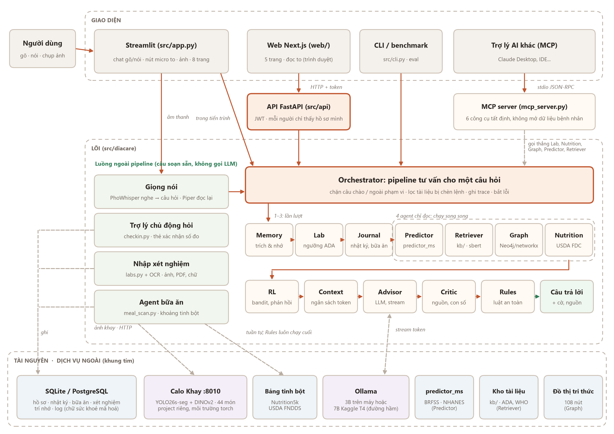

# 1. Hình dung cả cây

Hãy coi DiaCare-MAS như một cái cây. Đọc code theo thứ tự từ gốc lên lá thì hiểu nhanh hơn, vì phần trên luôn dựa vào phần dưới, còn phần dưới không biết gì về phần trên.

| Phần cây | Là gì trong code | Đặc điểm | Thư mục, tệp chính |
|---|---|---|---|
| **Đất** | dữ liệu, mô hình đã huấn luyện, kho tài liệu, script dựng dữ liệu | không chạy khi người dùng hỏi; chỉ được đọc | `kb/`, `data/`, `models/`, `tools/` |
| **Rễ** | kiểu dữ liệu và các hàm nền dùng ở khắp nơi | gần như không import module nào khác của hệ; nhiều module import nó | `state.py`, `rules.py`, `db.py`, `crypto.py`, `pg.py`, `llm.py`, `journal.py`, `labs.py`, `nutrition.py`, `ocr.py` |
| **Thân** | đường ống xử lý một câu hỏi và chỗ lắp ráp | một đường duy nhất, thứ tự cố định | `orchestrator.py`, `context.py`, `factory.py` |
| **Cành** | các agent và các luồng chạy cạnh pipeline | mỗi cành một việc, chỉ đọc/ghi phần `State` của mình | `memory.py`, `labs.LabAgent`, `journal.JournalAgent`, `predictor.py`, `retriever.py`, `kg.py`, `nutrition.NutritionAgent`, `rl.py`, `advisor.py`, `critic.py`, `checkin.py`, `meal_scan.py`, `speech.py`, `tts.py`, `coach.py` |
| **Lá** | giao diện: nơi người dùng chạm vào | mỏng, chủ yếu gọi cành và thân rồi hiển thị | `src/app.py`, `src/*_ui.py`, `src/api/`, `web/`, `src/cli.py`, `mcp_server.py` |
| **Rễ kiểm tra** | test và benchmark | giữ cho cây không đổ khi sửa | `tests/`, `eval/`, `bench.py` |

Hình kiến trúc toàn hệ (`docs/report/figs/c10_kien_truc_v49.png`) vẽ đúng các phần này: lá ở trên cùng, thân và cành ở giữa, đất ở dưới.

{width=100%}

Cách kiểm tra phần nào là gốc: đếm xem bao nhiêu tệp trong `src/` import nó. Đếm ngày 25/11/2026:

| Module | Số tệp import | Vai trò |
|---|---|---|
| `rules` | 14 | luật an toàn, ngưỡng nguy cơ, lời miễn trừ |
| `journal` | 13 | nhật ký tự theo dõi: đổi đơn vị, so mục tiêu, giờ Việt Nam |
| `labs` | 13 | đọc và xếp mức kết quả xét nghiệm |
| `nutrition` | 10 | bảng dinh dưỡng món Việt |
| `memory` | 7 | trí nhớ dài hạn |
| `orchestrator` | 2 | chỉ giao diện và `factory` gọi |

Module được nhiều nơi dùng là rễ: sửa nó ảnh hưởng nhiều chỗ, nên đọc kỹ và chạy toàn bộ test khi sửa. Module ít người dùng là cành hoặc lá: sửa thoải mái hơn.

# 2. Đất: dữ liệu và công cụ dựng dữ liệu

Không cần đọc trước, nhưng nên biết có gì:

- `kb/`: tài liệu y khoa (MedlinePlus, WHO) mà Retriever tìm trong đó. `kb/graph/`, `kb/rl/`: dữ liệu cho đồ thị tri thức và RL.
- `data/nutrition/`: `vn_foods.json` (50 món Việt, USDA) và `calo_khay_carb.csv` (tinh bột 65 món cho Agent bữa ăn).
- `models/`: mô hình dự đoán nguy cơ (`predictor_ms.joblib`), chính sách RL (`rl_policy.json`), bảng Q của Coach (`q_coach.json`).
- `data/diacare.db`: cơ sở dữ liệu thật của bạn (kèm `diacare.db.key`). **Không mở để thử nghiệm**; test dùng DB tạm.
- `tools/`: script sinh ra các tệp trên, ví dụ `build_carb_table.py`, `train_multisource.py`, `kg_neo4j.py`, `kaggle_llm.py` (bật/tắt 7B trên Kaggle), `critic_rescore.py`.

# 3. Rễ: đọc trước tiên

Đọc theo thứ tự này. Mỗi tệp ngắn, không phụ thuộc phần trên.

1. **`src/diacare/state.py`** (28 dòng). Dataclass `State`: mọi thứ của một lượt hỏi (câu hỏi, hồ sơ, xét nghiệm, tài liệu, bản nháp, câu trả lời, cờ, vết thực thi). Các agent không gọi nhau, chỉ đọc và ghi lên `State`. Hiểu tệp này là hiểu "bảng đen" mà cả hệ dùng chung.
2. **`src/diacare/rules.py`** (398 dòng). Luật an toàn chạy cuối mọi câu trả lời: `apply_rules` (dòng 355) chặn câu khuyên đổi thuốc, thêm ghi chú chuyển khám, cấp cứu, lời miễn trừ. `SafeStream` (dòng 245) lọc từng câu khi LLM đang viết, để câu nguy hiểm không bao giờ hiện lên màn hình. `risk_band`, `validate_profile`, `is_small_talk` cũng ở đây.
3. **`src/diacare/db.py`** + `crypto.py` + `pg.py`. Lớp `Store`: mọi bảng SQLite/PostgreSQL. Cột chữ có thông tin sức khoẻ được mã hoá Fernet (`crypto.py`); `pg.py` cho cùng mã chạy trên PostgreSQL.
4. **`src/diacare/llm.py`**. Gọi Ollama (`OllamaLLM`), stream token, thời gian chờ, `keep_alive`, lỗi `LLMUnavailable` có câu tiếng Việt cho người dùng.
5. **Ba module "tính toán y khoa"**, toàn hàm thuần, có test kỹ:
   - `labs.py`: `parse_lab_text`, `parse_lab_file`, `classify` (đổi đơn vị, so ngưỡng ADA 2024). `ocr.py` đọc chữ từ ảnh, PDF.
   - `journal.py`: đổi mg/dL ↔ mmol/L, `classify_glucose` so với mục tiêu điều trị, tóm tắt 14 ngày, giờ Việt Nam.
   - `nutrition.py`: tìm món ăn trong câu hỏi, tra bảng USDA.

**Quy tắc của rễ**: mọi con số cần đúng (đơn vị, ngưỡng, tinh bột) nằm ở đây, bằng code Python có test, không giao cho LLM.

# 4. Thân: đường đi của một câu hỏi

Đây là phần quan trọng nhất. Đọc liền một mạch:

1. **`src/diacare/orchestrator.py`**, hàm `Orchestrator.run` (dòng 83). Toàn bộ một lượt hỏi, từ trên xuống:

   | Dòng (khoảng) | Bước |
   |---|---|
   | 106 | câu chào: trả lời ngay, không gọi LLM |
   | 118 | câu ngoài phạm vi (`scope.py`) |
   | 133 | Memory: trích sự kiện mới, nhớ lại sự kiện cũ |
   | 158 | Lab: lấy kết quả xét nghiệm đã lưu và trong câu hỏi |
   | 161 | Journal: tóm tắt nhật ký 14 ngày và các bữa ăn |
   | 171 | **song song**: Predictor, Retriever, Graph, Nutrition (`_run_jobs`, dòng 319) |
   | 237 | RL chọn trọng tâm tư vấn |
   | 246 | Context cắt ngữ cảnh cho Advisor |
   | 248 | **Advisor gọi LLM** (bước duy nhất gọi mô hình) |
   | 258 | Critic so bản nháp với ngữ cảnh |
   | 280 | Rules: câu trả lời cuối |
   | 327, 341 | ghi log vào DB và `logs/runs.jsonl` |

   Lớp `_Tracer` (dòng 28) ghi mỗi bước bao nhiêu ms; đó là dữ liệu cho trang "Hoạt động agent".
2. **`src/diacare/context.py`**, `build_context(agent, state)`. Mỗi agent chỉ nhận lát ngữ cảnh nó cần, cắt theo ngân sách token (cửa sổ 4.096 token). Đọc để hiểu Advisor thấy gì.
3. **`src/diacare/factory.py`**. Chỗ lắp ráp: đọc biến môi trường (`DIACARE_LLM`, `DIACARE_FEATURES`...), dựng các agent, nối vào Orchestrator (`build_parts`, `build_orchestrator`). Muốn biết "agent nào đang bật" thì xem `parse_features`.

Sau ba tệp này bạn đã nắm được 80% hệ thống.

# 5. Cành: từng agent và các luồng bên cạnh

Mỗi cành độc lập; đọc cành nào khi cần. Cột "Ghi vào" là trường của `State` mà cành đó điền.

## 5.1. Cành trong pipeline tư vấn

| Agent | Tệp, lớp | Ghi vào | Điểm đáng đọc |
|---|---|---|---|
| Memory | `memory.py`, `MemoryAgent` | `state.memory` | trích dị ứng, thuốc, chẩn đoán bằng luật; tóm tắt lịch sử dài (`SummaryCache`) |
| Lab | `labs.py`, `LabAgent` | `state.labs` | xét nghiệm trong câu hỏi được lưu luôn |
| Journal | `journal.py`, `JournalAgent` (dòng 405) | `state.journal` | tóm tắt kèm nhận định sẵn, vì mô hình 3B hay tự so sai |
| Predictor | `predictor.py` | `state.risk` | mô hình đa nguồn đã hiệu chỉnh |
| Retriever | `retriever.py` | `state.docs` | sbert, tuỳ chọn BM25 + RRF |
| Graph | `kg.py`, `GraphAgent` | `state.kg` | Neo4j hoặc networkx trong bộ nhớ |
| Nutrition | `nutrition.py`, `NutritionAgent` | `state.nutrition` | xử lý từ đa nghĩa ("đường") |
| RL | `rl.py`, `RLAgent` (dòng 329) | `state.rl` | contextual bandit, mặt nạ an toàn |
| Advisor | `advisor.py` | `state.draft` | `SYSTEM_PROMPT`, lời dặn độ dài, lời dặn trích nguồn đặt cuối tin nhắn |
| Critic | `critic.py`, `check_grounding` (dòng 71) | `state.grounding` | chỉ đo và gắn cờ, không sửa câu |
| Rules | `rules.py`, `apply_rules` | `state.final`, `state.flags` | luôn chạy cuối |

Phụ trợ trong pipeline: `guard.py` (dò prompt injection), `scope.py` (câu ngoài phạm vi), `contracts.py` (bản tin chuẩn giữa các agent, báo cáo quyết định), `allergy.py`.

## 5.2. Cành chạy cạnh pipeline (không gọi LLM)

| Luồng | Tệp | Việc |
|---|---|---|
| Trợ lý chủ động hỏi | `checkin.py` | mở lời mỗi ngày; `handle_reply` chọn một trong bốn đường; số đo thành thẻ xác nhận, chỉ lưu khi bấm Lưu |
| Agent bữa ăn | `meal_scan.py` | gửi ảnh cho dịch vụ Calo Khay (HTTP, project riêng), tính khoảng tinh bột, vẽ vùng món lên ảnh |
| Giọng nói | `speech.py`, `tts.py` | PhoWhisper nhận dạng, đổi số đọc bằng chữ thành số, `has_speech` bỏ tiếng ồn; Piper đọc to |
| Coach Q-learning | `coach.py`, `coach_sim.py` | lời nhắc mỗi ngày từ nhật ký |
| Tóm tắt đi khám | `visit_report.py` | PDF một trang |

# 6. Lá: giao diện

Lá mỏng: gọi cành, thân rồi hiển thị. Đọc cuối cùng.

- **Streamlit** (`src/app.py`, 820 dòng): `main` (dòng 785) chọn trang; `load_parts` (dòng 79) dựng phần nặng một lần; `render_chat` (dòng 477) là trang Tư vấn; `_ask` (dòng 382) gọi `Orchestrator.run` và stream câu trả lời. Các trang khác tách ra tệp riêng: `journal_ui.py` (Hôm nay, Nhật ký), `meal_ui.py` (Bữa ăn), `checkin_ui.py` (thẻ trợ lý chủ động hỏi), `voice_ui.py` (nút micro to, có JavaScript bên trong). `ui_common.py` giữ phần thuần Python để test được (`SerialStore`, `chat_parts`, `photo_labs`).
- **API** (`src/api/main.py`, 986 dòng): FastAPI, mọi endpoint lọc theo tài khoản đăng nhập (`security.py`). Gọi cùng các hàm của rễ và cành như Streamlit.
- **Web** (`web/`, Next.js): `web/lib/api.ts` là mọi lời gọi API; mỗi trang ở `web/app/(app)/<trang>/page.tsx`; thành phần dùng lại ở `web/components/`.
- **Khác**: `src/cli.py` (chat trong terminal), `mcp_server.py` (công cụ cho trợ lý AI khác), `flowviz.py` (sơ đồ động của trang Hoạt động agent), `present.py` (định dạng câu trả lời).

Quy tắc của lá: không tính toán y khoa ở đây. Nếu thấy một phép so ngưỡng hay đổi đơn vị trong tệp giao diện, đó là chỗ nên chuyển xuống rễ.

# 7. Lộ trình đọc gợi ý

| Buổi | Đọc | Mục tiêu |
|---|---|---|
| 1 | `README.md` phần Kiến trúc, `state.py`, `orchestrator.run` | biết một câu hỏi đi qua những đâu |
| 2 | `context.py`, `advisor.py`, `llm.py`, `rules.py` | biết LLM được cho thấy gì và câu trả lời bị lọc ra sao |
| 3 | `labs.py`, `journal.py`, `nutrition.py` | phần tính toán y khoa |
| 4 | một agent bất kỳ ở mục 5.1 cùng test của nó trong `tests/` | cách một cành được viết và kiểm tra |
| 5 | `checkin.py`, `meal_scan.py`, `speech.py` | các luồng mới của V4.9 |
| 6 | `app.py` → `render_chat`, rồi `api/main.py` | giao diện nối vào lõi thế nào |

Mẹo khi đọc:

- **Đọc test cùng code.** `tests/test_<tên module>.py` là ví dụ chạy được: đầu vào nào cho ra gì. Ví dụ muốn hiểu `handle_reply` thì đọc `tests/test_checkin.py`.
- **Chạy thử một lượt không cần GPU** với LLM giả lập và một DB tạm (không đụng `data/diacare.db`):
  `DIACARE_LLM=demo DIACARE_EMBED=hash DIACARE_DB=thu.db python src/cli.py --profile docs/samples/hoso_nguy_co_cao.json`.
- **Xem vết thực thi**: bật Chế độ nhà phát triển trong Streamlit, hỏi một câu, mở trang "Hoạt động agent".
- **Chạy toàn bộ test** sau khi sửa rễ: `python -m pytest -q` (khoảng 2 phút, hơn 1.000 test).

# 8. Sửa gì thì đọc đâu

| Muốn | Bắt đầu từ |
|---|---|
| đổi cách trả lời của trợ lý | `advisor.py` (`SYSTEM_PROMPT`, `LENGTH_REMINDER`, `VOICE_REMINDER`) |
| thêm một luật an toàn | `rules.py` (`apply_rules`) + `tests/test_rules.py` |
| thêm một agent | viết lớp có một hàm đọc `State`, thêm trường vào `state.py`, gọi trong `Orchestrator.run`, bật trong `factory.py`, cấp ngữ cảnh trong `context.py` |
| đổi mô hình LLM | biến `DIACARE_MODEL`, `DIACARE_OLLAMA_URL`; code ở `llm.py` |
| thêm chỉ số xét nghiệm | `labs.py` (mẫu nhận dạng, ngưỡng) |
| thêm món vào bảng tinh bột | `tools/build_carb_table.py` (`EXTRA`) rồi chạy lại script |
| thêm một trang web | `web/app/(app)/<trang>/page.tsx`, endpoint mới ở `src/api/main.py`, hàm gọi ở `web/lib/api.ts` |
