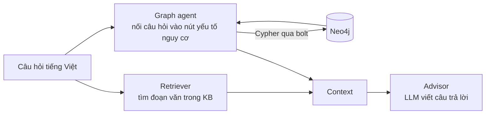
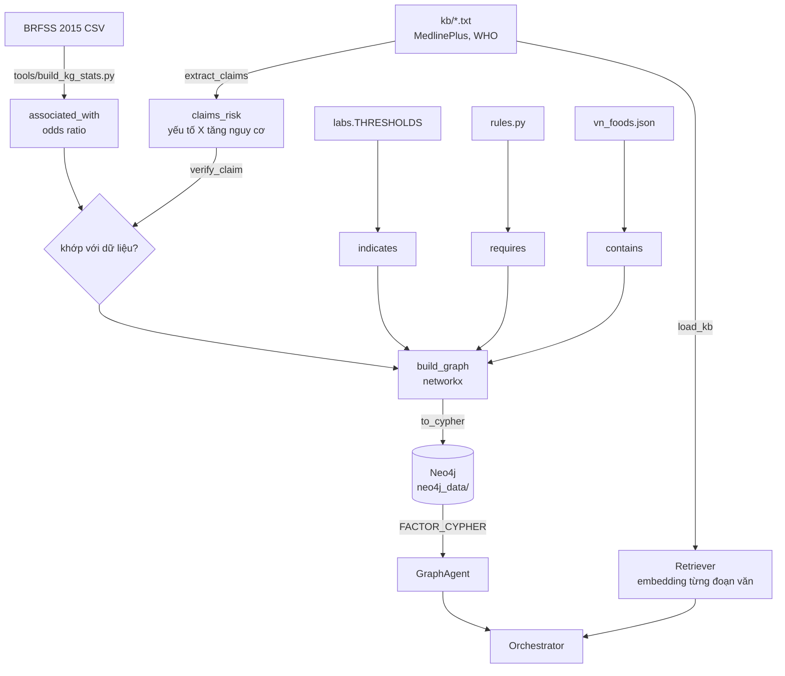

# Đồ thị tri thức (KG) của DiaCare-MAS: trình bày trong 10 phút

Tài liệu này trả lời bốn câu hỏi: KG trông thế nào, lưu ở đâu, được ứng dụng vào hệ thống ra sao, và code nào
nối kho tài liệu (KB) với đồ thị (KG).

## 0. Chuẩn bị (một lần, trước buổi trình bày)

1. Bật **Docker Desktop**, chờ biểu tượng cá voi báo đang chạy.
2. Bấm đúp **`chay_kg.bat`**. Script làm bốn việc: bật Ollama, bật Neo4j trong Docker, nạp đồ thị vào Neo4j,
   rồi mở giao diện chat với Graph agent đọc từ Neo4j.
3. Mở **http://localhost:7475** (Neo4j Browser). Ô *Connect URL* sửa thành `bolt://localhost:7688`,
   user `neo4j`, mật khẩu lấy trong tệp `neo4j.local.json` ở gốc repo.

Chỉ cần nạp lại đồ thị mà không mở giao diện: `python tools/kg_neo4j.py`.

## 1. KG trông thế nào: xem trong Neo4j Browser

Dán từng câu vào ô lệnh rồi nhấn Ctrl+Enter.

**Toàn bộ đồ thị trừ 50 món ăn** (cho hình tổng quan dễ nhìn):

```cypher
MATCH p=(a)-[r]->(b) WHERE NOT a:Food RETURN p
```

**Phần KG trích từ KB**: các khẳng định "yếu tố X làm tăng nguy cơ" lấy ra từ tài liệu MedlinePlus/WHO:

```cypher
MATCH p=(:RiskFactor)-[:claims_risk]->(:Condition {id: 'T2D'}) RETURN p
```

**Đối chiếu tài liệu với dữ liệu**: tài liệu nói gì, BRFSS đo được gì, kết luận ra sao:

```cypher
MATCH (f:RiskFactor)-[c:claims_risk]->(t:Condition {id: 'T2D'})
OPTIONAL MATCH (f)-[a:associated_with]->(t)
RETURN f.name AS yeu_to, c.source AS tai_lieu, c.verdict AS ket_luan,
       a.or_marginal AS or_rieng, a.or_adjusted AS or_hieu_chinh
ORDER BY ket_luan, yeu_to
```

**Đúng câu truy vấn mà Graph agent chạy khi người dùng hỏi về huyết áp:**

```cypher
:param fid => 'HIGH_BP'
```
```cypher
MATCH (f:RiskFactor {id: $fid})
OPTIONAL MATCH (f)-[a:associated_with]->(:Condition {id: 'T2D'})
OPTIONAL MATCH (f)-[c:claims_risk]->(:Condition {id: 'T2D'})
RETURN f.name AS name, f.measurable AS measurable,
       a {.or_marginal, .or_adjusted, .unit, .n} AS association,
       collect(c {.source, .direction, .verdict}) AS claims
```

**Ngưỡng xét nghiệm** (tri thức tra cứu, ADA 2024):

```cypher
MATCH p=(:LabTest)-[:indicates]->(:Condition) RETURN p
```

### Cấu trúc đồ thị

108 nút, 220 cạnh, 5 loại cạnh. Mỗi loại cạnh có một nguồn gốc và độ tin cậy riêng, không trộn làm một
loại "có liên quan":

| Loại cạnh | Nối | Nguồn | Độ tin cậy | Số cạnh |
|---|---|---|---|---|
| `indicates` | LabTest → Condition | ngưỡng ADA 2024 trong `labs.py` | tra cứu | 13 |
| `requires` | Symptom → Action | luật chuyển khám, cấp cứu trong `rules.py` | tra cứu | 27 |
| `contains` | Food → Nutrient | USDA FoodData Central, `vn_foods.json` | tra cứu | 143 |
| `associated_with` | RiskFactor → Condition | tính từ BRFSS 2015, 253.680 mẫu | đo được, là liên hệ chứ không phải nhân quả | 9 |
| `claims_risk` | RiskFactor → Condition | **trích từ KB** (`kb/*.txt`) | lời khẳng định, phải đối chiếu | 28 |

## 2. KG lưu ở đâu

So với cơ sở dữ liệu quan hệ để dễ hình dung:

| | Dữ liệu quan hệ của DiaCare | Đồ thị tri thức |
|---|---|---|
| Hệ quản trị | SQLite | Neo4j 5 Community |
| Đơn vị dữ liệu | bảng, dòng | nút, cạnh, thuộc tính |
| Ngôn ngữ truy vấn | SQL | Cypher |
| Tệp trên đĩa | `data/diacare.db` | **`neo4j_data/data/databases/neo4j/neostore.*.db`** |
| Nhật ký giao dịch | | `neo4j_data/data/transactions/neo4j/` |
| Cổng | (không, đọc thẳng tệp) | 7688 (bolt), 7475 (Browser) |

Mở Explorer tới `C:\DATA\diacare-mas\neo4j_data\data\databases\neo4j\` sẽ thấy các tệp:
`neostore.nodestore.db` (nút), `neostore.relationshipstore.db` (cạnh), `neostore.propertystore.db` và
`.strings` (thuộc tính như tên, odds ratio, câu trích). Thư mục này được gắn vào container Neo4j bằng
`-v neo4j_data/data:/data` (`tools/kg_neo4j.py`, hàm `_start`), nên dữ liệu nằm trên ổ đĩa của máy chứ không
nằm trong container.

**Bằng chứng dữ liệu lưu bền**: sau khi nạp, `tools/kg_neo4j.py` khởi động lại Neo4j rồi đếm lại số nút và in
ra `Sau khi khởi động lại Neo4j: còn 108 nút`. Neo4j ghi vào nhật ký giao dịch trước rồi mới chép sang
`neostore`, giống redo log của MySQL; khi tắt êm nó chép hết.

**Nguồn gốc của đồ thị** là các tệp trong repo: `kb/*.txt`, `kb/graph/brfss_associations.json`,
`data/nutrition/vn_foods.json`, cùng ngưỡng trong `labs.py` và luật trong `rules.py`. Neo4j là nơi lưu và
truy vấn; muốn dựng lại từ đầu thì chạy lại `tools/kg_neo4j.py`.

## 3. KG được ứng dụng vào hệ thống thế nào

Khi bật tính năng `kg`, Orchestrator gọi thêm **Graph agent** ngay sau Retriever:



Ví dụ thật, câu hỏi *"Tôi bị huyết áp cao và hút thuốc, bố tôi bị tiểu đường. Tôi có dễ bị không?"*:

```
Retriever  4 đoạn tài liệu: medlineplus_diabetic_diet.txt, medlineplus_type2_diabetes.txt, ...
Graph      neo4j: yếu tố HIGH_BP, SMOKING, FAMILY_HISTORY
```

Khối gửi kèm cho LLM:

```
Tri thức từ đồ thị [kg] (tài liệu nói gì và dữ liệu BRFSS đo được gì; số liệu là mối liên hệ thống kê,
không phải quan hệ nhân quả):
- Tăng huyết áp: tài liệu (medlineplus_diabetes, medlineplus_type2_diabetes) nêu là yếu tố nguy cơ.
  BRFSS 2015 (n = 253.680): OR 5,037 khi xét riêng, 2,132 khi hiệu chỉnh 21 chỉ số (có so với không) ...
- Hút thuốc lá: tài liệu (who_diabetes_factsheet) nêu là yếu tố nguy cơ. BRFSS 2015: OR 1,418 khi xét riêng,
  0,99 khi hiệu chỉnh ... Liên hệ gần như biến mất sau hiệu chỉnh, nên phần lớn đến từ các yếu tố đi kèm.
- Tiền sử gia đình: tài liệu nêu là yếu tố nguy cơ. dữ liệu khảo sát không đo yếu tố này nên chưa đối chiếu được.
```

Trong giao diện, mục **"Agent đã làm gì"** dưới mỗi câu trả lời và trang **Hoạt động agent** (sơ đồ động)
đều hiện bước **Graph** với chữ `neo4j:` để thấy agent đọc từ Neo4j.

**RAG và KG bổ sung cho nhau**: Retriever đưa cho LLM *đoạn văn* để trích dẫn; Graph agent đưa *dữ kiện có cấu
trúc* kèm nguồn: tài liệu nào nói, dữ liệu đo được bao nhiêu, đối chiếu có khớp không. RAG thường chỉ có phần
thứ nhất.

Bật, tắt bằng biến môi trường:

| Biến | Giá trị | Ý nghĩa |
|---|---|---|
| `DIACARE_FEATURES` | `v2,kg` | thêm Graph agent (mặc định **tắt**) |
| `DIACARE_KG` | `neo4j` | đọc đồ thị từ Neo4j; không kết nối được thì tự quay về networkx và báo ra màn hình |
| `DIACARE_KG` | `memory` (mặc định) | dựng đồ thị trong bộ nhớ bằng networkx từ tệp; dùng cho test, demo, Kaggle |

Hai cách đọc cho ra **cùng một kết quả**: `tests/test_graph_agent.py::test_neo4j_backend_matches_memory_backend`
so sánh từng dòng giữa Neo4j và networkx.

## 4. Code: KB và KG nối với nhau ở đâu



Cùng một kho `kb/` được dùng **hai cách**: Retriever cắt thành đoạn văn để tìm theo độ tương đồng (RAG), còn
`extract_claims` đọc cùng các tệp đó để rút ra cạnh có cấu trúc (KG).

| Bước | Chỗ trong code |
|---|---|
| Đọc kho tài liệu (dùng chung cho RAG và KG) | `src/diacare/kb.py:6` `load_kb` |
| RAG: nạp KB vào Retriever | `src/diacare/factory.py:98`, `src/diacare/retriever.py:83` |
| Danh sách yếu tố nguy cơ, cột BRFSS, tên tiếng Việt | `src/diacare/kg.py:41` `RISK_FACTORS` |
| Cụm tiếng Anh trong tài liệu → yếu tố và chiều tác động | `src/diacare/kg.py:75` `CLAIM_PHRASES` |
| **KB → KG**: trích khẳng định từ tài liệu | `src/diacare/kg.py:132` `extract_claims` |
| Chỉ trích trong danh sách yếu tố nguy cơ, bỏ câu nói về biến chứng | `src/diacare/kg.py:99`, `:108` `_sentences` |
| Tính odds ratio từ BRFSS | `tools/build_kg_stats.py:48` |
| Đối chiếu khẳng định với dữ liệu | `src/diacare/kg.py:151` `verify_claim` |
| Dựng đồ thị từ mọi nguồn | `src/diacare/kg.py:224` `build_graph` |
| Xuất sang Cypher (`MERGE`, chạy lại không trùng) | `src/diacare/kg.py:351` `to_cypher` |
| Bật Neo4j, gắn thư mục dữ liệu, nạp, khởi động lại | `tools/kg_neo4j.py:76` `_start`, `main` |
| Nối câu hỏi tiếng Việt vào nút (so khớp không dấu) | `src/diacare/kg.py:272` `link_factors` |
| Câu Cypher mà ứng dụng chạy | `src/diacare/kg.py:367` `FACTOR_CYPHER` |
| Đọc từ Neo4j / từ bộ nhớ | `src/diacare/kg.py:377` `Neo4jKG`, `:400` `MemoryKG` |
| Graph agent | `src/diacare/kg.py:412` `GraphAgent` |
| Chọn Neo4j hay networkx | `src/diacare/factory.py:119` `make_graph_agent` |
| Orchestrator gọi Graph agent | `src/diacare/orchestrator.py:110` |
| Ghép tri thức đồ thị vào ngữ cảnh LLM (ngân sách 250 token) | `src/diacare/context.py:56` |
| Đưa vào prompt | `src/diacare/advisor.py:25` |

## 5. Câu hỏi thầy có thể hỏi

**Sao không dùng thư viện mà phải có Neo4j chạy riêng?** Neo4j là máy chủ cơ sở dữ liệu như MySQL; thư viện
`neo4j` của Python chỉ là driver kết nối tới máy chủ. Docker chỉ là cách bật máy chủ đó. Đồ thị cũng có bản
networkx trong bộ nhớ (thư viện thuần), dùng khi không có Neo4j.

**KG khác KB thế nào?** KB là văn bản tự do, máy chỉ tìm được đoạn giống câu hỏi. KG là nút và cạnh có kiểu,
truy vấn chính xác được: "yếu tố nào tài liệu nói là nguy cơ nhưng dữ liệu không đo" là một câu Cypher, còn với
KB thì không hỏi được.

**Kết quả đối chiếu ra sao?** 28 khẳng định trích từ KB: 15 nhất quán với BRFSS, 13 không kiểm chứng được vì
khảo sát không đo (tiền sử gia đình, chủng tộc, thai kỳ, buồng trứng đa nang...), 0 mâu thuẫn.

**Có giới hạn gì?** Trích khẳng định dựa trên bảng cụm từ viết tay, hợp với kho 5 tài liệu hiện có, chưa tổng
quát cho tài liệu mới. Odds ratio là liên hệ trong khảo sát cắt ngang, không phải nhân quả. Tính năng `kg` chưa
được đo lại trên benchmark hội thoại nên chưa biết có làm câu trả lời tốt hơn hay không.
