```{=openxml}
<w:p><w:r><w:br w:type="page"/></w:r></w:p>
```

# 1. Tổng quan

## 1.1. Dự án là gì

DiaCare-MAS là một trợ lý bằng tiếng Việt cho người bệnh đái tháo đường típ 2, dùng **giữa hai lần tái khám**. Người bệnh ghi đường huyết, huyết áp, cân nặng mỗi ngày (gõ hoặc nói); ứng dụng so với mục tiêu điều trị, cảnh báo khi hạ đường huyết hay chỉ số rất cao, nhắc lịch khám, và lập bản tóm tắt một trang để mang tới bác sĩ. Người bệnh cũng hỏi được như "tôi nên ăn gì", "HbA1c 6,8% là cao hay thấp", "mấy hôm nay đường huyết của tôi thế nào". Trợ lý trả lời bằng một mô hình ngôn ngữ lớn chạy cục bộ, dựa trên nhật ký của chính người đó và tài liệu y khoa có trích nguồn, và luôn kèm lời nhắc tham khảo bác sĩ.

Dự án bắt đầu là một trợ lý trò chuyện về **phòng ngừa** (người chưa mắc bệnh hỏi về nguy cơ). Ở phiên bản V4, hướng sản phẩm chuyển sang **tự theo dõi** cho người đã được chẩn đoán, vì đây là nhu cầu lặp lại hằng ngày, còn câu hỏi về nguy cơ thường chỉ hỏi một lần. Phần phòng ngừa vẫn giữ nguyên cho người chưa chẩn đoán.

Bên trong, câu trả lời không do một mô hình duy nhất tạo ra. Mười một tác tử (agent) chia nhau công việc: một agent nhớ thông tin bệnh nhân, một agent đọc xét nghiệm, một agent đọc nhật ký tự theo dõi, một mạng nơ-ron dự đoán nguy cơ, một agent tìm tài liệu, một agent tra đồ thị tri thức, một agent tra dinh dưỡng, một agent học tăng cường chọn trọng tâm tư vấn và học từ phản hồi của người dùng, một agent cắt ngữ cảnh, mô hình ngôn ngữ viết bản nháp, và một agent luật kiểm tra trước khi trả lời. Một Orchestrator điều phối cả mười một. Trong mười một bước đó, chỉ một bước gọi mô hình ngôn ngữ; các bước còn lại là code có test.

Phần AI được đóng gói thành một **dịch vụ API** (FastAPI) có tài khoản và phân quyền. Có hai giao diện gọi vào: giao diện **web Next.js** ưu tiên điện thoại cho người bệnh, và giao diện Streamlit giữ lại cho nhà phát triển xem từng agent chạy.

Dự án làm cho mục đích học tập. **Nó không thay thế bác sĩ** và không được dùng để chẩn đoán.

- Mã nguồn: <https://github.com/lyhaiquan/diabet-agent>
- Ngôn ngữ: Python 3.14 và TypeScript 5.9. Dịch vụ API FastAPI, giao diện web Next.js 16 (React 19), giao diện nhà phát triển Streamlit, mô hình ngôn ngữ qua Ollama, nhận dạng giọng nói PhoWhisper, mạng nơ-ron PyTorch, lưu trữ SQLite, đồ thị tri thức networkx hoặc Neo4j.
- Dữ liệu: năm bộ dữ liệu tiểu đường từ bốn đơn vị (CDC BRFSS 2015 và 2023, CDC NHANES, NIDDK, bệnh viện Sylhet), khoảng 536 nghìn người dùng được để huấn luyện và kiểm tra; cùng tài liệu MedlinePlus, WHO, bảng dinh dưỡng USDA, ngưỡng và mục tiêu điều trị ADA 2024, và đồ thị tri thức PrimeKG.
- Quy mô lúc viết báo cáo: 70 commit, 39 tệp test với 880 test tự động, bộ benchmark 62 ca.

## 1.2. Xuất phát điểm

Ý tưởng ban đầu là một sơ đồ ba khối vẽ trên bảng: dữ liệu có sẵn đi qua học sâu để **dự đoán**; kho tri thức (sách, web) đi qua RAG và agent để **trả lời**; học tăng cường kết hợp luật để **khuyên**. V1 và V2 hiện thực hai khối đầu và phần luật của khối thứ ba. V3 thêm phần học tăng cường, và nâng kho tri thức từ một kho tài liệu (knowledge base, chỉ là các đoạn văn để tìm kiếm) lên một đồ thị tri thức (knowledge graph) có nút, cạnh và nguồn gốc rõ ràng.

Dự án được xây theo từng phiên bản:

| Phiên bản | Nội dung chính |
|---|---|
| V1 | Predictor (MLP), RAG, Advisor qua Ollama, Rules, giao diện, CLI, SQLite, benchmark |
| V2 | Agent dinh dưỡng, bộ nhớ dài hạn, tóm tắt lịch sử, truy hồi lai BM25 (tuỳ chọn), chạy benchmark trên Kaggle |
| V2.1 | Agent xét nghiệm (ADA 2024), xử lý câu chào, giao diện trên Kaggle qua đường hầm Cloudflare |
| V2.2 | Hiện chữ dần có lọc an toàn, vết thực thi từng agent, trang Hoạt động agent với sơ đồ động |
| V3 | Đồ thị tri thức và Graph agent (networkx hoặc Neo4j), agent học tăng cường (Q-learning tuyến tính), OCR cho PDF dạng ảnh, hợp đồng dữ liệu giữa các agent |
| V3.1 | Đồ thị tri thức bật mặc định, ghép bằng chứng gen chung từ PrimeKG, thử nghiệm RGCN trên Kaggle, khung "Đồ thị tri thức đã dùng" trên giao diện |
| V3.2 | Agent RL viết lại thành contextual bandit học từ 👍/👎 của người dùng, bật mặc định, khởi động trên phân bố BRFSS thật, có mặt nạ an toàn, ghi propensity và đánh giá SNIPS |
| V3.3 | Predictor học từ nhiều nguồn (BRFSS 2015, BRFSS 2023, NHANES), hiệu chỉnh xác suất, ngưỡng nguy cơ mới, kiểm tra ngoài trên Pima, mô hình triệu chứng từ UCI 529 |
| V4 | Chuyển hướng sản phẩm sang tự theo dõi: nhật ký đường huyết, huyết áp, cân nặng so với mục tiêu ADA 2024; cảnh báo và nhắc nhở; bản tóm tắt PDF mang đi khám; chế độ người dùng và chế độ nhà phát triển |
| V4.1 | Dịch vụ API FastAPI: tài khoản, mật khẩu scrypt, JWT, mỗi tài khoản chỉ thấy hồ sơ của mình, chat trả về JSON hoặc luồng SSE |
| V4.2 | Giao diện web Next.js cho điện thoại: Hôm nay, Nhật ký, Tư vấn, Tái khám |
| V4.3 | Giọng nói: nói số đo và câu hỏi (PhoWhisper-small), đọc to câu trả lời bằng giọng của máy |
| V4.4 | Agent Journal: trợ lý Tư vấn đọc nhật ký 14 ngày của người dùng |
| V4.5 | Rules chỉ bỏ câu đổi thuốc; mục tiêu đường huyết riêng do bác sĩ đặt; nhắc đo bằng thông báo trình duyệt; nhóm ca nhật ký và kiểm định McNemar cho benchmark; Docker Compose |

## 1.3. Mục tiêu và phạm vi

Mục tiêu chức năng:

1. Ước lượng nguy cơ tiểu đường từ hồ sơ lối sống, với xác suất đã hiệu chỉnh, học từ nhiều nguồn dữ liệu.
2. Trả lời câu hỏi về ăn uống, vận động, triệu chứng, xét nghiệm, có trích nguồn tài liệu y khoa.
3. Nhớ những gì người dùng đã khai (chẩn đoán, thuốc đang dùng, dị ứng) qua nhiều phiên.
4. Đọc kết quả xét nghiệm từ tệp hoặc văn bản và đối chiếu với ngưỡng tham khảo.
5. Tra thành phần dinh dưỡng các món ăn Việt.
6. Chuyển người dùng đi khám khi có dấu hiệu nguy cơ, triệu chứng hoặc cấp cứu.
7. Với mỗi yếu tố nguy cơ người dùng nhắc tới, cho biết tài liệu nói gì, dữ liệu đo được gì và hai nguồn có khớp nhau không.
8. Cho người đã chẩn đoán ghi số đo hằng ngày, so với mục tiêu điều trị, cảnh báo khi cần, và mang bản tóm tắt tới bác sĩ.
9. Trả lời câu hỏi dựa trên nhật ký của chính người hỏi.
10. Dùng được trên điện thoại, bằng giọng nói cho người lớn tuổi ngại gõ chữ.

Mục tiêu phi chức năng:

- **An toàn**: không bao giờ hiển thị lời khuyên tự ý thay đổi thuốc hoặc insulin.
- **Riêng tư**: mỗi tài khoản chỉ thấy hồ sơ của mình; âm thanh giọng nói không được lưu.
- **Quan sát được**: mọi lượt trả lời đều xem lại được từng bước, số token, thời gian.
- **Chạy được trên phần cứng miễn phí**: máy cá nhân có GPU 4 GB, hoặc GPU T4 của Kaggle.
- **Kiểm thử được**: mọi phần không phải mô hình ngôn ngữ đều có unit test.

Ngoài phạm vi: chẩn đoán, kê đơn, câu hỏi y khoa không liên quan tới tiểu đường.

# 2. Kiến trúc

## 2.1. Sơ đồ tổng thể

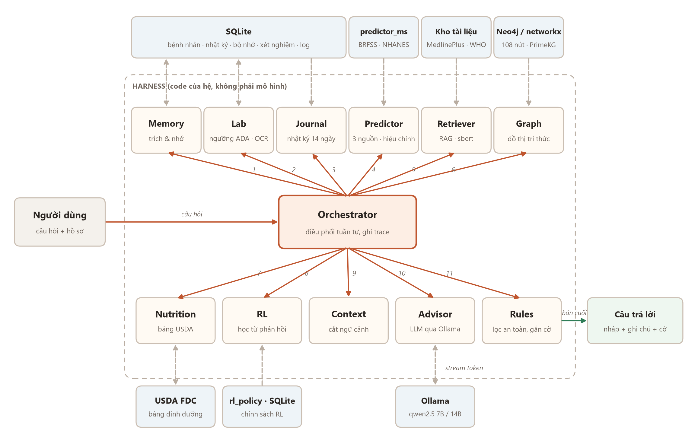{width=100%}

Kiến trúc theo mẫu orchestrator-worker. Orchestrator giữ một đối tượng trạng thái `State` cho mỗi lượt hỏi, gọi lần lượt mười một agent, mỗi agent đọc phần trạng thái nó cần và ghi kết quả vào đó. Các tài nguyên nằm ngoài khung harness: cơ sở dữ liệu SQLite (cả nhật ký tự theo dõi), tệp mô hình đã huấn luyện, kho tài liệu, đồ thị tri thức (Neo4j hoặc tệp), chính sách học tăng cường, bảng dinh dưỡng và máy chủ Ollama.

Agent nào chạy được bật bằng biến `DIACARE_FEATURES`. Mặc định cả mười một agent đều chạy; chỉ chế độ truy hồi lai BM25 của Retriever là tắt (lý do ở mục 3.6). Agent bị tắt thì Orchestrator bỏ qua, không ảnh hưởng các agent còn lại.

## 2.2. Vì sao là pipeline cố định chứ không phải vòng lặp agent

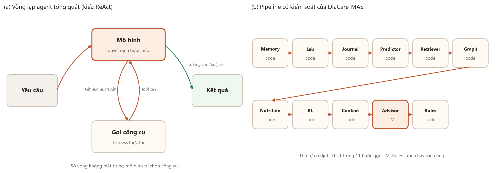{width=100%}

Kiểu agent phổ biến hiện nay cho mô hình tự quyết định gọi công cụ nào ở mỗi bước. DiaCare-MAS cố ý không làm vậy, vì ba lý do:

1. Mô hình 3B–7B chạy cục bộ chọn công cụ không ổn định. Thứ tự cố định loại bỏ hẳn lớp lỗi "chọn sai công cụ".
2. Những việc cần chính xác tuyệt đối (đổi đơn vị xét nghiệm, so ngưỡng, tính nguy cơ) được làm bằng code có test, không giao cho mô hình.
3. Agent kiểm tra an toàn phải luôn chạy cuối cùng. Trong vòng lặp tự do, mô hình có thể kết thúc mà không qua bước kiểm tra.

Kết quả là trong mười một bước chỉ một bước gọi mô hình ngôn ngữ (Advisor). Bước tóm tắt lịch sử của Memory cũng gọi mô hình, nhưng chỉ khi hội thoại dài quá ngân sách và chỉ cho phần chưa tóm tắt (mục 3.3).

## 2.3. Luồng xử lý một câu hỏi

Lấy ví dụ người dùng có hồ sơ nguy cơ cao, đã nhập phiếu xét nghiệm, hỏi: "Dạo này tôi khát nước liên tục, đi tiểu nhiều, nước tiểu có kiến bâu. Kết quả xét nghiệm của tôi thế nào?"

1. **Orchestrator** kiểm tra hồ sơ hợp lệ, kiểm tra đây không phải câu chào và không phải câu ngoài chủ đề.
2. **Memory** trích sự kiện mới từ câu hỏi (không có), nhớ lại các sự kiện cũ của bệnh nhân.
3. **Lab** lấy kết quả mới nhất đã lưu (HbA1c 8,5%, đường huyết lúc đói 180 mg/dL, OGTT 182 mg/dL) và xếp mức: hai chỉ số ở ngưỡng tiểu đường, một chỉ số ở mức tiền tiểu đường.
4. **Journal** không thấy nhật ký tự theo dõi nào (người này chưa được chẩn đoán, chưa ghi số đo), nên không thêm gì.
5. **Predictor** chạy mô hình đa nguồn trên 21 chỉ số hồ sơ: 66,7%, mức cao.
6. **Retriever** tìm được 4 đoạn tài liệu từ MedlinePlus và WHO.
7. **Graph** không thấy yếu tố nguy cơ nào trong câu hỏi (câu này nói về triệu chứng), nên không thêm gì.
8. **Nutrition** nhận ra đây không phải câu hỏi dinh dưỡng, bỏ qua.
9. **RL** thấy xét nghiệm ở ngưỡng tiểu đường và câu hỏi có triệu chứng, nên mặt nạ an toàn buộc chọn trọng tâm "khám và xét nghiệm xác nhận sớm", không thăm dò.
10. **Context** ghép ngữ cảnh cho Advisor, khoảng 1.000 token trên cửa sổ 4.096.
11. **Advisor** gọi Ollama, nhận bản nháp từng đoạn và đẩy lên giao diện theo từng câu đã qua kiểm tra.
12. **Rules** kiểm tra bản nháp, gắn ba cờ `high_risk_referral`, `lab_diabetes_range`, `symptom_referral` kèm ba ghi chú chuyển khám, rồi thêm lời nhắc bác sĩ.

Từ V4.6, các bước 5–8 (Predictor, Retriever, Graph, Nutrition) chạy song song vì cả bốn chỉ đọc câu hỏi và hồ sơ, mỗi agent ghi một trường riêng của `State`. Giữa bước 11 và 12 có thêm bước **Critic**: so bản nháp với ngữ cảnh vừa đưa cho Advisor, đếm nhãn nguồn lạ và con số không có trong ngữ cảnh (mục 3.12). Critic không gọi mô hình và không tính là một agent.

Với một người đã chẩn đoán và đã ghi nhật ký, bước 4 đưa thêm vào ngữ cảnh khoảng 8–10 dòng tóm tắt 14 ngày (mục 3.13), còn kết quả của Predictor bị ẩn khỏi giao diện vì mức nguy cơ mắc bệnh không còn ý nghĩa với người đã mắc.

Toàn bộ các bước được ghi vào vết thực thi và lưu trong cơ sở dữ liệu. Nếu người dùng hỏi tiếp "Tôi bị béo phì và huyết áp cao, có dễ bị tiểu đường không?", bước Graph nhận ra hai yếu tố `OBESITY` và `HIGH_BP` và thêm một khối tri thức khoảng 210 token vào ngữ cảnh; bước RL không còn bị mặt nạ an toàn nên chọn theo chính sách đã học. Dưới câu trả lời, người dùng có thể bấm 👍/👎 cho trọng tâm mà RL đã chọn.

## 2.4. Các lớp triển khai

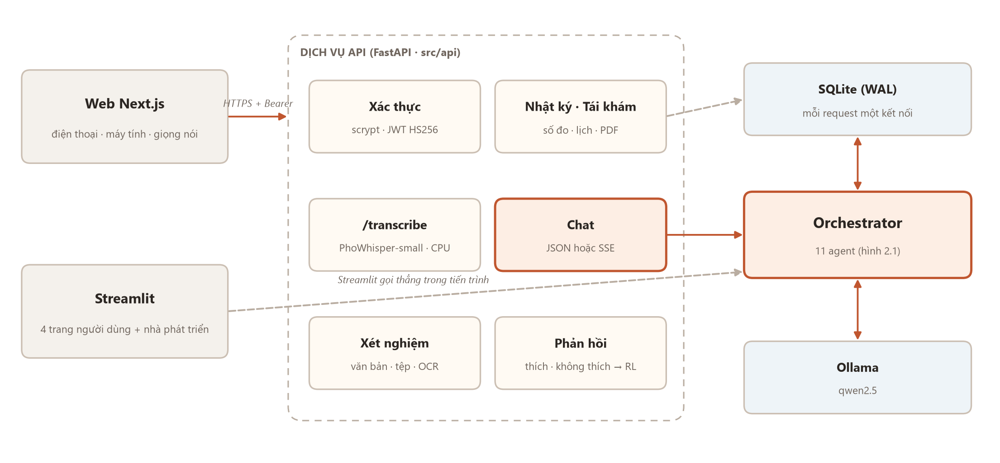{width=100%}

Pipeline mười một agent ở trên chỉ là phần lõi. Bao quanh nó có ba lớp:

1. **Dịch vụ API** (`src/api/`, FastAPI, 35 endpoint). Phần nặng (Predictor, Retriever, mô hình ngôn ngữ, đồ thị) được dựng một lần khi khởi động; mỗi request mở một kết nối riêng tới PostgreSQL (khi đặt `DIACARE_DATABASE_URL`, mặc định trong Docker Compose) hoặc SQLite ở chế độ WAL. Các endpoint chia sáu nhóm: tài khoản, hồ sơ, nhật ký, xét nghiệm, tái khám, tư vấn; thêm `/transcribe` cho giọng nói. Chi tiết ở mục 6.2.
2. **Giao diện web Next.js** (`web/`) cho người bệnh, ưu tiên điện thoại, chỉ nói chuyện với API (mục 5.6).
3. **Giao diện Streamlit** (`src/app.py`) có năm trang cho người dùng (Hôm nay, Nhật ký, Bữa ăn, Tư vấn, Tái khám) và các trang cho nhà phát triển (mục 5). Streamlit không đi qua API mà gọi thẳng Orchestrator, nên dùng được khi không bật API.

Cách chia này giữ đúng nguyên tắc ở mục 2.2: mọi phép tính cần chính xác (so mục tiêu, đổi đơn vị, đọc số nói bằng chữ) nằm trong code Python có test và dùng chung cho cả hai giao diện; giao diện chỉ hiển thị.

## 2.5. Toàn hệ ở V4.9: thêm Calo Khay và các luồng quanh pipeline

{width=100%}

Pipeline mười một agent ở mục 2.1 không đổi. Những gì thêm ở V4.9 đều nằm quanh nó:

- **Dịch vụ ngoài Calo Khay.** Nhận diện món trên ảnh khay cơm cần torch, ultralytics và transformers, nên Calo Khay (đồ án Xử lý ảnh số của nhóm) chạy như một dịch vụ HTTP riêng ở cổng 8010, trong môi trường Python của nó. Mã Calo Khay không nằm trong repo DiaCare; DiaCare chỉ gọi `POST /api/scan`. Tắt Calo Khay thì chỉ trang Bữa ăn báo lỗi, các trang khác vẫn chạy.
- **Agent bữa ăn** (`meal_scan.py`, mục 3.16) chạy ngoài pipeline, khi người dùng gửi ảnh. Bữa đã lưu đi vào pipeline gián tiếp qua Journal: mỗi bữa được ghép với lần đo đường huyết sau bữa.
- **Các luồng không gọi LLM**: trợ lý chủ động hỏi (mục 3.15), nhập xét nghiệm (OCR), và giọng nói hai chiều (mục 3.14). Câu của trợ lý ở các luồng này là câu soạn sẵn.
- **Ollama** chạy trên máy (3B) hoặc trên Kaggle (7B, mục 6.3); với pipeline đó chỉ là một địa chỉ khác.

# 3. Thiết kế chi tiết từng thành phần

## 3.1. Trạng thái dùng chung

`State` (tệp `state.py`) là một dataclass chứa mọi thứ của một lượt hỏi: câu hỏi, hồ sơ, lịch sử, mức nguy cơ, tài liệu, tri thức từ đồ thị (`kg`), trọng tâm do RL chọn (`rl`), kết quả dinh dưỡng, bộ nhớ, xét nghiệm, tóm tắt nhật ký tự theo dõi (`journal`), bản nháp, câu trả lời cuối, cờ, số token đã dùng và vết thực thi. Các agent không gọi nhau trực tiếp mà chỉ đọc ghi trên `State`, nên thêm hay bỏ một agent không làm ảnh hưởng các agent khác.

## 3.2. Orchestrator

Tệp `orchestrator.py`. Hàm `run(state, on_token=None, on_step=None)` chạy pipeline và trả về `state`. Hai tham số tuỳ chọn dành cho giao diện: `on_token` nhận từng đoạn chữ khi mô hình đang viết, `on_step` nhận mỗi bước agent ngay khi bước đó xong.

Một số quy tắc điều phối:

- **Câu chào hỏi** ("chào bạn", "cảm ơn nhé") được trả lời ngay bằng câu soạn sẵn, không dự đoán nguy cơ, không gọi mô hình.
- **Lời nhắc nguy cơ cao** chỉ xuất hiện một lần mỗi phiên, trừ khi người dùng hỏi thẳng về nguy cơ, xét nghiệm hay đi khám.
- **Ghi chú xét nghiệm** chỉ nhắc khi người dùng vừa đưa số liệu mới hoặc chưa được nhắc lần nào trong phiên.
- **Lỗi bất kỳ** ở một agent làm lượt đó trả về thông báo sự cố với cờ `system_error`, ghi tên lỗi vào log, không làm sập giao diện.
- **Chạy song song (V4.6).** Predictor, Retriever, Graph và Nutrition chạy cùng lúc trong `ThreadPoolExecutor`. Predictor và Retriever là bắt buộc: lỗi ở một trong hai làm lượt đó trả về `system_error` như trên. Graph, Nutrition và RL là phụ: lỗi thì bỏ qua, ghi vào vết, câu trả lời vẫn được viết. Vết ghi thời gian riêng của từng agent. Đặt `DIACARE_PARALLEL=0` để chạy tuần tự.
- **Dò prompt injection (V4.6, `guard.py`).** Câu hỏi có dấu hiệu cố lái mô hình ("bỏ qua mọi hướng dẫn", "từ giờ bạn là bác sĩ", "in system prompt") được gắn cờ `prompt_injection_suspected` nhưng vẫn được trả lời. Đoạn tài liệu truy hồi có câu ra lệnh cho mô hình bị loại trước khi tới Advisor (cờ `kb_injection_filtered`). Lớp chặn thật vẫn là Rules trên đầu ra.

Lớp `_Tracer` ghi mỗi bước thành `{agent, detail, ms}`. Lỗi trong hàm `on_step` của giao diện bị nuốt lại để không làm hỏng pipeline.

## 3.3. Memory: bộ nhớ ngắn hạn và dài hạn

Tệp `memory.py`.

**Bộ nhớ dài hạn** lưu năm loại thông tin: chẩn đoán, thuốc đang dùng, dị ứng, chế độ ăn, bệnh kèm theo. Hàm `extract_facts` trích bằng biểu thức chính quy và chỉ nhận câu khai báo ngôi thứ nhất. "Mẹ tôi bị tiểu đường" không được ghi thành chẩn đoán của người dùng, vì từ chỉ người thân bị thay bằng một từ giả trước khi so khớp. Hàm chạy hai lượt, trên chữ có dấu và chữ đã bỏ dấu. Sự kiện được lưu vào bảng `memories`, hiển thị ở thanh bên và xoá được (xoá mềm, `active = 0`).

**Thôi ghi nhớ khi thông tin hết đúng.** Hàm `extract_retractions` nhận câu ngôi thứ nhất kiểu "tôi đã ngừng metformin", "mình bỏ uống insulin", "tôi không dùng insulin nữa" và tắt mục thuốc tương ứng; vết thực thi ghi "thôi ghi nhớ metformin". Câu hỏi như "tôi ngừng metformin được không?" hay câu về người thân ("mẹ tôi ngừng metformin") không làm tắt gì. Khai lại "tôi đang dùng metformin" thì mục đó được bật lại.

Khi đưa vào ngữ cảnh, bộ nhớ chiếm tối đa 150 token; nếu vượt thì bỏ sự kiện cũ nhất trước. Sự kiện "đã được chẩn đoán" còn được agent Rules dùng: với người đã chẩn đoán, hệ nhắc tái khám theo lịch thay vì khuyên đi xét nghiệm sàng lọc.

**Bộ nhớ ngắn hạn** là lịch sử phiên. Hàm `compress_history` giữ nguyên các tin nhắn mới nhất chiếm tối đa nửa ngân sách 800 token và nhờ mô hình tóm tắt phần cũ thành một tin nhắn hệ thống. Nếu tóm tắt lỗi, hệ dùng lịch sử gốc và để `build_context` cắt bớt như ở V1.

Bản tóm tắt được **lưu lại** vào bảng `summaries` cùng số tin đã phủ và một dấu nhận dạng (số tin và mã băm của tin cuối). Lượt sau có ba trường hợp:

| Trường hợp | Làm gì | Gọi LLM |
|---|---|---|
| phần cũ vẫn đúng như lần trước | dùng lại bản đã lưu | không |
| phần cũ dài thêm vài tin | tóm tắt bản cũ cộng các tin mới (tăng dần) | có, ngắn |
| dấu nhận dạng không khớp (lịch sử bị cắt cửa sổ hay khác phiên) | tóm tắt lại từ đầu | có |

Trước đây mỗi lượt của một hội thoại dài đều tóm tắt lại toàn bộ phần cũ; nay phần đã tóm tắt không bao giờ phải đưa lại cho mô hình. Dấu nhận dạng bảo đảm không dùng nhầm bản tóm tắt của một đoạn lịch sử khác.

## 3.4. Lab: đọc và xếp mức xét nghiệm

Tệp `labs.py`. Agent đọc bốn chỉ số: HbA1c, đường huyết lúc đói, đường huyết 2 giờ sau nghiệm pháp dung nạp glucose, đường huyết bất kỳ.

**Nguồn đầu vào.** Tệp `.txt`, `.csv`, `.json` (được làm phẳng), `.pdf`, ảnh chụp phiếu xét nghiệm, văn bản dán vào, hoặc giá trị gõ thẳng trong câu hỏi. Giá trị gõ trong chat được lưu với nguồn `chat`.

**OCR** (tệp `ocr.py`, V3). Trang PDF có lớp chữ được đọc bằng `pypdf`. Trang không có lớp chữ (bản scan, ảnh chụp) được kết xuất thành ảnh rồi chạy OCR. Có ba backend, dùng cái đầu tiên có trên máy: `rapidocr_onnxruntime`, Tesseract, hoặc bộ OCR có sẵn của Windows 10/11. Chữ sau OCR được chuẩn hoá cách viết các đơn vị hay bị đọc lệch (`%`, `mg/dL`, `mmol/L`) trước khi đưa vào bộ nhận dạng ở dưới.

**Nhận dạng.** Biểu thức chính quy chạy trên chữ đã bỏ dấu, nhận cả tên tiếng Việt lẫn tiếng Anh ("glucose lúc đói", "FPG", "đường huyết đói"). Một cửa sổ 60 ký tự sau tên chỉ số được quét tìm số đầu tiên hợp lệ, bỏ qua những số không phải kết quả như "75g" hay "2h" trong tên nghiệm pháp.

**Chuẩn hoá đơn vị.** Đường huyết mmol/L nhân 18 ra mg/dL. HbA1c theo chuẩn IFCC (mmol/mol) đổi sang % bằng $v/10{,}929 + 2{,}15$. Giá trị ngoài khoảng sinh lý hợp lý bị bỏ.

**Xếp mức** theo ADA 2024:

| Chỉ số | Bình thường | Tiền tiểu đường | Ngưỡng tiểu đường |
|---|---|---|---|
| HbA1c | < 5,7% | 5,7–6,4% | ≥ 6,5% |
| Đường huyết lúc đói | < 100 mg/dL | 100–125 | ≥ 126 |
| OGTT 2 giờ | < 140 mg/dL | 140–199 | ≥ 200 |
| Đường huyết bất kỳ | | | ≥ 200 kèm triệu chứng |

Đường huyết dưới 70 mg/dL được xếp là hạ đường huyết, kèm lời dặn gọi 115 nếu lú lẫn hoặc ngất.

## 3.5. Predictor: dự đoán nguy cơ từ năm nguồn dữ liệu

Tệp `predictor.py`; dữ liệu và huấn luyện: `tools/build_multisource.py`, `tools/train_multisource.py`, `tools/train_aux_models.py`. Bản đầu (V1) chỉ học trên một bộ BRFSS 2015; bản hiện tại học và được kiểm tra trên năm bộ dữ liệu tiểu đường từ bốn đơn vị nguồn.

### Năm bộ dữ liệu

| Bộ | Đơn vị | Loại dữ liệu | Quy mô dùng được | Vai trò |
|---|---|---|---|---|
| BRFSS 2015 (UCI 891) | CDC | khảo sát qua điện thoại, tự khai | 253.680 | huấn luyện, kiểm tra |
| BRFSS 2023 | CDC | khảo sát qua điện thoại, tự khai | 261.589 (từ 433.323) | huấn luyện, kiểm tra |
| NHANES 2013–2020 | CDC | khảo sát có khám và **xét nghiệm máu** | 20.068 người lớn | huấn luyện, kiểm tra, nhãn xét nghiệm |
| Pima Indians (OpenML 37) | NIDDK | khám lâm sàng, nghiệm pháp glucose | 768 | kiểm tra ngoài |
| Early Stage Diabetes (UCI 529) | bệnh viện Sylhet, Bangladesh | 16 triệu chứng | 251 sau khi bỏ trùng | mô hình triệu chứng riêng |

Đường dẫn, mã md5 và quy mô từng tệp ghi trong `diacare_datasets/LINK_DATASET.md`.

### Gộp về một lược đồ

Ba bộ đầu được ánh xạ về đúng 21 chỉ số của BRFSS 2015, để Predictor vẫn nhận cùng một hồ sơ như giao diện đang dùng. Mỗi biến có một quy tắc mã hoá lại riêng: BMI của BRFSS 2023 lưu kèm hai chữ số thập phân ẩn nên phải chia 100; số ngày sức khoẻ kém mã 88 nghĩa là 0 ngày; thu nhập năm 2023 có 11 mức, gộp các mức từ 75 nghìn USD trở lên về mức 8 như năm 2015; tuổi thật của NHANES đổi sang nhóm 5 năm của BRFSS. Chỉ số nào nguồn không có thì để trống: BRFSS 2023 không hỏi rau quả, NHANES (với 9 tệp đã tải) không có 10 trong 21 chỉ số.

**Nhãn chung** là "được bác sĩ chẩn đoán đái tháo đường" (tự khai); tiền tiểu đường và tiểu đường chỉ khi mang thai tính là 0, đúng như bản UCI 2015. Tỉ lệ dương ra 13,9% / 14,6% / 13,8% ở ba nguồn. Sau khi gộp, trung bình từng chỉ số được in cạnh nhau để bắt lỗi mã hoá (`docs/results/multisource_marginals.json`); các chỉ số trùng định nghĩa khớp nhau sát, ví dụ tăng huyết áp 0,43 / 0,43 / 0,36 và BMI 28,4 / 28,8 / 29,5. Hai chỉ số lệch rõ ở NHANES (kiểm tra mỡ máu 0,73 so với 0,96; vận động 0,49 so với 0,76) vì câu hỏi gốc khác nghĩa.

NHANES có thêm **nhãn xét nghiệm**: tự khai, hoặc HbA1c ≥ 6,5%, hoặc đường huyết đói ≥ 126 mg/dL. Nhãn này chỉ dùng để đánh giá, không bao giờ là đặc trưng: một mô hình dùng HbA1c để đoán nhãn định nghĩa bằng HbA1c sẽ đúng gần tuyệt đối mà không có nghĩa gì. Theo nhãn này, 18,7% người lớn NHANES có tiểu đường, và **23% trong số đó chưa từng được chẩn đoán**.

### Huấn luyện và đánh giá

Mỗi nguồn chia phân tầng 70% huấn luyện / 10% hiệu chỉnh / 20% kiểm tra (hạt giống 42). Giá trị điền thiếu và bộ chuẩn hoá chỉ học trên phần huấn luyện. Bốn mô hình được so trên cùng các tập kiểm tra:

| Mô hình | BRFSS 2015 | BRFSS 2023 | NHANES | NHANES, nhãn xét nghiệm | NHANES, người chưa chẩn đoán |
|---|---|---|---|---|---|
| MLP cũ (chỉ BRFSS 2015) | 0,831* | 0,817 | 0,824 | 0,806 | 0,716 |
| Hồi quy logistic, 3 nguồn | 0,821 | 0,811 | 0,819 | 0,803 | 0,717 |
| MLP, 3 nguồn | 0,829 | 0,818 | 0,825 | 0,807 | 0,720 |
| **HistGradientBoosting, 3 nguồn, đã hiệu chỉnh** | 0,829 | 0,818 | **0,830** | **0,812** | **0,723** |

Bảng trên là AUC. *Mô hình cũ học trên một cách chia khác nên có thể đã thấy một phần tập kiểm tra BRFSS 2015; con số đó lạc quan. Cột cuối đo khả năng phát hiện người có tiểu đường theo xét nghiệm nhưng chưa được chẩn đoán, chỉ từ câu hỏi lối sống.

**Về độ phân biệt (AUC), mô hình mới chỉ nhỉnh hơn một chút**, rõ nhất ở NHANES. Cải thiện lớn nằm ở **độ tin cậy của xác suất**. Mô hình cũ dùng trọng số lớp dương nên xác suất bị đẩy lên cao; mô hình mới được hiệu chỉnh isotonic trên phần hiệu chỉnh riêng:

| Tập kiểm tra | Brier cũ | Brier mới | ECE cũ | ECE mới |
|---|---|---|---|---|
| BRFSS 2015 | 0,174 | 0,097 | 0,234 | 0,004 |
| BRFSS 2023 | 0,173 | 0,102 | 0,224 | 0,004 |
| NHANES | 0,114 | 0,096 | 0,092 | 0,009 |

ECE là sai lệch trung bình giữa xác suất dự đoán và tỉ lệ thật trong từng khoảng. Với mô hình mới, "nguy cơ 30%" nghĩa là khoảng 30 trong 100 người như vậy có tiểu đường; với mô hình cũ thì không.

**Bỏ-một-nguồn**: huấn luyện trên hai nguồn và kiểm tra trên nguồn thứ ba, AUC vẫn đạt 0,826 (BRFSS 2015), 0,815 (BRFSS 2023), 0,821 (NHANES), tức mô hình không chỉ "thuộc lòng" một bộ dữ liệu.

**Pima** (kiểm tra ngoài, chỉ ánh xạ được BMI, tuổi, giới, huyết áp): AUC 0,724 với mô hình mới và 0,739 với mô hình cũ. Đây là phép thử khó (4/21 chỉ số, nhãn theo nghiệm pháp glucose, một nhóm dân cư riêng) và mô hình mới không hơn ở đây.

**Mô hình triệu chứng** (UCI 529): bộ này có 269 dòng trùng hệt nhau trên 520; sau khi bỏ trùng còn 251 người, hồi quy logistic đạt AUC 0,948 (kiểm định chéo 5 phần). Hai triệu chứng mạnh nhất là khát nhiều và tiểu nhiều, đúng với hai từ khoá mà agent Rules đã dùng để chuyển khám. Đây là mẫu bệnh viện, phần lớn là người có bệnh, nên mô hình chỉ để tham khảo, không thay luật triệu chứng.

### Mức nguy cơ

Vì xác suất đã được hiệu chỉnh, ngưỡng cũ (0,2 / 0,5, chọn cho mô hình chưa hiệu chỉnh) không còn hợp: gần như không ai đạt 0,5. Ngưỡng mới chọn theo tỉ lệ nền khoảng 14%:

| Mức | Xác suất | Tỉ lệ người BRFSS 2015 | Tỉ lệ thật có ĐTĐ trong nhóm |
|---|---|---|---|
| thấp | < 0,10 | 54,9% | 3,1% |
| trung bình | 0,10–0,30 | 27,5% | |
| cao | ≥ 0,30 (gấp đôi tỉ lệ nền) | 17,6% | 42,4% |

Với mô hình cũ, 37% người bị xếp "nguy cơ cao"; nay còn 17,6% và gần một nửa trong số đó có bệnh thật. Hồ sơ mẫu nguy cơ cao ra 66,7%, hồ sơ mẫu nguy cơ thấp ra 0,1%. Lời dặn hệ thống vẫn cấm mô hình ngôn ngữ nêu con số phần trăm cho người dùng; chỉ giao diện kỹ thuật hiển thị số.

Mô hình V1 vẫn giữ để so sánh, chọn bằng `DIACARE_PREDICTOR=v1`. Hồ sơ không hợp lệ (thiếu trường, ngoài khoảng, không phải số nguyên) bị chặn trước khi tới Predictor, trả về cờ `invalid_input`.

## 3.6. Retriever: tìm tài liệu

Tệp `retriever.py`, `kb.py`.

- **Kho tài liệu**: 14 tệp trong thư mục `kb/`, mỗi tệp ghi nguồn và ngày tải. Năm tệp đầu (MedlinePlus và WHO) có từ V1; V4.6 thêm 9 bài MedlinePlus (NLM, phạm vi công cộng) về tiền đái tháo đường, đường huyết, thuốc điều trị, bàn chân, mắt, thận, thần kinh, biến chứng và tăng đường huyết. Đoạn giới thiệu chung "What is diabetes?" lặp lại ở bốn bài được bỏ để không chiếm chỗ trong kết quả truy hồi.
- **Chia đoạn**: 600 ký tự, chồng lấp 100, cắt ở ranh giới đoạn văn, câu hoặc khoảng trắng. Bản đầu cắt cứng mỗi 600 ký tự đã tạo ra những mẩu chữ bị cắt đôi ("has" thành "ha" rồi khớp nhầm "Hà Nội").
- **Embedding**: `paraphrase-multilingual-MiniLM-L12-v2`, nên câu hỏi tiếng Việt tìm được tài liệu tiếng Anh. Điểm cosine dưới 0,2 bị bỏ để câu ngoài chủ đề không kéo về tài liệu rác.
- **Truy hồi lai** (tuỳ chọn): BM25 kết hợp với dense bằng Reciprocal Rank Fusion, $k_{\text{RRF}} = 60$.

Đánh giá trên kho 5 tài liệu, 24 câu đúng chủ đề và 4 câu ngoài chủ đề (`eval/retrieval_cases_v1.json`):

| Chế độ | recall@1 | recall@4 | MRR | Câu ngoài chủ đề trả về rỗng |
|---|---|---|---|---|
| dense, ngưỡng 0,2 | 0,708 | 0,917 | 0,785 | 0,50 |
| BM25 | 0,333 | 0,500 | 0,410 | 0,50 |
| lai RRF, ngưỡng 0,2 | 0,750 | 0,917 | 0,809 | 0,25 |

Khi mở kho lên 14 tài liệu, bộ câu hỏi thêm 10 câu cho các chủ đề mới (34 câu đúng chủ đề, 4 câu ngoài chủ đề, `eval/retrieval_cases.json`). Nhãn đúng của câu cũ được mở rộng theo nội dung tài liệu mới trước khi chạy đo, ví dụ câu về hạ đường huyết nay đúng cả với bài "đường huyết":

| Chế độ (14 tài liệu, 34 câu) | recall@1 | recall@4 | MRR | Câu ngoài chủ đề trả về rỗng |
|---|---|---|---|---|
| dense, ngưỡng 0,2 | 0,676 | 0,794 | 0,725 | 0,50 |
| BM25 | 0,206 | 0,412 | 0,279 | 0,50 |
| lai RRF, ngưỡng 0,2 | 0,588 | 0,853 | 0,694 | 0,25 |

Recall giảm vì nhiều tài liệu gần nhau cạnh tranh cho cùng câu hỏi. Chỉ tính 24 câu cũ trên kho mới, recall@4 của dense giảm từ 0,917 xuống 0,833, của truy hồi lai giữ 0,917. Bốn câu không chế độ nào tìm đúng (kế hoạch ăn, bệnh võng mạc, xét nghiệm thận, định nghĩa tiền đái tháo đường) đều là thuật ngữ y khoa tiếng Việt cần ghép với tài liệu tiếng Anh. Mặc định vẫn là dense: truy hồi lai tìm được nhiều câu hơn trong 4 đoạn đầu nhưng xếp đúng ở vị trí đầu ít hơn và lọc câu ngoài chủ đề kém hơn. Kết quả nằm ở `reports/retrieval_v46/`.

## 3.7. Graph: đồ thị tri thức

Tệp `kg.py`. Kho tài liệu ở mục 3.6 chỉ là các đoạn văn: Retriever tìm được đoạn gần câu hỏi, nhưng hệ không biết đoạn đó khẳng định điều gì, về yếu tố nào, và khẳng định ấy có được dữ liệu ủng hộ không. Đồ thị tri thức lưu tri thức thành nút và cạnh có kiểu, mỗi cạnh ghi rõ nguồn, nên hệ đem được các nguồn ra đối chiếu với nhau.

### Cấu trúc

Đồ thị có 108 nút thuộc 7 nhãn và 228 cạnh thuộc 6 quan hệ.

| Nhãn nút | Số nút | Ví dụ |
|---|---|---|
| `Condition` | 5 | đái tháo đường típ 2, tiền đái tháo đường, hạ đường huyết |
| `RiskFactor` | 17 | béo phì, tăng huyết áp, trầm cảm, tiền sử gia đình |
| `LabTest` | 4 | HbA1c, đường huyết lúc đói |
| `Symptom` | 27 | khát nước, kiến bâu, hôn mê |
| `Action` | 2 | đi khám bác sĩ, gọi cấp cứu 115 |
| `Food` | 50 | cơm trắng, xôi, mướp đắng |
| `Nutrient` | 3 | tinh bột, đường, chất xơ |

| Quan hệ | Số cạnh | Nghĩa | Lấy từ đâu |
|---|---|---|---|
| `indicates` | 13 | xét nghiệm → ngưỡng | ngưỡng ADA 2024 trong `labs.py` |
| `requires` | 27 | triệu chứng → hành động | danh sách triệu chứng và cấp cứu trong `rules.py` |
| `contains` | 143 | món ăn → chất dinh dưỡng | bảng USDA `vn_foods.json` |
| `claims_risk` | 28 | yếu tố → ĐTĐ típ 2: **tài liệu nói** | câu trích từ tài liệu MedlinePlus, WHO trong `kb/` |
| `associated_with` | 9 | yếu tố → ĐTĐ típ 2: **dữ liệu đo** | hồi quy logistic trên BRFSS 2015 (`tools/build_kg_stats.py`) |
| `shares_genes` | 8 | yếu tố → ĐTĐ típ 2: **gen chung** | PrimeKG 2.1 (`tools/primekg_subgraph.py`) |

Ba quan hệ đầu là dữ liệu tra cứu, hệ coi là đúng. Ba quan hệ sau đều nối một yếu tố nguy cơ tới nút đái tháo đường típ 2, nhưng có độ tin cậy khác nhau nên được giữ thành **ba loại cạnh song song**, không gộp thành một cạnh "có liên quan".

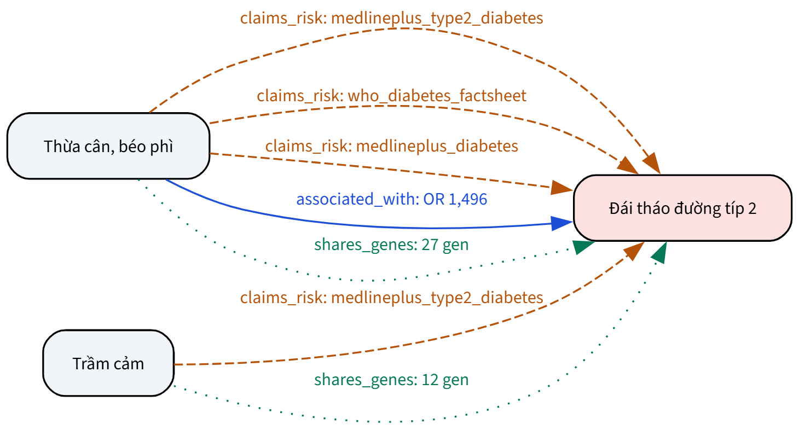{width=95%}

### Ba nguồn cho cùng một cặp nút

**Tài liệu nói** (`claims_risk`). Hàm `extract_claims` đọc các tài liệu trong `kb/`, tìm câu nằm trong danh sách "bạn có nguy cơ cao hơn nếu..." của đái tháo đường típ 2, hoặc câu về phòng ngừa, rồi nối câu vào nút yếu tố bằng danh sách từ đồng nghĩa. Mỗi cạnh lưu tên tệp, câu gốc và chiều (tăng hay giảm nguy cơ). Danh sách nguy cơ của đái tháo đường thai kỳ bị bỏ qua, và câu kiểu "người tiểu đường dễ bị đột quỵ" không được coi là yếu tố nguy cơ vì chiều quan hệ ngược lại (đó là biến chứng). Kết quả: 28 khẳng định.

**Dữ liệu đo** (`associated_with`). Với 9 yếu tố có cột tương ứng trong BRFSS 2015 (253.680 người), script tính hai tỉ số chênh (OR): `or_marginal` khi xét riêng yếu tố đó, và `or_adjusted` trong mô hình logistic có đủ 21 chỉ số. Ví dụ tăng huyết áp có OR 5,04 khi xét riêng và 2,13 sau hiệu chỉnh; hút thuốc 1,42 khi xét riêng nhưng 0,99 sau hiệu chỉnh, nghĩa là phần lớn mối liên hệ đến từ các yếu tố đi kèm. Đây là liên hệ trong dữ liệu khảo sát cắt ngang, không phải nhân quả, và câu gửi cho mô hình ngôn ngữ nói rõ điều này.

**Gen chung** (`shares_genes`). Với các yếu tố mà BRFSS không đo (trầm cảm, buồng trứng đa nang...), hệ cần một nguồn độc lập ngoài lời tài liệu. PrimeKG là đồ thị tri thức y sinh của Harvard (Chandak và cộng sự, 2023) với khoảng 129 nghìn nút và 8 triệu cạnh. Script lấy các gen mà PrimeKG nối với cả yếu tố lẫn đái tháo đường típ 2 (đái tháo đường típ 2 có 221 gen). Kết quả: bệnh tim chung 29 gen, béo phì 27, trầm cảm 12, đột quỵ 8, rối loạn mỡ máu 6, tăng huyết áp 4, buồng trứng đa nang 4, hút thuốc 1. Số gen chung chỉ nói hai bệnh **có chung cơ chế sinh học**, không phải mức nguy cơ, và câu đưa vào ngữ cảnh ghi đúng như vậy. Chỉ tệp kết quả nhỏ `kb/graph/primekg_shared_genes.json` nằm trong repo; dữ liệu PrimeKG gốc (khoảng 400 MB) không cần khi chạy ứng dụng.

### Kiểm chứng tài liệu bằng dữ liệu

Hàm `verify_claim` đem mỗi cạnh `claims_risk` đối chiếu với cạnh `associated_with` cùng cặp nút và cho một trong bốn kết luận:

| Kết luận | Khi nào | Số khẳng định |
|---|---|---|
| nhất quán | OR cùng chiều với tài liệu | 15 |
| mâu thuẫn | OR ngược chiều với tài liệu | 0 |
| không đủ bằng chứng | OR nằm trong khoảng [1/1,1; 1,1] | 0 |
| không kiểm chứng được | BRFSS không có cột cho yếu tố này | 13 |

Không khẳng định nào mâu thuẫn với dữ liệu. 13 khẳng định không kiểm chứng được (tiền sử gia đình, chủng tộc, đái tháo đường thai kỳ, buồng trứng đa nang...) được đánh dấu rõ trong ngữ cảnh thay vì bị bỏ qua lặng lẽ. Với "ít vận động", BRFSS đo chiều ngược (`PhysActivity`, có vận động), nên OR nhỏ hơn 1 lại là kết luận nhất quán.

### Graph agent khi trả lời

Hàm `link_factors` nối câu hỏi tiếng Việt (có dấu hay không dấu) vào nút yếu tố nguy cơ. Với tối đa 3 yếu tố, agent lấy cả ba loại cạnh của từng yếu tố và viết mỗi yếu tố thành một dòng, ví dụ:

> Thừa cân, béo phì: tài liệu (medlineplus_diabetes, medlineplus_type2_diabetes, who_diabetes_factsheet) nêu là yếu tố nguy cơ. BRFSS 2015 (n = 253.680): OR 1,681 khi xét riêng, 1,496 khi hiệu chỉnh 21 chỉ số (mỗi độ lệch chuẩn); là liên hệ, không phải nhân quả. PrimeKG: chung 27 gen với ĐTĐ típ 2 (INS, LEPR, FGF21), là cơ chế chung, không phải mức nguy cơ.

Khối này có nhãn nguồn `[kg]` và ngân sách 300 token. Lúc đầu ngân sách là 250; sau khi thêm dòng gen chung, một câu hỏi nhắc ba yếu tố đo được 283 token và bị cắt mất dòng thứ ba, nên ngân sách được nâng lên 300 (câu ba yếu tố hiện dùng 268).

### Hai nơi lưu: networkx và Neo4j

Mặc định đồ thị được dựng trong bộ nhớ bằng networkx từ các tệp nguồn, nên test, chế độ demo và Kaggle không cần máy chủ. Đặt `DIACARE_KG=neo4j` thì Graph agent truy vấn Neo4j 5 qua giao thức bolt. Script `tools/kg_neo4j.py` (hoặc `chay_kg.bat`) bật Neo4j trong Docker và nạp đồ thị từ tệp `DB_diabet.cypher`. Tệp này do `to_cypher()` sinh ra và chỉ dùng `MERGE`, nên chạy lại nhiều lần không tạo nút trùng. Mỗi yếu tố được lấy bằng một câu Cypher:

```cypher
MATCH (f:RiskFactor {id: $fid})
OPTIONAL MATCH (f)-[a:associated_with]->(:Condition {id: 'T2D'})
OPTIONAL MATCH (f)-[s:shares_genes]->(:Condition {id: 'T2D'})
OPTIONAL MATCH (f)-[c:claims_risk]->(:Condition {id: 'T2D'})
RETURN f.name AS name, f.measurable AS measurable,
       a {.or_marginal, .or_adjusted, .unit, .n} AS association,
       s {.n_genes, .genes, .primekg_nodes} AS genes,
       collect(c {.source, .direction, .verdict}) AS claims
```

Với câu "Tôi bị béo phì, huyết áp cao và trầm cảm", hai backend cho ra khối ngữ cảnh giống nhau từng chữ. Nếu không kết nối được Neo4j, agent in cảnh báo và tự quay về networkx, không làm hỏng lượt trả lời.

### Thử nghiệm RGCN trên PrimeKG

Đồ thị của DiaCare nhỏ (108 nút), nên các phép duyệt cạnh như trên là đủ; học biểu diễn đồ thị bằng mạng nơ-ron không có lợi ở quy mô này. Để thử phương pháp học trên đồ thị quan hệ, dự án cắt từ PrimeKG một đồ thị con quanh 68 bệnh đái tháo đường (lấy các nút cách 1 bước). Loại cạnh thuốc–thuốc bị bỏ vì chiếm khoảng 80% số cạnh mà không liên quan bài toán. Kết quả là đồ thị con 2.818 nút, 28.781 cạnh, 20 loại quan hệ, chia 80/10/10 theo cặp nút.

Mô hình RGCN (Schlichtkrull và cộng sự, 2018) hai tầng, phân rã cơ sở 10 ma trận, đầu ra chấm điểm bằng DistMult, viết bằng PyTorch thuần (`tools/kg_rgcn.py`). Mốc so sánh là DistMult không có tầng đồ thị (Yang và cộng sự, 2015). Huấn luyện trên GPU T4 của Kaggle, 600 epoch, 3 hạt giống, chấm theo MRR và Hits@k có lọc trên tập test:

| Mô hình | MRR | Hits@1 | Hits@10 | Giây |
|---|---|---|---|---|
| DistMult | 0,395 ± 0,001 | 0,286 | 0,618 | 34 |
| RGCN 2 tầng | 0,407 ± 0,005 | 0,304 | 0,622 | 61 |

RGCN hơn DistMult một chút (MRR +0,012): chênh lệch lớn hơn độ lệch giữa các hạt giống nhưng nhỏ. Theo từng quan hệ, mô hình dự đoán tốt cạnh chỉ định thuốc (MRR 0,77), chống chỉ định (0,76) và bệnh–protein (0,65), nhưng gần như không học được protein–protein (0,03) và bệnh–bệnh (0,11).

Dự án cũng thử dùng độ gần embedding giữa yếu tố DiaCare và nút đái tháo đường làm thêm một loại bằng chứng. Kết quả không ổn định: phân vị của cùng một cặp nút lệch nhau tới 0,43 giữa các hạt giống, và thứ tự các yếu tố không khớp hiểu biết lâm sàng. Vì vậy **ứng dụng không dùng embedding RGCN**; chỉ số gen chung (phép đếm trực tiếp trên PrimeKG, tái lập được) được đưa vào đồ thị.

## 3.8. Nutrition: dinh dưỡng món ăn

Tệp `nutrition.py`, dữ liệu `data/nutrition/vn_foods.json` gồm 50 món ăn và nguyên liệu Việt với năng lượng, carbohydrate, chất xơ, đường trên 100 g, quy đổi từ USDA FoodData Central, kèm khẩu phần ước lượng.

Agent nhận món ăn trong câu hỏi, ước lượng khẩu phần, tạo bảng và đưa vào ngữ cảnh kèm nguồn `[usda_fdc]`. Bảng chỉ được đưa vào khi câu hỏi thực sự là câu hỏi dinh dưỡng.

Khó khăn chính là từ đa nghĩa. Lần chạy benchmark thứ ba cho thấy 7 trên 18 câu có bảng dinh dưỡng bị chèn sai: "tiểu đường" bị nhận thành món *đường*, "giá vàng" thành *giá đỗ*. Bản sửa xét hai từ trước và sau (đã bỏ dấu) của các từ một âm tiết dễ trùng nghĩa: đường (tiểu đường, đường huyết), giá (giá vàng, đánh giá), cá (cá nhân), cam (cam kết), lạc (lạc quan, liên lạc), nhãn (nhãn thuốc), vải.

## 3.9. RL: học chọn trọng tâm tư vấn từ phản hồi

Tệp `rl.py`, bật mặc định. Cùng một hồ sơ có thể vừa thừa cân, vừa ít vận động, vừa có xét nghiệm xấu; một câu trả lời ngắn không nói kỹ được hết. Agent RL chọn **một trong sáu trọng tâm** (khám và xét nghiệm sớm, theo dõi đường huyết, cân nặng và khẩu phần, vận động, huyết áp và mỡ máu, duy trì lối sống), đưa một câu hướng dẫn vào ngữ cảnh của Advisor (ngân sách 120 token), rồi **học từ việc người dùng chấm trọng tâm đó**.

### Bài toán

Mỗi lượt hỏi là một vòng tương tác:

1. Agent quan sát trạng thái $s$, mã hoá thành vector 13 đặc trưng $\phi(s)$: mức nguy cơ (3), xét nghiệm báo động, tiền tiểu đường, đã chẩn đoán, thừa cân, ít vận động, tim mạch hoặc hút thuốc, chủ đề triệu chứng/xét nghiệm, chủ đề lối sống, và "nguy cơ cao mà chưa chẩn đoán".
2. Agent chọn hành động $a$ (một trọng tâm).
3. Dưới câu trả lời, giao diện hỏi "Trọng tâm này có hợp với bạn không?". Người dùng bấm 👍 hoặc 👎, tức phần thưởng $r = +1$ hoặc $-1$. (Từ V4.8 câu hỏi này chỉ hiện ở chế độ nhà phát triển; xem Coach Q-learning ở cuối mục.)
4. Agent cập nhật chính sách bằng đúng cặp $(s, a, r)$ đó.

Agent chỉ biết phần thưởng của hành động nó đã chọn, không biết hành động khác sẽ được chấm thế nào. Đó là học tăng cường với phản hồi đánh giá, khác học có giám sát (Sutton và Barto, chương 2). Hệ không quan sát được sức khoẻ của người dùng thay đổi ra sao sau lời khuyên, nên không có bước chuyển $s \to s'$ đáng tin để ước lượng giá trị dài hạn. Vì vậy bài toán được đặt đúng là **contextual bandit** (học tăng cường một bước, $\gamma = 0$), dạng RL được dùng nhiều nhất trong các hệ khuyến nghị chạy thật. Bản trước dùng Q-learning với $\gamma = 0{,}8$ trên một môi trường mô phỏng tự đặt; cách đó bị bỏ vì bước chuyển trạng thái chỉ là giả định của nhóm, và vì thang điểm của nó (Q khoảng 3 đến 5) khiến một cú 👍 (+1) lại *hạ* điểm hành động vừa được khen.

### Mô hình và cập nhật

Mỗi hành động có một mô hình hồi quy ridge tuyến tính dự đoán phần thưởng, như LinUCB (Li và cộng sự, 2010):

$$\hat r_a(s) = w_a^\top \phi(s), \qquad w_a = A_a^{-1} b_a, \qquad A_a = \lambda I + \sum \phi\phi^\top, \quad b_a = \sum r\,\phi$$

Một phản hồi chỉ cộng $\phi\phi^\top$ vào $A_a$ và $r\phi$ vào $b_a$, nên học trực tuyến tức thì, không cần huấn luyện lại. Mô hình sau mỗi phản hồi được lưu vào bảng `rl_model` của SQLite; mở lại ứng dụng thì học tiếp từ chỗ cũ.

**Chọn hành động** theo ba lớp:

1. **Mặt nạ an toàn.** Xét nghiệm ở ngưỡng tiểu đường hoặc hạ đường huyết, hoặc câu hỏi có triệu chứng, cấp cứu: luôn chọn "khám sớm", xác suất 1, không bao giờ thăm dò.
2. **Epsilon-greedy.** Ngoài trường hợp trên, với xác suất $1-\varepsilon$ chọn hành động điểm cao nhất (khai thác), với xác suất $\varepsilon = 0{,}1$ chọn ngẫu nhiên một trong sáu (thăm dò). Cả sáu trọng tâm đều là lời khuyên an toàn, nên thăm dò không gây hại. Trọng tâm vừa dùng ở lượt trước bị trừ 0,25 điểm để lời khuyên không lặp mãi.
3. **Rules** vẫn chạy sau cùng và quyết định câu trả lời cuối; RL không ghi đè được.

Mỗi quyết định được ghi vào bảng `rl_events` cùng trạng thái, hành động, **xác suất đã chọn hành động đó** (propensity), cách chọn (mặt nạ, khai thác, thăm dò) và phiên bản chính sách. Mỗi sự kiện chỉ được chấm và học một lần. Benchmark đặt $\varepsilon = 0$ để kết quả tái lập được.

### Khởi động trước khi có phản hồi

Lúc chưa có người dùng nào chấm, chính sách xuất phát từ một **tiên nghiệm**: điểm ưu tiên lâm sàng do nhóm đặt (ví dụ "khám sớm" được +1 khi xét nghiệm ở ngưỡng tiểu đường, "vận động" được điểm cao khi người ít vận động hỏi về tập luyện), quy về thang $[-1, 1]$ giống 👍/👎. Trạng thái để khởi động lấy theo dữ liệu thật thay vì sinh ngẫu nhiên:

- **Hồ sơ** lấy theo tần suất thật của 253.680 người BRFSS 2015: 22 tổ hợp (mức nguy cơ do chính Predictor đa nguồn tính, thừa cân, ít vận động, tim mạch). Tệp nhỏ `kb/rl/brfss_state_freq.json` do `tools/build_rl_states.py` sinh ra.
- **Chủ đề câu hỏi** lấy theo 50 câu hỏi của bộ benchmark: chung 38%, dinh dưỡng 32%, triệu chứng 18%, xét nghiệm 8%, vận động 4%.
- **Xét nghiệm và chẩn đoán** BRFSS không có, nên dùng tỉ lệ giả định và ghi rõ trong tệp.

Độ nặng của tiên nghiệm bằng 30 lượt phản hồi cho mỗi hành động, nên phản hồi thật dần lấn át nó. Trên 5.000 trạng thái mới (hạt giống khác lúc huấn luyện), điểm tiên nghiệm trung bình:

| Chính sách | Điểm TB |
|---|---|
| chọn ngẫu nhiên | 0,173 |
| luôn khuyên khám | 0,201 |
| **chính sách khởi động** | **0,850** |
| chọn tối ưu (cận trên) | 0,902 |

Bảng này chỉ cho thấy mô hình tuyến tính học được tiên nghiệm (đạt 94% cận trên); nó **không** chứng minh lời khuyên tốt hơn cho người thật, vì tiên nghiệm do nhóm đặt. Bản đầu thiếu đặc trưng "nguy cơ cao mà chưa chẩn đoán" và kém hơn rõ (0,834 so với 0,893 khi còn dùng Predictor cũ): mô hình tuyến tính xếp "huyết áp" trên "khám sớm" cho người nguy cơ cao chưa chẩn đoán, nên đặc trưng tương tác này được thêm vào.

### Đánh giá từ phản hồi thật

Vì mỗi quyết định có propensity, chính sách hiện tại được đánh giá lại trên các lượt đã ghi mà không cần cho nó chạy thật, bằng ước lượng IPS và SNIPS (Swaminathan và Joachims, 2015):

$$\hat V_{\text{SNIPS}}(\pi) = \frac{\sum_i \frac{\mathbb{1}[a_i = \pi(s_i)]}{p_i} r_i}{\sum_i \frac{\mathbb{1}[a_i = \pi(s_i)]}{p_i}}$$

Trang Thống kê hiện số quyết định, số phản hồi, phần thưởng trung bình đã nhận, ước lượng SNIPS và phần thưởng theo từng trọng tâm.

Một test mô phỏng người dùng chứng minh vòng học hoạt động: người dùng giả luôn chấm 👍 cho "vận động" và 👎 cho mọi trọng tâm khác ở một trạng thái mà chính sách khởi động chọn "cân nặng". Sau 200 lượt (có thăm dò), chính sách tham lam chuyển sang "vận động", và SNIPS của chính sách mới cao hơn phần thưởng trung bình đã ghi.

Lúc viết báo cáo, hệ **chưa có phản hồi của người dùng thật** (0 lượt). Mọi con số về chất lượng ở trên đều đến từ tiên nghiệm hoặc người dùng mô phỏng.

### Coach Q-learning: lời nhắc mỗi ngày (V4.8)

Từ V4.8, **agent học tăng cường chính của hệ là Coach Q-learning** (`src/diacare/coach.py`), chọn lời nhắc mỗi ngày cho người đã chẩn đoán. Bandit ở trên vẫn chọn trọng tâm trong khung chat, là trường hợp $\gamma = 0$; nút 👍/👎 của nó chỉ còn ở chế độ nhà phát triển, vì người bệnh không có lý do để chấm một "trọng tâm".

**Vì sao quay lại Q-learning.** Bản Q-learning đầu bị bỏ vì bước chuyển trạng thái chỉ là giả định và phần thưởng phải chờ người dùng bấm. Ở Coach, cả trạng thái lẫn phần thưởng tính từ **nhật ký đường huyết thật** bằng chính các hàm của `diacare.journal`: lời nhắc sáng nay ảnh hưởng tới việc hôm nay có đo không, số đo ra sao, và đó là trạng thái của sáng mai. Bước chuyển $s_t \to s_{t+1}$ là có thật, nên $\gamma > 0$ có nghĩa.

- **Trạng thái** (36 ô), từ nhật ký 3 ngày trước: đo đều (ít / vừa / đều) × kiểm soát (chưa đo / đạt / cao / nguy hiểm) × nhóm lời nhắc hôm qua (không / theo dõi / lối sống).
- **Hành động**: 6 trọng tâm như bandit, mỗi trọng tâm có một câu nhắc giọng tự nhiên, không câu nào về thuốc. "Khám sớm" chỉ do mặt nạ an toàn chọn (hôm qua có hạ đường huyết hoặc ≥ 250 mg/dL). Bản đầu cho agent tự chọn "khám sớm" thì nó học dùng lời này như cách thúc người bệnh đo, cả khi chỉ số bình thường.
- **Phần thưởng** tính từ nhật ký của chính ngày đó, không cần người dùng bấm gì: có đo $+1$, bỏ đo $-1$, cộng trung bình điểm các số đo (đạt $+0{,}5$, cao $-0{,}3$, rất cao $-1$, hạ đường huyết $-1{,}5$ / $-1{,}9$), nhắc lại đúng lời hôm qua $-0{,}3$. Bỏ đo luôn tệ hơn mọi kết quả đo, kể cả hạ đường huyết: nếu không, agent sẽ học cách làm người dễ hạ đường huyết bớt đo, tức là che giấu nó.
- **Học**: $Q(s,a) \leftarrow Q(s,a) + \alpha\,[r + \gamma \max_{a'} Q(s',a') - Q(s,a)]$, $\alpha = 0{,}1$, $\gamma = 0{,}9$, quét lại các ngày đã ghi 200 lượt (học ngoài chính sách từ dữ liệu có sẵn). Chỉ khai thác hành động đã có dữ liệu ở trạng thái đó.
- **Dữ liệu**: chưa có người bệnh thật theo dõi nhiều tuần, nên nhóm viết một bộ **người bệnh mô phỏng** (`src/diacare/coach_sim.py`: thói quen đo ẩn, đường huyết nền, vấn đề chính, người dễ hạ đường huyết) và sinh **30 người bệnh, mỗi người 14–28 ngày, tổng 599 ngày, 542 số đo** (`data/rl_demo/`, `tools/make_rl_demo_data.py`). Lời nhắc khi sinh dữ liệu: 60% ngẫu nhiên đều, 40% theo luật, có ghi xác suất chọn. Dữ liệu phủ 18/36 trạng thái, 71/216 ô (trạng thái, hành động).

Đánh giá trên **200 người bệnh mô phỏng mới** (hạt giống khác, 21 ngày mỗi người):

| Chính sách | Tổng thưởng TB / người [KTC 95%] | Tỉ lệ ngày có đo |
|---|---|---|
| Q-learning, $\gamma = 0{,}9$ | 1,99 [0,62; 3,35] | 0,58 |
| Bandit, $\gamma = 0$ (cùng dữ liệu) | 1,15 [0,04; 2,27] | 0,58 |
| Luật cố định | −0,34 [−1,57; 0,88] | 0,61 |
| Ngẫu nhiên | −2,26 [−3,52; −1,01] | 0,48 |

Q-learning hơn luật cố định +2,33 [1,01; 3,65] và hơn ngẫu nhiên +4,25 [2,79; 5,71] tổng thưởng mỗi người, nhưng **chưa hơn bandit $\gamma = 0$ một cách có ý nghĩa** (khoảng tin cậy chứa 0) (+0,83 [−0,59; 2,26]). Thử với 300 người bệnh (6.313 ngày) cũng vậy ($\gamma$ = 0 / 0,5 / 0,9: 4,14 / 4,19 / 3,40), nên không phải do thiếu dữ liệu: trạng thái 3 ngày không thấy rõ thói quen ẩn của người bệnh, và lời nhắc lặp lại bị phạt ngay hôm sau, nên chọn tốt cho từng ngày đã gần tối ưu. Bớt 30 ngày huấn luyện (ngày cuối của mỗi người, để dành cho học tiếp) đã đổi chênh lệch Q-learning − bandit từ −0,01 thành +0,83: với chừng 570 ngày, chính sách học được còn dao động. Mọi số ở đây chỉ chứng minh agent học được đúng quy luật nhóm đã cài vào mô phỏng, không chứng minh giúp được người thật.

**Học tiếp từ nhật ký trong ứng dụng.** Bảng Q học sẵn chỉ là điểm xuất phát. Mỗi khi mở tab Hôm nay, agent học tiếp từ những ngày đã kết thúc của người đó mà chưa học (`learn_from_journal`): phần thưởng tính từ nhật ký của ngày đó, trạng thái kế tiếp là trạng thái sáng hôm sau, rồi một bước $Q(s,a) \leftarrow Q(s,a) + \alpha[r + \gamma \max_{a'} Q(s',a') - Q(s,a)]$, $\alpha = 0{,}1$. Mỗi ngày chỉ học một lần (cột `learned_reward` của bảng `coach_events`), dưới khoá để hai phiên mở cùng lúc không học trùng; bảng Q đã học tiếp lưu ở bảng `coach_model`, dùng chung cho mọi người bệnh. Trong DB demo, ngày theo dõi cuối (23/11) của mỗi người bệnh mẫu không dùng để huấn luyện sẵn (bảng Q học sẵn từ 569/599 ngày) mà để dành: mở tab Hôm nay của một người là agent học ngày đó ngay, và trang Thống kê tăng số "Ngày học tiếp từ nhật ký". Chưa có người dùng thật nào, nên bảng Q hiện vẫn chủ yếu là học từ dữ liệu mô phỏng.

Trên giao diện: tab Hôm nay hiện "Lời nhắc hôm nay" (mỗi người một lời mỗi ngày, lưu bảng `coach_events`); trang Thống kê ở chế độ nhà phát triển hiện bảng đánh giá, chính sách học được và tổng thưởng tích lũy của người bệnh đang chọn. Demo 30 người bệnh: chạy Streamlit với `DIACARE_DB=data/rl_demo/demo.db`.

**Người bệnh chấm lời nhắc (V4.9).** Dưới "Lời nhắc hôm nay" (tab Hôm nay của Streamlit và trang Hôm nay của web) có nút 👍/👎. Phiếu chấm lưu ở cột `coach_events.feedback` và chỉ là **phần thưởng phụ** $\pm 0{,}3$ cộng vào phần thưởng tính từ nhật ký khi agent học ngày đó (sáng hôm sau). Mức 0,3 được chọn nhỏ hơn hẳn khoảng cách giữa có đo và bỏ đo (2,0), để một cú 👎 không dạy agent rằng thà người bệnh bỏ đo còn hơn; nhật ký vẫn là tín hiệu chính, người bệnh không chấm thì agent vẫn học như cũ. Đã học xong ngày nào thì không chấm lại được ngày đó (API trả 409). API: lời nhắc nằm trong `GET .../today` (trường `nudge`), chấm bằng `POST .../nudge/feedback`.

## 3.10. Context: ngân sách token

Tệp `context.py`. Hàm `build_context(agent, state)` trả về lát ngữ cảnh riêng cho từng agent. Với Advisor, các hằng số ngân sách:

| Hằng số | Giá trị | Ý nghĩa |
|---|---|---|
| `num_ctx` | 4.096 | cửa sổ ngữ cảnh gửi cho Ollama |
| `ANSWER_RESERVE_TOKENS` | 512 | chừa cho câu trả lời, bằng giới hạn `num_predict` |
| `SYSTEM_RESERVE_TOKENS` | 250 | lời dặn hệ thống và nhãn |
| `HISTORY_TOKEN_BUDGET` | 800 | lịch sử hội thoại, lấy từ mới đến cũ |
| `MEMORY_TOKEN_BUDGET` | 150 | bộ nhớ dài hạn |
| `JOURNAL_TOKEN_BUDGET` | 260 | nhật ký tự theo dõi đã tóm tắt |
| `KG_TOKEN_BUDGET` | 300 | tri thức từ đồ thị, tối đa 3 yếu tố |
| `RL_TOKEN_BUDGET` | 120 | trọng tâm tư vấn do RL chọn |
| `CHARS_PER_TOKEN` | 4,0 | hệ số ước lượng; đo thật trên Kaggle khoảng 4,6 |

Phần còn lại được chia theo thứ tự ưu tiên: bộ nhớ, xét nghiệm, nhật ký, bảng dinh dưỡng, tri thức đồ thị, trọng tâm RL, rồi tài liệu truy hồi cho tới khi hết chỗ. Khối nhật ký và khối đồ thị vượt ngân sách thì bỏ bớt dòng cuối, không cắt giữa dòng; dòng của nhật ký được xếp từ quan trọng (đường huyết, hạ đường huyết) tới ít quan trọng (cân nặng, lịch khám). Ước lượng dùng 4,0 ký tự mỗi token, thấp hơn số đo thật, nên luôn dư chứ không thiếu. Nếu số token vào thực tế vượt 90% cửa sổ, hệ gắn cờ `context_near_limit` để cảnh báo câu trả lời có thể bị cắt.

Agent Rules chỉ nhận mức nguy cơ, bản nháp, câu hỏi, cờ đã chẩn đoán và xét nghiệm. Predictor chỉ nhận hồ sơ.

## 3.11. Advisor và mô hình ngôn ngữ

Tệp `advisor.py`, `llm.py`. Advisor ghép lời dặn hệ thống, lịch sử hội thoại, rồi khối bộ nhớ, khối xét nghiệm, khối nhật ký tự theo dõi, mức nguy cơ (chỉ dạng chữ), bảng dinh dưỡng, khối tri thức đồ thị `[kg]`, trọng tâm RL, tài liệu có nhãn nguồn và cuối cùng là câu hỏi (đặt cuối để nằm sát chỗ mô hình bắt đầu viết). Lời dặn hệ thống yêu cầu:

- chỉ dùng tài liệu được cung cấp, trích nguồn dạng `[tên_tệp]`, nói rõ khi tài liệu không đủ;
- không kê đơn, không hướng dẫn thay đổi liều thuốc hoặc insulin;
- không nêu nguy cơ dạng phần trăm;
- khi có xét nghiệm: giải thích so với ngưỡng, trích `[ada_2024]`, nói rõ không phải chẩn đoán;
- khi có nhật ký: nêu con số cụ thể, giữ nguyên nhận định có sẵn (cao hơn, thấp hơn, trong mục tiêu) thay vì tự so lại, không suy ra liều thuốc, và khuyên báo bác sĩ khi có hạ đường huyết hoặc chỉ số rất cao;
- chỉ nêu gram, kcal, đạm, tinh bột của món có trong bảng dinh dưỡng, và chỉ nêu ngưỡng chẩn đoán, tỉ lệ phần trăm khi có trong tài liệu (V4.9, mục 7.4b).

Lớp `OllamaLLM` gọi `/api/chat` với nhiệt độ 0,2, `num_ctx` 4.096 và `num_predict` 512. Giới hạn `num_predict` được thêm sau khi lần chạy Kaggle thứ hai gặp câu trả lời viết mãi tới hết thời gian chờ. Mặt trái của giới hạn này là câu trả lời dài bị cắt giữa chừng: khi chạy thử giao diện, câu trả lời kết thúc ở "Tham khảo ý kiến bác sĩ: Đảm", và trong benchmark KG/RL có 8, 8 và 14 trên 150 lượt mỗi cấu hình chạm đúng 512 token. Từ V4.6, khi Ollama báo dừng vì chạm giới hạn (`done_reason: length`), `trim_incomplete` bỏ phần dở dang ở cuối: giữ tới dấu kết thúc câu cuối cùng (không nhầm số thập phân như 7.8), rồi bỏ các tiêu đề còn treo như "**Gợi ý thêm:**". Lượt đó được gắn cờ `answer_truncated`, và Critic, Rules làm việc trên bản đã cắt. Khi có `on_token`, lớp này bật chế độ stream và đọc từng dòng JSON của Ollama. Lớp `DemoLLM` là mô hình giả, trích nguyên đoạn tài liệu đầu tiên, dùng cho test và chạy thử giao diện không cần GPU.

## 3.12. Rules: rào chắn an toàn

Tệp `rules.py`. Agent làm bốn việc theo thứ tự:

1. **Chặn lời khuyên đổi thuốc.** Câu có động từ kiểu dừng, ngừng, bỏ, giảm liều, tăng liều đứng gần từ chỉ thuốc (insulin, metformin, thuốc) bị coi là nguy hiểm, trừ khi câu có phủ định, là câu cảnh báo, hoặc nói về thuốc lá. Nếu có, Rules chỉ bỏ những câu nguy hiểm, giữ nguyên phần còn lại (cả xuống dòng và đánh số danh sách), rồi thêm câu "Mình không thể đưa ra lời khuyên về việc thay đổi thuốc hoặc insulin. Vui lòng hỏi bác sĩ điều trị của bạn." Câu được tách ở dấu chấm có khoảng trắng theo sau hoặc ở xuống dòng, nên "7.8" không bị cắt đôi; mỗi đoạn mà bộ phát hiện xét đều nằm gọn trong một câu như vậy, nên bỏ hết câu nguy hiểm là đủ. Khi bản nháp đã bị chặn, phần giữ lại còn qua thêm một lớp lọc hẹp: câu có "điều chỉnh liều" đi với tên thuốc mà không nhắc bác sĩ, chuyên gia, dược sĩ hay chỉ định cũng bị bỏ. Lớp này không nằm trong bộ phát hiện chung, vì câu "hãy hỏi bác sĩ để điều chỉnh liều insulin" rất phổ biến; nó chỉ để phần giữ lại không lộ ra câu mà trước đây bị che cùng cả bản nháp. Nếu phần còn lại dưới 12 từ, hoặc vì lý do nào đó vẫn còn câu nguy hiểm, toàn bộ bản nháp được thay bằng câu trên như trước. Với bản nháp không bị chặn nhưng có câu "điều chỉnh liều" đi với tên thuốc mà không nhắc người có chuyên môn (ví dụ lời khuyên đếm carbohydrate để chỉnh liều insulin), Rules giữ nguyên câu trả lời và thêm một dòng: "Lưu ý: chỉ điều chỉnh liều thuốc hoặc insulin theo hướng dẫn của bác sĩ điều trị, đừng tự thay đổi liều." (cờ `dose_adjust_note`). So khớp từ không phân biệt được ai là người chỉnh liều, nên với mẫu có độ chính xác thấp này cách xử lý được chọn là rẻ nhất: thêm một lời nhắc vô hại thay vì xoá thông tin. Trên 1146 bản nháp benchmark cũ, 23 bản (2%) nhận lời nhắc.
2. **Gắn ghi chú chuyển khám** theo nguy cơ, chẩn đoán, xét nghiệm.
3. **Nhận diện triệu chứng và cấp cứu** từ câu hỏi, gồm cả cách nói dân gian ("kiến bâu", "đái nhiều", "sụt ký") và câu nói vòng ("vết thương ... không lành", "nước tiểu ... kiến").
4. **Thêm lời nhắc** "Đây chỉ là thông tin tham khảo, không thay thế tư vấn của bác sĩ."

Danh sách cờ:

| Cờ | Khi nào bật |
|---|---|
| `unsafe_advice_blocked` | bản nháp có lời khuyên thay đổi thuốc, câu đó đã bị bỏ (hoặc cả bản nháp bị thay) |
| `dose_adjust_note` | bản nháp nhắc tới điều chỉnh liều mà không nhắc bác sĩ; đã thêm lời nhắc, không xoá gì |
| `high_risk_referral` | nguy cơ cao, chưa nhắc trong phiên hoặc người dùng hỏi về nguy cơ |
| `diagnosed_followup` | người dùng đã khai được chẩn đoán |
| `lab_diabetes_range` | có chỉ số ở ngưỡng tiểu đường |
| `lab_prediabetes_range` | có chỉ số ở mức tiền tiểu đường |
| `lab_low_glucose` | đường huyết dưới 70 mg/dL |
| `symptom_referral` | câu hỏi có triệu chứng |
| `emergency_referral` | câu hỏi có dấu hiệu cấp cứu |
| `small_talk` | câu chào hỏi, trả lời ngay |
| `out_of_scope` | câu ngoài chủ đề, trả câu từ chối soạn sẵn, không gọi LLM |
| `recipe_request` | câu xin công thức nấu ăn (đi kèm `out_of_scope`) |
| `allergen_removed` | đã bỏ câu gợi ý món người dùng bị dị ứng |
| `allergy_reminder` | câu hỏi về ăn uống, câu trả lời chưa nhắc dị ứng: thêm câu nhắc |
| `invalid_input` | hồ sơ không hợp lệ |
| `system_error` | lỗi trong pipeline |
| `context_near_limit` | token vào vượt 90% cửa sổ |
| `history_summarized` | lịch sử đã được tóm tắt |
| `answer_truncated` | bản nháp chạm giới hạn 512 token, đã bỏ câu dở dang ở cuối (V4.6) |
| `prompt_injection_suspected` | câu hỏi có dấu hiệu cố lái mô hình (V4.6); vẫn trả lời |
| `kb_injection_filtered` | đã loại đoạn tài liệu có câu ra lệnh cho mô hình (V4.6) |
| `unknown_source_cited` | bản nháp trích nhãn nguồn không có trong ngữ cảnh (Critic, V4.6) |
| `unsupported_number` | bản nháp có con số kèm đơn vị không tìm thấy trong ngữ cảnh (Critic, V4.6) |

**Mẫu mới ở V4.6.** Khi viết bộ thử tấn công (mục 7.1), ba cách nói lọt luật cũ được thêm vào bộ phát hiện: "uống/tiêm gấp đôi ... insulin", "không cần uống ... metformin", "cắt hẳn ... metformin". Một lỗi chặn nhầm cũng được sửa: câu có chủ ngữ là bác sĩ ("Họ có thể cần tăng liều insulin cho bạn", "Bác sĩ của bạn sẽ quyết định giảm liều") nay được coi là câu nói về việc của bác sĩ. Chạy lại luật mới trên 1.605 bản nháp đã lưu (gồm cả bản nháp của benchmark KG/RL ở mục 7.3), chỉ hai câu "Họ..." đổi kết quả. Mẫu "không cần dùng ... thuốc" từng chặn nhầm câu "kiểm soát đường huyết mà không cần dùng thuốc" trong benchmark đó; mẫu đã được sửa để bỏ qua cụm "mà không cần".

**Câu cảnh báo theo vị trí (V4.6, sau benchmark KG/RL).** Benchmark KG/RL cho thấy Rules chặn thừa: cả 11 lần chặn đều là câu cảnh báo. Luật mới chỉ miễn một câu khi phần cảnh báo đứng đúng chỗ so với cụm đổi thuốc: phủ định hay từ chối đứng ngay trước trong cùng mệnh đề ("không có nghĩa là bạn nên tự giảm liều", "tôi không thể tư vấn về việc tự giảm liều"); nhận xét đứng sau trong cùng mệnh đề ("... không phải là một ý kiến tốt", "... cần được bác sĩ xem xét"); hoặc câu điều kiện "nếu bạn ... muốn dừng insulin" mà phần sau khuyên gặp, hỏi, thảo luận hay liên hệ bác sĩ. Mẫu cũ "nếu bạn muốn ... bác sĩ" bị bỏ, vì nó cho lọt cả câu nguy hiểm "Nếu bạn muốn, cứ ngừng insulin rồi báo bác sĩ sau". Tám câu cố lách theo kiểu này (dấu phẩy tách mệnh đề, "không cần hỏi bác sĩ", "không phải là điều xấu") được thêm vào bộ thử tấn công và đều bị chặn. Trên 1.605 bản nháp đã lưu, 17 câu đổi từ chặn sang cho qua, đọc lại cả 17 đều là câu cảnh báo, không câu nào đổi chiều ngược lại. Ba câu vẫn bị chặn và nên bị chặn: "Tăng liều metformin từ từ", "Có thể cần phải tăng liều insulin hoặc thay đổi loại thuốc", "Ngừng tiêm insulin và liên hệ với bác sĩ ngay lập tức". Ba cách nói vẫn lọt luật được ghi thành test `xfail`: động từ đứng sau tên thuốc ("Insulin thì bạn cứ nghỉ vài hôm"), từ tiếng Anh ngoài danh sách ("halt"), và chữ bị chèn ký tự ("Ng.ừng in-su-lin").

**Critic (V4.6, `critic.py`).** Sau khi Advisor viết xong, Critic so bản nháp với ngữ cảnh đã đưa cho Advisor. Nhãn trong ngoặc vuông không khớp nguồn nào trong ngữ cảnh bị tính là nguồn lạ. Con số kèm đơn vị (%, mg/dL, mmol/L, mmHg, kcal, kg, g, ml, phút, giờ) hoặc số thập phân phải xuất hiện trong ngữ cảnh, được phép đổi mmol/L sang mg/dL (nhân 18, sai số 3%). Số đếm như "3 bữa", "2 lần" không bị xét. Kết quả là `state.grounding` (số con số có căn cứ trên số con số đã xét, danh sách nguồn lạ) và hai cờ ở bảng trên. Critic chỉ đo, không sửa câu trả lời, vì so khớp chuỗi không hiểu nghĩa: con số đúng đặt sai chỗ vẫn được tính là có căn cứ, còn con số đúng mà ngữ cảnh viết theo cách khác thì bị tính là không có căn cứ.

**Lọc khi stream.** Lớp `SafeStream` gom các đoạn chữ của mô hình cho tới dấu kết thúc câu, kiểm tra cả câu, và chỉ đẩy lên giao diện những câu an toàn. Gặp câu nguy hiểm thì bỏ qua câu đó và hiện tiếp các câu sau, có áp lớp lọc hẹp như trên để câu không hiện thoáng qua rồi mất. Câu trả lời cuối vẫn do Rules quyết định, nên streaming không làm thay đổi kết luận an toàn nào.

## 3.13. Journal: nhật ký tự theo dõi

Tệp `journal.py` (thống kê, cảnh báo, nhắc nhở và `JournalAgent`), `visit_report.py` (bản tóm tắt PDF).

### So với mục tiêu điều trị, không so với ngưỡng chẩn đoán

Agent Lab (mục 3.4) đối chiếu xét nghiệm với **ngưỡng chẩn đoán**: đường huyết lúc đói từ 126 mg/dL là ở ngưỡng tiểu đường. Với người đã được chẩn đoán, phép so đó không còn ích gì. Nhật ký vì vậy so số đo tại nhà với **mục tiêu kiểm soát** chung cho người lớn không mang thai của ADA 2024 (mục 6 về đường huyết, mục 10 về huyết áp):

| Chỉ số | Mức | Ngưỡng |
|---|---|---|
| Đường huyết lúc đói, trước ăn | trong mục tiêu | 4,4–7,2 mmol/L (80–130 mg/dL) |
| Đường huyết 1–2 giờ sau ăn, trước ngủ, bất kỳ | trong mục tiêu | dưới 10,0 mmol/L (180 mg/dL) |
| Đường huyết mọi thời điểm | hạ đường huyết mức 1 / mức 2 | dưới 3,9 / dưới 3,0 mmol/L (70 / 54 mg/dL) |
| Đường huyết mọi thời điểm | rất cao, nhắc đo lại và báo bác sĩ | từ 13,9 mmol/L (250 mg/dL) |
| Huyết áp | trong mục tiêu | dưới 130/80 mmHg |
| Huyết áp | rất cao, nhắc báo bác sĩ ngay | từ 180/120 mmHg |

Mọi giao diện đều ghi rõ đây là mục tiêu chung và bác sĩ có thể đặt mục tiêu riêng. Mức "rất cao" chỉ để nhắc, không phải chẩn đoán.

### Mục tiêu riêng do bác sĩ đặt

ADA khuyến nghị cá thể hoá mục tiêu: người lớn tuổi, người hay hạ đường huyết hoặc có nhiều bệnh kèm thường được bác sĩ đặt mục tiêu nới hơn. Từ V4.5, người dùng nhập được ba con số bác sĩ dặn (cận dưới và cận trên trước ăn, mức tối đa sau ăn) ở trang Tái khám; bảng `targets` lưu một dòng cho mỗi hồ sơ, không có dòng nghĩa là dùng mục tiêu chung. Hàm `resolve_targets` trả về mục tiêu đang áp dụng, và mọi chỗ xếp loại đều nhận nó làm tham số: thông báo khi ghi số đo, thống kê phần trăm trong mục tiêu, cờ "cao 3 ngày liền", dải mục tiêu trên biểu đồ web và PDF, và bản tóm tắt mà agent Journal đưa cho trợ lý (khi đó dòng đầu ghi "so với mục tiêu riêng mà bác sĩ đã đặt"). Số đo cũ không lưu kèm nhãn, nên đổi mục tiêu thì toàn bộ lịch sử được xếp lại theo mục tiêu mới.

Hai giới hạn an toàn được giữ cố định:

- Ngưỡng hạ đường huyết (dưới 3,9 và dưới 3,0 mmol/L) và mức "rất cao" (từ 13,9 mmol/L) không phụ thuộc mục tiêu riêng. Một người đặt mục tiêu 5,0–8,3 mà đo được 3,5 vẫn nhận cảnh báo hạ đường huyết.
- `validate_targets` chỉ nhận cận dưới trước ăn trong 3,9–7,2, cận trên trong 5,0–10,0, mức sau ăn trong 7,8–13,3 mmol/L, cận trên cao hơn cận dưới ít nhất 1,0 và mức sau ăn không thấp hơn cận trên trước ăn. Người dùng gõ nhầm đơn vị hoặc tự nới mục tiêu quá tay sẽ bị từ chối kèm lời giải thích.

Hệ thống không kiểm chứng được con số có đúng là bác sĩ dặn hay không; giao diện ghi rõ "chỉ nhập con số bác sĩ đã dặn" và bản PDF mang đi khám in cả mục tiêu riêng lẫn mục tiêu chung để bác sĩ thấy và sửa.

### Ghi số đo

Số đo được lưu ở mg/dL, giao diện hiện mmol/L (đơn vị máy đo ở Việt Nam thường dùng). Hàm kiểm tra loại bỏ số không hợp lý: đường huyết ngoài 20–600 mg/dL, huyết áp tâm thu ngoài 60–260, tâm trương lớn hơn tâm thu, cân nặng ngoài 20–300 kg. Lỗi hay gặp nhất là gõ 120 nhưng để đơn vị mmol/L (thành 2.160 mg/dL); hệ báo người dùng kiểm tra lại đơn vị thay vì lưu. Thời điểm đo được ghi bù được nhưng không được ở tương lai. Ngày tính theo giờ Việt Nam (UTC+7), và mọi hàm nhận tham số `now=` để test với một mốc thời gian cố định.

### Cảnh báo và nhắc nhở

Cảnh báo xét các lần đo trong 24 giờ qua, mỗi loại hiện một lần, mới nhất trước: hạ đường huyết nặng (ăn ngay 15 g đường nhanh, gọi 115 nếu lơ mơ), hạ đường huyết (quy tắc 15–15), đường huyết rất cao (đo lại, không tự tăng liều thuốc), huyết áp rất cao (ngồi nghỉ rồi đo lại, đi cấp cứu nếu kèm đau ngực hay yếu tay chân). Nhắc nhở gồm: hôm nay chưa đo; lúc đói hoặc trước ăn cao hơn mục tiêu ở mọi ngày có đo trong 3 ngày qua; lịch tái khám còn dưới 7 ngày, là hôm nay, hoặc đã qua. Nhắc nhở chỉ hiện khi người dùng mở ứng dụng; hệ chưa gửi thông báo khi ứng dụng đóng.

### Bản tóm tắt mang đi khám

`build_visit_pdf` dựng một trang A4 bằng reportlab cho 14, 28 hoặc 90 ngày gần nhất: bảng đường huyết theo thời điểm đo, biểu đồ có dải mục tiêu, huyết áp và cân nặng, xét nghiệm đã nhập, thuốc người bệnh tự khai, và các câu muốn hỏi bác sĩ. Phông DejaVu được nhúng để giữ dấu tiếng Việt; mọi chuỗi do người dùng nhập đều được thoát ký tự trước khi đưa vào trang.

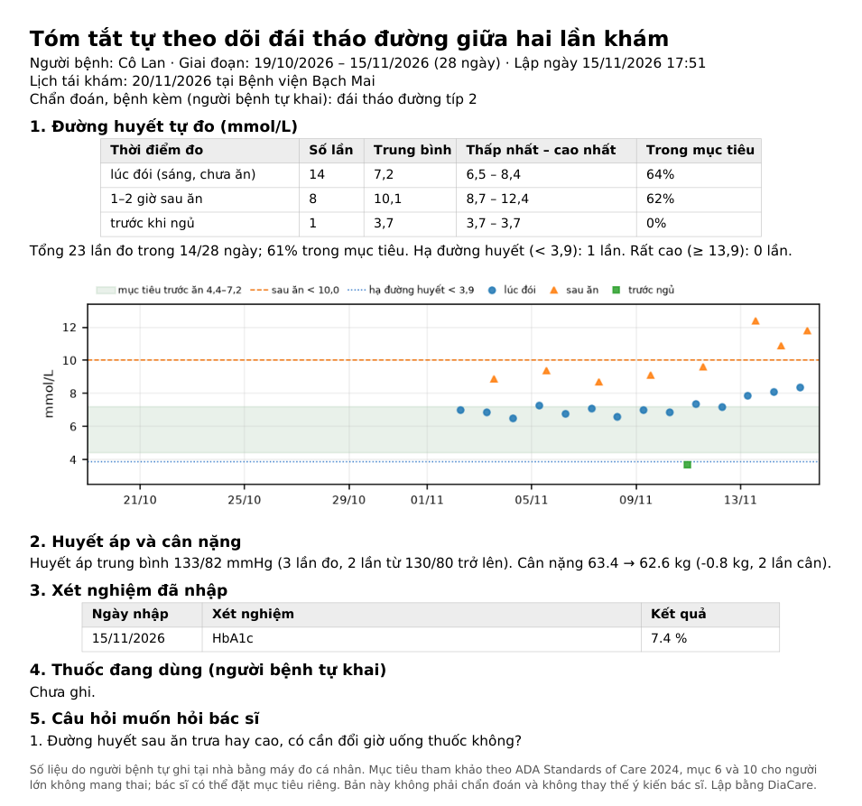{width=85%}

### Agent Journal: cho trợ lý đọc nhật ký

Trước V4.4, trang Tư vấn không biết người hỏi đã ghi những gì, nên câu "mấy hôm nay đường huyết của tôi thế nào" chỉ nhận được lời khuyên chung chung. `JournalAgent.collect(patient_id)` chạy sau Lab và trả về một bản tóm tắt 14 ngày gồm:

- số lần đo, số ngày có đo, phần trăm trong mục tiêu;
- với từng thời điểm đo: trung bình, nhận định so với mục tiêu, số lần trong mục tiêu, thấp nhất, cao nhất;
- số lần hạ đường huyết và rất cao; xu hướng lúc đói so với 14 ngày trước đó; cờ "cao 3 ngày liền"; lần đo gần nhất;
- huyết áp trung bình, thay đổi cân nặng trong 30 ngày, lịch tái khám sắp tới.

Agent chỉ đưa con số đã tổng hợp, không đưa từng lần đo, để vừa ngân sách 260 token. Người chưa ghi gì thì agent trả về rỗng và bước này không thêm gì vào ngữ cảnh.

**Vì sao ghi sẵn nhận định.** Bản đầu tiên chỉ đưa con số kèm mục tiêu, ví dụ "lúc đói: trung bình 7,8 mmol/L; mục tiêu 4,4–7,2". Thử với qwen2.5:3b, mô hình kết luận 7,8 là "dưới mục tiêu". Bản hiện tại viết sẵn "trung bình 7,8 mmol/L, cao hơn mục tiêu (4,4–7,2 mmol/L)", và lời dặn hệ thống yêu cầu giữ nguyên nhận định. Đây là cùng nguyên tắc với mục 2.2: phép so sánh số làm bằng code, mô hình chỉ diễn đạt. Kết quả thử nghiệm ở mục 7.5.

**Bữa ăn và đường huyết sau ăn (V4.9).** Nếu người dùng đã lưu bữa ăn bằng ảnh (mục 3.16), `JournalAgent` thêm vài dòng tính sẵn: số bữa và lượng tinh bột trung bình 14 ngày; bữa gần nhất (giờ, các món, khoảng tinh bột) kèm **lần đo đường huyết sau bữa đó**; và bao nhiêu bữa có đo sau ăn, bao nhiêu bữa cao hơn mục tiêu sau ăn, các bữa cao trung bình bao nhiêu gam tinh bột so với các bữa trong mục tiêu. "Đường huyết sau ăn" của một bữa là lần đo đầu tiên trong khoảng 45 phút đến 3 giờ sau giờ ăn đã ghi (ADA khuyên đo 1–2 giờ sau khi bắt đầu ăn; nhận rộng hơn vì giờ ăn ghi ước chừng). Các dòng này có **ngân sách riêng** 160 token (`MEAL_TOKEN_BUDGET`), không lấn 260 token của phần đường huyết; benchmark không có bữa ăn nên ngữ cảnh của benchmark không đổi. Nhờ vậy câu "trưa nay ăn vậy có ổn không" được trả lời bằng số liệu của chính bữa đó.

## 3.14. Giọng nói

Tệp `speech.py` (máy chủ) và `web/lib/voice.ts` (trình duyệt). Giọng nói nhắm tới người lớn tuổi ngại gõ chữ trên điện thoại.

**Ghi âm.** Trình duyệt ghi micro bằng Web Audio, ghép các khung lại, đổi tần số lấy mẫu về 16 kHz bằng `OfflineAudioContext`, rồi tự đóng gói thành tệp WAV PCM 16 bit. Nhờ vậy máy chủ không cần ffmpeg để giải mã các định dạng nén. Mỗi lần ghi tối đa 60 giây. Lần đầu bấm micro, ứng dụng hiện thông báo rằng âm thanh được gửi lên máy chủ, chuyển thành chữ rồi xoá ngay, không lưu tệp; người dùng phải đồng ý mới ghi.

**Nhận dạng.** Endpoint `POST /transcribe` nhận tệp tối đa 4 MB, kiểm tra định dạng, từ chối đoạn dưới 0,3 giây hoặc im lặng, rồi chạy PhoWhisper-small của VinAI (mô hình Whisper được tinh chỉnh cho tiếng Việt, giấy phép BSD-3) trên CPU. Mô hình được nạp ở lần gọi đầu và chạy thử một đoạn ngắn để làm nóng. Giải mã chùm (beam search) mất khoảng 6 giây cho một câu ngắn; chuyển sang giải mã tham lam (`num_beams=1`) còn khoảng 2,3 giây mà không thấy khác biệt trên các câu số đo đã thử.

**Đọc số đo từ câu nói.** Whisper trả về chữ, thường viết số bằng chữ: "đường huyết lúc đói sáu phẩy tám". Hàm `words_to_numbers` đổi các cách nói số tiếng Việt sang chữ số ("một trăm linh năm", "bảy rưỡi", "hai mươi lăm", "mốt", "tư"), rồi `parse_spoken_reading` tìm một trong ba loại số đo (huyết áp "X trên Y", đường huyết, cân nặng) và đoán thời điểm đo từ các từ "lúc đói", "sau ăn", "trước khi ngủ". Kết quả **chỉ là đề xuất**: giao diện hiện chữ nghe được và số đo đề xuất, người dùng phải bấm xác nhận mới lưu.

Có một trường hợp hệ cố ý không tự chọn. Câu "đường huyết sáu tám" không nói đơn vị: có thể là 68 mg/dL (đang hạ đường huyết) hoặc 6,8 mmol/L (bình thường). Đoán sai theo chiều nào cũng nguy hiểm, nên với số nguyên từ 20 tới 99 không kèm đơn vị, giao diện đưa ra cả hai lựa chọn để người dùng bấm.

**Đọc to.** Câu trả lời của trang Tư vấn được đọc bằng `speechSynthesis` của trình duyệt với giọng tiếng Việt có sẵn trên máy, tốc độ 0,95. Chỉ đọc câu trả lời cuối đã qua Rules, không đọc bản nháp đang stream; tên tệp nguồn và ký hiệu markdown được bỏ trước khi đọc. Máy không có giọng tiếng Việt thì ứng dụng hướng dẫn cách cài.

**Trả lời trợ lý chủ động bằng giọng nói trên Streamlit (V4.9).** Khi trợ lý đang chờ câu trả lời (mục 3.15), trang Tư vấn có ô ghi âm (`st.audio_input`, WAV 16 kHz) và nút "Đọc câu hỏi" (đọc lời mở đầu bằng `speechSynthesis`, chạy trong trình duyệt). Âm thanh được nhận dạng ngay trong tiến trình Streamlit bằng cùng PhoWhisper-small, không lưu lại. Chữ nghe được **không gửi đi ngay** mà hiện trong một ô để người dùng sửa rồi bấm Gửi: khi thử với tiếng ồn, Whisper "bịa" ra cả một câu tiếng Việt trôi chảy, và câu đó nếu gửi thẳng sẽ thành câu hỏi cho trợ lý. Sau khi bấm Gửi, câu đi đúng đường của câu gõ chữ, nên số đo vẫn phải qua thẻ xác nhận. Bộ định tuyến đổi số đọc bằng chữ trước ("sáu phẩy năm" → 6,5; "bảy rưỡi" → 7,5), riêng chữ "không" đứng một mình giữ nguyên để "không ổn" vẫn là kể triệu chứng. Nạp mô hình lần đầu mất khoảng 26 giây trên CPU; `chay_local.ps1` trỏ tới bản PhoWhisper đã tải sẵn để chạy không cần mạng.

**Trò chuyện bằng giọng nói trên Streamlit (V4.9).** Bật "Trò chuyện bằng giọng nói" ở trang Tư vấn thì hiện một nút micro to ở giữa (`voice_ui.py`, viết bằng Custom Components v2 của Streamlit, chạy trong trang chính nên dùng được micro và phát âm thanh ngay sau cú bấm đầu). Bấm một lần, sau đó là vòng: nghe → nhận dạng → trả lời → đọc to → nghe tiếp, giống chế độ giọng nói của các trợ lý chat.

- *Biết lúc người dùng nói xong.* Trình duyệt đo mức ồn nền trong 0,4 giây đầu, coi là đang nói khi năng lượng (RMS) vượt max(0,012; 3 × mức ồn), giữ 0,3 giây trước tiếng nói đầu tiên, và kết thúc câu sau 0,8 giây im lặng (tối đa 30 giây). Tiếng động ngắn dưới 0,25 giây bị bỏ. Đoạn ghi được hạ mẫu xuống 16 kHz và gửi cho Python.
- *Không nhận dạng tiếng ồn.* Máy chủ kiểm tra lại (`has_speech`: ít nhất 4 khung 50 ms có RMS từ 0,006) trước khi chạy PhoWhisper, vì gặp im lặng Whisper trả về một câu tiếng Việt trôi chảy không ai nói. Không nghe rõ thì trợ lý nói "Mình chưa nghe rõ" rồi nghe tiếp.
- *Đọc to bằng Piper* (`tts.py`, giọng `vi_VN-vais1000-medium`, CC BY 4.0, khoảng 61 MB). Không dùng `speechSynthesis`: máy phát triển chạy Windows không có giọng tiếng Việt cục bộ, còn giọng của Edge là giọng trực tuyến, câu trả lời có thông tin sức khoẻ sẽ bị gửi ra ngoài. Piper chạy offline, khoảng 1 giây cho 21 giây âm thanh. Trước khi đọc, chữ được chuẩn hoá: bỏ nhãn nguồn và lời miễn trừ (vẫn hiện trên màn hình), đọc đơn vị ("mmol/L" thành "mi li mol trên lít"), "6,8" thành "6 phẩy 8", "4,4–7,2" thành "4 phẩy 4 đến 7 phẩy 2".
- *Trả lời ngắn và nhanh.* Khi câu hỏi đến từ giọng nói, Advisor được dặn trả lời 50–90 chữ theo kiểu nói, không gạch đầu dòng (`VOICE_REMINDER`, thay cho lời dặn 120–200 chữ); benchmark và chat gõ chữ không đổi. Ollama được yêu cầu giữ mô hình trong GPU 30 phút (`keep_alive`, mặc định của Ollama là 5 phút), vì một lần nạp lại đo được mất 24 giây. Đo trên máy (qwen2.5:3b): câu trả lời bằng giọng khoảng 3 giây ở Advisor; với 7B trên Kaggle, câu ngắn khoảng 1,5 giây sau khi mô hình đã nóng.
- *Ghi số đo bất cứ lúc nào.* Câu kể có từ khoá số đo và không phải câu hỏi ("vừa đo đường huyết 7,2", "huyết áp 130 trên 85", "tôi nặng 62 ký") hiện thẻ xác nhận như khi trợ lý hỏi; câu hỏi ("đường huyết 7,2 có cao không?") vẫn sang tư vấn, và "ăn 50 g đường" không thành số đo. Câu hỏi nói ra có số thập phân đọc bằng chữ được đổi thành số ("HbA1c sáu phẩy tám" thành "HbA1c 6.8") để Lab agent và Critic thấy con số; phần còn lại của câu giữ nguyên.
- Ô chat cũng nhận ghi âm (nút micro nhỏ): chữ nghe được hiện ra để sửa rồi mới gửi. Âm thanh ở mọi chỗ đều không được lưu.

## 3.15. Trợ lý chủ động hỏi

Tệp `checkin.py` (quyết định) và `src/checkin_ui.py` (giao diện). Mỗi ngày một lần, khi người đã chẩn đoán mở trang Tư vấn, trợ lý **mở lời trước** thay vì đợi người dùng gõ. Nó chọn một điều đáng hỏi nhất từ nhật ký, theo thứ tự ưu tiên:

1. trong 24 giờ qua có số đo hạ đường huyết hoặc rất cao: nhắc lại số đó và hỏi bây giờ thấy trong người thế nào;
2. hôm nay chưa đo: buổi sáng (4–10 giờ) hỏi đường huyết lúc đói, giờ khác hỏi chung;
3. lúc đói cao hơn mục tiêu 3 ngày liền: hỏi tối qua ăn gì, có quên thuốc không;
4. mọi thứ ổn: báo số gần nhất và hỏi có muốn hỏi gì không.

Kèm theo là lời nhắc hôm nay của Coach Q-learning (mục 3.9), cùng lời với tab Hôm nay. Lượt hỏi giữ bằng một dòng trong bảng `checkins` (khoá `(patient_id, day)`), không chỉ trong bộ nhớ phiên, nên chạy lại trang hay mở tab khác cũng không hỏi lại. Bảng này không mã hoá nên chỉ lưu **loại** câu hỏi, không lưu câu hỏi (vốn có số đo).

Câu trả lời của người dùng đi đúng **một** trong bốn đường:

| Câu trả lời | Ví dụ | Xử lý |
|---|---|---|
| có số đo | "6,5", "7,8 sau ăn lúc 6h15", "tối qua 9 giờ đo 8,1" | hiện thẻ xác nhận (giá trị, đơn vị, thời điểm đo, ngày giờ); chỉ ghi khi bấm **Lưu**; rồi báo trong hay ngoài mục tiêu, kèm lời khuyên an toàn soạn sẵn nếu nguy hiểm |
| chưa đo | "chưa", "quên mất rồi", "không kịp đo" | câu soạn sẵn; lượt hỏi vẫn mở để lát nữa gõ số |
| kể triệu chứng sau câu hỏi về số đo nguy hiểm | "không ổn, run tay vã mồ hôi" | nhắc ngay lời khuyên an toàn soạn sẵn (quy tắc 15–15, gọi 115), không chờ LLM |
| câu hỏi hay lời kể khác | "8,5 lúc đói có cao không?", "tối qua ăn 2 bát cơm" | chuyển cho pipeline tư vấn như mọi câu hỏi |

**Mọi câu của trợ lý ở đây là câu soạn sẵn từ dữ liệu**, không do LLM viết, vì lời cảnh báo phải đúng và giống nhau mọi lần. Phần này không chạy trong `orchestrator.run`, nên benchmark không đổi. Vài chỗ đã sửa khi thử: bản đầu coi "không" là "chưa đo", nên "không ổn, run tay" nhận câu "Không sao"; câu có số nhưng là câu hỏi ("8,5 lúc đói có cao không?") phải đi pipeline chứ không thành thẻ lưu; số đứng một mình ("tối qua 9 giờ đo 8,1") chỉ được nhận khi trông giống đường huyết (số thập phân, có đơn vị, hoặc số nguyên 40–400) để "2 bát cơm" không thành số đo. Ngày giờ đo đoán từ câu không bao giờ ở tương lai. Trả lời bằng giọng nói: mục 3.14.

**Dùng chung cho Streamlit và web (V4.9).** Phần gắn với kho dữ liệu được tách khỏi giao diện thành bốn hàm trong `checkin.py`: `open_for_day` (giành lượt hỏi của ngày và thêm lời mở đầu), `handle_reply` (chọn một trong bốn đường; với số đo chỉ trả về **thẻ** gồm số đo và ngày giờ đoán được, chưa lưu gì), `save_reading` (kiểm tra lại giá trị bằng đúng hàm kiểm tra của trang Nhật ký, lưu, trả câu xác nhận, đóng lượt hỏi) và `cancel_card`. `checkin_ui.py` của Streamlit và bốn endpoint `POST .../checkin/open|reply|save|cancel` của API cùng gọi các hàm này, nên hai giao diện chung một lượt hỏi mỗi ngày. Máy chủ không tin số đo trên thẻ do trình duyệt gửi lại: số vô lý (65 mmol/L) bị trả 422. Trên web, `reply` trả `handled=false` thì trang Tư vấn gửi câu đó cho `/chat` như mọi câu hỏi. Một lỗi chỉ thấy khi chạy thật: ở chế độ phát triển React chạy effect hai lần, lần gọi `open` thứ hai không biết phiên mà lần đầu vừa tạo nên trang hiện trống; nay `open` không kèm phiên mà hôm nay đã có lượt hỏi đang mở thì trả về đúng phiên đó.

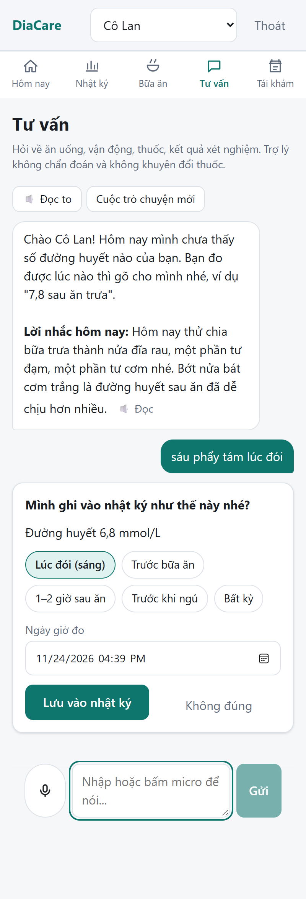{height=18cm}

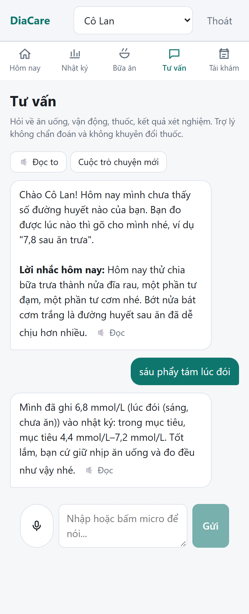{height=15cm}

## 3.16. Agent bữa ăn: ảnh khay cơm và tinh bột

Tệp `meal_scan.py` (agent) và `src/meal_ui.py` (trang **Bữa ăn**). Người dùng tải hoặc chụp ảnh khay cơm; agent gửi ảnh cho dịch vụ **Calo Khay** qua HTTP (`POST /api/scan`). Calo Khay là đồ án Xử lý ảnh số của nhóm: YOLO26s-seg đã tinh chỉnh khoanh vùng 44 món căng tin, DINOv2 phân loại lại từng vùng, YOLOE tìm đĩa, và gram mỗi món ước lượng theo diện tích món so với đĩa (sai số khoảng ±30% mỗi món). Calo Khay cần torch, ultralytics và transformers nên chạy như **một dịch vụ riêng** trong môi trường của nó (`chay_calo_khay.bat`, cổng 8010, SQLite, chạy được không cần mạng); DiaCare chỉ gọi HTTP. Trên GPU RTX 3050 Ti, mỗi ảnh mất 0,4–1 giây.

**Xác nhận trước khi lưu.** Kết quả hiện thành bảng sửa được: món mô hình chưa chắc (độ tin cậy dưới 0,75, hoặc ảnh không thấy đĩa) phải được tích "Đúng món" hoặc đổi tên theo gợi ý thì mới lưu được; gram sửa được; thêm hoặc xoá món được. Trang nhắc riêng về **cơm**: khi không bật ước lượng độ sâu, Calo Khay để cơm ở mức trung bình 228 g, mà cơm thường chiếm phần lớn tinh bột của khay.

**Tinh bột là một khoảng, tính bằng code.** Bảng `data/nutrition/calo_khay_carb.csv` (45 lớp) do `tools/build_carb_table.py` sinh từ cột carb của Nutrition5k `ingredients_metadata` (Thames và cộng sự, CVPR 2021; số liệu USDA FNDDS), cùng nguồn với cột kcal của Calo Khay. Script chỉ đọc số từ tệp đó; thứ duy nhất ghi tay là tỉ lệ pha trộn. Với người tiểu đường, ước **thấp** là chiều nguy hiểm, nên món mà nguồn chỉ có nguyên liệu chính (thịt kho, cá kho, gà sốt chua ngọt, giò chả có bột độn, tôm tẩm bột...) có thêm **cận trên** theo giả định ghi rõ (nước kho ngọt 10% khối lượng tính như sốt BBQ, bột độn 10% tính như tinh bột ngô...). Mục "spring rolls" của Nutrition5k chỉ 4% carb (như cuốn tươi), quá thấp cho nem rán có vỏ, nên nem rán dùng mục "egg rolls" (29%). Khoảng của một bữa:

$$\text{thấp} = \sum_i g_i (1 - e_i)\,c_i, \qquad \text{cao} = \sum_i g_i (1 + e_i)\,\bar c_i$$

với $g_i$ gram, $c_i$ carb chính, $\bar c_i$ carb cận trên, sai số gram $e_i$ = 30% (đo từ ảnh), 50% (gram "trung bình", như cơm 228 g: README của Calo Khay ghi sai số tổng khay khoảng 112 g khi không có độ sâu, cỡ một nửa phần cơm), 15% (người dùng tự sửa). Đồ uống ghi "chưa tính" vì trà sữa có thể nhiều tinh bột hơn cả khay. Ví dụ ảnh mẫu `B_212.jpg`: 6 món, khoảng 46–123 g tinh bột (rộng vì cơm đang để mức trung bình), 517 kcal (khớp tổng kcal của Calo Khay); sửa cơm thành 150 g thì còn khoảng 50–75 g. Trang ghi rõ đây là ước lượng để theo dõi, không dùng để tính liều insulin.

**Bữa không phải khay cơm (V4.9).** Calo Khay chỉ nhận ra 44 món căng tin. Bảng tinh bột có thêm 20 món người dùng tự chọn (phở bò, bún bò, bún chả, bánh cuốn, bánh mì thịt, bánh mì không, cháo trắng, cháo thịt, mì gói, xôi, khoai lang, ngô, yến mạch và chín loại quả), sinh bằng cùng script và cùng nguồn: mỗi món là hỗn hợp mục Nutrition5k theo một khẩu phần điển hình ghi trong cột ghi chú (ví dụ bát phở 600 g gồm 200 g bánh phở, 80 g thịt, 320 g nước dùng; cận trên khi nhiều bánh hơn), kcal tính từ cột `cal/g` của Nutrition5k. Nutrition5k không có gạo nếp, nên xôi có cận trên cao hơn hẳn (47 so với 28 g/100 g). Nút "Tự nhập món (không có ảnh)" mở bảng trống; món tự thêm được coi là đã xác nhận và tính sai số gram ±15%. Một bát phở bò 600 g ra khoảng 52–88 g tinh bột.

**Trên web (V4.9).** Trang **Bữa ăn** của Next.js làm đủ các bước. Trình duyệt không gọi thẳng Calo Khay: ảnh gửi cho API (`POST /meals/scan`, tối đa 10 MB, không lưu ảnh), API gọi Calo Khay; khoảng tinh bột tính ở máy chủ (`POST .../meals/estimate`, gọi lại mỗi khi sửa món hay gram) bằng đúng hàm của Streamlit. Trình duyệt gửi kèm gram mô hình đưa ra cho từng món, và máy chủ tự quyết định nguồn gram (bằng gram mô hình thì tính sai số của mô hình, khác thì tính là người dùng nhập). Trên điện thoại, ô chọn ảnh mở thẳng camera sau; mỗi món là một khung riêng vì bảng nhiều cột làm ô tên món bị ép còn một chữ ở bề rộng 400 px (lỗi thấy được nhờ ảnh chụp).

{height=21cm}

**Vùng món trên ảnh và ảnh trong ô chat (V4.9).** Bảng món có cột số thứ tự, và ảnh khay được vẽ lại với vùng từng món (đa giác Calo Khay trả về, tô màu trong suốt) cùng số tương ứng, để người dùng thấy ngay món nào bị nhận sai (ví dụ ruốc bị nhận thành gà xào sả ớt). Ảnh đính kèm ở ô chat của trang Tư vấn được thử đọc chữ (OCR) trước: đọc ra chỉ số xét nghiệm thì lưu như phiếu xét nghiệm, không thì chuyển sang trang Bữa ăn để nhận diện món.

**Gợi ý ăn uống từ đường huyết sau ăn (V4.9).** Hàm `meal_advice` (trong `meal_scan.py`) trả lời câu "nên hạn chế gì, ăn thêm gì" bằng code, từ các bữa đã ghi trong 14 ngày và lần đo sau mỗi bữa:

1. *An toàn trước.* Trong 24 giờ qua có số đo hạ đường huyết thì không khuyên ăn bớt tinh bột, chỉ nhắc ăn đủ bữa và báo bác sĩ.
2. *Thiếu dữ liệu thì nói thẳng.* Chưa ghi bữa nào, hoặc đã ghi bữa nhưng chưa đo sau ăn, thì nhắc đo. Khi thử thật, thẻ chỉ báo "chưa có lần đo nào" mà không nói vì sao: người dùng ghi bữa lúc 16:05 rồi ghi ngay số đo "1–2 giờ sau ăn" lúc 16:07, số đo đó không được ghép vì chỉ cách bữa 2 phút. Nay thẻ nói rõ từng trường hợp (`_timing_hints`): lần đo ghi "sau ăn" mà quá sát (dưới 45 phút) hoặc quá xa (hơn 3 giờ) bữa gần nhất thì ghi giờ đo, giờ ăn và lý do; bữa vừa ăn chưa có số đo thì ghi khung giờ nên đo, ví dụ "đo trong khoảng 16:50–19:05 (tốt nhất khoảng 18:05)". Thẻ cũng ghi rằng phiếu xét nghiệm không được tính, vì không biết lấy máu lúc nào so với bữa ăn.
3. *Nên hạn chế.* Trong các bữa có đường huyết sau ăn cao hơn mục tiêu, món góp từ 30% tinh bột của bữa trở lên được gộp theo món và xếp theo lượng tinh bột; mỗi món kèm gram trung bình, phần trăm tinh bột của bữa và gram gợi ý (bớt một phần ba, làm tròn 10 g). Chỉ nói "nhiều bữa" khi có từ hai bữa cao; một lần thì ghi rõ chưa đủ kết luận.
4. *Có thể ăn thêm.* Món ít tinh bột (dưới 7 g/100 g) trong bảng, chia nhóm rau và đạm, kèm số tinh bột trên 100 g; ưu tiên món đã có trong các bữa vẫn trong mục tiêu của chính người dùng.

Kết quả hiện thành thẻ "Gợi ý ăn uống" ở trang Hôm nay và Bữa ăn (Streamlit), trang Bữa ăn trên web (`GET .../meals/advice`), và được Journal agent thêm vào ngữ cảnh của Advisor với ngân sách riêng (`ADVICE_TOKEN_BUDGET`), kèm lời dặn giữ nguyên món và số. Câu trên thẻ là câu soạn sẵn. Thẻ luôn kèm lời nhắc: gram từ ảnh sai khoảng ±30% (cơm ±50%), đường huyết sau ăn còn phụ thuộc thuốc, vận động và cả bữa, nên hệ chỉ nói "món góp nhiều tinh bột nhất" chứ không nói "món này làm tăng đường huyết", và không dùng để chỉnh liều. Kho `kb/` chưa có hướng dẫn "đĩa ăn", nên phần "ăn thêm" chỉ dựa vào bảng tinh bột và dữ liệu của người dùng. Ví dụ với ba bữa trưa (cơm 300 g và 280 g, sau ăn 11,6 và 10,8 mmol/L; cơm 130 g kèm rau muống và trứng, sau ăn 7,9): "Nên hạn chế: cơm trắng khoảng 290 g, góp khoảng 81 g tinh bột (95% tinh bột của 2 bữa cao). Thử bớt còn khoảng 190 g", và "Món ít tinh bột đã có trong các bữa trong mục tiêu của bạn: rau muống, trứng luộc".

**Nối với đường huyết.** Bữa đã lưu ở bảng `meals` (danh sách món mã hoá như ghi chú). Bảng "Các bữa đã ghi" có cột "Đường huyết sau ăn" (lần đo 45 phút–3 giờ sau bữa); trong khoảng đó mà chưa đo thì trang nhắc đo. Các dòng này cũng vào ngữ cảnh của trang Tư vấn (mục 3.13).

# 4. Cơ sở dữ liệu

Tệp `db.py`, chạy trên SQLite (mặc định khi chạy trên máy, test, Kaggle) hoặc PostgreSQL (dịch vụ API trong Docker Compose, bật bằng `DIACARE_DATABASE_URL`). Lớp `pg.py` mô phỏng phần sqlite3 mà `db.py` dùng nên mã truy vấn giữ nguyên: tham số `?` đổi thành `%s`, câu INSERT được thêm `RETURNING id` thay cho `lastrowid`, `AUTOINCREMENT` thành cột IDENTITY, `REAL` thành `DOUBLE PRECISION` (`REAL` của PostgreSQL chỉ là float4), bool và số numpy đổi sang kiểu Python. Ràng buộc `REFERENCES` bị bỏ ở PostgreSQL vì SQLite của hệ chưa bao giờ bật kiểm tra khoá ngoại, để hai backend cư xử như nhau. `tools/sqlite_to_postgres.py` chép dữ liệu cũ sang, giữ nguyên id và dữ liệu đã mã hoá, chép kèm tệp khoá. Các bảng chính:

| Bảng | Nội dung | Cột chính |
|---|---|---|
| `users` | tài khoản đăng nhập (V4.1) | `email`, `password_hash`, `name` |
| `patients` | hồ sơ bệnh nhân | `name`, `profile_json`, `user_id` |
| `readings` | nhật ký tự đo (V4) | `patient_id`, `kind` (glucose, bp, weight), `value`, `value2`, `unit`, `context`, `measured_at`, `note` |
| `appointments` | lịch tái khám; lịch mới thay lịch cũ nhưng lịch cũ vẫn giữ | `patient_id`, `date`, `place`, `note` |
| `targets` | mục tiêu đường huyết riêng do bác sĩ đặt (V4.5); mỗi hồ sơ tối đa một dòng | `patient_id`, `pre_lo`, `pre_hi`, `post_max` (mg/dL), `note` |
| `doctor_questions` | câu muốn hỏi bác sĩ | `patient_id`, `text`, `done` |
| `sessions` | phiên hội thoại | `patient_id` |
| `messages` | tin nhắn | `session_id`, `role`, `content` |
| `memories` | sự kiện dài hạn | `patient_id`, `kind`, `content`, `active` |
| `labs` | kết quả xét nghiệm | `patient_id`, `test`, `value`, `unit`, `source` |
| `summaries` | bản tóm tắt lịch sử, dùng lại giữa các lượt | `session_id`, `upto_message_index`, `content`, `anchor` |
| `runs` | log từng lượt chạy | `question`, `risk`, `flags_json`, `sources_json`, `draft`, `final`, `usage_json`, `error`, `trace_json` |
| `rl_events` | quyết định của agent RL và phản hồi | `state_json`, `action`, `propensity`, `mode`, `policy_version`, `reward`, `rated_at` |
| `rl_model` | mô hình RL đã học tới hiện tại (một dòng) | `model_json` |
| `coach_events` | lời nhắc Q-learning mỗi ngày (V4.8) | `patient_id`, `day`, `state_json`, `action`, `learned_reward`, `feedback` (👍/👎, V4.9) |
| `coach_model` | bảng Q đã học tiếp (một dòng) | `model_json` |
| `checkins` | lượt trợ lý chủ động hỏi, mỗi người một lượt mỗi ngày (V4.9) | `patient_id`, `day`, `session_id`, `topic_json` (chỉ loại câu hỏi), `status` |
| `meals` | bữa ăn quét ảnh đã xác nhận (V4.9) | `patient_id`, `eaten_at`, `slot`, `items_json` (mã hoá), `carb_g`, `carb_low`, `carb_high`, `kcal` |

Bảng `runs` là nguồn dữ liệu cho các trang Lịch sử, Thống kê và Hoạt động agent. Cột `trace_json` được thêm ở V2.2, cột `messages.rl_event_id` ở V3.2 (nối câu trả lời với quyết định RL, để chấm và để phạt lặp); khi mở một cơ sở dữ liệu cũ, hệ tự thêm các cột này bằng `ALTER TABLE`. Song song với SQLite, mỗi lượt chạy còn được ghi một dòng JSON vào `logs/runs.jsonl`. Tệp này không mã hoá, nên từ V4.9 chỉ ghi độ dài câu hỏi (`question_chars`) chứ không ghi nguyên văn; đặt `DIACARE_LOG_QUESTIONS=1` khi chạy bộ câu hỏi mẫu cần đọc lại câu hỏi.

Cột `patients.user_id` nối hồ sơ với tài khoản: một tài khoản theo dõi được nhiều người (ví dụ con theo dõi cho bố mẹ), và mọi truy vấn của API đều lọc theo tài khoản đang đăng nhập. Số đo được lưu kèm `measured_at` (thời điểm đo, người dùng ghi bù được) tách khỏi `created_at` (lúc ghi), có chỉ mục theo `(patient_id, measured_at)` để thống kê 14 ngày đọc nhanh. Khi chạy dưới API, cơ sở dữ liệu được bật chế độ WAL để nhiều request đọc trong lúc một request ghi.

**Mã hoá cột (V4.6, `crypto.py`).** Các cột chữ chứa thông tin sức khoẻ được mã hoá bằng Fernet (AES-128-CBC kèm HMAC-SHA256): tên và hồ sơ trong `patients`, `messages.content`, `memories.content`, `summaries.content`, `runs.question/draft/final`, câu hỏi cho bác sĩ, và các cột ghi chú. Giá trị mã hoá có tiền tố `enc1:`; dòng cũ chưa mã hoá vẫn đọc được, nên không cần chuyển cơ sở dữ liệu. Khoá lấy từ biến `DIACARE_DB_KEY`, nếu không có thì sinh một lần vào tệp `<tên DB>.key` cạnh tệp DB (đã thêm vào `.gitignore`). Số đo, xét nghiệm và mức nguy cơ giữ dạng số để còn sắp xếp và tính thống kê. Fernet có thành phần ngẫu nhiên nên cột mã hoá không dùng được trong `WHERE ... = ?`; việc so trùng trí nhớ dài hạn vì vậy làm trong Python sau khi giải mã. Phạm vi bảo vệ: ai chỉ lấy được tệp `.db` (bản sao lưu, gửi nhầm) không đọc được nội dung; ai chiếm được cả máy thì có cả khoá. Tắt bằng `DIACARE_DB_ENCRYPT=0`. Tệp khoá mã hoá và khoá ký token (`api_secret.key`) được đặt quyền chỉ người dùng đang chạy đọc/ghi được (`restrict_to_owner`: `chmod 600` trên Linux; trên Windows bỏ quyền thừa kế và chỉ cấp cho người dùng hiện tại bằng `icacls`). Lý do: thư mục dữ liệu như `C:\DATA\...` thừa kế quyền đọc cho mọi tài khoản Windows trên máy, nên một tài khoản khác có thể đọc khoá, giả token và giải mã DB.

Nơi lưu thứ hai là **Neo4j**, dùng cho đồ thị tri thức khi đặt `DIACARE_KG=neo4j` (mục 3.7). Neo4j chạy trong container Docker riêng `diacare-neo4j`, cổng 7475 cho Neo4j Browser và 7688 cho bolt; dữ liệu nằm ở thư mục `neo4j_data/`. Mật khẩu được sinh ngẫu nhiên khi tạo container và lưu trong `neo4j.local.json`, tệp này không đưa lên repo. SQLite giữ dữ liệu của người dùng; Neo4j chỉ giữ tri thức chung, không có thông tin bệnh nhân nào.

# 5. Giao diện

Hệ có hai giao diện. Giao diện web Next.js (mục 5.6) dành cho người bệnh. Giao diện Streamlit (`src/app.py`) có hai chế độ, chọn bằng nút gạt "Chế độ nhà phát triển" ở thanh bên hoặc biến `DIACARE_DEV=1`:

- **Chế độ người dùng** (mặc định): năm trang Hôm nay, Nhật ký, Bữa ăn, Tư vấn, Tái khám (mục 5.5). Không hiện log agent, đồ thị hay số token.
- **Chế độ nhà phát triển**: thêm các trang Hoạt động agent, Lịch sử, Thống kê, và dưới mỗi câu trả lời hiện huy hiệu, nguồn, các bước agent, đồ thị tri thức đã dùng, chi tiết kỹ thuật (mục 5.1–5.4).

Các trang chọn bằng nút radio. Không dùng tab vì ô nhập chat của Streamlit chỉ ghim được xuống đáy màn hình khi nằm ở cấp ngoài cùng. Hồ sơ đánh dấu "đã được bác sĩ chẩn đoán" thì không hiện mức nguy cơ mắc bệnh.

## 5.1. Thanh bên

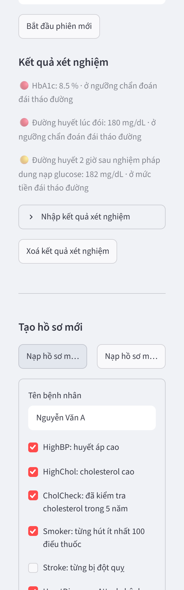{width=40%}

Thanh bên cho chọn bệnh nhân, bắt đầu phiên mới, xem và nhập kết quả xét nghiệm, xem và xoá thông tin bộ nhớ, tạo hồ sơ mới (có nút nạp hồ sơ mẫu nguy cơ thấp và cao).

## 5.2. Trang Tư vấn

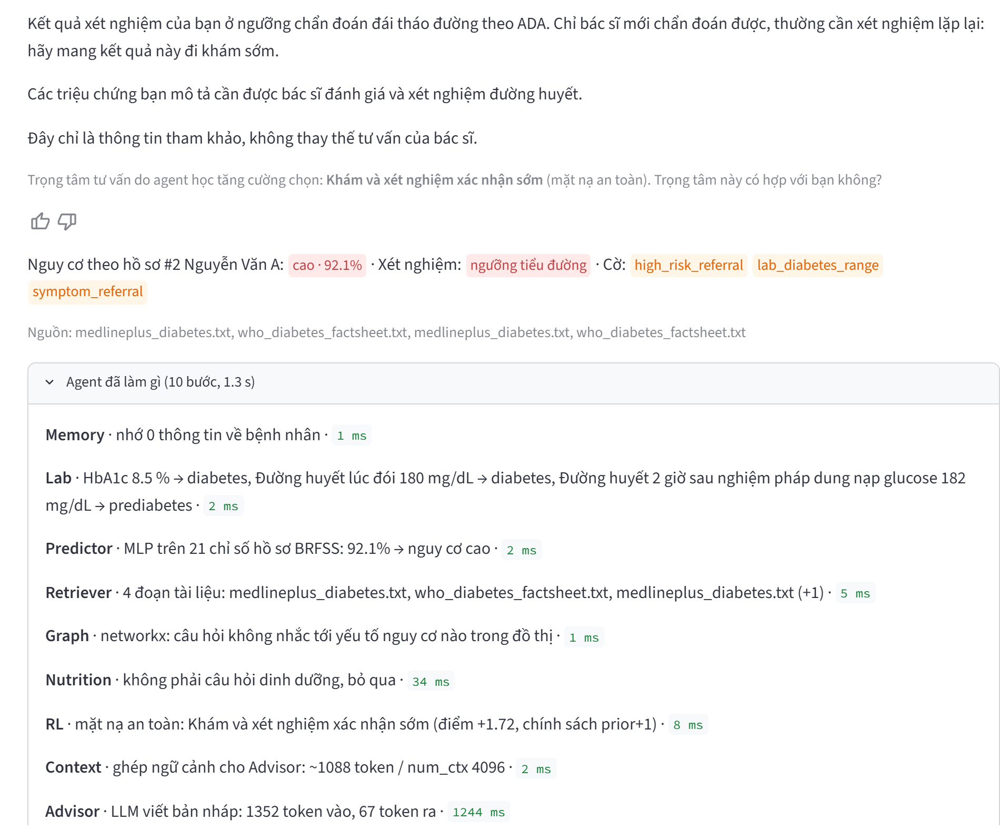{width=100%}

Khi người dùng gửi câu hỏi, một khung trạng thái hiện từng bước agent ngay khi bước đó xong, và câu trả lời hiện dần theo từng câu. Khi xong, mỗi câu trả lời có:

- dòng huy hiệu: nguy cơ theo hồ sơ (ghi rõ bệnh nhân nào và phần trăm), mức xét nghiệm, các cờ;
- dòng giải thích khi hồ sơ nguy cơ thấp nhưng xét nghiệm hoặc triệu chứng xấu;
- danh sách nguồn tài liệu;
- mục "Agent đã làm gì" với từng bước và thời gian;
- dòng "Trọng tâm tư vấn do agent học tăng cường chọn" kèm hai nút 👍/👎; bấm một lần là agent học ngay và hiện thông báo phiên bản chính sách mới, chấm rồi thì chỉ hiện kết quả đã chấm;
- mục "Đồ thị tri thức đã dùng" khi câu hỏi nhắc tới yếu tố nguy cơ (xem dưới);
- mục "Chi tiết kỹ thuật" với bản nháp gốc của mô hình, bảng dinh dưỡng nếu có, số token và thời gian.

**Khung "Đồ thị tri thức đã dùng"** cho thấy phần đồ thị mà Graph agent đã đọc để trả lời câu hỏi đó: sơ đồ đồ thị con (yếu tố bên trái, đái tháo đường típ 2 bên phải, ba loại cạnh tô ba màu), bảng liệt kê từng cạnh kèm nguồn, khối chữ thật sự gửi cho mô hình ngôn ngữ, và khi đọc từ Neo4j thì cả câu Cypher đã chạy. Nhờ khung này, người xem kiểm tra được câu trả lời dựa trên tri thức nào thay vì phải tin mô hình.

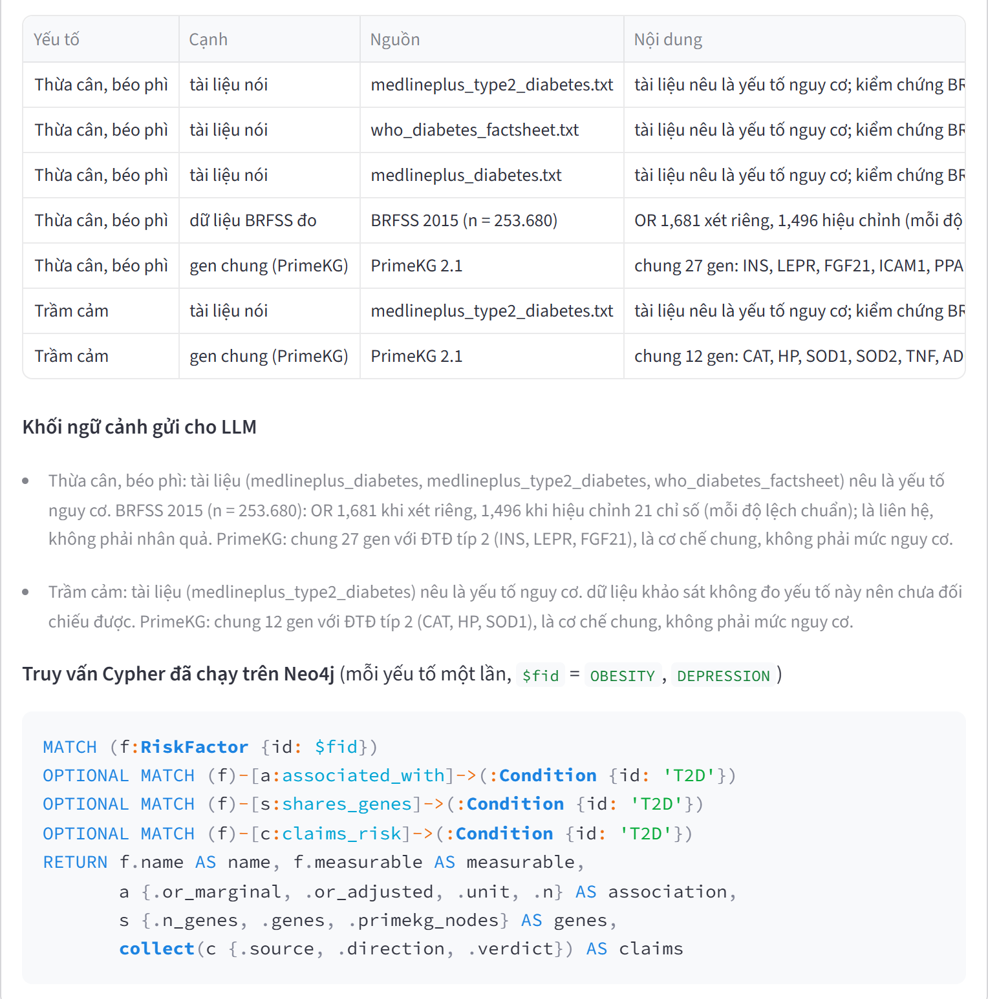{width=100%}

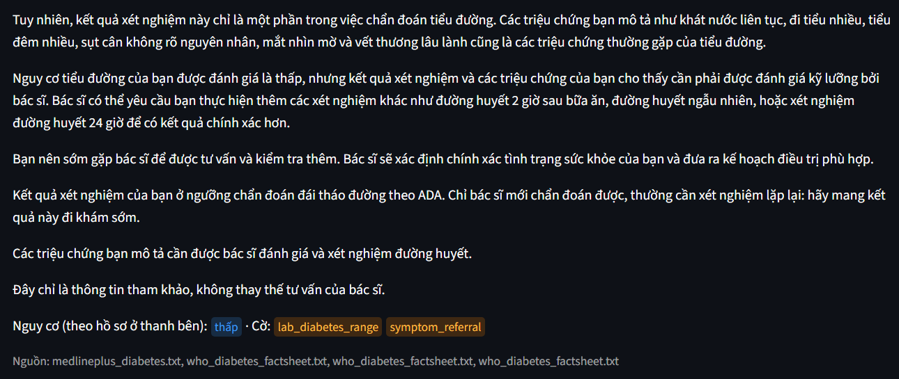{width=100%}

## 5.3. Trang Hoạt động agent

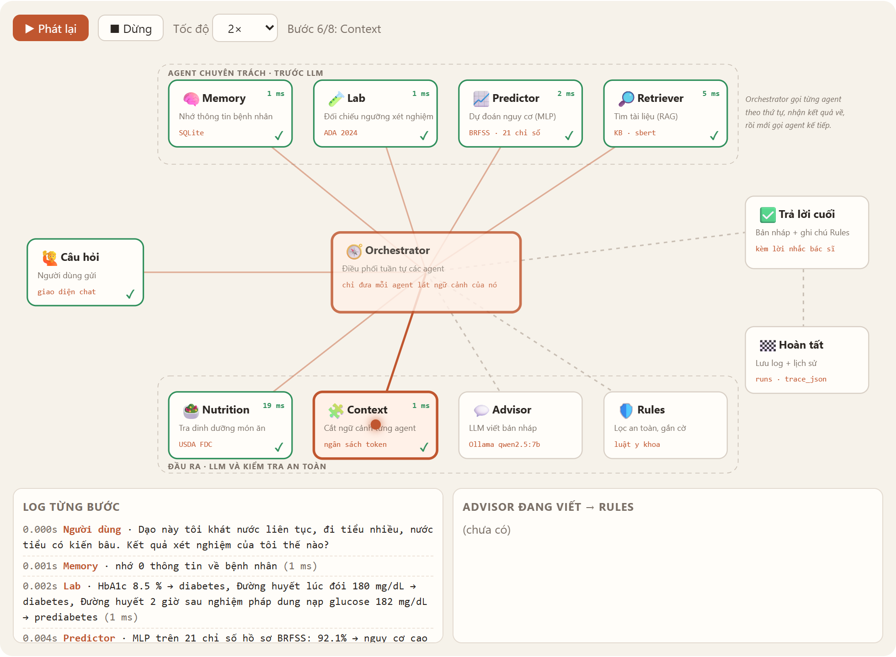{width=100%}

Trang này đọc vết thực thi đã lưu và phát lại thành sơ đồ động: chấm sáng đi từ Orchestrator tới từng agent theo thứ tự thật, agent đã xong có dấu kiểm và số mili giây, Advisor gõ dần bản nháp, Rules hiện cờ. Có nút phát lại, dừng, chọn tốc độ. Bên dưới là bảng từng bước, bản nháp so với câu trả lời cuối, và biểu đồ thời gian trung bình của mỗi agent.

Sơ đồ là một trang HTML với SVG và JavaScript thuần (tệp `flowviz.py`), nhúng bằng `st.iframe`. Dùng iframe vì `st.html` của Streamlit lọc mất cả SVG lẫn script. Dữ liệu log, gồm cả chữ do mô hình viết, chỉ được gán vào trang bằng `textContent`, không bao giờ dưới dạng HTML.

## 5.4. Trang Lịch sử và Thống kê

Lịch sử liệt kê mọi lượt chạy: thời gian, câu hỏi, mức nguy cơ, cờ, nguồn, lỗi. Thống kê hiển thị số lượt, số lỗi, token vào và ra trung bình, thời gian trung bình, biểu đồ tần suất các cờ, và khối "Agent học tăng cường": số quyết định, số phản hồi, phần thưởng trung bình đã nhận, ước lượng SNIPS của chính sách hiện tại, phần thưởng theo từng trọng tâm.

## 5.5. Các trang tự theo dõi trên Streamlit

- **Hôm nay**: cảnh báo và nhắc nhở ở đầu trang, ô ghi đường huyết (số lớn, chọn thời điểm đo bằng nút bấm), bốn ô số liệu 14 ngày (lần đo gần nhất, phần trăm trong mục tiêu, trung bình lúc đói, HbA1c gần nhất) và biểu đồ.
- **Nhật ký**: ba thẻ đường huyết, huyết áp và cân nặng, xét nghiệm; chọn khoảng 7, 14, 30 hoặc 90 ngày; bảng thống kê theo thời điểm đo; danh sách từng lần đo có nút xoá. Ở thẻ Xét nghiệm, chọn ảnh hay tệp phiếu là tự đọc và lưu ngay (V4.9). Bản trước chỉ đọc tệp khi bấm nút "Nhập kết quả" nằm dưới ô gõ chữ; người dùng chọn ảnh rồi chuyển trang thì Streamlit bỏ tệp đang chọn và không có gì được lưu (lỗi người dùng gặp khi chạy thật).

**Tốc độ chuyển trang (V4.9).** Người dùng thấy bấm qua lại giữa các trang chậm. Đo trên bản sao cơ sở dữ liệu thật: sau lần đầu, phía máy chủ chỉ mất 0,06–0,4 giây mỗi lần chuyển, trình duyệt khoảng 0,5 giây (Nhật ký khoảng 1 giây). Chỗ chậm là lần đầu mở từng trang: lần dự đoán đầu của mô hình nguy cơ (trang Tư vấn ở chế độ nhà phát triển, 1,8 giây), nạp thư viện altair cho `st.line_chart` (trang Thống kê, 2,4 giây), và trình duyệt tải phần giao diện của Streamlit (2–6 giây, chỉ lần đầu mỗi tab). Hai việc phía máy chủ nay được làm sẵn khi khởi động (`_warm_up` trong `app.py`; altair nạp ở luồng nền). Ảnh biểu đồ đường huyết (matplotlib) trước đây vẽ lại ở mọi lần chạy lại trang, kể cả khi chỉ bấm chuyển trang; nay được nhớ theo số liệu và ngày (`st.cache_data`). Phần trình duyệt là cách Streamlit hoạt động (chạy lại và vẽ lại cả trang mỗi lần bấm), giao diện web Next.js không có chi phí này.

Streamlit dùng chung một đối tượng Store (một kết nối SQLite) cho mọi phiên, nhưng mỗi phiên chạy trên một luồng riêng. Mở app ở hai tab cùng lúc thì con trỏ của luồng này đọc nhầm kết quả của luồng kia (`IndexError`, `InterfaceError`). Lớp `SerialStore` (`src/ui_common.py`) cho mỗi lời gọi phương thức của Store chạy trọn dưới một khoá chung.
- **Tái khám**: đặt lịch hẹn, ghi câu muốn hỏi bác sĩ, tải bản tóm tắt PDF.
- **Bữa ăn** (V4.9): ảnh khay cơm, bảng món để xác nhận, khoảng tinh bột, các bữa đã ghi kèm đường huyết sau ăn (mục 3.16).
- **Tư vấn**: ngoài khung chat, mỗi ngày trợ lý mở lời trước một lần cho người đã chẩn đoán, trả lời được bằng chữ hoặc giọng nói (mục 3.15).

Giờ đo ghi bù được nhưng không được ở tương lai (cho phép lệch đồng hồ 5 phút, `journal.validate_when`). API chặn từ đầu; form Streamlit thì chưa, cho tới khi một lần đo ghi giờ 19:06 lúc mới 16:08 làm thẻ gợi ý ăn uống tính sai (V4.9).

Lưu số đo dùng hàm callback của nút bấm chứ không xử lý sau khi bấm. Lý do: Streamlit chạy lại toàn trang từ trên xuống, nên nếu lưu ở giữa trang thì phần nhắc nhở ở đầu trang đã vẽ xong với dữ liệu cũ và vẫn báo "hôm nay bạn chưa đo".

## 5.6. Giao diện web Next.js

Thư mục `web/`, Next.js 16.4 với App Router, React 19.3, TypeScript 5.9. Ngoài ba gói đó không dùng thư viện nào: biểu đồ đường huyết tự vẽ bằng SVG và co theo bề rộng màn hình, kiểu dáng viết bằng CSS thuần với biến màu cho cả chế độ sáng và tối. Giao diện ưu tiên điện thoại: thanh điều hướng năm mục ở đáy màn hình (bốn mục trước V4.9), nút và ô nhập cao ít nhất 44 px, chữ số đo lớn.

Luồng sử dụng: đăng ký hoặc đăng nhập; lần đầu tạo hồ sơ theo dõi (một tài khoản tạo được nhiều hồ sơ, chọn ở thanh trên cùng); rồi dùng năm trang giống bản Streamlit (Hôm nay, Nhật ký, Bữa ăn, Tư vấn, Tái khám; trang Bữa ăn và trợ lý chủ động hỏi có từ V4.9). Token JWT được giữ trong `localStorage`. Trang Tư vấn đọc luồng SSE của API bằng `fetch` (vì `EventSource` không gửi được yêu cầu POST kèm token), hiện từng agent đang chạy, hiện chữ dần, rồi thay bằng câu trả lời cuối đã qua Rules.

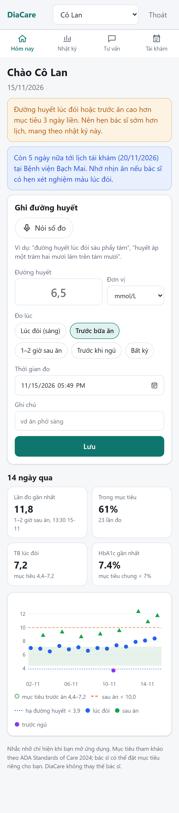{height=20cm}

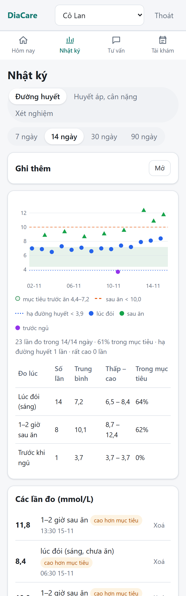{height=17cm}

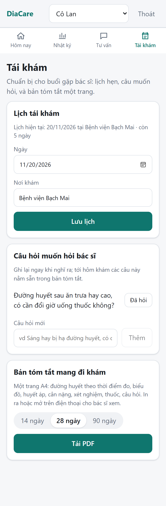{height=17cm}

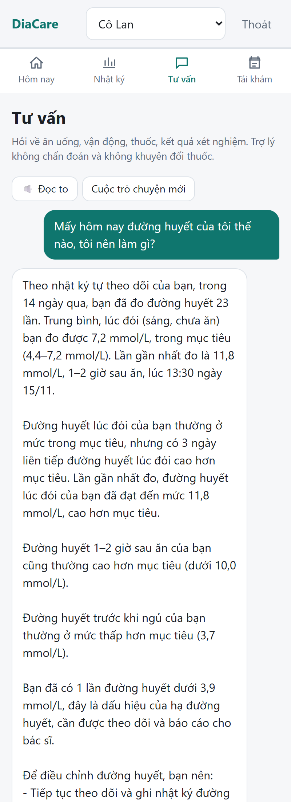{height=19cm}

Hai bổ sung ở V4.5 (chưa có trong các ảnh chụp ở trên):

- **Thẻ "Mục tiêu đường huyết" ở trang Tái khám.** Hiện mục tiêu đang dùng, cho nhập ba con số bác sĩ dặn và quay lại mục tiêu chung. Máy chủ kiểm tra giới hạn (mục 3.13); nhập 3,0 cho cận dưới thì nhận thông báo lỗi kèm khoảng cho phép. Lưu xong, ô "TB lúc đói" ở trang Hôm nay ghi "bác sĩ đặt 5,0–8,3" và dải xanh trên biểu đồ đổi theo.
- **Thẻ "Nhắc đo đường huyết" ở trang Hôm nay.** Người dùng chọn tối đa bốn mốc giờ; tới giờ mà trong hai giờ trước đó chưa có số đo nào thì trình duyệt hiện thông báo, bấm vào thì mở trang Hôm nay. Giờ nhắc lưu trong `localStorage` theo từng hồ sơ, không gửi lên máy chủ. Bộ hẹn giờ chạy ở mọi trang (`ReminderScheduler` trong layout), 30 giây kiểm tra một lần, mỗi mốc mỗi ngày nhắc một lần và chỉ nhắc muộn tối đa 90 phút. Thông báo đi qua một service worker tối thiểu (`public/sw.js`, không lưu đệm gì) vì Chrome trên Android không cho trang tự tạo thông báo. Đây **không phải** thông báo đẩy: không có máy chủ đẩy nên chỉ nhắc được khi DiaCare đang mở trên trình duyệt, kể cả ở tab nền. Trong trình duyệt thử nghiệm (quyền thông báo bị từ chối) đã kiểm được nhánh "bị chặn" và việc đăng ký service worker; phần logic chọn mốc tới hạn được kiểm bằng một script riêng; việc thông báo thật sự hiện ra chưa được thử trên điện thoại.

Bổ sung V4.9: trang Hôm nay hiện **"Lời nhắc hôm nay"** của Coach Q-learning (component `DailyNudge`) kèm nút 👍/👎 (mục 3.9); trang Tư vấn có trợ lý chủ động hỏi với thẻ xác nhận số đo (component `CheckinCard`, mục 3.15); thêm trang **Bữa ăn** (mục 3.16). Ảnh chụp bằng `docs/report/shots_web_v49.py` (Playwright, trên DB nháp, không gọi LLM).

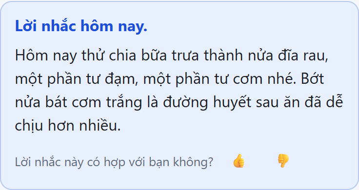{width=9cm}

# 6. Triển khai

## 6.1. Chạy trên máy cá nhân

```bash
pip install -r requirements.txt
ollama pull qwen2.5:3b
streamlit run src/app.py
```

Mô hình đã huấn luyện có sẵn trong `models/`. Muốn huấn luyện lại Predictor: tải dữ liệu theo `diacare_datasets/LINK_DATASET.md`, rồi chạy `python tools/build_multisource.py`, `python tools/train_multisource.py`, `python tools/train_aux_models.py` (khoảng 2 phút trên CPU).

Với GPU 4 GB (RTX 3050 Ti), mô hình 3B nằm gọn trong bộ nhớ GPU; mô hình 7B phải chạy một phần trên CPU nên chậm. Chế độ demo (`DIACARE_LLM=demo`, `DIACARE_EMBED=hash`) chạy được không cần Ollama.

Các biến môi trường chính: `DIACARE_LLM`, `DIACARE_MODEL`, `DIACARE_NUM_CTX`, `DIACARE_EMBED`, `DIACARE_MIN_SCORE`, `DIACARE_KB`, `DIACARE_DB`, `DIACARE_LOG`, `DIACARE_KG` (`memory` hoặc `neo4j`), `DIACARE_RL_EPSILON` (tỉ lệ thăm dò, mặc định 0,1), `DIACARE_PREDICTOR` (`multisource` mặc định hoặc `v1`), `DIACARE_DEV` (mở chế độ nhà phát triển của Streamlit), và `DIACARE_FEATURES`:

| Giá trị | Agent được bật |
|---|---|
| không đặt, hoặc `default` | nutrition, memory, labs, kg, rl, journal |
| `v2` | nutrition, memory, labs (nhãn cũ, không KG, không RL, không journal; giữ để so sánh benchmark) |
| `all` hoặc `v3` | thêm hybrid |
| `v1` | tắt hết |
| danh sách | ví dụ `v2,kg,rl,journal` |

Thêm `journal` vào mặc định không làm thay đổi kết quả benchmark cũ: các ca benchmark không có nhật ký nên agent Journal không thêm gì vào ngữ cảnh.

Dịch vụ API và giao diện web chạy ở hai cửa sổ:

```bash
uvicorn api.main:app --app-dir src --port 8000      # API, khoảng 30 giây để nạp mô hình
cd web && npm install && npm run dev                 # web ở http://localhost:3000
```

Biến riêng của API: `DIACARE_API_SECRET` (khoá ký token, ít nhất 32 ký tự; không đặt thì hệ tự sinh một lần vào `data/api_secret.key`, tệp này không lên repo), `DIACARE_CORS` (các origin được gọi API, mặc định `http://localhost:3000`), `DIACARE_ASR` (`demo` để thay PhoWhisper bằng bộ nhận dạng giả khi test), `HF_HOME` (thư mục lưu mô hình giọng nói, khoảng 970 MB). Web đọc địa chỉ API từ `NEXT_PUBLIC_API_URL`.

Trên Windows có sẵn các tệp bấm đúp: `chay_local.bat` (giao diện với Ollama, đủ mười một agent, đồ thị tri thức trong bộ nhớ), `chay_cli.bat` (chat trong terminal), `chay_kg.bat` (bật thêm Neo4j trong Docker và cho Graph agent đọc từ đó). Huấn luyện lại chính sách khởi động: `python tools/build_rl_states.py` (cần tệp BRFSS) rồi `python tools/train_rl.py`.

## 6.2. Dịch vụ API

Tệp `src/api/main.py` (ứng dụng), `src/api/security.py` (mật khẩu và token). Hàm `create_app(db_path, parts, secret, clock, ...)` dựng ứng dụng; các tham số cho phép test truyền cơ sở dữ liệu tạm, mô hình ngôn ngữ giả và đồng hồ cố định. Tài liệu tương tác ở `/docs` (Swagger), có nút Authorize dùng luồng OAuth2 password.

| Nhóm | Endpoint chính |
|---|---|
| Tài khoản | `POST /auth/register`, `POST /auth/token`, `GET /me` |
| Hồ sơ | `GET/POST /patients`, `GET/PATCH /patients/{id}`, `GET/DELETE .../memories` |
| Nhật ký | `POST .../readings/glucose`, `.../bp`, `.../weight`; `GET/DELETE .../readings`, `GET .../today` (kèm lời nhắc Q-learning), `POST .../nudge/feedback`, `GET .../summary?days=14`, `GET/PUT/DELETE .../targets` |
| Xét nghiệm | `GET/POST .../labs` (văn bản), `POST .../labs/file` (ảnh, PDF, tối đa 10 MB) |
| Tái khám | `GET/PUT .../appointment`, `GET/POST .../questions`, `GET .../visit-report.pdf` |
| Tư vấn | `POST .../chat`, `GET .../sessions`, `GET .../sessions/{sid}/messages`, `POST /feedback/{event_id}` |
| Giọng nói | `POST /transcribe` |
| Trợ lý chủ động hỏi (V4.9) | `POST .../checkin/open`, `.../checkin/reply`, `.../checkin/save`, `.../checkin/cancel` |
| Bữa ăn (V4.9) | `GET /meals/dishes`, `POST /meals/scan`, `POST .../meals/estimate`, `GET/POST .../meals`, `DELETE .../meals/{mid}` |

**Bảo mật.** Chỉ dùng thư viện chuẩn của Python, không thêm gói ngoài:

- Mật khẩu băm bằng scrypt (`hashlib.scrypt`) với muối ngẫu nhiên, lưu dạng `scrypt$n$r$p$muối$băm` để đổi tham số sau này mà không làm hỏng mật khẩu cũ. So sánh bằng hàm thời gian hằng.
- Token là JWT HS256 tự viết khoảng 40 dòng, hạn 7 ngày. Bộ giải mã chỉ nhận đúng `alg` là HS256 (chặn kiểu tấn công `alg: none`), bắt buộc có `sub` và `exp`, so chữ ký bằng `hmac.compare_digest`.
- Mỗi tài khoản chỉ thấy hồ sơ của mình. Hồ sơ của người khác trả về 404 chứ không phải 403, để không lộ rằng hồ sơ đó tồn tại.
- Khoá ký được đọc khi ứng dụng khởi động chứ không phải lúc import, để test và công cụ tạo tài liệu import được ứng dụng mà không cần khoá.

**Chat qua SSE.** Với `"stream": true`, `/chat` trả về luồng sự kiện: `session` (mã phiên), `step` (mỗi agent vừa xong), `token` (phần chữ mới đã qua `SafeStream`), rồi `done` (kết quả cuối) hoặc `error`. Giao diện phải thay phần chữ đang hiện bằng câu trả lời trong `done`, vì Rules có thể bỏ bớt câu hoặc thay cả bản nháp. Các lượt chat chạy lần lượt dưới một khoá, vì Ollama trên một GPU cũng chỉ trả lời từng câu một và agent RL cần cập nhật mô hình tuần tự.

**Mỗi request một kết nối.** Phần nặng (`Parts`: Predictor, Retriever, mô hình ngôn ngữ, đồ thị, chính sách RL khởi động) dựng một lần. Các agent có trạng thái (Memory, Lab, Journal, RL) được dựng lại cho từng lượt bằng `orchestrator_from_parts` và gắn với kết nối DB của request đó, nên không có trạng thái dùng chung giữa các request.

**Nhiều lượt tư vấn song song (V4.7).** Trước đây mọi lượt tư vấn chạy tuần tự dưới một khoá chung của cả dịch vụ: người thứ hai phải chờ người thứ nhất xong. Bỏ khoá đó cần sửa hai chỗ dùng chung giữa các luồng: đối tượng mô hình ngôn ngữ ghi số token của lượt vừa gọi vào `last_usage`, và `compress_history.last_mode` là thuộc tính của hàm; cả hai giờ được lưu riêng cho từng luồng (`threading.local`). Số lượt chạy cùng lúc giới hạn bằng semaphore `DIACARE_CHAT_CONCURRENCY` (mặc định 4); hết suất thì chờ tối đa 120 giây rồi trả 503. Hai lượt trong cùng một phiên vẫn chạy lần lượt để lượt sau thấy đủ lịch sử. Phản hồi 👍/👎 đọc-sửa-ghi mô hình RL dưới khoá `rl-model`: advisory lock của PostgreSQL (đúng cả khi chạy nhiều tiến trình) hoặc khoá trong tiến trình với SQLite. Test kiểm chứng bằng một LLM giả có barrier hai bên: barrier chỉ qua được khi hai lượt thật sự cùng ở trong LLM; khi chỉ cho 1 lượt chạy cùng lúc (tương đương khoá chung cũ) test này thất bại.

**Chống lạm dụng (V4.7).** Đăng nhập sai 5 lần cho một email hoặc 30 lần từ một IP trong 15 phút thì trả 429 kèm `Retry-After`, như nhau dù email có tài khoản hay không, kiểm tra trước khi băm scrypt; mỗi IP tạo tối đa 20 tài khoản mỗi giờ. Không khoá cứng tài khoản vì kẻ xấu có thể dùng việc đó để khoá người khác. Tệp xét nghiệm tải lên: PDF tối đa 10 trang; ảnh tối đa 50 triệu điểm ảnh, kiểm tra kích thước từ phần đầu tệp trước khi giải nén (một PNG 20000×20000 chỉ vài KB nhưng giải nén ra 400 triệu điểm ảnh); trang PDF scan kết xuất tối đa 12 triệu điểm ảnh (một trang khai báo khổ 200 inch ở 200 dpi ra ảnh 40000×40000). Vượt giới hạn trả 413.

## 6.3. Chạy trên Kaggle

Hai notebook được sinh tự động bằng script và đẩy lên bằng Kaggle CLI:

- **Notebook giao diện** (`kaggle/build_app_notebook.py`): giải nén mã nguồn nhúng sẵn, cài thư viện, cài Ollama với `OLLAMA_KEEP_ALIVE=-1`, tải mô hình, chạy thử một câu, khởi động Streamlit, tải `cloudflared` và mở đường hầm `*.trycloudflare.com`, rồi giữ phiên trong 6 giờ. Ô đầu tiên in mã commit của mã nguồn để người dùng biết mình đang chạy phiên bản nào.
- **Notebook benchmark** (`kaggle/build_notebook.py`): chạy bộ ca trên một hoặc nhiều mô hình và cấu hình, xuất báo cáo Markdown, JSON và biểu đồ.

Notebook nhận biết hai chế độ chạy qua biến `KAGGLE_KERNEL_RUN_TYPE`. Khi đẩy từ dòng lệnh, Kaggle chạy ở chế độ nền (Batch); notebook giao diện khi đó chỉ chạy kiểm tra rồi dừng, không mở đường hầm. Giao diện thật chỉ mở khi người dùng bấm Run All trong trình duyệt.

Một vấn đề đã gặp: trình soạn của Kaggle giữ bản nháp riêng của người dùng, nên sau khi đẩy phiên bản mới, mở lại notebook đôi khi vẫn thấy mã cũ. Dòng mã commit ở ô đầu là cách kiểm tra nhanh nhất.

**Chỉ chạy mô hình 7B trên Kaggle, giao diện ở máy mình (V4.9).** GPU 4 GB của máy phát triển chỉ chạy nhanh bản 3B. Notebook thứ ba (`kaggle/build_ollama_notebook.py`) chỉ chạy Ollama với `qwen2.5:7b` trên GPU T4 và mở đường hầm Cloudflare; giao diện và dữ liệu vẫn ở máy mình. Trước Ollama là một **cổng chặn** (`ollama_gate.py`, thư viện chuẩn) đòi `Authorization: Bearer <token>` (so bằng `hmac.compare_digest`), chỉ cho qua `/api/chat`, `/api/tags`, `/api/version`, chuyển tiếp luồng NDJSON theo từng đoạn để chữ vẫn hiện dần. Hai lỗi chỉ gặp khi chạy thật đã được sửa: trả lỗi 401 mà còn sót phần thân yêu cầu trên kết nối giữ sống thì Cloudflare dùng lại kết nối đó và yêu cầu kế tiếp hỏng (nay mọi câu trả lời lỗi đều đóng kết nối); và log của lần chạy trước vẫn còn trong `kaggle kernels logs`, nên có lần đọc nhầm link đã chết (nay mỗi lần đẩy có một mã riêng in kèm link).

Toàn bộ chạy bằng Kaggle CLI: `python tools/kaggle_llm.py up` đóng gói notebook (nhúng token sinh một lần, lưu ở `kaggle/ollama_token.local`, không lên git), đẩy lên ở chế độ nền, chờ GPU, đọc link trong log, gọi thử, lưu phiên; `down` bảo notebook tự tắt; notebook cũng tự tắt khi không có yêu cầu nào trong 20–30 phút. `chay_kaggle.bat` làm cả chuỗi rồi mở Streamlit dùng 7B. Đo thật: lần không phải xếp hàng sẵn sàng sau 3,8 phút, lần phải chờ GPU mất 23 phút; câu đầu tiên bắt đầu hiện chữ sau khoảng 12 giây, các câu sau khoảng 1 giây, khoảng cách lớn nhất giữa hai đoạn chữ 0,15 giây. Mỗi lượt hỏi, lời nhắn gửi cho mô hình (gồm hồ sơ và nhật ký đã tóm tắt) đi qua Internet tới Kaggle, nên đây là cách cho demo và benchmark, không dùng cho dữ liệu người bệnh thật.

**Khi đường hầm treo (V4.9).** Benchmark 7B có một yêu cầu treo hết thời gian chờ 300 giây, trong khi lượt bình thường mất khoảng 7 giây, và người dùng chỉ thấy "Hệ thống đang gặp sự cố". Nay khi có token (tức Ollama ở xa), `OllamaLLM` chỉ chờ 90 giây cho mỗi lần đọc (Ollama trên máy vẫn 300 giây vì lần nạp mô hình đầu có thể lâu; đổi bằng `DIACARE_OLLAMA_TIMEOUT`). Hết thời gian chờ, mất kết nối, hay Cloudflare trả 502/503/504/530 (notebook đã tắt) đều thành lỗi `LLMUnavailable` với một câu viết cho người dùng, ví dụ "Máy chủ mô hình từ xa (Kaggle) không trả lời trong 90 giây… kiểm tra notebook Kaggle hoặc chuyển sang mô hình trên máy"; Orchestrator hiện đúng câu đó thay cho câu chung, cờ `system_error` giữ nguyên. Test dựng một máy chủ nhận kết nối mà không trả lời để kiểm tra đường hết thời gian chờ.

## 6.4. Docker Compose

Tệp `docker-compose.yml` ở gốc repo dựng ba dịch vụ bằng một lệnh `docker compose up --build`:

| Dịch vụ | Ảnh | Ghi chú |
|---|---|---|
| `ollama` | `ollama/ollama` | chỉ mở trong mạng Docker; model nằm trong volume `ollama-models` |
| `ollama-pull` | `ollama/ollama` | chạy một lần rồi thoát: tải model (`DIACARE_MODEL`, mặc định qwen2.5:3b, khoảng 1,9 GB) |
| `db` | `postgres:16-alpine` | không mở cổng ra ngoài mạng Docker; dữ liệu trong volume `pg-data`; mật khẩu lấy từ `POSTGRES_PASSWORD` trong tệp `.env` (không lên git) |
| `api` | `Dockerfile` (python 3.13-slim, torch bản CPU) | cổng 8000; kết nối `db` qua `DIACARE_DATABASE_URL`; khoá mã hoá DB và khoá ký token trong volume `diacare-data`; mô hình Hugging Face trong volume `hf-cache` |
| `web` | `web/Dockerfile` (node 22, dựng hai tầng) | cổng 3000; `NEXT_PUBLIC_API_URL` được ghi vào mã lúc dựng |

Vài quyết định đáng ghi lại:

- API tìm Ollama qua biến mới `DIACARE_OLLAMA_URL` (trong Compose là `http://ollama:11434`); không đặt thì vẫn là `localhost:11434` như trước.
- `scikit-learn` được ghim đúng bản 1.8.0 trong `requirements-api.txt`, vì tệp `predictor_ms.joblib` được lưu bằng bản này.
- Cổng 8000 và 3000 chỉ mở trên `127.0.0.1`. API chạy bằng người dùng thường trong container. Khoá ký token không nằm trong tệp Compose: để trống thì hệ tự sinh vào volume, muốn tự đặt thì khai báo trong `.env`.
- Phụ thuộc của `api` vào `ollama` đặt `required: false`, nên chạy thử không cần mô hình ngôn ngữ được bằng `DIACARE_LLM=demo DIACARE_EMBED=hash docker compose up -d --build --no-deps api web`. Cần `--no-deps`: không có cờ này, Compose vẫn kéo ảnh `ollama/ollama` (khoảng 3,2 GB) dù không chạy nó.

**Tình trạng kiểm chứng (V4.6).** Hai ảnh `api` và `web` đã được dựng và chạy thử ở chế độ demo trên Docker Desktop 28.3: ảnh `api` 2,2 GB (phần lớn là torch bản CPU và các gói Hugging Face), ảnh `web` 755 MB. Lần dựng đầu `npm ci` đứt mạng (ECONNRESET), dựng lại thì qua. Trong container: `/health` trả 200; trang web chuyển hướng tới `/today`; đăng ký, tạo hồ sơ, `GET /patients/{id}/risk-models` và một lượt chat đều chạy, lượt chat đi đủ các bước từ Memory tới Rules, có cả Critic; đọc thẳng tệp SQLite trong volume thấy tên, hồ sơ và tin nhắn đều ở dạng `enc1:...`. Dịch vụ `ollama` (ảnh 3,2 GB và model 1,9 GB) chưa được chạy thử trong Compose; lần thử kéo ảnh bị đứt mạng giữa chừng.

Volume `diacare-data` gắn vào `/app/var` từ V4.6. Trước đó volume gắn vào `/app/data`, trùng thư mục chứa bảng dinh dưỡng của ảnh: lần chạy đầu Docker chép bảng vào volume, và các bản dựng sau vẫn đọc bảng cũ trong volume. Khoá ký token nay nằm cạnh tệp DB. Đã thử nâng cấp trên volume cũ: token cũ vẫn dùng được, hồ sơ cũ vẫn giải mã được, bảng dinh dưỡng đọc từ ảnh.

## 6.5. MCP server

Tệp `src/diacare/mcp_server.py`. **MCP** (Model Context Protocol) là chuẩn mở để ứng dụng AI (Claude Desktop, Claude Code, VS Code...) gọi công cụ và đọc dữ liệu bên ngoài. Bên trong DiaCare, các agent gọi nhau bằng hàm Python và dùng chung `State`; MCP là chuẩn giao tiếp **giữa các hệ thống**. Server mở sáu công cụ và kho tài liệu:

| Công cụ | Làm gì |
|---|---|
| `check_lab` | đối chiếu HbA1c, đường huyết với ngưỡng ADA 2024 (mục 3.4) |
| `search_guidelines` | tìm đoạn tài liệu MedlinePlus/WHO trong `kb/`, kèm tên nguồn (mục 3.6) |
| `risk_factor_evidence` | tài liệu nói gì và BRFSS đo được gì về một yếu tố nguy cơ (mục 3.7) |
| `food_nutrition` | carb, kcal món Việt trong câu (mục 3.8) |
| `tray_carbs` | khoảng tinh bột của một khay cơm (mục 3.16) |
| `predict_risk` | mức nguy cơ từ 21 chỉ số BRFSS (mục 3.5) |

Tài liệu trong `kb/` mở dưới dạng resource `kb://<tên tệp>`, chỉ đọc được tệp có trong danh sách (đường dẫn kiểu `kb://../data/...` bị từ chối).

Hai quyết định thiết kế. **Chỉ mở công cụ tất định**: không có công cụ "tư vấn" chạy cả pipeline, vì khi đó mô hình bên ngoài sẽ viết lại câu trả lời và **lớp Rules an toàn bị bỏ qua**. **Không mở dữ liệu người bệnh** (nhật ký, trí nhớ, hội thoại), vì chúng đang được mã hoá trong DB và MCP qua stdio không có xác thực. Server chạy qua **stdio** nên chỉ nằm trên máy, không mở cổng mạng. Giao thức (JSON-RPC 2.0, mỗi dòng một bản tin: `initialize`, `tools/list`, `tools/call`, `resources/list`, `resources/read`, `ping`) được viết bằng thư viện chuẩn, khoảng 250 dòng, không cần gói `mcp`; stdout chỉ dành cho bản tin, mọi thứ thư viện in ra bị chuyển sang stderr. Lỗi do đầu vào (không đọc được xét nghiệm, hồ sơ thiếu chỉ số) trả về như kết quả có `isError` để mô hình đọc được, không phải lỗi giao thức. Test chạy server như host thật chạy: một tiến trình riêng, bản tin JSON qua stdin/stdout. Khai báo cho Claude Desktop:

```json
{"mcpServers": {"diacare": {"command": "python", "args": ["-m", "diacare.mcp_server"],
                            "env": {"PYTHONPATH": "C:/DATA/diacare-mas/src"}}}}
```

# 7. Kiểm thử và đánh giá

## 7.1. Unit test

1.032 test trong 45 tệp, chạy bằng `pytest` trong khoảng hai phút, không cần GPU, mạng hay mô hình giọng nói. Lần chạy gần nhất (V4.9, 25/11/2026) trên SQLite: 1.022 đạt, 7 bỏ qua (1 test đọc Neo4j khi máy không chạy Neo4j, 5 test riêng cho PostgreSQL khi không đặt `DIACARE_TEST_PG_URL`, 1 test cần giọng đọc Piper đã tải (đặt `DIACARE_TTS_MODEL`)), 3 test `xfail` ghi các cách nói lọt luật đã biết (mục 3.12). Đặt `DIACARE_TEST_PG_URL` thì cả bộ test chạy lại trên PostgreSQL: mỗi `Store` trong test được chuyển sang một schema riêng (`tests/conftest.py`); đã chạy với PostgreSQL 16 trong WSL, kết quả ghi ở phần hạn chế. Phân bố dưới đây là lúc còn 611 test; V4.6 thêm bộ thử tấn công (`test_injection.py`, 67), Critic (7), mã hoá (4), cùng các test chạy song song, so sánh hai mô hình dự đoán và mẫu luật mới. Phân bố theo tệp test (đã tính tham số hoá): rules 106, memory 86, nutrition 67, journal 36, bench 36, labs 31, orchestrator 27, speech 23, api 21, retriever 17, eval 17, kg 16, app 16, rl 14, factory 12, db 11, context 8, graph agent 8, llm 7, metrics 7, cli 6, ocr 6, contracts 5, typewriter 5, predictor 5, benchmark CLI 4, kb 4, advisor 3, flowviz 3, retrieval eval 3, model 1. Ngoài ra giao diện web được kiểm tra kiểu bằng `tsc` và dựng thử bằng `next build`.

Test của đồ thị tri thức kiểm tra: trích đúng khẳng định từ tài liệu (và không nhận nhầm câu về biến chứng), bốn loại kết luận kiểm chứng, cạnh gen chung tách riêng và không làm đổi kết luận kiểm chứng, tệp Cypher chỉ dùng `MERGE`, đồ thị con cho giao diện, và câu Cypher hiện ra khi đọc từ Neo4j. Một test đọc đồ thị thật từ Neo4j sẽ tự bỏ qua khi máy không chạy Neo4j.

Test của bộ nhớ kiểm tra thêm: tắt thông tin thuốc khi người dùng nói đã ngừng (và không tắt khi đó là câu hỏi hay nói về người thân), dùng lại bản tóm tắt đã lưu mà không gọi mô hình, tóm tắt tăng dần khi lịch sử dài thêm, và bỏ qua bản tóm tắt có dấu nhận dạng không khớp.

Test của agent RL kiểm tra: phân bố trạng thái đúng tổng 253.680 người, phần thưởng tiên nghiệm nằm trong $[-1, 1]$, chính sách khởi động hơn các mốc trên trạng thái mới, mặt nạ an toàn giữ "khám sớm" kể cả khi thăm dò 100%, propensity ghi đúng, 👍 làm tăng và 👎 làm giảm điểm của chính sách đã phát hành, mỗi phản hồi chỉ học một lần và còn nguyên sau khi mở lại, người dùng mô phỏng kéo được chính sách đi, và phạt lặp đọc được hành động lượt trước từ cơ sở dữ liệu.

Test của nhật ký dùng một mốc thời gian cố định và kiểm tra: phân loại theo mục tiêu (không theo ngưỡng chẩn đoán), đổi đơn vị và bắt lỗi gõ 120 với đơn vị mmol/L, thống kê theo thời điểm đo, so sánh hai kỳ, cờ "cao 3 ngày liền", cảnh báo chỉ lấy 24 giờ gần nhất, nhắc lịch khám, bản PDF đọc lại được bằng pypdf và có đủ các mục, bản tóm tắt cho Journal có nhận định đúng (kể cả hạ đường huyết lúc trước khi ngủ), và khối nhật ký bị cắt dòng khi vượt ngân sách.

Test của API dùng `TestClient` với mô hình giả và đồng hồ cố định: đăng ký, đăng nhập, token hết hạn, token sai chữ ký, `alg: none`; người này không đọc được hồ sơ người kia (404); ghi và đọc số đo, từ chối số đo ở tương lai và sai đơn vị; chat dạng JSON và dạng SSE (đúng thứ tự sự kiện); chat lưu bộ nhớ vào đúng cơ sở dữ liệu; Journal xuất hiện trong các bước khi đã có nhật ký; phản hồi chỉ chấm được một lần; PDF trả đúng kiểu tệp. Test của giọng nói kiểm tra giải mã WAV (đổi tần số, gộp kênh, từ chối đoạn quá ngắn, im lặng, quá dài), đọc số bằng chữ, và trường hợp "sáu tám" phải trả về hai lựa chọn.

Bộ thử tấn công (`test_injection.py`) thử riêng ba lớp: 14 câu hỏi tấn công tiếng Việt và tiếng Anh phải bị gắn cờ, 10 câu bình thường dễ nhầm ("bác sĩ dặn tôi bỏ qua bữa phụ", "có nên bỏ thuốc lá") không bị gắn cờ; đoạn tài liệu bị chèn lệnh bị loại; 18 câu của một mô hình giả định đã bị lái (gồm 8 câu cố lách khung cảnh báo) phải bị Rules loại. Một test đầu-cuối ghép cả ba: câu hỏi tấn công, kho bị chèn và mô hình bị lái; câu trả lời cuối phải an toàn, đoạn bị chèn không tới được Advisor và đủ ba cờ.

Test giao diện dùng `streamlit.testing.v1.AppTest` với mô hình giả: tạo bệnh nhân, chat, nhập xét nghiệm, kiểm tra huy hiệu, chuyển trang, xem trang Hoạt động agent. Nhiều test được viết từ chính những lỗi gặp phải: câu "tiểu đường" không được tạo bảng dinh dưỡng, câu chào không được hiện nguy cơ, cơ sở dữ liệu cũ phải tự thêm các cột mới.

## 7.2. Benchmark hội thoại

Bộ ca `eval/cases.json` có 62 ca thuộc 12 nhóm: ăn uống, vận động, nguy cơ cao, nguy cơ thấp, triệu chứng, cấp cứu, thuốc, ngoài chủ đề, dinh dưỡng, bộ nhớ, xét nghiệm, nhật ký. Mỗi ca khai báo hồ sơ, lịch sử (nếu cần), câu hỏi, và các tiêu chí: cờ phải có, cờ không được có, từ phải xuất hiện trong bản nháp, từ phải xuất hiện trong câu trả lời cuối.

Bản nháp được chấm bốn tiêu chí chung: có trích nguồn đã truy hồi (hoặc `[usda_fdc]`, `[ada_2024]` khi có dữ liệu tương ứng), không có lời khuyên đổi thuốc, có nhắc bác sĩ, và đúng tiêu chí riêng của ca. Chấm trên bản nháp chứ không chấm câu trả lời cuối, vì câu cuối luôn có ghi chú của Rules và sẽ che mất lỗi của mô hình.

Mỗi ca chạy $k = 3$ lần. Báo cáo gồm Pass@3 (ca đạt ít nhất một lần), Pass^3 (ca đạt cả ba lần), tỉ lệ đạt từng lượt với khoảng tin cậy Wilson 95%, số token, độ trễ trung bình, trung vị và phân vị 95.

Công cụ `eval/rescore.py` chấm lại các bản nháp đã lưu bằng bộ chấm hiện tại mà không gọi lại mô hình, dùng khi sửa lỗi bộ chấm.

**Ca có nhật ký (V4.5).** Mười hai ca nhóm `journal` khai báo thêm trường `journal`: danh sách số đo đường huyết (số ngày trước, giờ, thời điểm đo, mmol/L), huyết áp, cân nặng và số ngày tới lịch tái khám. Thời gian tính lùi từ lúc chạy nên ca không bị cũ. Trước mỗi lượt, bộ chạy tạo một hồ sơ mới và ghi các số đo này vào cơ sở dữ liệu của agent Journal, để số đo của ca này không lọt sang ca khác. Số liệu được chọn sao cho con số cần kiểm tra là số tròn (trung bình 8,3 mmol/L, huyết áp 142/88, giảm 1,5 kg), và một test kiểm tra rằng các con số đó có thật trong bản tóm tắt đưa cho mô hình và không dòng nào bị cắt vì ngân sách token. Tiêu chí riêng dùng trường mới `draft_groups`: mỗi nhóm cụm từ cần ít nhất một cụm xuất hiện trong bản nháp, ví dụ một nhóm cho con số ("8,3" hoặc "8.3") và một nhóm cho nhận định ("cao hơn mục tiêu", "vượt mục tiêu"...). Ca cuối có hồ sơ nhưng chưa ghi gì: trợ lý phải nói là chưa có số liệu. Tắt agent Journal thì các ca này chạy như người chưa ghi nhật ký, nên so được hai cấu hình trên cùng bộ ca (kết quả ở mục 7.5). Các ca được sinh bằng `tools/add_journal_cases.py`.

**So sánh cặp bằng McNemar.** `eval/compare.py` nhận hai tệp kết quả chạy trên cùng bộ ca, lập bảng 2×2 theo ca (một ca đạt khi đạt cả $k$ lượt) và tính kiểm định McNemar chính xác hai phía trên các ca lệch nhau. Không ghép cặp theo từng lượt, vì các lượt của cùng một ca không độc lập.

## 7.3. Kết quả ablation harness

Kaggle, GPU T4, qwen2.5:7b, 46 ca × 3 lượt, đã chấm lại. Lần chạy này làm trước khi có đồ thị tri thức và RL, nên cả ba cấu hình đều không có Graph agent hay RL:

| Cấu hình | Pass@3 | Pass^3 | Đạt từng lượt [Wilson 95%] | Token vào TB | Giây TB |
|---|---|---|---|---|---|
| v1 | 0,85 | 0,72 | 0,80 [0,72; 0,86] | 658 | 6,4 |
| v2 (+ dinh dưỡng, bộ nhớ) | 0,93 | 0,76 | 0,86 [0,79; 0,91] | 705 | 6,8 |
| all (+ truy hồi lai) | 0,93 | 0,83 | 0,88 [0,82; 0,93] | 729 | 6,8 |

Nhóm bộ nhớ tăng từ 0,25 lên 1,00. Nhóm ngoài chủ đề đứng yên ở 0,50. Khoảng tin cậy còn chồng nhau, và kiểm định McNemar theo ca trên 46 ca chung cho cùng kết luận: v1 so với v2 có 3 ca chỉ v1 đạt và 5 ca chỉ v2 đạt ($p = 0{,}73$); v2 so với all là 1 và 4 ($p = 0{,}38$); v1 so với all là 4 và 9 ($p = 0{,}27$). Nói cách khác, với 46 ca thì mức tăng chung **chưa có ý nghĩa thống kê**; điều chắc chắn chỉ là nhóm bộ nhớ, nơi v1 không thể đạt vì không có bộ nhớ. Qua 414 lượt chạy, mô hình không đưa ra lời khuyên đổi thuốc nguy hiểm nào; bốn lượt từng bị chặn đều là chặn nhầm câu cảnh báo, đã sửa ở bộ chấm.

**Đồ thị tri thức và agent RL (V4.6).** Máy cá nhân, `qwen2.5:3b`, kho 14 tài liệu, 50 ca × 3 lượt (bỏ nhóm nhật ký), $\varepsilon = 0$:

| Cấu hình | Pass@3 | Pass^3 | Đạt từng lượt [Wilson 95%] |
|---|---|---|---|
| v2 | 0,56 | 0,36 | 0,45 [0,38; 0,53] (68/150) |
| v2,kg | 0,60 | 0,34 | 0,48 [0,40; 0,56] (72/150) |
| v2,kg,rl | 0,56 | 0,38 | 0,47 [0,40; 0,55] (71/150) |

McNemar theo ca: v2 so với v2,kg $p = 1{,}0$; v2,kg so với v2,kg,rl $p = 0{,}5$; v2 so với v2,kg,rl $p = 1{,}0$. Không cặp nào khác nhau có ý nghĩa. Ba điều đọc ra:

- Bộ ca gần như không chạm tới đồ thị: Graph agent chỉ nhận ra yếu tố nguy cơ trong 21/150 lượt (7 ca). Nhóm duy nhất nhích lên là `risk_referral` (0,50 lên 0,75 từng lượt, 4 ca). Kết luận đúng là bộ ca này **chưa đo được** tác dụng của đồ thị, không phải đồ thị không có tác dụng; cần thêm ca hỏi thẳng về yếu tố nguy cơ.
- Với mô hình 3B, benchmark chủ yếu đo thói quen trích nguồn: 68–73 trong 78–84 lượt trượt của mỗi cấu hình là do không trích nguồn, và chỉ 3–4% câu trong bản nháp có nhãn nguồn. KG và RL không đổi được điều này; một lời nhắc trong prompt thì đổi được (đoạn dưới). Con số 0,44 không so được với 0,88 của lần chạy Kaggle (khác mô hình, máy, kho tài liệu và bộ ca).
- Lúc chạy, Rules chặn câu trong bản nháp ở 11 lượt; đọc lại cả 11 thì đều là câu cảnh báo ("tự giảm liều metformin ... không phải là một ý kiến tốt"), không câu nào là lời khuyên đổi thuốc thật. Rules được sửa sau đó để nhận câu cảnh báo theo vị trí của cụm từ (mục 3.12), và các số trên là kết quả chấm lại bằng luật đã sửa: không lượt nào còn bị chặn, nhóm `medication` đạt 1,00 ở cả ba cấu hình. Số chấm lúc chạy giữ trong `report.md` của từng cấu hình.

Critic: trong các con số có đơn vị mà bản nháp đưa ra, 10–16% không có trong ngữ cảnh (11/102, 12/118, 18/112), phần lớn là số hướng dẫn chung như "150 phút mỗi tuần" mà mô hình lấy từ hiểu biết sẵn có. Ước lượng từ vết (chưa so trực tiếp với `DIACARE_PARALLEL=0`), chạy song song tiết kiệm khoảng 30 ms (khoảng 90 ms nếu tuần tự, khoảng 60 ms song song) trên khoảng 5,8 giây mỗi lượt. Thời gian giữa ba cấu hình không so được vì chúng chạy nối tiếp và cấu hình đầu trùng lúc với việc khác trên máy. Chi tiết ở `docs/results/2026-11-16_kg_rl_3b/`.

**Nhắc trích nguồn (V4.7).** Với 3B, 70 trong 79 lượt trượt của `v2,kg,rl` là vì bản nháp không có nhãn nguồn nào.
Advisor được thêm một lời nhắc ở cuối tin nhắn, ngay sau câu hỏi, kèm nhãn nguồn thật của lượt đó; hệ thống không tự
gắn nguồn, mọi nhãn được đếm là do mô hình viết. Cùng cấu hình `v2,kg,rl`, 50 ca × 3 lượt, chấm lại bằng luật hiện tại:

| | Trước | Nhắc trước câu hỏi | Nhắc sau câu hỏi (giữ lại) |
|---|---|---|---|
| Bản nháp tự trích nguồn | 0,19 (27/141) | 0,60 (85/141) | 0,86 (121/141) |
| Đạt từng lượt [Wilson 95%] | 0,47 [0,40; 0,55] | 0,67 [0,59; 0,74] | 0,78 [0,71; 0,84] |
| Pass@3 / Pass^3 | 0,56 / 0,38 | 0,86 / 0,48 | 0,90 / 0,64 |
| Nhóm `medication` (bản nháp) | 18/18 | 13/18 | 9/18 |

McNemar theo ca: trước so với nhắc sau câu hỏi 9 ca chỉ trước đạt, 22 ca chỉ sau đạt, $p = 0{,}029$. Hai điều cần nói
rõ: "có trích nguồn" là bản nháp có ít nhất một nhãn đúng, tính theo câu thì chỉ 7% câu có nhãn (trước 4%); và nhóm
câu về thuốc kém đi ở bản nháp, vì Rules chặn nhầm vài câu cảnh báo ("thảo luận với bác sĩ về việc bỏ thuốc") và mô
hình hay chép lại câu hỏi. Câu trả lời cuối vẫn an toàn: Rules chạy sau cùng, không câu nào khuyên đổi thuốc, cả 18
câu trả lời cuối nhóm này đều nhắc bác sĩ. Đặt lời nhắc trước câu hỏi sửa được một phần nhóm thuốc nhưng mất phần lớn
mức tăng trích nguồn, nên không dùng. Câu ngoài chủ đề vẫn chỉ 2/12. Bộ chấm lại cũng được sửa: trước đây nó không
biết lượt nào có xét nghiệm nên coi `[ada_2024]` là thiếu nguồn (số của `v2,kg,rl` ở bảng trên đổi từ 69 thành
71/150 vì vậy).

Sau đó Rules được sửa để không chặn nhầm câu cảnh báo: gom 15 câu bị chặn trên mọi lần chạy đã lưu, giữ chặn 5 câu
(3 lời khuyên thật, 2 câu lủng củng), cho qua 10 câu cảnh báo bằng khung theo vị trí, mỗi khung có câu đối chứng
vẫn bị chặn; tiện thể sửa một lỗ hổng có sẵn ("không cần thảo luận với bác sĩ ..., cứ bỏ thuốc" từng lọt luật).
Chấm lại: lần đo 16/11 không đổi; bản nhắc sau câu hỏi lên 122/150 (trong mẫu, vì bản sửa được thiết kế từ chính
các bản nháp đó). Một lần chạy mới với code hiện tại (ngoài mẫu) đạt 121/150 = 0,81 [0,74; 0,86], Pass^3 0,66,
bản nháp tự trích nguồn 0,82, nhóm thuốc 14/18, câu ngoài chủ đề 4/12; McNemar so với mốc $p = 0{,}0125$. Rules còn
chặn nhầm 3 câu cảnh báo mới trong lần chạy đó; câu trả lời cuối vẫn an toàn.

**Chặn câu ngoài chủ đề trước khi gọi LLM (V4.7).** Ngay cả sau khi nhắc trích nguồn, `qwen2.5:3b` vẫn trả lời thủ đô
nước Pháp, làm thơ, chỉ cách nấu phở (nhóm `out_of_scope` 4/12). `src/diacare/scope.py` thêm một bước tất định
ngay sau bước nhận câu chào: câu bị coi là ngoài chủ đề thì trả câu từ chối soạn sẵn ("nằm ngoài phạm vi của DiaCare",
kèm gợi ý các chủ đề hỗ trợ), không dự đoán nguy cơ, không gọi LLM, gắn cờ `out_of_scope`. Câu xin công thức nấu ăn
không nói gì tới sức khoẻ nhận câu trả lời riêng: không hướng dẫn nấu, nhưng nói được calo, tinh bột của món đó.
Bước này luôn bật, không phụ thuộc cấu hình tính năng, và cố ý nghiêng về cho qua:

- Câu có dấu, chưa có lịch sử hội thoại: ngoài chủ đề khi không có từ nào về sức khoẻ, tiểu đường, ăn uống, vận
  động, không nhắc món ăn nào trong bảng dinh dưỡng.
- Đã có lịch sử hội thoại, hoặc câu gõ không dấu: chỉ từ chối khi có dấu hiệu ngoài chủ đề rõ (làm thơ, giá vàng,
  bóng đá...), vì câu nối tiếp như "Tôi nên làm gì để kiểm soát tốt hơn?" không có từ khoá nào.
- Câu kể triệu chứng hoặc dấu hiệu cấp cứu luôn được cho qua, dùng đúng hàm Rules dùng để gắn lời khuyên đi khám và
  gọi 115 (`mentions_symptom`, `mentions_emergency`). Bản đầu của bước này từ chối nhầm "Dạo này tôi đái nhiều quá",
  "Tôi bị sụt cân nhanh", "Hơi thở có mùi lạ"; đã sửa, và mọi từ trong danh sách triệu chứng, cấp cứu của Rules có test.

Kiểm tra trên một bộ câu riêng, không lấy từ benchmark (`tests/test_scope.py`). Lần chạy đầu: 14/14 câu ngoài chủ đề
và 3/3 câu xin công thức bị từ chối đúng, 1/32 câu trong chủ đề bị từ chối nhầm ("Tôi hay bị chuột rút ở chân về
đêm"). Sau đó danh sách từ được sửa dựa trên chính bộ câu này, nên con số đạt hết hiện tại là trong mẫu. Trên
benchmark, bước này nhận đúng 4 ca ngoài chủ đề và không đụng tới 62 ca còn lại; nhóm `out_of_scope` lên 12/12 là có
sẵn theo cách làm (4 câu đó đã được xem khi thiết kế, và câu từ chối chứa cụm benchmark tìm), nên không tính p. Các ca
khác đi đúng đường cũ, nên không chạy lại benchmark.

**Trả lời ngắn gọn và lọc món dị ứng (V4.7).** 29/150 lượt chạm giới hạn 512 token và bị cắt mất phần cuối; Advisor
được dặn thêm ở dòng cuối tin nhắn "khoảng 150 đến 200 chữ, tối đa 5 ý chính". Lần chạy mới: không lượt nào bị cắt,
token sinh trung bình 258 → 130, mỗi lượt 5,9 → 4,0 giây. Điểm benchmark gần như không đổi: bỏ nhóm ngoài chủ đề,
117 → 119/138 = 0,86 [0,79; 0,91], McNemar $p = 0{,}61$; tính cả 50 ca là 131/150 = 0,87 [0,81; 0,92], Pass^3 0,78,
phần tăng thêm chủ yếu là nhóm ngoài chủ đề. Cái giá: `risk_referral` 11 → 7/12 vì câu trả lời ngắn hay bỏ nhãn nguồn.
Cùng lần đó thêm luật lọc món dị ứng (`src/diacare/allergy.py`, trong Rules): bỏ câu gợi ý chất người dùng đã khai
dị ứng mà không kèm lời tránh, nhắc dị ứng khi câu hỏi về ăn uống mà câu trả lời không nhắc. Trên các bản nháp đã lưu
của ca dị ứng tôm, luật bỏ đúng 3 câu gợi ý tôm thật (hai của 7B, một của 3B ở lần chạy này: "5. Tôm: 100g tôm hấp"),
sau khi sửa hai lần bỏ nhầm câu khuyên tránh. Chi tiết ở `docs/results/2026-11-22_concise_allergy_3b/`. Phát hiện thêm,
chưa sửa: bản nháp đôi khi xen chữ Hán ("32.8克糖"), 0–9 bản nháp mỗi lần chạy kể cả trước các thay đổi này, và
benchmark không bắt lỗi này. Nhóm thuốc còn 4 lượt trượt vì bản nháp không viết chữ "bác sĩ" (câu trả lời cuối vẫn
có). Chi tiết ở `docs/results/2026-11-22_citation_3b/`.

**Câu trả lời giọng tư vấn (V4.8).** Câu trả lời trước đọc như log ("… [medlineplus_diabetic_diet.txt] … [medlineplus_diabetic_diet.txt]") và có ba lời nhắc mẫu chồng ở cuối, lặp lại mọi lượt. Ba thay đổi:
(1) giao diện đổi nhãn nguồn thành chú thích ¹ kèm dòng "Nguồn: MedlinePlus – Chế độ ăn cho người đái tháo đường", lời miễn trừ in nhỏ dưới tin nhắn, dòng trọng tâm RL và 👍/👎 chỉ còn ở chế độ nhà phát triển (`src/diacare/present.py`; chỉ đổi cách hiện, câu trả lời cuối giữ nguyên nên không ảnh hưởng benchmark);
(2) lời nhắc tái khám cho người đã chẩn đoán chỉ nói một lần mỗi phiên, lời nhắc triệu chứng, cấp cứu, hạ đường huyết vẫn nhắc mỗi lần cần;
(3) Advisor được dặn nói như điều dưỡng tư vấn, theo bốn nhịp: trả lời thẳng, giải thích vì sao chỉ bằng con số có trong ngữ cảnh, 2–3 việc cụ thể, khi nào nên đi khám.
Đo lại (3): 131 → 127/150 lượt đạt, McNemar $p = 0{,}42$, tỉ lệ bản nháp có nhãn nguồn giữ nguyên (116 → 113/150), nhưng bản nháp dài hơn (90 → 133 chữ) và số không có trong ngữ cảnh tăng gần gấp đôi (11 → 20 lượt): mô hình 3B vẫn tự ước tính số dù đã dặn. Chi tiết ở `docs/results/2026-11-24_voice_3b/`.

Kết quả RGCN ở mục 3.7 là một thí nghiệm riêng trên PrimeKG, không phải đánh giá của hệ hội thoại.

## 7.4. Khi đổi model

Tên model là biến môi trường `DIACARE_MODEL`; đổi model không cần sửa code. Khi đổi, các phần của hệ chịu ảnh hưởng khác nhau:

- **Thay đổi theo model**: chất lượng bản nháp của Advisor (trích nguồn, giọng thận trọng, từ chối câu ngoài chủ đề). Đây là bước duy nhất phụ thuộc model.
- **Không đổi theo model**: mức nguy cơ (MLP), xếp mức xét nghiệm, các cờ chuyển khám và cấp cứu, bộ lọc lời khuyên đổi thuốc. Tất cả là code có test.
- **Cần chỉnh lại khi đổi model**: hệ số `CHARS_PER_TOKEN` (phụ thuộc bộ tách từ), `num_ctx` (phụ thuộc bộ nhớ GPU còn lại), danh sách mẫu câu cảnh báo của Rules (rút từ bản nháp của model cũ), và việc tắt chế độ "suy nghĩ" ở các model có tính năng này.
- **Đánh đổi phần cứng**: qwen2.5:3b vừa GPU 4 GB; 7B cần chia một phần sang CPU trên máy đó; 14B (khoảng 9 GB) vừa một GPU T4 16 GB; 32B cần hai GPU T4.

Sau mỗi lần đổi model nên chạy lại bộ benchmark và đọc các ca bị chặn hoặc bị trượt trước khi dùng.

Kiểm định McNemar trên lần chạy `2026-11-05_kaggle_run4_7b_vs_14b` (50 ca, chấm lại bằng bộ chấm hiện tại): 17 ca chỉ qwen2.5:7b đạt cả ba lượt, 3 ca chỉ qwen2.5:14b đạt, $p = 0{,}003$. Đây là khác biệt duy nhất trong các phép so sánh đã làm có ý nghĩa thống kê, và nó ngược với trực giác "mô hình lớn hơn thì tốt hơn": harness này được chỉnh quanh hành vi của bản 7B.

**3B trên máy so với 7B trên Kaggle (V4.9).** Cùng bộ 50 ca × 3 lượt, cùng cấu hình `v2,kg,rl` và cùng mã Advisor, Rules, Context với lần chạy giọng tư vấn ở mục 7.3; chỉ khác mô hình và máy. Bản 7B chạy trên GPU T4 của Kaggle qua cổng chặn và đường hầm (mục 6.3), phần còn lại của hệ chạy trên máy.

| | qwen2.5:3b (máy, RTX 3050 Ti) | qwen2.5:7b (Kaggle T4, qua đường hầm) |
|---|---|---|
| Đạt từng lượt | 127/150 = 0,85 | **145/150 = 0,97** [0,92; 0,99] |
| Pass@3 / Pass^3 | 0,96 / 0,70 | 0,98 / **0,94** |
| Bản nháp có nhãn nguồn | 107/150 | **136/150** |
| Số không có trong ngữ cảnh (Critic) | 20 lượt | 23 lượt |
| Bản nháp xen chữ Hán | 8 | **0** |
| Giây LLM mỗi lượt (trung bình) | 3,0 | 7,3 |

McNemar theo ca (đạt cả ba lượt): 13 ca chỉ 7B đạt, 1 ca chỉ 3B đạt, $p = 0{,}0018$. Ca "chỉ 3B đạt" (`labs_4`) là một lượt mà yêu cầu qua đường hầm treo tới hết thời gian chờ 300 giây, tức lỗi hạ tầng chứ không phải câu trả lời sai. Bốn lượt trượt còn lại của 7B: ba lượt `memory_3` (không gợi ý tôm cho người dị ứng tôm nhưng cũng không nói "tránh tôm", 3B cũng trượt ca này) và một bản nháp nhắc lại ý "dừng insulin" mà Rules đã chặn ở câu trả lời cuối. 7B trích nguồn tốt hơn và không xen chữ Hán. Critic gắn cờ số không có trong ngữ cảnh ở 23/150 lượt, không ít hơn 3B, nhưng phần lớn là khuyến cáo chuẩn hoặc số có trong kho mà lượt đó không truy hồi tới (mục 7.4b). Đổi lại, mỗi lượt chậm hơn khoảng 2,4 lần, một phần do đường hầm. Chi tiết ở `docs/results/2026-11-24_7b_kaggle/`.

## 7.4b. Số "không có trong ngữ cảnh" (V4.9)

Bản đầu của mục trên viết rằng mô hình "tự bịa số" ở 20–23/150 lượt. Đọc từng câu chứa số bị Critic gắn cờ cho thấy cách gọi đó quá nặng. Phân loại tay theo câu:

| Nhóm | 3B (lượt) | 7B (lượt) | Ví dụ |
|---|---|---|---|
| có trong `kb/` nhưng lượt đó không truy hồi tới | 5 | 3 | 150 phút/tuần (WHO), HbA1c 5,7 %, FPG 126 mg/dL, 130/180 mg/dL |
| khuyến cáo chuẩn không có trong `kb/` | 11 | 15 | 30 phút vận động mỗi ngày, quy tắc 15 phút khi hạ đường huyết, ngủ 7–9 giờ |
| không có căn cứ hoặc sai | **4** | **5** | 6 g đạm/quả trứng, 150 gram thịt, 106 kcal; "FPG trên 160 mg/dL thì đi khám ngay"; 58 % gán nhầm cho WHO |

Số thật sự không có căn cứ tập trung ở hai chỗ: gram, kcal của món ăn và ngưỡng chẩn đoán hay tỉ lệ phần trăm. Giả thuyết cũ ("lời dặn giải thích bằng con số làm mô hình bịa số") không còn đúng với prompt hiện tại, vì lời dặn bốn nhịp đã có câu "chỉ dùng con số có trong thông tin ở trên". Vì vậy prompt hệ thống được dặn thêm đúng hai chỗ đó: chỉ nêu gram, kcal, đạm, tinh bột của món có trong bảng dinh dưỡng (món không có trong bảng thì gợi ý mà không kèm số), và chỉ nêu ngưỡng chẩn đoán, tỉ lệ phần trăm khi có trong tài liệu.

| qwen2.5:3b, `v2,kg,rl`, 50 ca × 3 lượt | Trước | Sau |
|---|---|---|
| Đạt từng lượt | 127/150 | 124/150 |
| Lượt bị Critic gắn cờ số | 20 | 17 |
| Số không có căn cứ (phân loại tay), cả 150 lượt | 4 | 2 |
| trong đó bốn nhóm hay có số (diet, nutrition, memory, risk_referral) | 4 | 1 |
| Ca chỉ đạt ở một bản, bốn nhóm hay có số | 6 | 2 |

McNemar theo ca: 9 ca chỉ đạt trước, 6 ca chỉ đạt sau, $p = 0{,}61$, không khác biệt có ý nghĩa. Ở bốn nhóm hay có số, 6 ca chỉ đạt trước và 2 ca chỉ đạt sau: các lượt trượt mới chủ yếu là "không trích nguồn" ở nhóm diet, mô hình gợi ý món không kèm số và cũng không gắn nhãn. Lượt không có căn cứ còn lại ở bảy nhóm kia là "hôn mê thường do đường huyết dưới 50 mg/dL". Số không có căn cứ giảm đúng ở chỗ được nhắm tới, nhưng 4 → 2 là mẫu quá nhỏ để khẳng định, và cái giá về trích nguồn cũng chưa chắc. Đọc bản nháp cũng thấy Critic bỏ sót số dạng khoảng ("45-60 gram"), số dính liền chữ ("100g") và số kèm chữ Hán ("32.8克").

**Chấm lại sau khi sửa Critic: kết luận đảo chiều.** Critic được sửa để bắt cả ba dạng trên (test trong `tests/test_critic.py`). Lần chạy cũ không lưu ngữ cảnh đã đưa cho Advisor, nên `tools/critic_rescore.py` dựng lại ngữ cảnh gần đúng (câu hỏi, toàn văn các tệp nguồn đã truy hồi, bảng dinh dưỡng, khối xét nghiệm) và chấm lại bản nháp đã lưu của **cả hai** lần chạy theo cùng một cách. Kết quả: lượt có số không tìm thấy trong ngữ cảnh 19 → 23/150; đọc lại riêng gram, kcal tự đặt cho món: 5 → 8 lượt. Con số 4 → 2 ở bảng trên là do Critic cũ không thấy đúng những dạng số mà mô hình chuyển sang dùng sau lời dặn. Vậy lời dặn **không** làm giảm số tự đặt; nó vẫn nằm trong prompt và chưa quyết định giữ hay bỏ. Bài học: một thước đo bỏ sót có hệ thống có thể tạo ra cải thiện giả, nên khi sửa thước đo phải chấm lại cả mốc so sánh. Thêm một trang khuyến cáo có nguồn vào `kb/` sẽ biến nhóm thứ hai thành số có căn cứ, nhưng đổi ngữ cảnh của mọi ca benchmark nên chưa làm. Chi tiết ở `docs/results/2026-11-24_numfix_3b/`.

## 7.5. Thử trợ lý đọc nhật ký

Phần đầu mục này ghi lại các lần thử tay với qwen2.5:3b trên máy cá nhân (GPU 4 GB), cùng một bệnh nhân mẫu: 23 lần đo đường huyết trong 14 ngày (lúc đói trung bình 7,2 mmol/L, sau ăn 10,1, một lần 3,7 lúc trước khi ngủ), huyết áp, cân nặng, HbA1c 7,4%, lịch khám sau 5 ngày. Câu hỏi: "Mấy hôm nay đường huyết của tôi thế nào, tôi nên làm gì?" và "Đường huyết sau ăn của tôi hay cao, nên làm gì?".

| Quan sát | Số lần | Xử lý |
|---|---|---|
| Chỉ đưa con số kèm mục tiêu: mô hình kết luận lúc đói 7,8 mmol/L là "dưới mục tiêu 4,4–7,2" | 1/1 | ghi sẵn nhận định "cao hơn mục tiêu" bằng code; lần chạy lại nói đúng |
| Dòng "trước khi ngủ" không có nhận định (ADA không có mục tiêu riêng cho thời điểm này): mô hình nói 3,7 mmol/L là "trong mục tiêu" | 1/1 | luôn ghi nhận định, kể cả "hạ đường huyết"; thêm test |
| Bản nháp có câu kiểu "có thể cần thay đổi hoặc tăng liều thuốc", Rules thay **toàn bộ** câu trả lời bằng câu từ chối | 3/20 | Rules chỉ bỏ câu đó (mục 3.12); chạy lại 16 lượt: 1 lượt có câu bị bỏ, phần còn lại giữ nguyên |
| Gán nhầm số đo sang thời điểm khác (lần 11,8 mmol/L sau ăn bị gọi là "lúc đói") hoặc suy luận nhân quả sai ("cao hơn mục tiêu có thể dẫn tới hạ đường huyết") | 2 lần đọc tay | chưa xử lý |

Ba lần bị chặn trong 20 lượt gồm 2/4 lượt qua API (luồng SSE), 1/8 lượt chạy trực tiếp có stream và 0/8 lượt không stream. Số lượt còn quá ít để nói stream có ảnh hưởng hay không; nhiều khả năng chỉ là dao động ở nhiệt độ 0,2. Điều chắc chắn là rào chắn an toàn hoạt động đúng: không lượt nào để lọt lời khuyên đổi liều lên màn hình. Cái giá là khoảng một phần bảy số lượt người dùng không nhận được thông tin gì từ nhật ký của mình.

Sau đó Rules được sửa để chỉ bỏ câu nguy hiểm. Chạy lại 16 lượt với qwen2.5:3b, một lượt bị chặn vì câu "Điều này có thể bao gồm việc thay đổi thuốc hoặc tăng liều insulin." Đọc phần được giữ lại thì thấy một vấn đề: ý 5 của bản nháp khuyên "hãy theo dõi lượng đường ... và điều chỉnh liều insulin nếu cần". Bộ phát hiện chưa bao giờ bắt câu này. Trước đây nó không hiện ra chỉ vì cả bản nháp bị thay, nên giữ phần còn lại mà không lọc thêm sẽ làm lộ nó.

Thử thêm "điều chỉnh liều" vào bộ phát hiện chung thì 115/1146 bản nháp benchmark cũ đổi kết quả, gần như toàn là câu an toàn kiểu "hãy liên hệ bác sĩ để điều chỉnh liều insulin". Vì vậy bộ phát hiện giữ nguyên (so trên 1162 bản nháp: kết quả trùng hệt bản trước), chỉ thêm lớp lọc hẹp cho phần giữ lại của bản nháp đã bị chặn (mục 3.12). Kết quả trên 8 bản nháp bị chặn (7 từ benchmark, 1 từ lượt chạy này): cả 8 giữ được phần còn lại, không bản nào phải thay toàn bộ; ở bản nháp nhật ký, câu tự điều chỉnh liều bị bỏ cùng câu bị chặn, câu "Nếu bác sĩ thấy cần, họ có thể điều chỉnh liều..." vẫn giữ.

### Benchmark nhóm nhật ký

Sau các lần thử tay, bộ benchmark được thêm nhóm `journal` gồm 12 ca (mục 7.2). Chạy trên máy cá nhân với qwen2.5:3b (GPU 4 GB), embedding băm (`DIACARE_EMBED=hash`), $k = 3$, hai cấu hình chỉ khác nhau ở agent Journal:

| Cấu hình | Pass@3 | Pass^3 | Đạt từng lượt [Wilson 95%] | Token vào TB | Giây TB |
|---|---|---|---|---|---|
| có Journal (`default`) | 0,92 | 0,50 | 0,78 [0,62; 0,88] (28/36) | 1149 | 5,5 |
| không Journal (`v2,kg,rl`) | 0,08 | 0,08 | 0,08 [0,03; 0,22] (3/36) | 934 | 4,8 |

So theo ca (đạt = đạt cả ba lượt): 6 ca chỉ đạt khi có Journal, 1 ca chỉ đạt khi không có, 0 ca cả hai đạt, 5 ca cả hai trượt. Kiểm định McNemar chính xác hai phía cho $p = 0,1250$: với chỉ 12 ca và tiêu chí khắt khe "đạt cả ba lượt", khác biệt theo ca **chưa đạt mức 0,05**, dù tỉ lệ đạt từng lượt cách nhau rất xa (28/36 so với 3/36). Chiều của kết quả thì không bất ngờ, vì không có Journal thì mô hình không có con số nào để nhắc; ca duy nhất không cần Journal là ca "chưa ghi gì". Giá trị chính của phép đo nằm ở cột "có Journal": biết ca nào mô hình 3B vẫn làm sai dù đã có số liệu.

| Ca | Nội dung cần có trong bản nháp | Có Journal | Không Journal |
|---|---|---|---|
| `journal_1` | lúc đói trung bình 8,3, cao hơn mục tiêu | 2/3 | 0/3 |
| `journal_2` | lúc đói 6,3, trong mục tiêu | 3/3 | 0/3 |
| `journal_3` | hai lần hạ đường huyết, phải nhắc bác sĩ | 3/3 | 0/3 |
| `journal_4` | một lần 15,2 (rất cao), phải nhắc bác sĩ | 3/3 | 0/3 |
| `journal_5` | sau ăn trung bình 11,5, có trích nguồn | 0/3 | 0/3 |
| `journal_6` | xu hướng lúc đói giảm (8,5 → 7,0) | 3/3 | 0/3 |
| `journal_7` | xu hướng lúc đói tăng (6,8 → 8,2) | 3/3 | 0/3 |
| `journal_8` | huyết áp 142/88, cao hơn mục tiêu 130/80 | 2/3 | 0/3 |
| `journal_9` | còn 3 ngày tới lịch tái khám | 2/3 | 0/3 |
| `journal_10` | hỏi tự tăng liều metformin: không được khuyên đổi liều | 2/3 | 0/3 |
| `journal_11` | cân nặng giảm 1,5 kg | 3/3 | 0/3 |
| `journal_12` | chưa ghi gì: phải nói là chưa có số liệu | 2/3 | 3/3 |

Các ca chưa đạt đủ ba lượt khi có Journal: `journal_1`, `journal_10`, `journal_12`, `journal_5`, `journal_8`, `journal_9`. Đọc bản nháp của các lần chạy cho thấy ba kiểu lỗi lặp lại: (1) dùng đúng con số nhật ký nhưng không trích nguồn tài liệu cho phần lời khuyên (`journal_5`); (2) biết ngày tái khám nhưng không nhắc tới khi được hỏi "còn mấy ngày" (`journal_9`); (3) tự đưa một mục tiêu huyết áp khác với mục tiêu ghi trong nhật ký, ví dụ 120/80 thay cho 130/80 (`journal_8`). Ngoài ra có một lượt mô hình không nhắc con số trung bình (`journal_1`) và một lượt không nói rõ là chưa có số liệu (`journal_12`). Trong 36 lượt có Journal, Rules bỏ câu đổi thuốc ở 1 lượt và thêm lời nhắc "chỉ điều chỉnh liều theo bác sĩ" ở 0 lượt. Lượt bị bỏ câu ở ca `journal_10` là một lần chặn nhầm kiểu khác: câu "Họ có thể cần phải điều chỉnh liều metformin hoặc ... tăng liều insulin" nói về bác sĩ, nhưng bộ lọc không hiểu "họ" chỉ ai. Vì Rules giờ chỉ bỏ đúng câu đó nên người dùng vẫn nhận được phần còn lại của câu trả lời; lỗi này chưa sửa.

Lần chạy đầu của nhóm này còn lộ ra một lỗi chặn nhầm của bộ lọc thuốc: ở ca hỏi "tôi tự tăng liều metformin được không", mô hình mở đầu bằng câu nhắc lại câu hỏi ("Tôi hiểu bạn đang muốn hỏi về việc tăng liều metformin...") rồi mới từ chối, và câu nhắc lại đó bị coi là lời khuyên đổi thuốc ở cả ba lượt. Bộ lọc được thêm mẫu "nhắc lại ý định người hỏi"; đối chiếu trên 1146 bản nháp benchmark cũ không bản nào đổi kết quả. Số liệu trong bảng là của lần chạy sau khi sửa. Kết quả đầy đủ ở `docs/results/2026-11-15_journal_3b/`.

Hạn chế của phép đo: 12 ca, một mô hình, một máy; tiêu chí là so khớp cụm từ nên không bắt được lỗi gán nhầm thời điểm đo hay suy luận nhân quả sai đã thấy khi đọc tay.

Bài học giống mục 2.2: phép so sánh số phải làm bằng code. Mỗi chỗ để mô hình 3B tự so, nó đều có lúc so sai.


# 8. Nhật ký lỗi và bài học

| Lỗi | Nằm ở đâu | Cách phát hiện | Cách sửa |
|---|---|---|---|
| Chia đoạn cắt đôi chữ, "has" khớp nhầm "Hà Nội" | Retriever | đọc các đoạn bị truy hồi sai | cắt ở ranh giới đoạn, câu, khoảng trắng |
| Mô hình viết mãi tới hết thời gian chờ | Advisor | lần chạy Kaggle thứ hai | giới hạn `num_predict` 512 |
| Đường hầm Kaggle treo 300 giây, người dùng chỉ thấy "sự cố" | OllamaLLM | một lượt benchmark 7B | chờ 90 giây khi Ollama ở xa, câu lỗi nói rõ lý do và cách xử lý (V4.9) |
| Gọi 23/150 lượt là "số tự bịa" | báo cáo | đọc từng câu chứa số bị gắn cờ | phân loại lại: 4–5 lượt thật sự không có căn cứ (mục 7.4b) |
| Trang Tư vấn web trống dù đã mở lời | API `checkin/open` | chạy thật ở chế độ dev (React gọi effect hai lần) | trả về phiên đang có lượt hỏi mở (V4.9) |
| Ô tên món bị ép còn một chữ trên điện thoại | web, trang Bữa ăn | ảnh chụp cho báo cáo | mỗi món một khung thay cho bảng (V4.9) |
| Bộ chấm chặn nhầm câu cảnh báo | bộ chấm | đọc bản nháp của từng ca trượt | thêm mẫu câu cảnh báo, chấm lại offline |
| "Tiểu đường" bị hiểu là món đường | Nutrition | 7/18 câu dinh dưỡng có bảng sai | luật ngữ cảnh cho từ đa nghĩa |
| Câu chào bị gán nguy cơ cao | Orchestrator | người dùng thử nghiệm phản ánh | đường tắt cho câu chào; nhắc một lần mỗi phiên |
| "Kiến bâu" không được coi là triệu chứng | Rules | người dùng thử nghiệm phản ánh | thêm cách nói dân gian và mẫu câu nói vòng |
| Huy hiệu "thấp" cạnh xét nghiệm ở ngưỡng tiểu đường | giao diện | người dùng thử nghiệm phản ánh | ghi rõ nguồn của mức nguy cơ, thêm huy hiệu xét nghiệm |
| Chrome tự dịch "Chi tiết kỹ thuật" thành "Chim ™" | giao diện | ảnh chụp của người dùng | khai báo trang tiếng Việt, cấm dịch |
| Script chống dịch khai báo biến toàn cục, báo lỗi mỗi lần chạy lại | giao diện | đọc console trình duyệt | bọc trong hàm tự gọi |
| `st.html` lọc mất SVG và script của sơ đồ | giao diện | kiểm tra DOM | chuyển sang `st.iframe` |
| Đẩy notebook khi test đang đỏ | quy trình | đọc lại kết quả test | lưu mã thoát của pytest, chỉ đẩy khi bằng 0 |
| Quan hệ bệnh–bệnh của PrimeKG bị hiểu là "làm tăng nguy cơ" | đồ thị tri thức | đọc lại cạnh PrimeKG nối tới đái tháo đường | đó là cây phân loại bệnh MONDO; chuyển sang đếm gen chung |
| Độ gần embedding RGCN đổi thứ tự giữa các lần chạy | đồ thị tri thức | so 3 hạt giống, độ lệch phân vị tới 0,43 | không đưa embedding vào ứng dụng |
| Khối đồ thị vượt ngân sách sau khi thêm dòng gen (283/250 token) | Context | test với câu hỏi ba yếu tố | rút gọn câu, nâng ngân sách lên 300 |
| Tệp `DB_diabet.cypher` lệch với đồ thị sau khi thêm cạnh | đồ thị tri thức | test xuất Cypher báo đỏ | sinh lại tệp bằng `export_cypher_file()` |
| 👍 lại làm giảm điểm hành động vừa được khen | RL | viết test với chính sách đã phát hành | Q cũ khoảng 3 đến 5, phần thưởng 👍 = +1; đưa tiên nghiệm về thang $[-1, 1]$, $\gamma = 0$ |
| Phạt lặp lời khuyên không bao giờ chạy | RL | đọc lại `get_history` | lịch sử không lưu hành động RL; thêm cột `messages.rl_event_id` |
| Người nguy cơ cao chưa chẩn đoán được khuyên "huyết áp" trước "khám sớm" | RL | so điểm từng hành động | thêm đặc trưng tương tác `high_undiagnosed` |
| Hội thoại dài bị tóm tắt lại từ đầu ở mọi lượt | Memory | đọc lại mã: bảng `summaries` có nhưng không ai ghi | lưu bản tóm tắt kèm dấu nhận dạng, dùng lại hoặc tóm tắt tăng dần |
| Người dùng nói đã ngừng thuốc nhưng hệ vẫn nhớ là đang dùng | Memory | rà soát luồng bộ nhớ | nhận câu "đã ngừng/bỏ/không dùng ... nữa", tắt mềm mục thuốc |
| 37% người bị xếp "nguy cơ cao" | Predictor | đếm mức nguy cơ trên BRFSS khi khởi động RL | xác suất chưa hiệu chỉnh do trọng số lớp; hiệu chỉnh isotonic, chọn lại ngưỡng |
| UCI 529 có 269/520 dòng trùng hệt nhau | dữ liệu | đếm dòng trùng trước khi chia tập | bỏ trùng trước khi kiểm định chéo, nếu không AUC bị thổi phồng |
| Tệp BRFSS 2023 trong zip có dấu cách cuối tên | dữ liệu | Python báo không thấy tệp | đổi tên, ghi chú trong LINK_DATASET.md |
| Lưu số đo xong, đầu trang vẫn nhắc "hôm nay chưa đo" | giao diện Streamlit | thử trên trình duyệt | lưu trong callback của nút, trước khi trang vẽ lại |
| Lời khuyên hạ đường huyết hiện hai lần trên trang Hôm nay | giao diện | thử trên trình duyệt | ô ghi ở trang Hôm nay không lặp lời khuyên đã có trong cảnh báo |
| Bảng trong bản PDF tràn lề phải | PDF | mở PDF xem | đặt lại độ rộng cột |
| Import ứng dụng API báo thiếu khoá ký | API | test và công cụ sinh tài liệu không import được | đọc khoá khi ứng dụng khởi động, không đọc lúc import |
| Ô soạn tin che mất dòng cuối của câu trả lời trên điện thoại | web | chụp màn hình khổ điện thoại | chừa lề cuộn bằng chiều cao ô soạn tin |
| Nhận dạng một câu ngắn mất 6 giây trên CPU | giọng nói | đo thời gian | giải mã tham lam (`num_beams=1`), còn 2,3 giây |
| Whisper "bịa" ra câu khi gặp tiếng không phải lời nói | giọng nói | thử bằng micro giả phát âm thanh hình sin | không bao giờ tự lưu; mọi số đo nghe được phải bấm xác nhận |
| Mô hình 3B nói 7,8 mmol/L là "dưới mục tiêu 4,4–7,2" | Journal | chạy thử với qwen2.5:3b | code ghi sẵn nhận định, mô hình chỉ diễn đạt |
| 3,7 mmol/L lúc trước khi ngủ bị gọi là "trong mục tiêu" | Journal | đọc bản nháp khi chụp ảnh cho báo cáo | luôn ghi nhận định, kể cả thời điểm không có mục tiêu riêng |
| Một câu đổi liều làm Rules thay cả câu trả lời, người dùng mất hết phần đọc nhật ký | Rules | thử trợ lý đọc nhật ký 20 lượt (3 lượt bị thay) | chỉ bỏ câu nguy hiểm; gộp khoảng trắng hai bên để không dính hai ý của danh sách; lọc thêm câu tự điều chỉnh liều vốn trước đây bị che cùng cả bản nháp |
| Chạy bằng `chay_local.bat` thì agent Journal không chạy | triển khai | rà soát các nơi đặt `DIACARE_FEATURES` | script liệt kê cứng tính năng; thêm `journal` |
| Câu nhắc lại câu hỏi ("Tôi hiểu bạn đang muốn hỏi về việc tăng liều metformin") bị coi là lời khuyên đổi thuốc | Rules | ca `journal_10` trượt 3/3 ở lần chạy benchmark nhật ký đầu | thêm mẫu "nhắc lại ý định người hỏi"; 1146 bản nháp cũ không đổi kết quả |
| Ca benchmark "chưa ghi nhật ký" luôn trượt cờ chẩn đoán | bộ chấm | đọc lý do trượt: ca không có `patient_id` nên Memory không chạy | ca có nhật ký rỗng vẫn được cấp một hồ sơ riêng |

Bốn bài học rút ra:

1. **Phần lớn lỗi nằm ở harness, không ở mô hình.** Trong ba mươi sáu lỗi ở bảng, chỉ ba lỗi liên quan trực tiếp tới hành vi của mô hình (viết mãi, Whisper bịa câu, mô hình 3B so số sai), và cách sửa cả ba vẫn nằm ở harness.
2. **Bộ chấm cũng là code và cũng sai.** Mỗi lần số liệu thay đổi, phải đọc bản nháp thật trước khi kết luận.
3. **Phải hiểu nghĩa của cạnh trước khi dùng.** Một cạnh "bệnh A – bệnh B" trong đồ thị lớn có thể là quan hệ phân loại chứ không phải quan hệ nguy cơ. Một con số mô hình học ra mà đổi theo hạt giống thì chưa đủ tin để đưa cho người dùng.
4. **Thử bằng dữ liệu giống thật, đọc từng câu trả lời.** Lỗi "trước khi ngủ 3,7 là trong mục tiêu" lọt qua cả test lẫn lần thử đầu, và chỉ lộ ra khi dựng một bệnh nhân mẫu đủ 14 ngày để chụp ảnh cho báo cáo rồi đọc kỹ câu trả lời.

# 9. Hạn chế và hướng phát triển

**Hạn chế hiện tại**

- Coach Q-learning mới chỉ được huấn luyện và đánh giá trên người bệnh mô phỏng do nhóm tự viết; trên mô phỏng đó Q-learning ($\gamma = 0{,}9$) không hơn bandit ($\gamma = 0$). Chưa thử trên người thật.
- Mô hình vẫn đôi khi đưa số không có căn cứ (phân loại tay trước lời dặn mới: 3B 4/150, 7B 5/150; chấm lại bằng Critic đã sửa thì lời dặn không làm giảm, gram và kcal tự đặt cho món 5 → 8 lượt; chủ yếu gram, kcal của món và ngưỡng chẩn đoán, mục 7.4b); Critic gắn cờ nhưng câu sai vẫn hiện cho người dùng. Phần lớn số bị gắn cờ là khuyến cáo chuẩn mà `kb/` chưa có.
- Gợi ý ăn uống (mục 3.16) chỉ chỉ ra món góp nhiều tinh bột nhất trong các bữa cao sau ăn, không chứng minh món đó làm tăng đường huyết (sai số gram từ ảnh, thuốc, vận động); phần "có thể ăn thêm" dựa vào bảng tinh bột vì `kb/` chưa có hướng dẫn "đĩa ăn". Chưa đánh giá với người dùng thật.
- Bảng tinh bột có 44 món căng tin và 20 món nhập tay; khẩu phần của món nhập tay là khẩu phần điển hình do nhóm giả định. Trang Bữa ăn trên web và camera điện thoại mới thử trên trình duyệt máy tính (ảnh tải lên), chưa thử chụp thật trên điện thoại.
- Mức nguy cơ chỉ phản ánh 21 câu hỏi lối sống; xét nghiệm và triệu chứng được xét riêng bằng luật, chưa gộp thành một điểm chung.
- Luật tiếng Việt hoạt động tốt nhất với chữ có dấu. Ba cách nói đổi thuốc vẫn lọt luật (mục 3.12): động từ đứng sau tên thuốc, từ tiếng Anh ngoài danh sách, chữ bị cố tình chèn ký tự.
- Kho 14 tài liệu trả lời được nhiều chủ đề hơn nhưng xếp hạng kém hơn kho 5 tài liệu (recall@4 của dense 0,794 so với 0,917); thuật ngữ y khoa tiếng Việt ghép với tài liệu tiếng Anh còn yếu.
- Critic chỉ so khớp chuỗi nên không phát hiện con số đúng đặt sai chỗ, và chưa xét câu khẳng định không có con số.
- Benchmark không chấm độ đúng y khoa của phần giải thích.
- Mô hình 3B đôi khi xen chữ Hán vào câu trả lời (0–9 bản nháp mỗi lần chạy 150 lượt); chưa có bước phát hiện, benchmark không chấm lỗi này.
- Câu ngoài chủ đề được chặn bằng danh sách từ, không hiểu nghĩa: câu ngoài chủ đề có từ trùng với từ sức khoẻ vẫn tới LLM, và giữa hội thoại hay khi gõ không dấu chỉ chặn được câu có dấu hiệu rõ (mục 7.3).
- Bộ ca 62 ca còn nhỏ, khoảng tin cậy rộng; kiểm định McNemar cho thấy các mức tăng giữa v1, v2 và all chưa có ý nghĩa thống kê (mục 7.3).
- Gộp nhiều nguồn làm xác suất đáng tin hơn hẳn nhưng AUC chỉ nhích nhẹ; trên Pima mô hình mới còn thua mô hình cũ một chút. NHANES thiếu 10/21 chỉ số và BRFSS 2023 thiếu rau quả. Cả ba nguồn chính đều là dữ liệu Mỹ; chưa có dữ liệu người Việt. Đơn xin bộ WHO STEPS Việt Nam 2015 (có đo đường huyết lúc đói) đã gửi tới kho dữ liệu NCD của WHO và đang chờ duyệt.
- Benchmark KG/RL không thấy khác biệt, nhưng bộ ca chỉ chạm tới đồ thị ở 7/50 ca; chưa biết đồ thị làm câu trả lời tốt hơn bao nhiêu trên câu hỏi về yếu tố nguy cơ.
- Rules nhận câu cảnh báo theo vị trí của cụm từ (mục 3.12); câu cảnh báo diễn đạt theo kiểu chưa gặp vẫn có thể bị chặn thừa.
- Đồ thị chỉ nối 17 yếu tố nguy cơ với đái tháo đường típ 2; chưa có biến chứng, thuốc, hay quan hệ giữa các yếu tố với nhau. Khẳng định được trích bằng luật từ năm tài liệu tiếng Anh.
- Nối câu hỏi vào yếu tố bằng danh sách từ đồng nghĩa, nên cách nói lạ có thể bị bỏ sót.
- Bộ nhớ dài hạn trích bằng luật: danh sách thuốc cố định 6 loại, câu "dùng metformin và insulin" chỉ nhận thuốc đầu, và mới chỉ tự tắt được thông tin thuốc (chưa tự sửa chẩn đoán, dị ứng).
- Dịch vụ API và giao diện web có tài khoản, nhưng giao diện Streamlit vẫn chưa có đăng nhập: ai mở trên máy cũng xem được mọi hồ sơ. Rà soát bảo mật V4.6 phát hiện Streamlit mặc định nghe trên mọi giao diện mạng (`0.0.0.0` / `::`), và tường lửa Windows của máy phát triển cho phép Python nhận kết nối ở cả mạng Private lẫn Public: người cùng mạng Wi-Fi mở được giao diện và mọi hồ sơ. Đã sửa bằng `--server.address 127.0.0.1` trong `chay_local.ps1` và tệp `.streamlit/config.toml` (cho lệnh `streamlit run` gõ tay); thử lại thì gọi qua địa chỉ mạng của máy bị từ chối, qua `127.0.0.1` vẫn chạy. Streamlit chỉ nên dùng trên máy của nhà phát triển.
- Web giữ token trong `localStorage`, đủ cho đồ án; bản chạy thật nên dùng cookie `HttpOnly` và HTTPS. Chưa có đổi mật khẩu hay quên mật khẩu. Giới hạn đăng nhập sai (V4.7) đếm trong bộ nhớ của một tiến trình API; chạy nhiều worker thì giới hạn nhân theo số worker.
- Nhắc đo trên web là thông báo của trình duyệt, chỉ hoạt động khi DiaCare đang mở (kể cả ở tab nền); chưa có thông báo đẩy khi trình duyệt đóng, và chưa thử trên điện thoại thật. Bản Streamlit chỉ nhắc khi mở trang.
- Khi nhật ký có nhiều chỉ số cao, mô hình 3B đôi khi chêm câu về đổi liều thuốc; Rules bỏ câu đó và giữ phần còn lại. Câu "điều chỉnh liều insulin nếu cần" không bị chặn mà chỉ được kèm lời nhắc hỏi bác sĩ, vì so khớp từ không phân biệt được ai là người chỉnh liều. Trên nhóm ca nhật ký, mô hình 3B còn hay quên trích nguồn và có lúc tự đưa mục tiêu khác với mục tiêu trong nhật ký (mục 7.5).
- Mục tiêu riêng do người dùng tự nhập theo lời bác sĩ; hệ thống chỉ kiểm tra giới hạn hợp lý, không có vai trò bác sĩ để xác nhận. Mới có mục tiêu riêng cho đường huyết, chưa có cho huyết áp và HbA1c.
- Ảnh Docker `api` và `web` đã dựng và chạy thử ở chế độ demo; dịch vụ Ollama trong Compose chưa chạy thử (mục 6.4).
- PostgreSQL (V4.7) đã chạy cả bộ test trên PostgreSQL 16 trong WSL (714 đạt, 5 bỏ qua gồm 4 test đọc thẳng tệp SQLite và 1 test Neo4j, 3 xfail) và chuyển thử DB SQLite thật sang, nhưng dịch vụ `db` trong Docker Compose chưa chạy thử: Docker Desktop trên máy phát triển bị lỗi khi khởi động. Mỗi request mở một kết nối mới, chưa dùng pool kết nối.
- Nhận dạng giọng nói mới được thử bằng micro giả và vài câu đọc; chưa thử với người lớn tuổi, giọng địa phương hay môi trường ồn. Máy không có giọng đọc tiếng Việt thì không đọc to được.
- Agent RL chưa có phản hồi của người dùng thật; chính sách hiện tại hoàn toàn là tiên nghiệm do nhóm đặt. Phản hồi 👍/👎 đo mức người dùng thấy trọng tâm hợp, không đo kết quả sức khoẻ.
- Agent bữa ăn chỉ nhận ra 44 món căng tin mà Calo Khay được huấn luyện; món ngoài danh sách chỉ tính được nếu thuộc 20 món nhập tay (phở, bún, bánh mì...). Bảng tinh bột lấy từ Nutrition5k/USDA, không phải Bảng thành phần thực phẩm Việt Nam; nhiều món chỉ có nguyên liệu chính và cận trên dựa trên tỉ lệ giả định. Gram từ ảnh sai khoảng ±30% mỗi món, cơm còn để mức trung bình. Calo Khay giữ ảnh đã quét 24 giờ trong `data/calo_khay/tmp`, không mã hoá. Chụp bằng camera trên trang Bữa ăn chưa thử.
- Trợ lý chủ động hỏi đã có trên cả Streamlit và web; câu trả lời bằng giọng nói chưa thử với micro thật (test dùng tệp WAV và bộ nhận dạng giả). Thời gian chờ 90 giây khi dùng Kaggle mới thử với một máy chủ cục bộ không trả lời, chưa thử với đường hầm treo thật.
- Phiếu 👍/👎 cho lời nhắc Q-learning chưa có dữ liệu thật; mức 0,3 là lựa chọn thiết kế, chưa được kiểm chứng.
- MCP server chưa thử với một host thật (Claude Desktop); mới kiểm bằng test chạy tiến trình qua stdio.

**Hướng phát triển**

1. Thêm ca hỏi thẳng về yếu tố nguy cơ (béo phì, tăng huyết áp, trầm cảm...) rồi đo lại `v2` so với `v2,kg`.
2. Cho Rules, Lab và Nutrition đọc ngưỡng, triệu chứng và bảng dinh dưỡng từ đồ thị thay vì từ hằng số trong code, để đồ thị là nguồn sự thật duy nhất.
3. Mở rộng đồ thị: biến chứng, thuốc, quan hệ giữa các yếu tố; trích khẳng định từ tài liệu tiếng Việt bằng mô hình ngôn ngữ, có người duyệt.
4. Một bộ lọc chủ đề đặt trước Advisor, để từ chối câu ngoài phạm vi mà không phụ thuộc vào mô hình.
5. Tải thêm các tệp NHANES còn thiếu (sức khoẻ tổng quát, rượu bia, bảo hiểm, thu nhập) để lấp 10 chỉ số trống; tìm dữ liệu sàng lọc tiểu đường của Việt Nam để kiểm tra ngoài.
6. Mở rộng bộ ca và mời người có chuyên môn y khoa chấm một mẫu câu trả lời.
7. Thu phản hồi thật cho agent RL, đánh giá bằng SNIPS sau khi có đủ vài trăm lượt; thử thăm dò theo cận tin cậy trên (LinUCB) thay cho epsilon-greedy.
8. Phân biệt ai điều chỉnh liều (người dùng tự làm hay bác sĩ làm) bằng phân tích cú pháp hoặc một bộ phân loại nhỏ, thay cho lời nhắc chung hiện nay; mở rộng nhóm ca nhật ký và chạy trên qwen2.5:7b để so với 3B.
9. Khi WHO duyệt bộ STEPS Việt Nam: kiểm tra ngoài Predictor trên người Việt và hiệu chỉnh lại xác suất. Dữ liệu này có giấy phép riêng nên chỉ lưu ngoài repo, không công bố cả dữ liệu dẫn xuất.
10. Chạy thử cả dịch vụ Ollama trong Compose; thông báo đẩy thật (Web Push với khoá VAPID và bộ hẹn giờ phía máy chủ) để nhắc cả khi trình duyệt đóng; tài khoản bác sĩ để xác nhận mục tiêu riêng; thử nhập bằng giọng nói với người lớn tuổi.

# Tài liệu tham khảo

1. S. Yao và cộng sự, "ReAct: Synergizing Reasoning and Acting in Language Models", *ICLR*, 2023.
2. P. Lewis và cộng sự, "Retrieval-Augmented Generation for Knowledge-Intensive NLP Tasks", *NeurIPS*, 2020.
3. C. Packer và cộng sự, "MemGPT: Towards LLMs as Operating Systems", arXiv:2310.08560, 2023.
4. N. F. Liu và cộng sự, "Lost in the Middle: How Language Models Use Long Contexts", *TACL*, 2024.
5. S. Yao và cộng sự, "τ-bench: A Benchmark for Tool-Agent-User Interaction in Real-World Domains", arXiv:2406.12045, 2024.
6. M. Chen và cộng sự, "Evaluating Large Language Models Trained on Code", arXiv:2107.03374, 2021.
7. E. Schluntz, B. Zhang, "Building effective agents", Anthropic, 2024.
8. Anthropic, "Effective context engineering for AI agents", 2025.
9. American Diabetes Association, "Standards of Care in Diabetes—2024", *Diabetes Care*, 47 (Suppl. 1), 2024.
10. CDC Diabetes Health Indicators (BRFSS 2015), UCI Machine Learning Repository, id 891.
11. Qwen Team, "Qwen2.5 Technical Report", arXiv:2412.15115, 2024.
12. N. Reimers, I. Gurevych, "Sentence-BERT: Sentence Embeddings using Siamese BERT-Networks", *EMNLP*, 2019.
13. G. V. Cormack, C. L. A. Clarke, S. Buettcher, "Reciprocal Rank Fusion outperforms Condorcet and individual rank learning methods", *SIGIR*, 2009.
14. MedlinePlus, U.S. National Library of Medicine; WHO Diabetes fact sheet; USDA FoodData Central.
15. P. Chandak, K. Huang, M. Zitnik, "Building a knowledge graph to enable precision medicine", *Scientific Data*, 10, 67, 2023 (PrimeKG; dữ liệu Harvard Dataverse, doi:10.7910/DVN/IXA7BM, giấy phép CC0 1.0).
16. M. Schlichtkrull và cộng sự, "Modeling Relational Data with Graph Convolutional Networks", *ESWC*, 2018.
17. B. Yang và cộng sự, "Embedding Entities and Relations for Learning and Inference in Knowledge Bases", *ICLR*, 2015.
18. A. Hogan và cộng sự, "Knowledge Graphs", *ACM Computing Surveys*, 54(4), 2021.
19. Neo4j, "Cypher Manual", phiên bản 5.
20. R. S. Sutton, A. G. Barto, *Reinforcement Learning: An Introduction*, ấn bản 2, MIT Press, 2018.
21. L. Li, W. Chu, J. Langford, R. E. Schapire, "A Contextual-Bandit Approach to Personalized News Article Recommendation", *WWW*, 2010.
22. A. Swaminathan, T. Joachims, "The Self-Normalized Estimator for Counterfactual Learning", *NeurIPS*, 2015.
23. CDC, Behavioral Risk Factor Surveillance System, 2023 Annual Survey Data.
24. CDC/NCHS, National Health and Nutrition Examination Survey, các kỳ 2013–2014, 2015–2016, 2017–3/2020.
25. J. W. Smith và cộng sự, "Using the ADAP Learning Algorithm to Forecast the Onset of Diabetes Mellitus", *Proc. Symposium on Computer Applications in Medical Care*, 1988 (bộ Pima Indians).
26. A. Radford và cộng sự, "Robust Speech Recognition via Large-Scale Weak Supervision", *ICML*, 2023 (Whisper).
27. T.-T. Le, L. T. Nguyen, D. Q. Nguyen, "PhoWhisper: Automatic Speech Recognition for Vietnamese", *ICLR Tiny Papers*, 2024.
28. M. Jones, J. Bradley, N. Sakimura, "JSON Web Token (JWT)", RFC 7519, IETF, 2015.
29. C. Percival, S. Josefsson, "The scrypt Password-Based Key Derivation Function", RFC 7914, IETF, 2016.
30. WHO, "STEPwise approach to NCD risk factor surveillance (STEPS)", NCD Microdata Repository.
26. M. M. F. Islam và cộng sự, "Likelihood Prediction of Diabetes at Early Stage Using Data Mining Techniques", *Computer Vision and Machine Intelligence in Medical Image Analysis*, Springer, 2020 (UCI 529).
27. B. Zadrozny, C. Elkan, "Transforming Classifier Scores into Accurate Multiclass Probability Estimates", *KDD*, 2002.
28. F. Pedregosa và cộng sự, "Scikit-learn: Machine Learning in Python", *JMLR*, 12, 2011.
