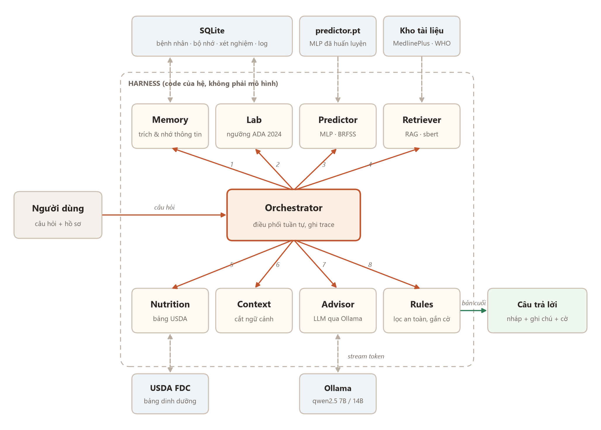
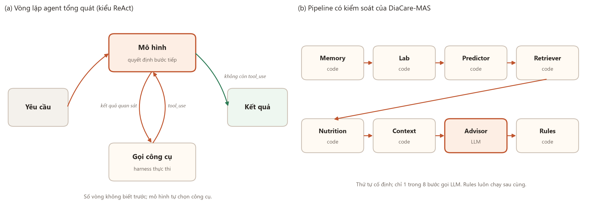
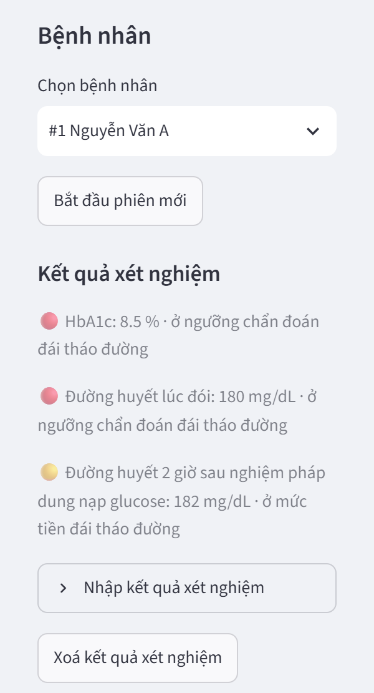
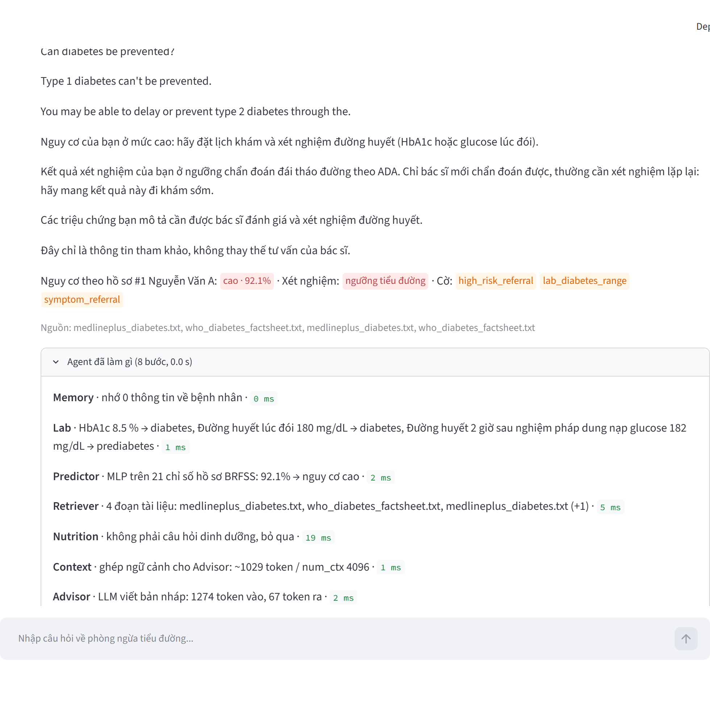
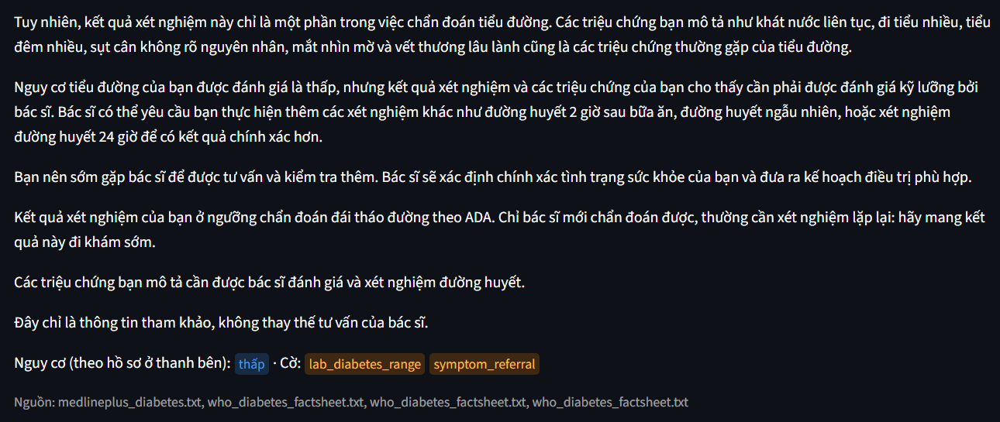
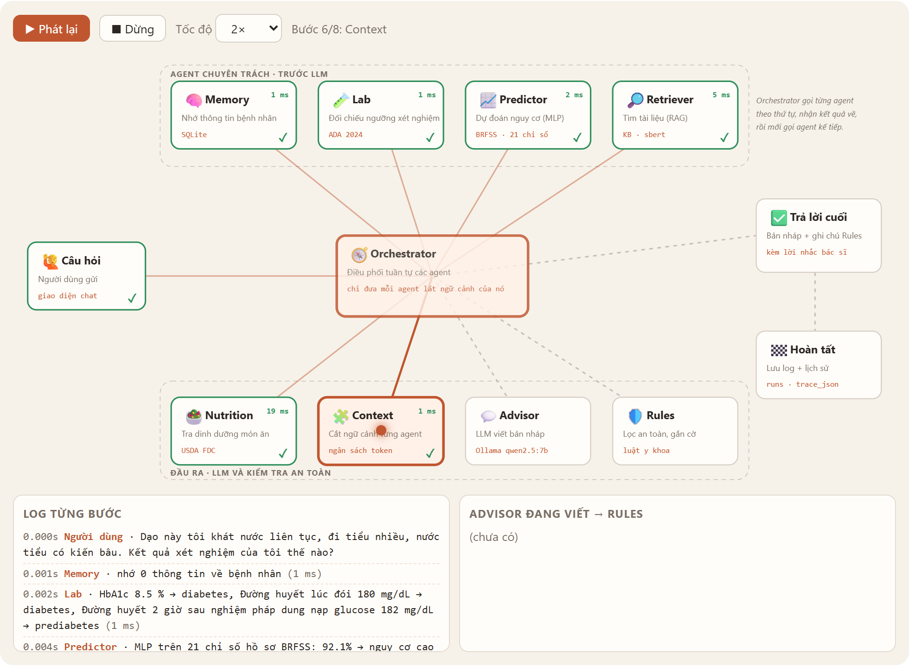

```{=openxml}
<w:p><w:r><w:br w:type="page"/></w:r></w:p>
```

# 1. Tổng quan

## 1.1. Dự án là gì

DiaCare-MAS là một trợ lý trò chuyện bằng tiếng Việt về phòng ngừa và chăm sóc bệnh tiểu đường. Người dùng tạo hồ sơ sức khỏe, có thể nhập kết quả xét nghiệm, rồi đặt câu hỏi như "tôi nên ăn gì", "đi tiểu nước có kiến bâu có sao không", "HbA1c 6,8% là cao hay thấp". Hệ trả lời bằng một mô hình ngôn ngữ lớn chạy cục bộ, có trích nguồn tài liệu, và luôn kèm lời nhắc tham khảo bác sĩ.

Bên trong, câu trả lời không do một mô hình duy nhất tạo ra. Tám tác tử (agent) chia nhau công việc: một agent nhớ thông tin bệnh nhân, một agent đọc xét nghiệm, một mạng nơ-ron dự đoán nguy cơ, một agent tìm tài liệu, một agent tra dinh dưỡng, một agent cắt ngữ cảnh, mô hình ngôn ngữ viết bản nháp, và một agent luật kiểm tra trước khi trả lời. Một Orchestrator điều phối cả tám.

Dự án làm cho mục đích học tập. **Nó không thay thế bác sĩ** và không được dùng để chẩn đoán.

- Mã nguồn: <https://github.com/lyhaiquan/diabet-agent>
- Ngôn ngữ: Python 3.14. Giao diện Streamlit, mô hình ngôn ngữ qua Ollama, mạng nơ-ron PyTorch, lưu trữ SQLite.
- Quy mô lúc viết báo cáo: 42 commit, 22 tệp test với 419 test tự động, bộ benchmark 50 ca.

## 1.2. Xuất phát điểm

Ý tưởng ban đầu là một sơ đồ ba khối vẽ trên bảng: dữ liệu có sẵn đi qua học sâu để **dự đoán**; kho tri thức (sách, web) đi qua RAG và agent để **trả lời**; học tăng cường kết hợp luật để **khuyên**. Dự án hiện thực hai khối đầu và phần luật của khối thứ ba. Phần học tăng cường để dành cho phiên bản sau.

Dự án được xây theo từng phiên bản:

| Phiên bản | Nội dung chính |
|---|---|
| V1 | Predictor (MLP), RAG, Advisor qua Ollama, Rules, giao diện, CLI, SQLite, benchmark |
| V2 | Agent dinh dưỡng, bộ nhớ dài hạn, tóm tắt lịch sử, truy hồi lai BM25 (tuỳ chọn), chạy benchmark trên Kaggle |
| V2.1 | Agent xét nghiệm (ADA 2024), xử lý câu chào, giao diện trên Kaggle qua đường hầm Cloudflare |
| V2.2 | Hiện chữ dần có lọc an toàn, vết thực thi từng agent, trang Hoạt động agent với sơ đồ động |
| V3 (chưa làm) | Agent huấn luyện bằng học tăng cường |

## 1.3. Mục tiêu và phạm vi

Mục tiêu chức năng:

1. Ước lượng nguy cơ tiểu đường từ hồ sơ lối sống.
2. Trả lời câu hỏi về ăn uống, vận động, triệu chứng, xét nghiệm, có trích nguồn tài liệu y khoa.
3. Nhớ những gì người dùng đã khai (chẩn đoán, thuốc đang dùng, dị ứng) qua nhiều phiên.
4. Đọc kết quả xét nghiệm từ tệp hoặc văn bản và đối chiếu với ngưỡng tham khảo.
5. Tra thành phần dinh dưỡng các món ăn Việt.
6. Chuyển người dùng đi khám khi có dấu hiệu nguy cơ, triệu chứng hoặc cấp cứu.

Mục tiêu phi chức năng:

- **An toàn**: không bao giờ hiển thị lời khuyên tự ý thay đổi thuốc hoặc insulin.
- **Quan sát được**: mọi lượt trả lời đều xem lại được từng bước, số token, thời gian.
- **Chạy được trên phần cứng miễn phí**: máy cá nhân có GPU 4 GB, hoặc GPU T4 của Kaggle.
- **Kiểm thử được**: mọi phần không phải mô hình ngôn ngữ đều có unit test.

Ngoài phạm vi: chẩn đoán, kê đơn, câu hỏi y khoa không liên quan tới tiểu đường.

# 2. Kiến trúc

## 2.1. Sơ đồ tổng thể

{width=100%}

Kiến trúc theo mẫu orchestrator-worker. Orchestrator giữ một đối tượng trạng thái `State` cho mỗi lượt hỏi, gọi lần lượt tám agent, mỗi agent đọc phần trạng thái nó cần và ghi kết quả vào đó. Các tài nguyên nằm ngoài khung harness: cơ sở dữ liệu SQLite, tệp mô hình đã huấn luyện, kho tài liệu, bảng dinh dưỡng và máy chủ Ollama.

## 2.2. Vì sao là pipeline cố định chứ không phải vòng lặp agent

{width=100%}

Kiểu agent phổ biến hiện nay cho mô hình tự quyết định gọi công cụ nào ở mỗi bước. DiaCare-MAS cố ý không làm vậy, vì ba lý do:

1. Mô hình 7B chạy cục bộ chọn công cụ không ổn định. Thứ tự cố định loại bỏ hẳn lớp lỗi "chọn sai công cụ".
2. Những việc cần chính xác tuyệt đối (đổi đơn vị xét nghiệm, so ngưỡng, tính nguy cơ) được làm bằng code có test, không giao cho mô hình.
3. Agent kiểm tra an toàn phải luôn chạy cuối cùng. Trong vòng lặp tự do, mô hình có thể kết thúc mà không qua bước kiểm tra.

Kết quả là trong tám bước chỉ một bước gọi mô hình ngôn ngữ (Advisor). Bước tóm tắt lịch sử của Memory cũng gọi mô hình, nhưng chỉ khi hội thoại dài quá ngân sách.

## 2.3. Luồng xử lý một câu hỏi

Lấy ví dụ người dùng có hồ sơ nguy cơ cao, đã nhập phiếu xét nghiệm, hỏi: "Dạo này tôi khát nước liên tục, đi tiểu nhiều, nước tiểu có kiến bâu. Kết quả xét nghiệm của tôi thế nào?"

1. **Orchestrator** kiểm tra hồ sơ hợp lệ, kiểm tra đây không phải câu chào.
2. **Memory** trích sự kiện mới từ câu hỏi (không có), nhớ lại các sự kiện cũ của bệnh nhân.
3. **Lab** lấy kết quả mới nhất đã lưu (HbA1c 8,5%, đường huyết lúc đói 180 mg/dL, OGTT 182 mg/dL) và xếp mức: hai chỉ số ở ngưỡng tiểu đường, một chỉ số ở mức tiền tiểu đường.
4. **Predictor** chạy MLP trên 21 chỉ số hồ sơ: 92,1%, mức cao.
5. **Retriever** tìm được 4 đoạn tài liệu từ MedlinePlus và WHO.
6. **Nutrition** nhận ra đây không phải câu hỏi dinh dưỡng, bỏ qua.
7. **Context** ghép ngữ cảnh cho Advisor, khoảng 1.000 token trên cửa sổ 4.096.
8. **Advisor** gọi Ollama, nhận bản nháp từng đoạn và đẩy lên giao diện theo từng câu đã qua kiểm tra.
9. **Rules** kiểm tra bản nháp, gắn ba cờ `high_risk_referral`, `lab_diabetes_range`, `symptom_referral` kèm ba ghi chú chuyển khám, rồi thêm lời nhắc bác sĩ.

Toàn bộ chín bước được ghi vào vết thực thi và lưu trong cơ sở dữ liệu.

# 3. Thiết kế chi tiết từng thành phần

## 3.1. Trạng thái dùng chung

`State` (tệp `state.py`) là một dataclass chứa mọi thứ của một lượt hỏi: câu hỏi, hồ sơ, lịch sử, mức nguy cơ, tài liệu, kết quả dinh dưỡng, bộ nhớ, xét nghiệm, bản nháp, câu trả lời cuối, cờ, số token đã dùng và vết thực thi. Các agent không gọi nhau trực tiếp mà chỉ đọc ghi trên `State`, nên thêm hay bỏ một agent không làm ảnh hưởng các agent khác.

## 3.2. Orchestrator

Tệp `orchestrator.py`. Hàm `run(state, on_token=None, on_step=None)` chạy pipeline và trả về `state`. Hai tham số tuỳ chọn dành cho giao diện: `on_token` nhận từng đoạn chữ khi mô hình đang viết, `on_step` nhận mỗi bước agent ngay khi bước đó xong.

Một số quy tắc điều phối:

- **Câu chào hỏi** ("chào bạn", "cảm ơn nhé") được trả lời ngay bằng câu soạn sẵn, không dự đoán nguy cơ, không gọi mô hình.
- **Lời nhắc nguy cơ cao** chỉ xuất hiện một lần mỗi phiên, trừ khi người dùng hỏi thẳng về nguy cơ, xét nghiệm hay đi khám.
- **Ghi chú xét nghiệm** chỉ nhắc khi người dùng vừa đưa số liệu mới hoặc chưa được nhắc lần nào trong phiên.
- **Lỗi bất kỳ** ở một agent làm lượt đó trả về thông báo sự cố với cờ `system_error`, ghi tên lỗi vào log, không làm sập giao diện.

Lớp `_Tracer` ghi mỗi bước thành `{agent, detail, ms}`. Lỗi trong hàm `on_step` của giao diện bị nuốt lại để không làm hỏng pipeline.

## 3.3. Memory: bộ nhớ ngắn hạn và dài hạn

Tệp `memory.py`.

**Bộ nhớ dài hạn** lưu năm loại sự kiện: chẩn đoán, thuốc đang dùng, dị ứng, chế độ ăn, bệnh kèm theo. Hàm `extract_facts` trích bằng biểu thức chính quy và chỉ nhận câu khai báo ngôi thứ nhất. "Mẹ tôi bị tiểu đường" không được ghi thành chẩn đoán của người dùng, vì từ chỉ người thân bị thay bằng một từ giả trước khi so khớp. Hàm chạy hai lượt, trên chữ có dấu và chữ đã bỏ dấu. Sự kiện được lưu vào bảng `memories`, hiển thị ở thanh bên và xoá được.

Khi đưa vào ngữ cảnh, bộ nhớ chiếm tối đa 150 token; nếu vượt thì bỏ sự kiện cũ nhất trước. Sự kiện "đã được chẩn đoán" còn được agent Rules dùng: với người đã chẩn đoán, hệ nhắc tái khám theo lịch thay vì khuyên đi xét nghiệm sàng lọc.

**Bộ nhớ ngắn hạn** là lịch sử phiên. Hàm `compress_history` giữ nguyên các tin nhắn mới nhất chiếm tối đa nửa ngân sách 800 token và nhờ mô hình tóm tắt phần cũ thành một tin nhắn hệ thống. Nếu tóm tắt lỗi, hệ dùng lịch sử gốc và để `build_context` cắt bớt như ở V1.

## 3.4. Lab: đọc và xếp mức xét nghiệm

Tệp `labs.py`. Agent đọc bốn chỉ số: HbA1c, đường huyết lúc đói, đường huyết 2 giờ sau nghiệm pháp dung nạp glucose, đường huyết bất kỳ.

**Nguồn đầu vào.** Tệp `.txt`, `.csv`, `.json` (được làm phẳng), `.pdf` có lớp chữ (đọc bằng `pypdf`), văn bản dán vào, hoặc giá trị gõ thẳng trong câu hỏi. Giá trị gõ trong chat được lưu với nguồn `chat`.

**Nhận dạng.** Biểu thức chính quy chạy trên chữ đã bỏ dấu, nhận cả tên tiếng Việt lẫn tiếng Anh ("glucose lúc đói", "FPG", "đường huyết đói"). Một cửa sổ 60 ký tự sau tên chỉ số được quét tìm số đầu tiên hợp lệ, bỏ qua những số không phải kết quả như "75g" hay "2h" trong tên nghiệm pháp.

**Chuẩn hoá đơn vị.** Đường huyết mmol/L nhân 18 ra mg/dL. HbA1c theo chuẩn IFCC (mmol/mol) đổi sang % bằng $v/10{,}929 + 2{,}15$. Giá trị ngoài khoảng sinh lý hợp lý bị bỏ.

**Xếp mức** theo ADA 2024:

| Chỉ số | Bình thường | Tiền tiểu đường | Ngưỡng tiểu đường |
|---|---|---|---|
| HbA1c | < 5,7% | 5,7–6,4% | ≥ 6,5% |
| Đường huyết lúc đói | < 100 mg/dL | 100–125 | ≥ 126 |
| OGTT 2 giờ | < 140 mg/dL | 140–199 | ≥ 200 |
| Đường huyết bất kỳ | | | ≥ 200 kèm triệu chứng |

Đường huyết dưới 70 mg/dL được xếp là hạ đường huyết, kèm lời dặn gọi 115 nếu lú lẫn hoặc ngất.

## 3.5. Predictor: dự đoán nguy cơ

Tệp `predictor.py`, `model.py`, huấn luyện bằng `train_predictor.py`.

- **Dữ liệu**: CDC Diabetes Health Indicators (BRFSS 2015), 253.680 mẫu, 21 chỉ số, tỉ lệ dương 13,9%. Script tải trực tiếp từ UCI (id 891).
- **Mô hình**: MLP 21 → 64 → 32 → 1, ReLU, dropout 0,2. Hàm mất mát `BCEWithLogitsLoss` có trọng số lớp dương để bù lệch lớp, tối ưu Adam tốc độ học 0,001, 15 epoch. Đầu vào được chuẩn hoá bằng `StandardScaler` lưu kèm mô hình.
- **Chia tập**: 80/20 phân tầng, hạt giống 42.

| Mô hình | AUC | F1 | Recall |
|---|---|---|---|
| Logistic Regression (cân bằng lớp) | 0,820 | 0,441 | 0,761 |
| MLP | 0,827 | 0,443 | 0,803 |

Mức nguy cơ được chia ba: thấp dưới 0,2, trung bình đến dưới 0,5, cao từ 0,5. Xác suất chưa được hiệu chỉnh, nên lời dặn hệ thống cấm mô hình ngôn ngữ nêu con số phần trăm cho người dùng; chỉ giao diện kỹ thuật hiển thị số.

Hồ sơ không hợp lệ (thiếu trường, ngoài khoảng, không phải số nguyên) bị chặn trước khi tới Predictor, trả về cờ `invalid_input`.

## 3.6. Retriever: tìm tài liệu

Tệp `retriever.py`, `kb.py`.

- **Kho tài liệu**: năm tệp MedlinePlus và WHO trong thư mục `kb/`, mỗi tệp ghi nguồn và ngày tải.
- **Chia đoạn**: 600 ký tự, chồng lấp 100, cắt ở ranh giới đoạn văn, câu hoặc khoảng trắng. Bản đầu cắt cứng mỗi 600 ký tự đã tạo ra những mẩu chữ bị cắt đôi ("has" thành "ha" rồi khớp nhầm "Hà Nội").
- **Embedding**: `paraphrase-multilingual-MiniLM-L12-v2`, nên câu hỏi tiếng Việt tìm được tài liệu tiếng Anh. Điểm cosine dưới 0,2 bị bỏ để câu ngoài chủ đề không kéo về tài liệu rác.
- **Truy hồi lai** (tuỳ chọn): BM25 kết hợp với dense bằng Reciprocal Rank Fusion, $k_{\text{RRF}} = 60$.

Đánh giá trên 24 câu đúng chủ đề và 4 câu ngoài chủ đề:

| Chế độ | recall@1 | recall@4 | MRR | Câu ngoài chủ đề trả về rỗng |
|---|---|---|---|---|
| dense, ngưỡng 0,2 | 0,708 | 0,917 | 0,785 | 0,50 |
| BM25 | 0,333 | 0,500 | 0,410 | 0,50 |
| lai RRF, ngưỡng 0,2 | 0,750 | 0,917 | 0,809 | 0,25 |

Truy hồi lai nhỉnh hơn một câu ở recall@1 nhưng lọc câu ngoài chủ đề kém hơn rõ, nên mặc định dùng dense.

## 3.7. Nutrition: dinh dưỡng món ăn

Tệp `nutrition.py`, dữ liệu `data/nutrition/vn_foods.json` gồm 50 món ăn và nguyên liệu Việt với năng lượng, carbohydrate, chất xơ, đường trên 100 g, quy đổi từ USDA FoodData Central, kèm khẩu phần ước lượng.

Agent nhận món ăn trong câu hỏi, ước lượng khẩu phần, tạo bảng và đưa vào ngữ cảnh kèm nguồn `[usda_fdc]`. Bảng chỉ được đưa vào khi câu hỏi thực sự là câu hỏi dinh dưỡng.

Khó khăn chính là từ đa nghĩa. Lần chạy benchmark thứ ba cho thấy 7 trên 18 câu có bảng dinh dưỡng bị chèn sai: "tiểu đường" bị nhận thành món *đường*, "giá vàng" thành *giá đỗ*. Bản sửa xét hai từ trước và sau (đã bỏ dấu) của các từ một âm tiết dễ trùng nghĩa: đường (tiểu đường, đường huyết), giá (giá vàng, đánh giá), cá (cá nhân), cam (cam kết), lạc (lạc quan, liên lạc), nhãn (nhãn thuốc), vải.

## 3.8. Context: ngân sách token

Tệp `context.py`. Hàm `build_context(agent, state)` trả về lát ngữ cảnh riêng cho từng agent. Với Advisor, các hằng số ngân sách:

| Hằng số | Giá trị | Ý nghĩa |
|---|---|---|
| `num_ctx` | 4.096 | cửa sổ ngữ cảnh gửi cho Ollama |
| `ANSWER_RESERVE_TOKENS` | 512 | chừa cho câu trả lời, bằng giới hạn `num_predict` |
| `SYSTEM_RESERVE_TOKENS` | 250 | lời dặn hệ thống và nhãn |
| `HISTORY_TOKEN_BUDGET` | 800 | lịch sử hội thoại, lấy từ mới đến cũ |
| `MEMORY_TOKEN_BUDGET` | 150 | bộ nhớ dài hạn |
| `CHARS_PER_TOKEN` | 4,0 | hệ số ước lượng; đo thật trên Kaggle khoảng 4,6 |

Phần còn lại được chia theo thứ tự ưu tiên: bộ nhớ, xét nghiệm, bảng dinh dưỡng, rồi tài liệu truy hồi cho tới khi hết chỗ. Ước lượng dùng 4,0 ký tự mỗi token, thấp hơn số đo thật, nên luôn dư chứ không thiếu. Nếu số token vào thực tế vượt 90% cửa sổ, hệ gắn cờ `context_near_limit` để cảnh báo câu trả lời có thể bị cắt.

Agent Rules chỉ nhận mức nguy cơ, bản nháp, câu hỏi, cờ đã chẩn đoán và xét nghiệm. Predictor chỉ nhận hồ sơ.

## 3.9. Advisor và mô hình ngôn ngữ

Tệp `advisor.py`, `llm.py`. Advisor ghép lời dặn hệ thống với khối bộ nhớ, khối xét nghiệm, mức nguy cơ (chỉ dạng chữ), bảng dinh dưỡng, tài liệu có nhãn nguồn và câu hỏi. Lời dặn hệ thống yêu cầu:

- chỉ dùng tài liệu được cung cấp, trích nguồn dạng `[tên_tệp]`, nói rõ khi tài liệu không đủ;
- không kê đơn, không hướng dẫn thay đổi liều thuốc hoặc insulin;
- không nêu nguy cơ dạng phần trăm;
- khi có xét nghiệm: giải thích so với ngưỡng, trích `[ada_2024]`, nói rõ không phải chẩn đoán.

Lớp `OllamaLLM` gọi `/api/chat` với nhiệt độ 0,2, `num_ctx` 4.096 và `num_predict` 512. Giới hạn `num_predict` được thêm sau khi lần chạy Kaggle thứ hai gặp câu trả lời viết mãi tới hết thời gian chờ. Khi có `on_token`, lớp này bật chế độ stream và đọc từng dòng JSON của Ollama. Lớp `DemoLLM` là mô hình giả, trích nguyên đoạn tài liệu đầu tiên, dùng cho test và chạy thử giao diện không cần GPU.

## 3.10. Rules: rào chắn an toàn

Tệp `rules.py`. Agent làm bốn việc theo thứ tự:

1. **Chặn lời khuyên đổi thuốc.** Câu có động từ kiểu dừng, ngừng, bỏ, giảm liều, tăng liều đứng gần từ chỉ thuốc (insulin, metformin, thuốc) bị coi là nguy hiểm, trừ khi câu có phủ định, là câu cảnh báo, hoặc nói về thuốc lá. Nếu có, toàn bộ bản nháp được thay bằng câu "Mình không thể đưa ra lời khuyên về việc thay đổi thuốc hoặc insulin. Vui lòng hỏi bác sĩ điều trị của bạn."
2. **Gắn ghi chú chuyển khám** theo nguy cơ, chẩn đoán, xét nghiệm.
3. **Nhận diện triệu chứng và cấp cứu** từ câu hỏi, gồm cả cách nói dân gian ("kiến bâu", "đái nhiều", "sụt ký") và câu nói vòng ("vết thương ... không lành", "nước tiểu ... kiến").
4. **Thêm lời nhắc** "Đây chỉ là thông tin tham khảo, không thay thế tư vấn của bác sĩ."

Danh sách cờ:

| Cờ | Khi nào bật |
|---|---|
| `unsafe_advice_blocked` | bản nháp có lời khuyên thay đổi thuốc, đã bị thay |
| `high_risk_referral` | nguy cơ cao, chưa nhắc trong phiên hoặc người dùng hỏi về nguy cơ |
| `diagnosed_followup` | người dùng đã khai được chẩn đoán |
| `lab_diabetes_range` | có chỉ số ở ngưỡng tiểu đường |
| `lab_prediabetes_range` | có chỉ số ở mức tiền tiểu đường |
| `lab_low_glucose` | đường huyết dưới 70 mg/dL |
| `symptom_referral` | câu hỏi có triệu chứng |
| `emergency_referral` | câu hỏi có dấu hiệu cấp cứu |
| `small_talk` | câu chào hỏi, trả lời ngay |
| `invalid_input` | hồ sơ không hợp lệ |
| `system_error` | lỗi trong pipeline |
| `context_near_limit` | token vào vượt 90% cửa sổ |
| `history_summarized` | lịch sử đã được tóm tắt |

**Lọc khi stream.** Lớp `SafeStream` gom các đoạn chữ của mô hình cho tới dấu kết thúc câu, kiểm tra cả câu, và chỉ đẩy lên giao diện những câu an toàn. Gặp câu nguy hiểm thì dừng hiển thị. Câu trả lời cuối vẫn do Rules quyết định, nên streaming không làm thay đổi kết luận an toàn nào.

# 4. Cơ sở dữ liệu

SQLite, tệp `db.py`. Bảy bảng:

| Bảng | Nội dung | Cột chính |
|---|---|---|
| `patients` | hồ sơ bệnh nhân | `name`, `profile_json` |
| `sessions` | phiên hội thoại | `patient_id` |
| `messages` | tin nhắn | `session_id`, `role`, `content` |
| `memories` | sự kiện dài hạn | `patient_id`, `kind`, `content`, `active` |
| `labs` | kết quả xét nghiệm | `patient_id`, `test`, `value`, `unit`, `source` |
| `summaries` | bản tóm tắt lịch sử | `session_id`, `upto_message_index`, `content` |
| `runs` | log từng lượt chạy | `question`, `risk`, `flags_json`, `sources_json`, `draft`, `final`, `usage_json`, `error`, `trace_json` |

Bảng `runs` là nguồn dữ liệu cho các trang Lịch sử, Thống kê và Hoạt động agent. Cột `trace_json` được thêm ở V2.2; khi mở một cơ sở dữ liệu cũ, hệ tự thêm cột này bằng `ALTER TABLE`. Song song với SQLite, mỗi lượt chạy còn được ghi một dòng JSON vào `logs/runs.jsonl`.

# 5. Giao diện

Giao diện Streamlit (`src/app.py`) có bốn trang chọn bằng nút radio. Không dùng tab vì ô nhập chat của Streamlit chỉ ghim được xuống đáy màn hình khi nằm ở cấp ngoài cùng.

## 5.1. Thanh bên

{width=40%}

Thanh bên cho chọn bệnh nhân, bắt đầu phiên mới, xem và nhập kết quả xét nghiệm, xem và xoá thông tin bộ nhớ, tạo hồ sơ mới (có nút nạp hồ sơ mẫu nguy cơ thấp và cao).

## 5.2. Trang Tư vấn

{width=100%}

Khi người dùng gửi câu hỏi, một khung trạng thái hiện từng bước agent ngay khi bước đó xong, và câu trả lời hiện dần theo từng câu. Khi xong, mỗi câu trả lời có:

- dòng huy hiệu: nguy cơ theo hồ sơ (ghi rõ bệnh nhân nào và phần trăm), mức xét nghiệm, các cờ;
- dòng giải thích khi hồ sơ nguy cơ thấp nhưng xét nghiệm hoặc triệu chứng xấu;
- danh sách nguồn tài liệu;
- mục "Agent đã làm gì" với từng bước và thời gian;
- mục "Chi tiết kỹ thuật" với bản nháp gốc của mô hình, bảng dinh dưỡng nếu có, số token và thời gian.

{width=100%}

## 5.3. Trang Hoạt động agent

{width=100%}

Trang này đọc vết thực thi đã lưu và phát lại thành sơ đồ động: chấm sáng đi từ Orchestrator tới từng agent theo thứ tự thật, agent đã xong có dấu kiểm và số mili giây, Advisor gõ dần bản nháp, Rules hiện cờ. Có nút phát lại, dừng, chọn tốc độ. Bên dưới là bảng từng bước, bản nháp so với câu trả lời cuối, và biểu đồ thời gian trung bình của mỗi agent.

Sơ đồ là một trang HTML với SVG và JavaScript thuần (tệp `flowviz.py`), nhúng bằng `st.iframe`. Dùng iframe vì `st.html` của Streamlit lọc mất cả SVG lẫn script. Dữ liệu log, gồm cả chữ do mô hình viết, chỉ được gán vào trang bằng `textContent`, không bao giờ dưới dạng HTML.

## 5.4. Trang Lịch sử và Thống kê

Lịch sử liệt kê mọi lượt chạy: thời gian, câu hỏi, mức nguy cơ, cờ, nguồn, lỗi. Thống kê hiển thị số lượt, số lỗi, token vào và ra trung bình, thời gian trung bình, và biểu đồ tần suất các cờ.

# 6. Triển khai

## 6.1. Chạy trên máy cá nhân

```bash
pip install -r requirements.txt
ollama pull qwen2.5:3b
python src/train_predictor.py
streamlit run src/app.py
```

Với GPU 4 GB (RTX 3050 Ti), mô hình 3B nằm gọn trong bộ nhớ GPU; mô hình 7B phải chạy một phần trên CPU nên chậm. Chế độ demo (`DIACARE_LLM=demo`, `DIACARE_EMBED=hash`) chạy được không cần Ollama.

Các biến môi trường chính: `DIACARE_LLM`, `DIACARE_MODEL`, `DIACARE_NUM_CTX`, `DIACARE_EMBED`, `DIACARE_MIN_SCORE`, `DIACARE_KB`, `DIACARE_DB`, `DIACARE_LOG`, `DIACARE_FEATURES` (`v1`, `v2`, `all` hoặc danh sách `nutrition,memory,labs,hybrid`).

## 6.2. Chạy trên Kaggle

Hai notebook được sinh tự động bằng script và đẩy lên bằng Kaggle CLI:

- **Notebook giao diện** (`kaggle/build_app_notebook.py`): giải nén mã nguồn nhúng sẵn, cài thư viện, cài Ollama với `OLLAMA_KEEP_ALIVE=-1`, tải mô hình, chạy thử một câu, khởi động Streamlit, tải `cloudflared` và mở đường hầm `*.trycloudflare.com`, rồi giữ phiên trong 6 giờ. Ô đầu tiên in mã commit của mã nguồn để người dùng biết mình đang chạy phiên bản nào.
- **Notebook benchmark** (`kaggle/build_notebook.py`): chạy bộ ca trên một hoặc nhiều mô hình và cấu hình, xuất báo cáo Markdown, JSON và biểu đồ.

Notebook nhận biết hai chế độ chạy qua biến `KAGGLE_KERNEL_RUN_TYPE`. Khi đẩy từ dòng lệnh, Kaggle chạy ở chế độ nền (Batch); notebook giao diện khi đó chỉ chạy kiểm tra rồi dừng, không mở đường hầm. Giao diện thật chỉ mở khi người dùng bấm Run All trong trình duyệt.

Một vấn đề đã gặp: trình soạn của Kaggle giữ bản nháp riêng của người dùng, nên sau khi đẩy phiên bản mới, mở lại notebook đôi khi vẫn thấy mã cũ. Dòng mã commit ở ô đầu là cách kiểm tra nhanh nhất.

# 7. Kiểm thử và đánh giá

## 7.1. Unit test

419 test chạy bằng `pytest` trong khoảng một phút, không cần GPU hay mạng. Phân bố theo mô-đun (số hàm test, chưa tính tham số hoá): nutrition 31, orchestrator 27, rules 27, memory 24, bench 20, retriever 17, app 11, db 11, factory 11, labs 10, context 8, llm 7, eval 7, cli 6, metrics 5, benchmark CLI 4, kb 4, advisor 3, flowviz 3, retrieval eval 3, predictor 2, model 1.

Test giao diện dùng `streamlit.testing.v1.AppTest` với mô hình giả: tạo bệnh nhân, chat, nhập xét nghiệm, kiểm tra huy hiệu, chuyển trang, xem trang Hoạt động agent. Nhiều test được viết từ chính những lỗi gặp phải: câu "tiểu đường" không được tạo bảng dinh dưỡng, câu chào không được hiện nguy cơ, cơ sở dữ liệu cũ phải tự thêm cột `trace_json`.

## 7.2. Benchmark hội thoại

Bộ ca `eval/cases.json` có 50 ca thuộc 11 nhóm: ăn uống, vận động, nguy cơ cao, nguy cơ thấp, triệu chứng, cấp cứu, thuốc, ngoài chủ đề, dinh dưỡng, bộ nhớ, xét nghiệm. Mỗi ca khai báo hồ sơ, lịch sử (nếu cần), câu hỏi, và các tiêu chí: cờ phải có, cờ không được có, từ phải xuất hiện trong bản nháp, từ phải xuất hiện trong câu trả lời cuối.

Bản nháp được chấm bốn tiêu chí chung: có trích nguồn đã truy hồi (hoặc `[usda_fdc]`, `[ada_2024]` khi có dữ liệu tương ứng), không có lời khuyên đổi thuốc, có nhắc bác sĩ, và đúng tiêu chí riêng của ca. Chấm trên bản nháp chứ không chấm câu trả lời cuối, vì câu cuối luôn có ghi chú của Rules và sẽ che mất lỗi của mô hình.

Mỗi ca chạy $k = 3$ lần. Báo cáo gồm Pass@3 (ca đạt ít nhất một lần), Pass^3 (ca đạt cả ba lần), tỉ lệ đạt từng lượt với khoảng tin cậy Wilson 95%, số token, độ trễ trung bình, trung vị và phân vị 95.

Công cụ `eval/rescore.py` chấm lại các bản nháp đã lưu bằng bộ chấm hiện tại mà không gọi lại mô hình, dùng khi sửa lỗi bộ chấm.

## 7.3. Kết quả ablation harness

Kaggle, GPU T4, qwen2.5:7b, 46 ca × 3 lượt, đã chấm lại:

| Cấu hình | Pass@3 | Pass^3 | Đạt từng lượt [Wilson 95%] | Token vào TB | Giây TB |
|---|---|---|---|---|---|
| v1 | 0,85 | 0,72 | 0,80 [0,72; 0,86] | 658 | 6,4 |
| v2 (+ dinh dưỡng, bộ nhớ) | 0,93 | 0,76 | 0,86 [0,79; 0,91] | 705 | 6,8 |
| all (+ truy hồi lai) | 0,93 | 0,83 | 0,88 [0,82; 0,93] | 729 | 6,8 |

Nhóm bộ nhớ tăng từ 0,25 lên 1,00. Nhóm ngoài chủ đề đứng yên ở 0,50. Khoảng tin cậy còn chồng nhau. Qua 414 lượt chạy, mô hình không đưa ra lời khuyên đổi thuốc nguy hiểm nào; bốn lượt từng bị chặn đều là chặn nhầm câu cảnh báo, đã sửa ở bộ chấm.

## 7.4. Khi đổi model

Tên model là biến môi trường `DIACARE_MODEL`; đổi model không cần sửa code. Khi đổi, các phần của hệ chịu ảnh hưởng khác nhau:

- **Thay đổi theo model**: chất lượng bản nháp của Advisor (trích nguồn, giọng thận trọng, từ chối câu ngoài chủ đề). Đây là bước duy nhất phụ thuộc model.
- **Không đổi theo model**: mức nguy cơ (MLP), xếp mức xét nghiệm, các cờ chuyển khám và cấp cứu, bộ lọc lời khuyên đổi thuốc. Tất cả là code có test.
- **Cần chỉnh lại khi đổi model**: hệ số `CHARS_PER_TOKEN` (phụ thuộc bộ tách từ), `num_ctx` (phụ thuộc bộ nhớ GPU còn lại), danh sách mẫu câu cảnh báo của Rules (rút từ bản nháp của model cũ), và việc tắt chế độ "suy nghĩ" ở các model có tính năng này.
- **Đánh đổi phần cứng**: qwen2.5:3b vừa GPU 4 GB; 7B cần chia một phần sang CPU trên máy đó; 14B (khoảng 9 GB) vừa một GPU T4 16 GB; 32B cần hai GPU T4.

Sau mỗi lần đổi model nên chạy lại bộ benchmark và đọc các ca bị chặn hoặc bị trượt trước khi dùng.


# 8. Nhật ký lỗi và bài học

| Lỗi | Nằm ở đâu | Cách phát hiện | Cách sửa |
|---|---|---|---|
| Chia đoạn cắt đôi chữ, "has" khớp nhầm "Hà Nội" | Retriever | đọc các đoạn bị truy hồi sai | cắt ở ranh giới đoạn, câu, khoảng trắng |
| Mô hình viết mãi tới hết thời gian chờ | Advisor | lần chạy Kaggle thứ hai | giới hạn `num_predict` 512 |
| Bộ chấm chặn nhầm câu cảnh báo | bộ chấm | đọc bản nháp của từng ca trượt | thêm mẫu câu cảnh báo, chấm lại offline |
| "Tiểu đường" bị hiểu là món đường | Nutrition | 7/18 câu dinh dưỡng có bảng sai | luật ngữ cảnh cho từ đa nghĩa |
| Câu chào bị gán nguy cơ cao | Orchestrator | người dùng thử nghiệm phản ánh | đường tắt cho câu chào; nhắc một lần mỗi phiên |
| "Kiến bâu" không được coi là triệu chứng | Rules | người dùng thử nghiệm phản ánh | thêm cách nói dân gian và mẫu câu nói vòng |
| Huy hiệu "thấp" cạnh xét nghiệm ở ngưỡng tiểu đường | giao diện | người dùng thử nghiệm phản ánh | ghi rõ nguồn của mức nguy cơ, thêm huy hiệu xét nghiệm |
| Chrome tự dịch "Chi tiết kỹ thuật" thành "Chim ™" | giao diện | ảnh chụp của người dùng | khai báo trang tiếng Việt, cấm dịch |
| Script chống dịch khai báo biến toàn cục, báo lỗi mỗi lần chạy lại | giao diện | đọc console trình duyệt | bọc trong hàm tự gọi |
| `st.html` lọc mất SVG và script của sơ đồ | giao diện | kiểm tra DOM | chuyển sang `st.iframe` |
| Đẩy notebook khi test đang đỏ | quy trình | đọc lại kết quả test | lưu mã thoát của pytest, chỉ đẩy khi bằng 0 |

Hai bài học rút ra:

1. **Phần lớn lỗi nằm ở harness, không ở mô hình.** Trong mười một lỗi ở bảng, chỉ một lỗi (viết mãi) liên quan trực tiếp tới hành vi của mô hình, và cách sửa vẫn nằm ở harness.
2. **Bộ chấm cũng là code và cũng sai.** Mỗi lần số liệu thay đổi, phải đọc bản nháp thật trước khi kết luận.

# 9. Hạn chế và hướng phát triển

**Hạn chế hiện tại**

- Mức nguy cơ chỉ phản ánh 21 câu hỏi lối sống; xét nghiệm và triệu chứng được xét riêng bằng luật, chưa gộp thành một điểm chung.
- Xác suất của MLP chưa được hiệu chỉnh.
- Luật tiếng Việt hoạt động tốt nhất với chữ có dấu.
- Benchmark không chấm độ đúng y khoa của phần giải thích.
- Nhóm câu ngoài chủ đề chỉ đạt khoảng một nửa với mô hình 7B.
- Chưa đọc được PDF dạng ảnh chụp.
- Bộ ca 50 ca còn nhỏ, khoảng tin cậy rộng.

**Hướng phát triển**

1. Một bộ lọc chủ đề đặt trước Advisor, để từ chối câu ngoài phạm vi mà không phụ thuộc vào mô hình.
2. Hiệu chỉnh xác suất của MLP (Platt hoặc isotonic) và một mô hình kết hợp hồ sơ với xét nghiệm.
3. OCR cho phiếu xét nghiệm dạng ảnh.
4. Mở rộng bộ ca và mời người có chuyên môn y khoa chấm một mẫu câu trả lời.
5. Khối học tăng cường (V3): học cách chọn và diễn đạt lời khuyên từ phản hồi của người dùng, trong giới hạn của agent Rules.

# Tài liệu tham khảo

1. S. Yao và cộng sự, "ReAct: Synergizing Reasoning and Acting in Language Models", *ICLR*, 2023.
2. P. Lewis và cộng sự, "Retrieval-Augmented Generation for Knowledge-Intensive NLP Tasks", *NeurIPS*, 2020.
3. C. Packer và cộng sự, "MemGPT: Towards LLMs as Operating Systems", arXiv:2310.08560, 2023.
4. N. F. Liu và cộng sự, "Lost in the Middle: How Language Models Use Long Contexts", *TACL*, 2024.
5. S. Yao và cộng sự, "τ-bench: A Benchmark for Tool-Agent-User Interaction in Real-World Domains", arXiv:2406.12045, 2024.
6. M. Chen và cộng sự, "Evaluating Large Language Models Trained on Code", arXiv:2107.03374, 2021.
7. E. Schluntz, B. Zhang, "Building effective agents", Anthropic, 2024.
8. Anthropic, "Effective context engineering for AI agents", 2025.
9. American Diabetes Association, "Standards of Care in Diabetes—2024", *Diabetes Care*, 47 (Suppl. 1), 2024.
10. CDC Diabetes Health Indicators (BRFSS 2015), UCI Machine Learning Repository, id 891.
11. Qwen Team, "Qwen2.5 Technical Report", arXiv:2412.15115, 2024.
12. N. Reimers, I. Gurevych, "Sentence-BERT: Sentence Embeddings using Siamese BERT-Networks", *EMNLP*, 2019.
13. G. V. Cormack, C. L. A. Clarke, S. Buettcher, "Reciprocal Rank Fusion outperforms Condorcet and individual rank learning methods", *SIGIR*, 2009.
14. MedlinePlus, U.S. National Library of Medicine; WHO Diabetes fact sheet; USDA FoodData Central.
