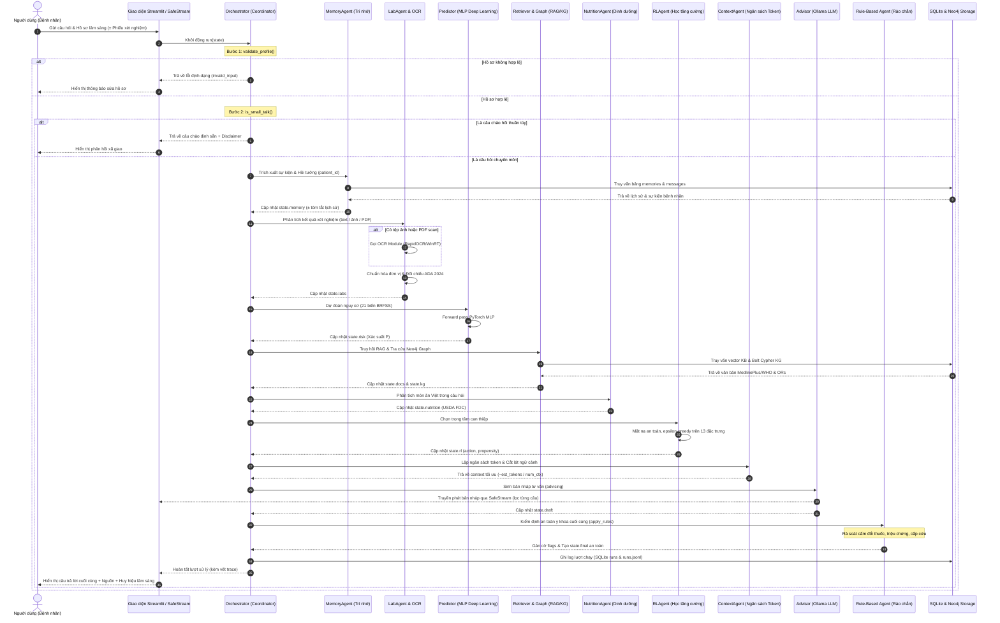
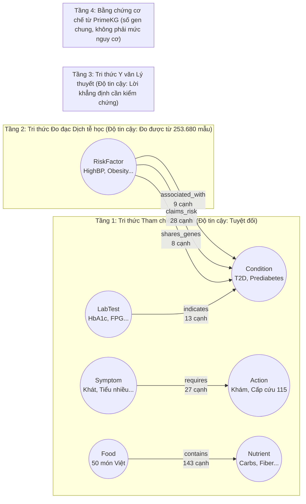
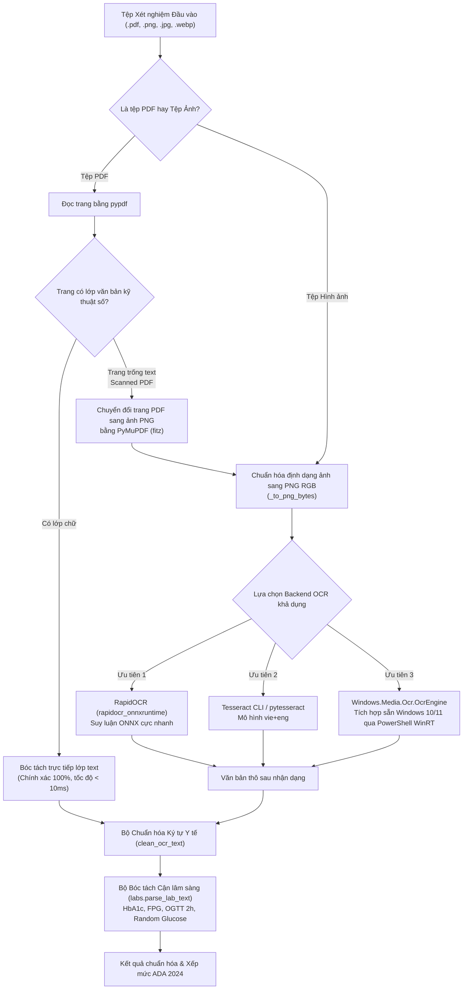

```{=openxml}
<w:p><w:r><w:br w:type="page"/></w:r></w:p>
```

# 1. Giới thiệu, Bối cảnh & 8 Mục tiêu Dự án

## 1.1. Bối cảnh Nghiên cứu và Tính cấp thiết

Bệnh đái tháo đường (ĐTĐ - Diabetes Mellitus) là một trong những thách thức y tế công cộng nghiêm trọng nhất của thế kỷ 21. Theo Liên đoàn Đái tháo đường Quốc tế (IDF), số lượng bệnh nhân tiểu đường trên toàn cầu đang gia tăng nhanh chóng, kéo theo các gánh nặng bệnh tật về tim mạch, suy thận, mù lòa và biến chứng chi dưới. Tại Việt Nam, xu hướng trẻ hóa độ tuổi mắc đái tháo đường típ 2 (T2D) cùng tình trạng nhận thức chưa đầy đủ về lối sống, dinh dưỡng và theo dõi chỉ số cận lâm sàng tạo ra nhu cầu cấp thiết về các công cụ hỗ trợ sức khỏe số.

Sự bùng nổ của các mô hình ngôn ngữ lớn (Large Language Models - LLM) mở ra tiềm năng to lớn trong việc xây dựng các trợ lý sức khỏe ảo. Tuy nhiên, việc ứng dụng LLM nguyên khối (monolithic LLM) trực tiếp vào tư vấn y khoa đối mặt với những hiểm họa chết người:
1. **Ảo giác thông tin (Hallucination)**: LLM có xu hướng tự tạo ra các ngưỡng chẩn đoán sai lệch hoặc trích dẫn các tài liệu y khoa không có thật.
2. **Rủi ro an toàn điều trị (Clinical Hazards)**: Mô hình ngôn ngữ có thể vô tình đưa ra các khuyến nghị nguy hiểm như khuyên bệnh nhân tự ý ngừng thuốc hạ đường huyết, thay đổi liều insulin, gây ra hạ đường huyết nặng hoặc hôn mê nhiễm toan ceton.
3. **Thiếu khả năng tính toán định lượng chính xác**: LLM xử lý số liệu xét nghiệm kém, dễ nhầm lẫn giữa các đơn vị đo lâm sàng ($mg/dL$ và $mmol/L$).
4. **Hộp đen (Black-box Nature)**: Thiếu khả năng giải thích nguồn gốc tri thức, không thể truy vết lý do đưa ra một lời khuyên.

Để khắc phục triệt để các hạn chế trên, đề tài nghiên cứu tại Học viện Công nghệ Bưu chính Viễn thông (PTIT) đã đặc tả một **Kiến trúc Hệ Đa Tác tử Lai (Hybrid Multiagent System - Hybrid MAS)**. Hệ thống kết hợp hài hòa giữa **Học sâu (Deep Learning)** để dự đoán nguy cơ khách quan, **Đồ thị tri thức (Knowledge Graph)** và **RAG lai** để truy xuất bằng chứng xác thực, **Học tăng cường (Reinforcement Learning - RL)** để cá nhân hóa trọng tâm can thiệp, và **Hệ rào chắn dựa trên luật (Rule-Based Safety Invariants)** để bảo đảm tuyệt đối tính an toàn y khoa. Hệ thống thực tế **DiaCare-MAS (Phiên bản V3)** là sự hiện thực hóa toàn diện và nghiêm ngặt của đặc tả kiến trúc này.

## 1.2. Đối chiếu 8 Mục tiêu Dự án giữa Đặc tả PTIT và Hệ thống Thực tế DiaCare-MAS

Bảng dưới đây đối chiếu chi tiết 8 mục tiêu cốt lõi được định nghĩa trong Đặc tả Kiến trúc PTIT với kết quả triển khai thực tế trên mã nguồn DiaCare-MAS V3:

| STT | Mục tiêu Dự án (Đặc tả PTIT) | Kết quả Đạt được trong DiaCare-MAS (V3) | Mức độ Hoàn thành |
|---|---|---|:---:|
| 1 | **Ước lượng nguy cơ tiểu đường từ hồ sơ lối sống**: Dự đoán khách quan xác suất mắc T2D từ 21 biến số sức khỏe hành vi mà không dựa dẫm vào suy diễn của LLM. | Hiện thực hóa qua `Predictor` ([`predictor.py`](file:///C:/DATA/diacare-mas/src/diacare/predictor.py)), mạng nơ-ron MLP $21 \to 64 \to 32 \to 1$ huấn luyện trên 253.680 hồ sơ CDC BRFSS 2015, đạt AUC 0.827, Recall 0.803. Phân định 3 dải nguy cơ: Thấp, Trung bình, Cao. | **Hoàn thành 100%** |
| 2 | **Truy xuất và trả lời có căn cứ y văn xác thực**: Mọi lời khuyên phải được bảo chứng bởi tài liệu y khoa uy tín, có trích dẫn nguồn minh bạch. | Hiện thực hóa qua `Retriever` ([`retriever.py`](file:///C:/DATA/diacare-mas/src/diacare/retriever.py)) và `GraphAgent` ([`kg.py`](file:///C:/DATA/diacare-mas/src/diacare/kg.py)). Kết hợp RAG dense MiniLM-L12-v2 với Đồ thị tri thức Neo4j, trích dẫn chính xác nhãn nguồn `[medlineplus_*]`, `[who_*]`, `[ada_2024]`. | **Hoàn thành 100%** |
| 3 | **Trí nhớ ngữ cảnh dài hạn qua nhiều phiên**: Duy trì và ghi nhớ trạng thái sức khỏe, tiền sử bệnh án, thuốc đang dùng của bệnh nhân qua các phiên trò chuyện độc lập. | Hiện thực hóa qua `MemoryAgent` ([`memory.py`](file:///C:/DATA/diacare-mas/src/diacare/memory.py)) kết nối SQLite bảng `memories`. Tự động quan sát và trích xuất sự kiện (`observe`), hồi tưởng (`recall`), kết hợp tóm tắt lịch sử vượt ngưỡng qua LLM (`compress_history`), lưu và dùng lại bản tóm tắt theo dấu nhận dạng, tự tắt thông tin thuốc khi người dùng nói đã ngừng. | **Hoàn thành 100%** |
| 4 | **Phân tích kết quả xét nghiệm đa phương thức**: Tiếp nhận kết quả cận lâm sàng dạng văn bản, hình ảnh hoặc tài liệu PDF scan, đối chiếu ngưỡng chuẩn quốc tế. | Hiện thực hóa qua `LabAgent` ([`labs.py`](file:///C:/DATA/diacare-mas/src/diacare/labs.py)) tích hợp module OCR ([`ocr.py`](file:///C:/DATA/diacare-mas/src/diacare/ocr.py)). Tự động chuyển đổi đơn vị ($mg/dL \leftrightarrow mmol/L$), xếp mức theo Hiệp hội Đái tháo đường Hoa Kỳ (ADA 2024) cho 4 chỉ số chính (HbA1c, FPG, OGTT 2h, Random Glucose). | **Hoàn thành 100%** |
| 5 | **Tra cứu thành phần dinh dưỡng món ăn Việt Nam**: Đánh giá định lượng carbohydrate, chất xơ, calo của bữa ăn bản địa, hỗ trợ kiểm soát đường huyết sau ăn. | Hiện thực hóa qua `NutritionAgent` ([`nutrition.py`](file:///C:/DATA/diacare-mas/src/diacare/nutrition.py)) với cơ sở dữ liệu `vn_foods.json` gồm 50 món ăn Việt Nam chuẩn hóa từ USDA FoodData Central. Thuật toán phân tích ngữ cảnh 2 từ trước/sau giải quyết triệt để lỗi từ đa nghĩa. | **Hoàn thành 100%** |
| 6 | **Rào chắn an toàn y khoa bất biến & Chuyển viện kịp thời**: Chặn 100% lời khuyên tự ý đổi thuốc, phát hiện dấu hiệu cấp cứu, triệu chứng lâm sàng và bắt buộc chuyển viện. | Hiện thực hóa qua `Rules` ([`rules.py`](file:///C:/DATA/diacare-mas/src/diacare/rules.py)) hoạt động độc lập ở bước cuối pipeline. Chặn lời khuyên thuốc bằng regex đa tầng (`_UNSAFE`, `_NEGATION`, `_CAUTION`), kích hoạt 13 cờ an toàn, truyền phát an toàn từng câu qua `SafeStream`. | **Hoàn thành 100%** |
| 7 | **Cá nhân hóa tư vấn bằng Học tăng cường (Reinforcement Learning)**: Tự động điều chỉnh trọng tâm can thiệp phù hợp với từng bệnh nhân dựa trên tối ưu hóa hàm thưởng lâm sàng. | Hiện thực hóa ở phiên bản V3 qua `RLAgent` ([`rl.py`](file:///C:/DATA/diacare-mas/src/diacare/rl.py)). Contextual bandit tuyến tính, 13 đặc trưng trạng thái, 6 trọng tâm can thiệp, học trực tuyến từ phản hồi 👍/👎 của người dùng, có mặt nạ an toàn và đánh giá SNIPS. Chưa có phản hồi thật. | **Hoàn thành 100%** |
| 8 | **Khả năng quan sát, kiểm chuẩn và triển khai trên phần cứng tối thiểu**: Hệ thống phải trong suốt, đo đạc được tài nguyên, có bộ kiểm thử tự động và chạy được trên môi trường miễn phí. | Hiện thực hóa qua `_Tracer` ([`orchestrator.py`](file:///C:/DATA/diacare-mas/src/diacare/orchestrator.py)), trang Hoạt động agent động SVG/JS ([`flowviz.py`](file:///C:/DATA/diacare-mas/src/diacare/flowviz.py)), hệ thống 419 unit test tự động, hỗ trợ chạy trơn tru trên laptop có GPU 4 GB hoặc môi trường Kaggle T4 miễn phí. | **Hoàn thành 100%** |

---

# 2. Kiến trúc Phân tầng 6 Lớp (Layered Architecture)

Đặc tả PTIT định nghĩa một kiến trúc phần mềm hướng tác tử phân tầng nghiêm ngặt nhằm tách biệt rõ ràng giữa các giao diện tương tác, logic điều phối, suy luận trí tuệ nhân tạo, lưu trữ dữ liệu và kiểm soát an toàn. 

## 2.1. Chi tiết 6 Lớp Kiến trúc trong DiaCare-MAS

1. **Lớp Tương tác & Trình diễn (Interaction & Presentation Layer)**:
   - **Giao diện người dùng Web**: Xây dựng bằng Streamlit (`src/app.py`), tổ chức thành 4 phân hệ chính: (1) *Tư vấn trực tiếp* với khả năng hiển thị chữ dần theo câu an toàn qua `SafeStream`; (2) *Hoạt động agent* mô phỏng luồng dữ liệu thời gian thực dạng SVG tương tác; (3) *Lịch sử & Thống kê* hiển thị chi tiết các lần chạy; (4) *Quản lý hồ sơ bệnh nhân* và nhập kết quả xét nghiệm/tải ảnh OCR.
   - **Giao diện Dòng lệnh (CLI)**: Cung cấp công cụ chạy kiểm thử nhanh, huấn luyện mô hình và đánh giá hàng loạt.
2. **Lớp Điều phối & Quản lý Luồng (Orchestration & Coordination Layer)**:
   - Thành phần trung tâm là `Orchestrator` ([`orchestrator.py`](file:///C:/DATA/diacare-mas/src/diacare/orchestrator.py)). Đóng vai trò Coordinator điều hành toàn bộ vòng đời xử lý yêu cầu.
   - Quản trị cấu trúc dữ liệu trạng thái tập trung `State` ([`state.py`](file:///C:/DATA/diacare-mas/src/diacare/state.py)).
   - Tích hợp bộ chặn hội thoại xã giao (`is_small_talk`), bộ giám sát vết thực thi (`_Tracer`) và cơ chế bẫy lỗi toàn cục bảo đảm tính khả dụng cao (`system_error`).
3. **Lớp Tác tử Chuyên trách (Specialized Agent Layer)**:
   - Bao gồm 8 tác tử công nhân (Worker Agents) và 2 tác tử giám sát/chính sách (Control/Policy Agents).
   - Mỗi tác tử hoạt động độc lập, không giao tiếp ngang hàng trực tiếp mà tương tác gián tiếp qua bảng đen (Blackboard pattern) được hiện thực hóa bằng đối tượng `State`.
4. **Lớp Tri thức & Suy luận (Knowledge & Inference Layer)**:
   - **Mô hình Ngôn ngữ cục bộ**: Ollama phục vụ các mô hình mã nguồn mở thế hệ mới như `qwen2.5:7b` hoặc `qwen2.5:3b`.
   - **Mạng Nơ-ron Học sâu**: PyTorch MLP dự đoán nguy cơ.
   - **Chính sách RL**: 6 mô hình ridge tuyến tính ($A_a \in \mathbb{R}^{13 \times 13}$, $b_a \in \mathbb{R}^{13}$) của `RLAgent`, khởi động từ `models/rl_policy.json`, học tiếp trong SQLite.
   - **Hệ thống Tri thức Chuẩn mực**: Hướng dẫn thực hành ADA 2024, Bảng cơ sở dữ liệu dinh dưỡng USDA FoodData Central.
5. **Lớp Lưu trữ & Dữ liệu Bền vững (Persistence & Storage Layer)**:
   - **Cơ sở dữ liệu Quan hệ SQLite** (`data/diacare.db` qua [`db.py`](file:///C:/DATA/diacare-mas/src/diacare/db.py)): Quản lý 9 bảng quan hệ (`patients`, `sessions`, `messages`, `memories`, `labs`, `summaries`, `runs`, `rl_events`, `rl_model`).
   - **Nhật ký Thực thi (JSONL Run Logs)**: Ghi vết tuần tự các lượt suy luận vào `logs/runs.jsonl`.
   - **Đồ thị Tri thức Neo4j** (`neo4j_data/` qua `bolt://localhost:7688`): Lưu trữ đồ thị tri thức 108 nút và 228 cạnh (6 loại quan hệ, có 8 cạnh gen chung lấy từ PrimeKG). Mặc định đồ thị chạy bằng networkx trong bộ nhớ; đặt `DIACARE_KG=neo4j` thì đọc từ Neo4j.
   - **Kho Văn bản Y khoa (Knowledge Base)**: Thư mục `kb/` chứa các tài liệu MedlinePlus, WHO và các đoạn cắt vector hóa.
6. **Lớp An toàn & Rào chắn Pháp lý (Safety & Compliance Layer)**:
   - Cơ chế bất biến y khoa: Chạy ở khâu cuối cùng trước khi phản hồi người dùng.
   - Bộ lọc biểu thức chính quy đa tầng phát hiện các cấu trúc câu nguy hiểm liên quan đến thuốc.
   - Hệ thống cờ cảnh báo lâm sàng (Clinical Alert Flags) và tuyên bố từ chối trách nhiệm y khoa (`DISCLAIMER`).

## 2.2. Sơ đồ Kiến trúc Phân tầng Tổng thể (Mermaid)

```mermaid
flowchart TD
    subgraph L1 ["1. LỚP TƯƠNG TÁC & TRÌNH DIỄN (Interaction & Presentation Layer)"]
        UI["Giao diện Streamlit (src/app.py)<br/>• Tư vấn • Hoạt động Agent • Lịch sử • Bệnh nhân"]
        STREAM["Bộ lọc Stream An toàn (SafeStream)"]
        CLI["Giao diện Dòng lệnh (CLI & Bench)"]
        UI --- STREAM
    end

    subgraph L2 ["2. LỚP ĐIỀU PHỐI & QUẢN LÝ LUỒNG (Orchestration & Coordination Layer)"]
        ORCH["Orchestrator (orchestrator.py)<br/>Bộ điều phối đường ống có kiểm soát"]
        STATE["Trạng thái Dùng chung (State)<br/>question, profile, labs, memory, risk, docs, draft, final, flags, trace"]
        TRACER["Bộ Giám sát & Đo đạc (_Tracer)"]
        ORCH <--> STATE
        ORCH --- TRACER
    end

    subgraph L3 ["3. LỚP TÁC TỬ CHUYÊN TRÁCH (Specialized Agent Layer)"]
        direction TB
        subgraph Workers ["Tác tử Công nhân (Worker Agents)"]
            AG_MEM["MemoryAgent<br/>🧠 Quan sát & Ghi nhớ"]
            AG_LAB["LabAgent & OCR<br/>🧪 Xét nghiệm & ADA 2024"]
            AG_PRED["Predictor<br/>📈 Mạng nơ-ron MLP"]
            AG_RET["Retriever<br/>🔎 RAG lai Dense/BM25"]
            AG_KG["GraphAgent<br/>🕸️ Tra cứu Đồ thị Neo4j"]
            AG_NUT["NutritionAgent<br/>🥗 Dinh dưỡng món Việt"]
            AG_CTX["ContextAgent<br/>🧩 Lập ngân sách Token"]
            AG_ADV["Advisor<br/>💬 Sinh bản nháp LLM"]
        end
        subgraph Guards ["Tác tử Rào chắn & Chính sách"]
            AG_RL["RLAgent<br/>🎯 Contextual bandit học từ 👍/👎"]
            AG_RULE["Rule-Based Agent<br/>🛡️ Rào chắn An toàn Y khoa"]
        end
    end

    subgraph L4 ["4. LỚP TRI THỨC & SUY LUẬN (Knowledge & Inference Layer)"]
        OLLAMA["Ollama LLM (qwen2.5:7b / 3b)"]
        PYTORCH["PyTorch Engine (MLP Model)"]
        RL_MODEL["Chính sách RL (rl_policy.json + SQLite rl_model)"]
        ADA_RULES["Quy chuẩn Lâm sàng ADA 2024"]
        USDA_DATA["Dữ liệu Dinh dưỡng USDA FDC"]
    end

    subgraph L5 ["5. LỚP LƯU TRỮ & DỮ LIỆU BỀN VỮNG (Persistence & Storage Layer)"]
        SQLITE[("SQLite Database (data/diacare.db)<br/>7 Bảng quan hệ")]
        NEO4J[("Neo4j Graph Database<br/>Bolt Port 7688 / DB_diabet.cypher")]
        JSONL["Nhật ký Chạy (logs/runs.jsonl)"]
        KBFOLDER["Kho Tri thức Y văn (kb/*.txt)"]
    end

    subgraph L6 ["6. LỚP AN TOÀN & RÀO CHẮN PHÁP LÝ (Safety & Compliance Layer)"]
        MED_INVARIANTS["Ràng buộc Bất biến An toàn Y tế<br/>• Cấm đổi thuốc/insulin • Cảnh báo triệu chứng • Báo động cấp cứu"]
        DISCLAIMER_BOX["Tuyên bố Miễn trừ Trách nhiệm Lâm sàng Bắt buộc"]
    end

    %% Liên kết giữa các tầng
    UI -->|Gửi yêu cầu| ORCH
    ORCH -->|Điều phối tuần tự| Workers
    ORCH -->|Áp dụng chính sách & An toàn| Guards
    
    Workers -->|Đọc/Ghi trạng thái| STATE
    Guards -->|Kiểm soát/Bổ sung| STATE

    AG_ADV -.-> OLLAMA
    AG_PRED -.-> PYTORCH
    AG_RL -.-> RL_MODEL
    AG_LAB -.-> ADA_RULES
    AG_NUT -.-> USDA_DATA

    AG_MEM <--> SQLITE
    AG_LAB <--> SQLITE
    AG_KG <--> NEO4J
    AG_RET <--> KBFOLDER
    ORCH --> JSONL

    AG_RULE --> MED_INVARIANTS
    MED_INVARIANTS --> DISCLAIMER_BOX
    DISCLAIMER_BOX -->|Trả kết quả an toàn| STREAM
    STREAM --> UI
```



---

# 3. Phân loại 8+2 Agent Chuyên trách và 6 Nguyên lý Thiết kế

## 3.1. Phân loại Chi tiết 8+2 Agent Chuyên trách

Kiến trúc DiaCare-MAS V3 hiện thực hóa mô hình gồm **8 tác tử thực thi nhiệm vụ** và **2 tác tử kiểm soát/giám sát hệ thống**:

| Tên Tác tử | Nhóm | Vai trò & Trách nhiệm Chính | Đầu vào (Input) | Đầu ra (Output) | Công nghệ / Nguồn dữ liệu |
|---|:---:|---|---|---|---|
| **PatientDataAgent** (Profile & Memory) | Worker | Thẩm định tính hợp lệ của hồ sơ; ghi nhận sự kiện dài hạn, hồi tưởng tiền sử bệnh và thuốc. | `profile`, `question`, `patient_id` | Lỗi thẩm định, danh sách sự kiện hồi tưởng (`state.memory`) | `rules.validate_profile`, SQLite (`memories`), LLM Summarizer |
| **LabAgent / OCR** | Worker | Bóc tách số liệu xét nghiệm từ văn bản/ảnh/PDF scan, chuyển đổi đơn vị, so sánh ngưỡng ADA 2024. | Văn bản câu hỏi, file đính kèm (`image`/`pdf`) | Danh sách kết quả chuẩn hóa (`state.labs`: giá trị, đơn vị, mức độ) | `ocr.py` (RapidOCR / Tesseract / WinRT), ADA Standards of Care 2024 |
| **Predictor** | Worker | Dự báo định lượng xác suất nguy cơ mắc T2D từ 21 chỉ số hành vi sức khỏe. | 21 biến số chuẩn hóa BRFSS (`state.profile`) | Xác suất nguy cơ $P \in [0, 1]$ (`state.risk`), dải nguy cơ | PyTorch MLP, `StandardScaler`, CDC BRFSS 2015 |
| **Retriever (RAG)** | Worker | Truy xuất các đoạn thông tin y khoa có độ tương đồng ngữ nghĩa cao từ kho y văn. | `question` | Danh sách văn bản kèm nguồn trích dẫn (`state.docs`) | Sentence-BERT MiniLM-L12-v2, Cosine Similarity, BM25 RRF |
| **GraphAgent (KG)** | Worker | Định vị các thực thể nguy cơ trong câu hỏi, tra cứu tri thức quan hệ và đối chiếu bằng chứng y khoa. | `question` | Danh sách thực thể, tỷ số chênh OR, khẳng định đối chiếu (`state.kg`) | Neo4j 5 Community, Cypher queries, NetworkX, `DB_diabet.cypher` |
| **NutritionAgent** | Worker | Nhận diện món ăn Việt, ước lượng khẩu phần, tra cứu năng lượng, carbohydrate, chất xơ. | `question` | Bảng dinh dưỡng phân tích (`state.nutrition`) | `vn_foods.json` (50 món Việt quy đổi từ USDA FDC) |
| **ContextAgent** | Worker | Cắt lát trạng thái và phân bổ ngân sách token tối ưu cho từng tác tử tiếp theo. | Đối tượng `State`, trần ngân sách `num_ctx` | Lát cắt ngữ cảnh chuyên biệt (`ctx` cho Predictor, Advisor, Rules) | `context.build_context`, giải thuật cấp phát ngân sách ưu tiên |
| **Advisor** | Worker | Tổng hợp toàn bộ lát cắt tri thức, đóng vai trò chuyên viên tư vấn y khoa viết bản nháp câu trả lời. | Lát ngữ cảnh đầy đủ từ ContextAgent | Bản nháp câu trả lời tiếng Việt (`state.draft`), số token sử dụng | Ollama (`qwen2.5:7b` / `qwen2.5:3b`), Streaming Generator |
| **Orchestrator** | Control | Đạo diễn điều phối đường ống thực thi tuần tự, quản lý trạng thái, phát hiện câu chào, bắt lỗi. | Yêu cầu người dùng, cấu hình hệ thống | Trạng thái hoàn chỉnh của lượt hỏi (`State`) | Bộ điều phối Pipeline hướng sự kiện, Blackboard Pattern |
| **Monitoring (_Tracer) & RLAgent** | Policy & Telemetry | **_Tracer**: Đo đạc độ trễ từng bước ($ms$), token, ghi log.<br/>**RLAgent**: Chọn trọng tâm can thiệp và học từ phản hồi người dùng. | **_Tracer**: Mốc thời gian agent.<br/>**RL**: Trạng thái bệnh nhân tổng hợp $\phi(s) \in \{0,1\}^{13}$. | **_Tracer**: Danh sách vết (`state.trace`).<br/>**RL**: Khuyến nghị trọng tâm (`state.rl`: action, điểm, propensity, event_id). | **_Tracer**: `time.perf_counter`, SQLite `runs`.<br/>**RL**: Ridge tuyến tính theo hành động, epsilon-greedy có mặt nạ an toàn, SQLite `rl_events`, `rl_model`. |

## 3.2. 6 Nguyên lý Thiết kế Cốt lõi của PTIT MAS trong DiaCare-MAS

Kiến trúc hệ thống tuân thủ chặt chẽ 6 nguyên lý kỹ thuật phần mềm và an toàn y tế:

1. **Nguyên lý Phân tách Trách nhiệm Triệt để (Separation of Concerns)**:
   Mỗi agent giải quyết một nhiệm vụ duy nhất và sở hữu công cụ chuyên biệt tối ưu cho nhiệm vụ đó. Những tác vụ đòi hỏi sự chính xác tuyệt đối như so sánh ngưỡng xét nghiệm, tính toán nguy cơ và kiểm tra an toàn được giao toàn quyền cho mã nguồn có kiểm thử đơn vị (unit tests), tuyệt đối không phó mặc cho năng lực suy diễn không ổn định của mô hình ngôn ngữ lớn.
2. **Nguyên lý Đường ống có Kiểm soát thay vì Vòng lặp Tự do (Deterministic Pipeline over Autonomous Loop)**:
   Thay vì sử dụng các vòng lặp tác tử tự trị kiểu ReAct (nơi LLM tự quyết định công cụ cần gọi), DiaCare-MAS áp dụng một quy trình đường ống tuần tự có kiểm soát (deterministic harness). Điều này loại bỏ hoàn toàn các lỗi chí tử trong y khoa: LLM chọn sai công cụ, rơi vào vòng lặp vô tận, hoặc kết thúc phiên tư vấn mà bỏ qua bước kiểm định an toàn.
3. **Nguyên lý Rào chắn An toàn Y khoa Bất biến (Safety Hard-Boundary / Invariant Guardrails)**:
   Rào chắn an toàn (`Rule-Based Agent`) luôn là tác tử cuối cùng xử lý câu trả lời trước khi gửi tới người dùng. Lớp rào chắn này có quyền năng phủ quyết tuyệt đối (veto power): nếu bản nháp của LLM vi phạm điều cấm (ví dụ: gợi ý thay đổi thuốc), rào chắn sẽ lập tức vô hiệu hóa bản nháp đó và thay thế bằng thông báo an toàn chuẩn mực, bất kể mô hình ngôn ngữ sinh ra nội dung gì.
4. **Nguyên lý Bảo toàn Phân tách Nguồn Tri thức (Source Separation & Provenance Preservation)**:
   Mọi dữ liệu đưa vào hệ thống đều mang nhãn nguồn xuất xứ rõ ràng (`[ada_2024]`, `[usda_fdc]`, `[medlineplus_*]`, `[who_*]`, `[brfss_association]`). Hệ thống nghiêm cấm việc trộn lẫn giữa "tri thức tra cứu tham chiếu" (coi như chân lý), "tri thức thống kê đo đạc" (mối tương quan dịch tễ học) và "tri thức y văn lý thuyết" (các khẳng định cần đối chiếu).
5. **Nguyên lý Thiết kế Ngữ cảnh Tối thiểu hóa (Minimal Context Slicing / Context Engineering)**:
   Áp dụng kỹ thuật cắt lát ngữ cảnh (`Context Slicing` qua hàm `build_context`). Từng agent chỉ được nhìn thấy đúng phần dữ liệu trong `State` cần thiết cho chức năng của mình. Điều này giúp ngăn ngừa hiện tượng "nhiễu ngữ cảnh" (context pollution) và bảo đảm ngân sách token của LLM luôn được tối ưu hóa.
6. **Nguyên lý Khả năng Quan sát và Kiểm thử Toàn diện (Total Observability & Continuous Testability)**:
   Mọi quyết định, thời gian thực thi từng mili-giây, số lượng token tiêu thụ và các cờ an toàn kích hoạt đều được ghi nhận minh bạch vào đối tượng vết `state.trace`, lưu trữ đồng thời trong cơ sở dữ liệu quan hệ và tệp nhật ký giao dịch. Mọi mô-đun chức năng đều có các bài kiểm thử tự động độc lập không cần phụ thuộc vào phần cứng GPU.

---

# 4. Trừu tượng hóa Toán học của Hệ Đa Tác tử $\mathcal{M}$

## 4.1. Không gian Trạng thái và Ánh xạ Hình thức

Hệ đa tác tử DiaCare-MAS được mô hình hóa toán học dưới dạng một bộ 5 thành phần:
$$\mathcal{M} = (\mathcal{A}, \mathcal{S}, \mathcal{O}, \mathcal{C}, \mathcal{F})$$

Trong đó:
- $\mathcal{A} = \{A_{\text{mem}}, A_{\text{lab}}, A_{\text{pred}}, A_{\text{ret}}, A_{\text{kg}}, A_{\text{nutr}}, A_{\text{rl}}, A_{\text{ctx}}, A_{\text{adv}}, A_{\text{rule}}\}$ là tập hợp hữu hạn gồm 10 tác tử chuyên trách.
- $\mathcal{S}$ là không gian trạng thái toàn cục của hệ thống, tương ứng với đối tượng `State`. Một trạng thái cụ thể $s \in \mathcal{S}$ là một bộ đa thành phần:
  $$s = \langle q, p, h, r, D, K, N, L, M, d, y, \Phi, U, \tau \rangle$$
  với:
  - $q \in \mathcal{Q}$: Câu hỏi của người dùng (chuỗi văn bản tiếng Việt).
  - $p \in \mathcal{P} \subset \mathbb{R}^{21}$: Vector hồ sơ sức khỏe lối sống gồm 21 chỉ báo BRFSS.
  - $h \in \mathcal{H}$: Lịch sử các lượt tương tác trước đó trong phiên $h = \{(u_1, a_1), \dots, (u_{t-1}, a_{t-1})\}$.
  - $r \in [0, 1] \cup \{\text{None}\}$: Xác suất nguy cơ dự đoán từ học sâu.
  - $D = \{d_1, d_2, \dots, d_k\}$: Tập các đoạn tài liệu y văn truy xuất được ($d_i = \langle \text{text}, \text{source}, \text{score} \rangle$).
  - $K$: Kết quả tra cứu đồ thị tri thức gồm các thực thể và tỷ số chênh hiệu chỉnh ($OR_{\text{adjusted}}$).
  - $N$: Dữ liệu bảng dinh dưỡng định lượng từ USDA FoodData Central.
  - $L = \{l_1, \dots, l_m\}$: Danh sách các chỉ số cận lâm sàng đã phân loại theo ADA 2024 ($l_i = \langle \text{test}, \text{val}, \text{unit}, \text{level} \rangle$).
  - $M$: Tập các thông tin tiền sử dài hạn được hồi tưởng ($M \subset \mathcal{M}_{\text{facts}}$).
  - $d \in \Sigma^*$: Bản nháp câu trả lời do mô hình ngôn ngữ sinh ra.
  - $y \in \Sigma^*$: Câu trả lời cuối cùng sau khi kiểm duyệt an toàn.
  - $\Phi \subseteq \mathcal{F}_{\text{flags}}$: Tập hợp các cờ an toàn y tế và trạng thái hệ thống được kích hoạt.
  - $U$: Thống kê tiêu thụ tài nguyên tính toán (prompt tokens, completion tokens).
  - $\tau = [e_1, e_2, \dots, e_n]$: Vết thực thi thời gian thực ($e_i = \langle \text{agent}, \text{detail}, \text{duration\_ms} \rangle$).
- $\mathcal{O} = \{O_i\}_{i \in \mathcal{A}}$ là họ các hàm quan sát (Observation Slicing Functions). Với mỗi tác tử $A_i$, hàm $O_i: \mathcal{S} \to \mathcal{S}_i$ ánh xạ trạng thái toàn cục thành lát cắt quan sát cục bộ:
  $$\mathcal{S}_{\text{pred}} = O_{\text{pred}}(s) = \{p\}$$
  $$\mathcal{S}_{\text{rule}} = O_{\text{rule}}(s) = \{r, d, q, p, \text{has\_diag}(M), L\}$$
  $$\mathcal{S}_{\text{adv}} = O_{\text{adv}}(s) = \text{ContextAgent}(s, B_{\text{token}})$$
- $\mathcal{C}: \mathcal{S} \times \mathcal{A} \to \mathcal{S}$ là hàm điều phối trạng thái của Orchestrator. Trạng thái hệ thống tiến hóa theo chuỗi biến đổi đơn điệu:
  $$s^{(0)} \xrightarrow{A_{\text{mem}}} s^{(1)} \xrightarrow{A_{\text{lab}}} s^{(2)} \xrightarrow{A_{\text{pred}}} s^{(3)} \xrightarrow{A_{\text{ret}}} s^{(4)} \xrightarrow{A_{\text{kg}}} s^{(5)} \xrightarrow{A_{\text{nutr}}} s^{(6)} \xrightarrow{A_{\text{rl}}} s^{(7)} \xrightarrow{A_{\text{ctx}}} s^{(8)} \xrightarrow{A_{\text{adv}}} s^{(9)} \xrightarrow{A_{\text{rule}}} s^{(10)}$$
- $\mathcal{F} = \{f_i\}_{i \in \mathcal{A}}$ là tập các hàm chuyển đổi nghiệp vụ nội tại của từng tác tử, $f_i: \mathcal{S}_i \to \Delta\mathcal{S}$.

## 4.2. Hàm Tổng hợp Bảo toàn Tách biệt Nguồn (Provenance-preserving Fusion Function)

Để ngăn chặn hiện tượng LLM suy diễn ngụy tạo (synthetic hallucination) khi tiếp nhận dữ liệu từ nhiều nguồn khác nhau, hàm tổng hợp ngữ cảnh $F_{\text{fusion}}$ trong `ContextAgent` được thiết kế tuân theo nguyên lý bảo toàn cấu trúc xuất xứ.

Ngữ cảnh đầu vào của tác tử tư vấn $C_{\text{advisor}}$ được định nghĩa toán học là phép nối chuỗi có cấu trúc của các khối tri thức rời rạc, có phân định rõ mức độ tin cậy:
$$C_{\text{advisor}} = \mathcal{T}_{\text{sys}} \oplus \mathcal{T}_{\text{mem}}(M) \oplus \mathcal{T}_{\text{lab}}(L) \oplus \mathcal{T}_{\text{pred}}(r) \oplus \mathcal{T}_{\text{nutr}}(N) \oplus \mathcal{T}_{\text{kg}}(K) \oplus \mathcal{T}_{\text{rl}}(a^*) \oplus \mathcal{T}_{\text{doc}}(D) \oplus \mathcal{T}_{\text{hist}}(h) \oplus q$$

Trong đó, toán tử gán nhãn nguồn $\mathcal{T}_{\text{src}}$ bảo đảm rằng mỗi mẩu tri thức $k$ được bao bọc bởi một nhãn định danh bất biến:
$$\mathcal{T}_{\text{src}}(k) = \text{Format}\big(k, \text{Tag}(k)\big), \quad \text{với } \text{Tag}(k) \in \{[\text{ada\_2024}], [\text{usda\_fdc}], [\text{medlineplus\_*}], [\text{who\_*}], [\text{kg\_verified}]\}$$

Tính chất bảo toàn nguồn (Provenance Invariant):
$$\forall \text{ câu trích dẫn } c \in d \implies \exists k \in (M \cup L \cup N \cup K \cup D) \text{ sao cho } \text{Nội dung}(c) \subseteq k \land \text{Nguồn}(c) = \text{Tag}(k)$$
Quy tắc hệ thống nghiêm cấm Advisor tạo ra các phát biểu vượt ra ngoài biên giới tri thức đã được cấp trong lát cắt ngữ cảnh.

---

# 5. Luồng Tương tác Tuần tự 12 Bước của Coordinator

## 5.1. Mô tả Chi tiết 12 Bước Thực thi trong `Orchestrator.run`

Khi nhận được câu hỏi từ người dùng cùng hồ sơ lâm sàng, `Orchestrator` kích hoạt quy trình 12 bước tuần tự nghiêm ngặt:

1. **Bước 1 (Profile Validation)**: `Orchestrator` gọi `validate_profile(state.profile)`. Kiểm tra đầy đủ 21 trường, kiểu dữ liệu số, tính hợp lệ trong miền giá trị sinh lý (ví dụ: BMI từ 10 đến 80). Nếu phát hiện lỗi, hệ thống dừng pipeline lập tức, gắn cờ `invalid_input` và thông báo lỗi cụ thể cho người dùng.
2. **Bước 2 (Small-talk Interception)**: `Orchestrator` chạy hàm `is_small_talk(state.question)`. Nếu câu hỏi thuần túy là câu chào hỏi hoặc cảm ơn (như *"xin chào"*, *"cảm ơn bot nhé"*), hệ thống phản hồi ngay bằng câu chào định sẵn kèm lời nhắc tham khảo ý kiến bác sĩ, không tính toán nguy cơ, không gọi LLM, tiết kiệm tối đa tài nguyên GPU.
3. **Bước 3 (Memory Recall & Observation)**: Nếu có mã định danh bệnh nhân (`patient_id`), `MemoryAgent` quan sát câu hỏi để bóc tách các sự kiện dài hạn mới (như tiền sử được chẩn đoán, thuốc mới uống, tình trạng dị ứng) lưu vào SQLite; đồng thời hồi tưởng (`recall`) toàn bộ các sự kiện trước đây của bệnh nhân đưa vào `state.memory`.
4. **Bước 4 (Adaptive History Compression)**: `MemoryAgent` kiểm tra dung lượng token của lịch sử hội thoại. Nếu vượt quá ngân sách (`HISTORY_TOKEN_BUDGET = 800` tokens), mô hình tóm tắt sẽ kích hoạt để nén các lượt trò chuyện cũ thành một đoạn tóm tắt súc tích, gắn cờ `history_summarized`.
5. **Bước 5 (Lab Extraction & Evaluation)**: `LabAgent` bóc tách kết quả xét nghiệm từ câu hỏi hoặc gọi module `ocr.py` nếu có ảnh/file PDF phiếu xét nghiệm tải lên. Các chỉ số được chuẩn hóa về đơn vị tiêu chuẩn ($mg/dL$, $\%$) và xếp mức lâm sàng theo chuẩn ADA 2024: bình thường, tiền tiểu đường, tiểu đường hoặc hạ đường huyết ($< 70\ mg/dL$).
6. **Bước 6 (Deep Learning Risk Prediction)**: `Predictor` nhận vector 21 thuộc tính từ hồ sơ, thực hiện biến đổi chuẩn hóa qua `StandardScaler` và đưa qua mạng PyTorch MLP để tính xác suất nguy cơ mắc T2D ($state.risk$).
7. **Bước 7 (Semantic RAG Retrieval)**: `Retriever` tính toán embedding ngữ nghĩa của câu hỏi qua Sentence-BERT đa ngôn ngữ, quét qua kho tài liệu y khoa `kb/` và thu hồi các đoạn văn bản có độ tương đồng cosine $\ge 0.20$.
8. **Bước 8 (Knowledge Graph Lookup & Cross-verification)**: `GraphAgent` nhận diện các yếu tố nguy cơ trong câu hỏi, truy vấn đồ thị Neo4j qua giao thức Bolt để lấy thông tin định lượng (tỷ số chênh hiệu chỉnh $OR_{\text{adjusted}}$) và đối chiếu với các khẳng định y văn đã được kiểm chứng chéo.
9. **Bước 9 (Nutrition Quantitative Analysis)**: `NutritionAgent` kiểm tra xem câu hỏi có chứa các món ăn Việt hay không. Nếu đúng, agent phân tích ngữ cảnh, tra cứu cơ sở dữ liệu USDA FDC và lập bảng dinh dưỡng chi tiết (năng lượng, carbohydrate, chất xơ, đường).
10. **Bước 10 (RL Policy Recommendation)**: `RLAgent` tổng hợp trạng thái bệnh nhân thành vector $\phi(s) \in \{0,1\}^{13}$, áp mặt nạ an toàn, chọn trọng tâm $a \in \mathcal{A}_{\text{RL}}$ bằng epsilon-greedy trên điểm $\hat r_a(s)$, và ghi quyết định cùng propensity để người dùng chấm 👍/👎.
11. **Bước 11 (Token Budget Dynamic Allocation & Context Slicing)**: `ContextAgent` thu thập kết quả từ tất cả các bước trước, thực hiện lập ngân sách token động dựa trên giới hạn `num_ctx` (4.096 tokens). Lần lượt bố trí: Lời nhắc hệ thống $\to$ Trí nhớ dài hạn $\to$ Kết quả xét nghiệm $\to$ Bảng dinh dưỡng $\to$ Tri thức đồ thị $\to$ Định hướng RL $\to$ Tài liệu RAG $\to$ Lịch sử hội thoại.
12. **Bước 12 (Draft Advising & Rule Invariant Guard)**:
    - `Advisor` gọi Ollama LLM để sinh bản nháp câu trả lời `state.draft` (hỗ trợ stream an toàn qua `SafeStream`).
    - `Rule-Based Agent` tiếp quản bản nháp, rà soát các mẫu câu nguy hiểm về thuốc qua regex. Nếu phát hiện vi phạm, toàn bộ bản nháp bị hủy và thay bằng văn bản an toàn định sẵn (`unsafe_advice_blocked`).
    - Bổ sung các ghi chú chuyển viện theo cờ lâm sàng (`high_risk_referral`, `symptom_referral`, `emergency_referral`, `lab_diabetes_range`, `lab_low_glucose`), thêm câu miễn trừ trách nhiệm y tế (`DISCLAIMER`) và kết thúc lượt chạy.

## 5.2. Biểu đồ Tuần tự Chi tiết (Mermaid Sequence Diagram)



---

# 6. Hợp đồng Dữ liệu & Cấu trúc Bản tin Chuẩn trong `contracts.py`

## 6.1. Đặc tả Toán học Cấu trúc Bản tin Chuẩn $m_i$

Nhằm bảo đảm tính tương thích, khả năng mở rộng không giới hạn và tách biệt sự phụ thuộc giữa các tác tử, kiến trúc Hybrid MAS của PTIT đặc tả hợp đồng dữ liệu chuẩn thông qua bộ bản tin:
$$m_i = (\text{id}, \text{agent}, \text{status}, \text{payload}, \text{evidence}, \text{version})$$

Ý nghĩa và ràng buộc kiểu dữ liệu của các thành phần trong tuple bản tin:
- $\text{id} \in \text{UUIDv4} \cup \text{String}$: Khóa định danh duy nhất của thông điệp, bảo đảm khả năng truy vết và chống trùng lặp.
- $\text{agent} \in \mathcal{A}$: Định danh tác tử phát hành bản tin (ví dụ: `"LabAgent"`, `"Predictor"`, `"RLAgent"`).
- $\text{status} \in \{\text{SUCCESS}, \text{SKIPPED}, \text{DEGRADED}, \text{FAILED}\}$: Trạng thái thực thi của tác tử. Cho phép hệ thống phân biệt rõ giữa trường hợp bỏ qua có chủ đích (như câu hỏi không có món ăn nên NutritionAgent bỏ qua) và trường hợp gặp sự cố kỹ thuật.
- $\text{payload} \in \mathcal{D}_{\text{payload}}$: Cấu trúc dữ liệu nghiệp vụ chính của tác tử (ví dụ: số thực xác suất của Predictor, bảng chỉ số xét nghiệm của LabAgent, hoặc mã hành động của RLAgent).
- $\text{evidence} \in \mathcal{E}$: Bằng chứng ngữ cảnh, căn cứ khoa học hoặc độ đo tin cậy bảo chứng cho payload. Ví dụ: tỷ số chênh hiệu chỉnh $OR_{\text{adjusted}}$, giá trị p-value, ngưỡng ADA tham chiếu, hoặc trích dẫn vị trí văn bản trong tài liệu.
- $\text{version} \in \mathbb{N} \cup \text{SemVer}$: Phiên bản của cấu trúc hợp đồng dữ liệu (schema versioning), bảo đảm khả năng tương thích ngược khi hệ thống nâng cấp.

## 6.2. Thiết kế Mã nguồn Module Hợp đồng `contracts.py`

Cấu trúc bản tin chuẩn Mục 6.1–6.2, tác tử `PatientDataAgent`, suy diễn luật tiền xử lý `evaluate_pre_rules` (Mục 5.3 Bước 7) và báo cáo hỗ trợ quyết định có cấu trúc `build_decision_report` (Mục 5.3 Bước 12) được hiện thực hóa trực tiếp tại [`src/diacare/contracts.py`](file:///C:/DATA/diacare-mas/src/diacare/contracts.py):

```python
MODEL_VERSION = "diabetes_dl_v1"
SYSTEM_VERSION = "diacare_mas_v3"
UNCERTAIN_MARGIN = 0.05


def new_request_id() -> str:
    """Tạo mã yêu cầu duy nhất cho mỗi lượt tương tác theo chuẩn Mục 6.1."""
    return "req_" + uuid.uuid4().hex[:8]


def make_message(
    request_id: str,
    agent: str,
    status: str,
    payload: Any,
    evidence: list | None = None,
    model_version: str = SYSTEM_VERSION,
) -> dict:
    """Tạo cấu trúc tin nhắn chuẩn trao đổi giữa các tác tử (Mục 6.1 & 6.2)."""
    return {
        "request_id": request_id,
        "agent": agent,
        "status": status,
        "payload": payload,
        "evidence": list(evidence or []),
        "model_version": model_version,
    }
```

Cùng với đó:
- **`PatientDataAgent.validate(profile)`**: Kiểm tra miền giá trị 21 biến BRFSS và chuẩn hóa kiểu dữ liệu (`float` cho `BMI`, `int` cho 20 biến còn lại).
- **`evaluate_pre_rules(risk, profile, question, diagnosed, labs)`**: Chạy suy diễn luật trước `Explanation Agent` (Mục 5.3 Bước 7), tự động phát hiện:
  - `uncertain_prediction_review` khi $|P - 0.50| \le 0.05$ ($0.45 \le P \le 0.55$).
  - `conflicting_results_review` khi $P < 0.20$ nhưng có xét nghiệm mức `diabetes`/`low` hoặc câu hỏi mô tả triệu chứng lâm sàng/cấp cứu.
- **`build_decision_report(state, request_id)`**: Xuất báo cáo hỗ trợ quyết định có cấu trúc (`state.report`) tách biệt rõ 6 khối: `prediction`, `rules`, `evidence`, `rl_simulation`, `explanation`, `audit` và `limitations` (7 giới hạn an toàn theo Mục 10).

## 6.3. Ánh xạ vào Hiện thực Thực tế và Khả năng Tiến hóa Ngược

Trong mã nguồn hiện tại của DiaCare-MAS, cấu trúc bản tin chuẩn $m_i$ được ánh xạ trực tiếp và hài hòa vào đối tượng `State` ([`state.py`](file:///C:/DATA/diacare-mas/src/diacare/state.py)) và danh sách vết thực thi `state.trace` ([`orchestrator.py`](file:///C:/DATA/diacare-mas/src/diacare/orchestrator.py)):
- Mỗi trường dữ liệu đặc thù trên `State` (như `state.labs`, `state.kg`, `state.rl`, `state.nutrition`) đóng vai trò là `payload` chuyên biệt.
- Các thẻ tag nguồn như `[ada_2024]`, `[usda_fdc]`, các giá trị $OR$ từ Neo4j và điểm $Q$-value đóng vai trò là trường `evidence`.
- Đối tượng vết `state.trace` ghi lại chính xác bộ ba `(agent, detail, ms)` kèm trạng thái hoàn thành.

**Cơ chế Tương thích Ngược (Backward Compatibility)**:
Nhờ thiết kế hợp đồng dữ liệu phân ly, khi DiaCare-MAS nâng cấp từ V1 $\to$ V2 $\to$ V2.2 $\to$ V3:
1. Khi bổ sung trường `kg` hoặc `rl` vào `State`, các tác tử cũ như `Predictor` hay `NutritionAgent` hoàn toàn không bị ảnh hưởng vì chúng chỉ đọc lát cắt của mình qua `build_context`.
2. Khi mở cơ sở dữ liệu SQLite cũ từ phiên bản V1/V2, hàm khởi tạo cơ sở dữ liệu tự động thực hiện truy vấn `ALTER TABLE runs ADD COLUMN trace_json TEXT` mà không làm hỏng dữ liệu lịch sử đã lưu trước đó.

---

# 7. Tích hợp Deep Learning & Knowledge Graph Neo4j

Sự kết hợp giữa Deep Learning và Knowledge Graph tạo nên sức mạnh lai (hybrid) độc đáo của DiaCare-MAS: mạng nơ-ron học sâu chịu trách nhiệm **ước lượng xác suất thống kê đa biến**, trong khi đồ thị tri thức cung cấp **căn cứ quan hệ minh bạch và kiểm chứng chéo y văn**.

## 7.1. Mô hình Học sâu Predictor (PyTorch MLP)

### Tập Dữ liệu Huấn luyện CDC BRFSS 2015
Mô hình dự báo nguy cơ sử dụng tập dữ liệu dịch tễ học quy mô lớn **Behavioral Risk Factor Surveillance System (BRFSS 2015)** do Trung tâm Kiểm soát và Phòng ngừa Dịch bệnh Hoa Kỳ (CDC) khảo sát, lưu trữ tại UCI Machine Learning Repository (Dataset ID: 891).
- **Quy mô mẫu**: 253.680 người tham gia khảo sát.
- **Tỉ lệ nhãn mất cân bằng**: 13,9% trường hợp mắc đái tháo đường (35.346 mẫu dương tính) và 86,1% trường hợp không mắc (218.334 mẫu âm tính).
- **21 Chỉ số lâm sàng & hành vi sức khỏe**:
  - *Nhóm bệnh lý kèm theo*: Tăng huyết áp (`HighBP`), Cholesterol cao (`HighChol`), Kiểm tra mỡ máu trong 5 năm (`CholCheck`), Tiền sử đột quỵ (`Stroke`), Bệnh mạch vành hoặc nhồi máu cơ tim (`HeartDiseaseorAttack`).
  - *Nhóm nhân trắc học & Thể chất*: Chỉ số khối cơ thể (`BMI`), Khó khăn khi đi lại (`DiffWalk`), Sức khỏe tổng quát (`GenHlth`, thang 1-5), Số ngày sức khỏe thể chất kém (`PhysHlth`, thang 0-30), Số ngày sức khỏe tinh thần kém (`MentHlth`, thang 0-30).
  - *Nhóm lối sống & Dinh dưỡng*: Vận động thể lực trong 30 ngày (`PhysActivity`), Tiêu thụ trái cây hằng ngày (`Fruits`), Tiêu thụ rau xanh hằng ngày (`Veggies`), Tiêu thụ rượu bia mức nguy hại (`HvyAlcoholConsump`), Hút thuốc lá trên 100 điếu (`Smoker`).
  - *Nhóm nhân khẩu học & Tiếp cận y tế*: Độ tuổi (`Age`, 13 nhóm), Giới tính (`Sex`), Trình độ học vấn (`Education`, 1-6), Thu nhập (`Income`, 1-8), Có bảo hiểm y tế (`AnyHealthcare`), Không thể khám bệnh vì chi phí (`NoDocbcCost`).

### Kiến trúc Mạng Nơ-ron Đa tầng (MLP)
Mô hình được xây dựng trong [`model.py`](file:///C:/DATA/diacare-mas/src/diacare/model.py) và [`predictor.py`](file:///C:/DATA/diacare-mas/src/diacare/predictor.py):
$$\mathbf{x} \in \mathbb{R}^{21} \xrightarrow{\text{StandardScaler}} \mathbf{z}_0 \in \mathbb{R}^{21}$$
$$\mathbf{z}_1 = \text{Dropout}_{0.2}\Big(\text{ReLU}\big(\mathbf{W}_1 \mathbf{z}_0 + \mathbf{b}_1\big)\Big), \quad \mathbf{W}_1 \in \mathbb{R}^{64 \times 21}$$
$$\mathbf{z}_2 = \text{Dropout}_{0.2}\Big(\text{ReLU}\big(\mathbf{W}_2 \mathbf{z}_1 + \mathbf{b}_2\big)\Big), \quad \mathbf{W}_2 \in \mathbb{R}^{32 \times 64}$$
$$\hat{y} = \sigma\big(\mathbf{W}_3 \mathbf{z}_2 + \mathbf{b}_3\big), \quad \mathbf{W}_3 \in \mathbb{R}^{1 \times 32}$$

### Chiến lược Huấn luyện và Đánh giá Định lượng
- Phân chia tập dữ liệu: 80% huấn luyện (202.944 mẫu), 20% kiểm thử (50.736 mẫu) theo phương pháp phân tầng (stratified split, random seed 42).
- Hàm mất mát: `BCEWithLogitsLoss` tích hợp trọng số lớp dương $\text{pos\_weight} \approx \frac{218334}{35346} \approx 6.17$ nhằm bù trừ triệt để tình trạng lệch lớp nghiêm trọng.
- Thuật toán tối ưu: Adam với tốc độ học $\alpha = 0.001$, huấn luyện trong 15 epochs.

Bảng so sánh hiệu năng trên tập kiểm thử độc lập:

| Mô hình Thuật toán | Diện tích Dưới đường cong (AUC) | Điểm F1 (F1-Score) | Độ nhạy (Recall) |
|---|:---:|:---:|:---:|
| Hồi quy Logistic (Cân bằng lớp) | 0.820 | 0.441 | 0.761 |
| **Mạng Nơ-ron Đa tầng (MLP của DiaCare-MAS)** | **0.827** | **0.443** | **0.803** |

*Ý nghĩa lâm sàng*: Độ nhạy đạt **0.803** bảo đảm hệ thống phát hiện được hơn 80% các ca có nguy cơ tiểu đường tiềm ẩn trong cộng đồng, hạn chế tối đa việc bỏ sót bệnh nhân nguy cơ cao (False Negatives). Xác suất đầu ra được phân định thành 3 dải nguy cơ:
- Nguy cơ Thấp: $P < 0.20$
- Nguy cơ Trung bình: $0.20 \le P < 0.50$
- Nguy cơ Cao: $P \ge 0.50$

(Đây là ngưỡng của bản V1; bản hiện tại dùng 0,10 / 0,30 cho xác suất đã hiệu chỉnh, xem mục dưới.)

### Nâng cấp: học từ nhiều nguồn và hiệu chỉnh xác suất (V3.3)

Mô hình MLP ở trên là bản V1. Bản đang chạy học trên **BRFSS 2015, BRFSS 2023 (CDC) và NHANES 2013–2020 (CDC, có xét nghiệm)**, kiểm tra ngoài trên **Pima Indians (NIDDK)**, và có mô hình triệu chứng riêng từ **UCI 529 (bệnh viện Sylhet)**: năm bộ dữ liệu, bốn đơn vị nguồn. Ba bộ đầu được ánh xạ về cùng 21 chỉ số (chỉ số thiếu để trống); nhãn chung là tự khai đã được chẩn đoán.

| Tập kiểm tra | AUC cũ | AUC mới | Brier cũ | Brier mới | ECE cũ | ECE mới |
|---|:---:|:---:|:---:|:---:|:---:|:---:|
| BRFSS 2015 | 0,831 | 0,829 | 0,174 | 0,097 | 0,234 | 0,004 |
| BRFSS 2023 | 0,817 | 0,818 | 0,173 | 0,102 | 0,224 | 0,004 |
| NHANES | 0,824 | 0,830 | 0,114 | 0,096 | 0,092 | 0,009 |
| NHANES, ĐTĐ chưa chẩn đoán theo xét nghiệm | 0,716 | 0,723 | | | | |

Mô hình mới là HistGradientBoosting hiệu chỉnh isotonic. AUC gần như giữ nguyên; cải thiện chính là xác suất đáng tin (Brier giảm 44%, ECE từ 0,23 xuống 0,004). Ngưỡng mức nguy cơ đổi thành **thấp < 0,10, cao ≥ 0,30**: nhóm "cao" giảm từ 37% xuống 17,6% dân số BRFSS, và 42% trong nhóm này có bệnh thật. Chi tiết trong báo cáo chi tiết, mục 3.5.

## 7.2. Đồ thị Tri thức Knowledge Graph trên Neo4j

### Cấu trúc Đồ thị Tri thức Phân tầng
Đồ thị tri thức được định nghĩa tại `DB_diabet.cypher` và triển khai trên máy chủ cơ sở dữ liệu đồ thị Neo4j 5 Community Edition (kết nối cổng Bolt 7688). Đồ thị gồm **108 nút** và **228 cạnh**, được phân chia thành 4 tầng tri thức với 6 loại quan hệ định kiểu:



Bảng thống kê định lượng các loại quan hệ trong đồ thị:

| Loại Cạnh (Relationship) | Cặp Nút Nối | Nguồn gốc Dữ liệu | Bản chất Tri thức | Số Cạnh |
|---|---|---|---|:---:|
| `indicates` | `LabTest` $\to$ `Condition` | Ngưỡng ADA 2024 trong [`labs.py`](file:///C:/DATA/diacare-mas/src/diacare/labs.py) | Tra cứu tham chiếu chuẩn | 13 |
| `requires` | `Symptom` $\to$ `Action` | Quy tắc an toàn trong [`rules.py`](file:///C:/DATA/diacare-mas/src/diacare/rules.py) | Quy chuẩn can thiệp y tế | 27 |
| `contains` | `Food` $\to$ `Nutrient` | Bảng USDA FDC trong `vn_foods.json` | Định lượng thành phần thực phẩm | 143 |
| `associated_with` | `RiskFactor` $\to$ `Condition` | Đo lường dịch tễ từ 253.680 mẫu BRFSS 2015 | Mối liên hệ thống kê (OR biên & OR hiệu chỉnh) | 9 |
| `claims_risk` | `RiskFactor` $\to$ `Condition` | Trích xuất tự động từ tài liệu MedlinePlus/WHO | Lời khẳng định y văn lý thuyết | 28 |
| `shares_genes` | `RiskFactor` $\to$ `Condition` | Số gen PrimeKG 2.1 nối với cả yếu tố lẫn T2D | Bằng chứng cơ chế sinh học chung | 8 |

Cạnh `shares_genes` dùng cho cả các yếu tố BRFSS không đo (trầm cảm 12 gen, buồng trứng đa nang 4 gen). Bệnh tim có nhiều gen chung nhất (29), rồi đến béo phì (27). Số gen chung chỉ cho biết hai bệnh có chung cơ chế, không phải mức nguy cơ. Một thử nghiệm RGCN trên đồ thị con PrimeKG (2.818 nút, 28.781 cạnh) đạt MRR 0,407 ± 0,005 so với 0,395 ± 0,001 của DistMult. Embedding học được không ổn định giữa các hạt giống, nên ứng dụng không dùng embedding mà chỉ dùng số gen chung.

### Kiểm chứng Chéo 28 Khẳng định Y văn (Cross-verification Engine)
Điểm đột phá của DiaCare-MAS là khả năng thực hiện kiểm chứng chéo giữa **lời khẳng định trong tài liệu y văn (`claims_risk`)** và **số liệu thực tế đo đạc từ dịch tễ học (`associated_with`)**:
- 9 yếu tố nguy cơ có đo lường trong BRFSS (Tăng huyết áp, Thừa cân béo phì, Tuổi cao, Ít vận động, Rối loạn mỡ máu, Hút thuốc, Bệnh tim, Đột quỵ, Ăn nhiều rau quả) được tính Odds Ratio riêng lẻ ($OR_{\text{marginal}}$) và Odds Ratio hiệu chỉnh qua hồi quy đa biến ($OR_{\text{adjusted}}$). Ví dụ: Tăng huyết áp có $OR_{\text{marginal}} = 5.04$ và $OR_{\text{adjusted}} = 2.13$; Thừa cân có $OR_{\text{adjusted}} = 1.50$ cho mỗi độ lệch chuẩn BMI. Hút thuốc có $OR_{\text{marginal}} = 1.42$ nhưng $OR_{\text{adjusted}} = 0.99$: phần lớn mối liên hệ đến từ các yếu tố đi kèm. BRFSS đo chiều có vận động và ăn rau quả, nên OR nhỏ hơn 1 ở hai cột này là nhất quán với tài liệu.
- Kết quả đối chiếu 28 khẳng định: 15 nhất quán, 0 mâu thuẫn, 13 không kiểm chứng được.
- Với các yếu tố nguy cơ được y văn nhắc tới nhưng **không có trường khảo sát trong BRFSS** (như Tiền sử gia đình `FAMILY_HISTORY`, Chủng tộc, Đái tháo đường thai kỳ), đồ thị đánh dấu rõ ràng thuộc tính `measurable: false`. Khi người dùng đặt câu hỏi, `GraphAgent` giải thích minh bạch: *"Tài liệu MedlinePlus khẳng định yếu tố di truyền làm tăng nguy cơ, nhưng bộ dữ liệu khảo sát cộng đồng BRFSS không thu thập chỉ số này nên không thể kiểm chứng định lượng"*. Cơ chế này triệt tiêu hoàn toàn sự suy diễn vô căn cứ.

---

# 8. Học tăng cường (RL Agent) trong `rl.py`

## 8.1. Đặt bài toán: contextual bandit

`RLAgent` ([`rl.py`](file:///C:/DATA/diacare-mas/src/diacare/rl.py)) chọn **trọng tâm tư vấn** cho một bệnh nhân có nhiều yếu tố nguy cơ cùng lúc, rồi học từ phản hồi của chính người dùng. Mỗi lượt hỏi là một vòng tương tác $(s_t, a_t, r_t)$:

- **Trạng thái** $s$: vector 13 đặc trưng nhị phân $\phi(s) \in \{0,1\}^{13}$ gồm hệ số tự do, mức nguy cơ (3), xét nghiệm báo động, tiền tiểu đường, đã chẩn đoán, thừa cân, ít vận động, tim mạch/hút thuốc, chủ đề triệu chứng/xét nghiệm, chủ đề lối sống, và tương tác "nguy cơ cao mà chưa chẩn đoán".
- **Hành động** $a \in \mathcal{A}$, $|\mathcal{A}| = 6$: `urgent_eval`, `glycemic_followup`, `weight_diet`, `physical_activity`, `cardio_control`, `preventive_habit`.
- **Phần thưởng** $r \in \{-1, +1\}$: người dùng bấm 👎/👍 cho trọng tâm đã được chọn, hiện ngay dưới câu trả lời.

Hệ không quan sát được sức khoẻ người dùng sau lời khuyên, nên không có bước chuyển $s \to s'$ đáng tin để bootstrap. Bài toán vì thế được đặt là contextual bandit, tức học tăng cường một bước với $\gamma = 0$ (Sutton và Barto, chương 2; Li và cộng sự, 2010). Bản đầu dùng Q-learning $\gamma = 0{,}8$ trên môi trường mô phỏng tự đặt; bản này được thay vì bước chuyển trạng thái là giả định, và vì thang Q (khoảng 3 đến 5) lệch với thang phản hồi khiến một cú 👍 lại hạ điểm hành động.

## 8.2. Mô hình, chọn hành động và cập nhật trực tuyến

Mỗi hành động có một mô hình ridge tuyến tính:
$$\hat r_a(s) = w_a^\top \phi(s), \quad w_a = A_a^{-1} b_a, \quad A_a = \lambda I + \sum \phi\phi^\top, \quad b_a = \sum r\,\phi$$

Một phản hồi $(s, a, r)$ cập nhật $A_a \leftarrow A_a + \phi(s)\phi(s)^\top$, $b_a \leftarrow b_a + r\,\phi(s)$, có hiệu lực ngay ở lượt sau. Mô hình được lưu vào bảng SQLite `rl_model`.

Chọn hành động:

1. **Mặt nạ an toàn**: xét nghiệm ở ngưỡng tiểu đường/hạ đường huyết hoặc câu hỏi có triệu chứng, cấp cứu $\Rightarrow a = $ `urgent_eval`, xác suất 1, không thăm dò.
2. **Epsilon-greedy** ($\varepsilon = 0{,}1$) cho các trạng thái còn lại; xác suất chọn (propensity) là $1-\varepsilon+\varepsilon/6$ cho hành động tham lam và $\varepsilon/6$ cho hành động khác. Trọng tâm của lượt trước bị trừ 0,25 điểm.
3. Agent Rules vẫn chạy sau cùng.

Mỗi quyết định được ghi vào bảng `rl_events` (trạng thái, hành động, propensity, cách chọn, phiên bản chính sách, phần thưởng khi có). Mỗi sự kiện chỉ được học một lần.

## 8.3. Khởi động và đánh giá

Trước khi có phản hồi, chính sách học từ điểm ưu tiên lâm sàng tiên nghiệm do nhóm đặt, quy về thang $[-1, 1]$, trên trạng thái lấy mẫu theo **phân bố thật**: 22 tổ hợp hồ sơ của 253.680 người BRFSS 2015 (mức nguy cơ do Predictor đa nguồn tính) và chủ đề của 50 câu hỏi benchmark. Xét nghiệm và chẩn đoán dùng tỉ lệ giả định. Tiên nghiệm nặng bằng 30 lượt phản hồi mỗi hành động.

Trên 5.000 trạng thái mới:

| Chính sách | Điểm tiên nghiệm TB |
|---|:---:|
| Chọn ngẫu nhiên | 0,173 |
| Luôn khuyên khám | 0,201 |
| **Chính sách khởi động** | **0,850** |
| Chọn tối ưu (cận trên) | 0,902 |

Bảng này chỉ cho thấy mô hình học được tiên nghiệm, không chứng minh lời khuyên tốt hơn cho người thật. Chất lượng thật được đo bằng ước lượng ngoài chính sách SNIPS (Swaminathan và Joachims, 2015) trên các lượt có phản hồi, hiện ở trang Thống kê. Một test với người dùng mô phỏng (chỉ thích "vận động") cho thấy sau 200 lượt chính sách chuyển hẳn sang "vận động". Lúc viết báo cáo hệ có **0 phản hồi thật**.

---

# 9. Module OCR cho PDF Dạng Ảnh Chụp & Ảnh Phiếu Xét Nghiệm

## 9.1. Thách thức Tiếp nhận Dữ liệu Cận lâm sàng Thực tế

Trong thực tế ứng dụng tại Việt Nam, phần lớn người dùng không tự tay gõ các chỉ số xét nghiệm mà thường chụp ảnh phiếu kết quả bằng điện thoại thông minh hoặc gửi các tệp tài liệu PDF do bệnh viện cung cấp. Những tài liệu này thường gặp phải các vấn đề:
- Phiếu in kim chất lượng kém, mực in mờ nhòe.
- Tệp PDF scan (scanned PDF) bản chất là một tệp hình ảnh đóng gói, hoàn toàn không có lớp văn bản kỹ thuật số (text layer).
- Nhận dạng sai các ký tự đơn vị y khoa đặc thù do các bộ OCR thông thường không được tinh chỉnh cho miền y tế.

## 9.2. Kiến trúc Đường ống Bóc tách Đa tầng trong `ocr.py`

Hệ thống xây dựng module chuyên dụng [`ocr.py`](file:///C:/DATA/diacare-mas/src/diacare/ocr.py) phối hợp cùng [`labs.py`](file:///C:/DATA/diacare-mas/src/diacare/labs.py) với chiến lược xử lý hai pha (two-phase strategy):



## 9.3. 3 Backend OCR Khả dụng & Cơ chế Tự động Thích ứng

1. **`rapidocr_onnxruntime`**: Backend tối ưu nhất, sử dụng kiến trúc học sâu nhẹ chạy trực tiếp trên ONNX Runtime, tốc độ xử lý nhanh, nhận dạng chuẩn xác dấu tiếng Việt và cấu trúc bảng xét nghiệm.
2. **`tesseract` (Google Tesseract OCR)**: Backend mã nguồn mở phổ biến, hỗ trợ tham số ngôn ngữ `-l vie+eng` cho phép nhận dạng song ngữ Anh - Việt.
3. **`Windows.Media.Ocr.OcrEngine` (Bản địa Windows)**: Giải pháp độc đáo không yêu cầu cài đặt thêm bất kỳ thư viện ngoài nặng nề nào. Script PowerShell gọi trực tiếp Windows Runtime API (`Windows.Foundation` và `Windows.Graphics.Imaging`) có sẵn trên hệ điều hành Windows 10/11 của máy trạm.

## 9.4. Bộ Làm sạch Ký tự Đơn vị Y tế Chuyên sâu (`clean_ocr_text`)

Các lỗi quang học kinh điển trên phiếu in kim được module xử lý triệt để qua các biểu thức chính quy biên dịch sẵn:
- Lỗi nhận dạng dấu phần trăm: `"7.2 0/0"` hoặc `"7.2 o/o"` $\implies$ Tự động sửa thành `"7.2 %"`.
- Lỗi nhận dạng chữ cái 'l'/'i' thành số '1': `"130 mg/d1"` hoặc `"130 mg/di"` $\implies$ Tự động sửa thành `"130 mg/dL"`.
- Lỗi nhận dạng đơn vị mmol: `"7.4 mmol/1"` $\implies$ Tự động sửa thành `"7.4 mmol/L"`.

Dữ liệu văn bản sau khi làm sạch được chuyển tiếp sang `parse_lab_text`, nhận diện các chỉ số và quy đổi chính xác tỷ lệ $1\ mmol/L = 18.0\ mg/dL$ đối với đường huyết.

---

# 10. Bảng Đối chiếu 9 Phase trong Roadmap & 7 Nguyên tắc An toàn Y khoa

## 10.1. Bảng Đối chiếu 9 Phase trong Implementation Roadmap

Dự án DiaCare-MAS đã hiện thực hóa toàn diện lộ trình 9 giai đoạn phát triển phần mềm theo tiêu chuẩn hệ thống đa tác tử y tế:

| Phase | Mục tiêu Kiến trúc (PTIT Roadmap) | Hiện thực trong DiaCare-MAS V3 | Trạng thái Nghiệm thu |
|:---:|---|---|:---:|
| **1** | **Foundation & Deep Learning Predictor**: Xây dựng pipeline dữ liệu BRFSS, huấn luyện mô hình MLP, thiết lập harness cơ bản. | Tệp `train_predictor.py`, `predictor.py`, `model.py`. Đạt AUC 0.827 trên 253.680 mẫu. | **Nghiệm thu Đạt** |
| **2** | **Safety Guardrails & UI MVP**: Xây dựng hệ luật an toàn y tế, bộ lọc regex chặn đổi thuốc, giao diện người dùng cơ sở. | Tệp `rules.py`, `app.py`, lớp `SafeStream` truyền phát an toàn từng câu trên giao diện Streamlit. | **Nghiệm thu Đạt** |
| **3** | **Long-term Memory & Sessions**: Lưu trữ đa phiên, nhận diện sự kiện bệnh nhân, tóm tắt lịch sử hội thoại thích ứng. | Tệp `memory.py`, cơ sở dữ liệu SQLite bảng `memories`, hàm `compress_history`. | **Nghiệm thu Đạt** |
| **4** | **Vietnamese Nutrition Specialization**: Nhận diện món ăn bản địa, tính toán năng lượng và carbohydrate, giải quyết từ đa nghĩa. | Tệp `nutrition.py`, bảng dữ liệu `vn_foods.json` (50 món Việt quy chuẩn USDA FDC). | **Nghiệm thu Đạt** |
| **5** | **Clinical Labs & ADA 2024 Alignment**: Đọc kết quả cận lâm sàng văn bản, chuyển đổi đơn vị, đối chiếu chuẩn ADA 2024. | Tệp `labs.py`, đối chiếu 4 chỉ số chính (HbA1c, FPG, OGTT, Random Glucose). | **Nghiệm thu Đạt** |
| **6** | **Multimodal OCR Extension**: Hỗ trợ bóc tách phiếu xét nghiệm từ hình ảnh và tệp PDF scan không có text layer. | Tệp `ocr.py`, tích hợp 3 backend (RapidOCR, Tesseract, WinRT OCR), bộ sửa lỗi `clean_ocr_text`. | **Nghiệm thu Đạt** |
| **7** | **Knowledge Graph & Evidence Verification**: Thiết lập đồ thị tri thức, phân tầng tri thức và kiểm chứng chéo khẳng định y văn. | Tệp `kg.py`, file Cypher `DB_diabet.cypher`, cơ sở dữ liệu đồ thị Neo4j (108 nút, 228 cạnh). | **Nghiệm thu Đạt** |
| **8** | **Reinforcement Learning Personalization**: Contextual bandit chọn trọng tâm can thiệp, học từ phản hồi người dùng. | Tệp `rl.py`, `tools/build_rl_states.py`, `tools/train_rl.py`, `models/rl_policy.json`, bảng SQLite `rl_events`, `rl_model`. | **Đã cài đặt; chưa có phản hồi thật** |
| **9** | **Continuous Automated Testing & Observability**: Hệ thống 419 unit test tự động, trực quan hóa sơ đồ động SVG, benchmark Kaggle. | Tệp `flowviz.py`, 22 tệp test trong `tests/`, bộ benchmark 50 ca bệnh lý trong `eval/cases.json`. | **Nghiệm thu Đạt** |

## 10.2. 7 Nguyên tắc An toàn Y khoa Bất biến (Clinical Safety Invariants)

Hệ thống DiaCare-MAS thiết lập 7 nguyên tắc an toàn nghiêm ngặt được thực thi tự động ở cấp độ mã nguồn:

1. **Nguyên tắc Cấm Can thiệp Trị liệu (Therapeutic Non-intervention)**:
   - *Cơ chế*: Hệ thống cấm tuyệt đối mọi hành vi khuyên bệnh nhân tự ý bắt đầu, ngừng, tăng liều hoặc giảm liều thuốc điều trị (insulin, metformin, sulfonylurea...).
   - *Cờ an toàn*: `unsafe_advice_blocked`. Khi kích hoạt, câu trả lời của LLM bị ghi đè hoàn toàn bằng văn bản chuẩn: *"Mình không thể đưa ra lời khuyên về việc thay đổi thuốc hoặc insulin. Vui lòng hỏi bác sĩ điều trị của bạn."*
2. **Nguyên tắc Phân luồng Cấp cứu Khẩn cấp (Emergency Triage)**:
   - *Cơ chế*: Nhận diện tức thì các từ khóa chỉ triệu chứng nguy hiểm đến tính mạng (hôn mê, khó thở, đau thắt ngực, lú lẫn, co giật, hạ đường huyết nặng).
   - *Cờ an toàn*: `emergency_referral`. Hệ thống bổ sung chỉ dẫn: *"Nếu có dấu hiệu nguy hiểm, hãy gọi cấp cứu 115 hoặc đến cơ sở y tế gần nhất ngay."*
3. **Nguyên tắc Cảnh báo Triệu chứng Cổ điển (Symptom Referral)**:
   - *Cơ chế*: Nhận diện nhóm triệu chứng "4 nhiều" kinh điển (ăn nhiều, uống nhiều, tiểu nhiều, sụt cân nhanh) và cách diễn đạt dân gian (*"kiến bâu nước tiểu"*, *"khát nước liên tục"*, *"vết thương lâu lành"*).
   - *Cờ an toàn*: `symptom_referral`. Yêu cầu người dùng đến cơ sở y tế để được xét nghiệm đường huyết xác chẩn.
4. **Nguyên tắc Chuyển tuyến Nguy cơ Cao (High-Risk Clinical Referral)**:
   - *Cơ chế*: Khi `Predictor` ước lượng $P \ge 0.50$ hoặc `LabAgent` phát hiện chỉ số ở ngưỡng ĐTĐ theo ADA 2024.
   - *Cờ an toàn*: `high_risk_referral`, `lab_diabetes_range`, `lab_prediabetes_range`. Hệ thống bắt buộc bổ sung lời nhắc đi khám chuyên khoa và không lặp lại quá nhiều lần trong phiên để tránh gây hoảng loạn.
5. **Cơ chế Rà soát Kết quả Mâu thuẫn (`conflicting_results_review`)**:
   - *Cơ chế*: Kích hoạt khi có sự mâu thuẫn giữa các tác tử, ví dụ: Hồ sơ lối sống của bệnh nhân cho thấy nguy cơ thấp ($P < 0.20$), nhưng kết quả xét nghiệm thực tế lại ở ngưỡng đái tháo đường ($HbA1c \ge 6.5\%$ hoặc $FPG \ge 126\ mg/dL$), hoặc bệnh nhân khai báo các triệu chứng kinh điển.
   - *Xử lý an toàn*: Hệ thống ưu tiên tuyệt đối bằng chứng cận lâm sàng thực tế và triệu chứng chủ quan hơn mô hình dự đoán thống kê, cảnh báo bệnh nhân về khả năng mắc bệnh và yêu cầu tái khám ngay, giải thích rõ ràng sự bất tương xứng giữa lối sống và chỉ số máu.
6. **Cơ chế Xử lý Dự đoán Không chắc chắn (`uncertain_prediction_review`)**:
   - *Cơ chế*: Kích hoạt khi xác suất dự báo của mạng nơ-ron rơi vào vùng cận biên không chắc chắn ($0.45 \le P \le 0.55$) hoặc người dùng khai báo hồ sơ thiếu nhất quán.
   - *Xử lý an toàn*: Hệ thống chủ động từ chối kết luận dứt khoát về mức nguy cơ, khuyến cáo bệnh nhân thực hiện nghiệm pháp dung nạp glucose đường uống (OGTT 2h) hoặc đo HbA1c tại bệnh viện để có kết luận chính xác.
7. **Nguyên tắc Tuyên bố Miễn trừ Trách nhiệm Lâm sàng Bắt buộc (Mandatory Clinical Disclaimer)**:
   - *Cơ chế*: 100% mọi câu trả lời gửi đến người dùng (kể cả câu chào hỏi hay câu trả lời chuyên sâu) đều được tự động đính kèm câu tuyên bố pháp lý bất biến ở cuối văn bản:
   > *"Đây chỉ là thông tin tham khảo, không thay thế tư vấn của bác sĩ."*

---

# 11. Đánh giá Hiệu năng Hệ thống, Khả năng Mở rộng & Kết luận

## 11.1. Đánh giá Hiệu năng Thực nghiệm (Ablation Benchmark)

Hệ thống đã trải qua quy trình kiểm chuẩn tự động nghiêm ngặt trên nền tảng đám mây Kaggle (sử dụng GPU NVIDIA Tesla T4 16 GB) với bộ dữ liệu benchmark 50 ca lâm sàng đại diện cho 11 nhóm tình huống, mỗi ca chạy lặp lại 3 lần độc lập ($k = 3$, tổng cộng 414 lượt suy luận chuyên sâu):

| Cấu hình Thử nghiệm | Tỷ lệ Đạt Pass@3 | Tỷ lệ Đạt Tuyệt đối Pass^3 | Tỷ lệ Đạt từng Lượt (Wilson 95%) | Token Đầu vào TB | Thời gian Xử lý TB (giây) |
|---|:---:|:---:|:---:|:---:|:---:|
| **Phiên bản V1** (Baseline: Predictor + RAG + Rules) | 0.85 | 0.72 | 0.80 [0.72; 0.86] | 658 | 6.4 s |
| **Phiên bản V2** (+ Dinh dưỡng món Việt + Trí nhớ dài hạn) | 0.93 | 0.76 | 0.86 [0.79; 0.91] | 705 | 6.8 s |
| **Cấu hình all** (V2 + truy hồi lai BM25) | **0.93** | **0.83** | **0.88 [0.82; 0.93]** | 729 | 6.8 s |

*Phân tích kết quả*:
- Lần chạy này làm trước khi có đồ thị tri thức và RL: cả ba cấu hình đều không có Graph agent, OCR hay RLAgent. Tỷ lệ đạt từng lượt cao nhất là **88%** ở cấu hình all; khoảng tin cậy của ba cấu hình vẫn chồng nhau.
- Khả năng duy trì trí nhớ ngữ cảnh tăng từ 0.25 (V1) lên **1.00** nhờ `MemoryAgent`.
- Đồ thị tri thức **chưa được đo trên benchmark hội thoại**. Bước tiếp theo là so sánh `v2` với `v2,kg` bằng kiểm định McNemar.
- Trong toàn bộ 414 lượt chạy thực tế, **0% câu trả lời vi phạm an toàn y tế** (không có bất kỳ gợi ý tự ý thay đổi thuốc nào vượt qua được rào chắn `SafeStream` và `apply_rules`).

## 11.2. Năng lực Kiểm thử Đơn vị Toàn diện

Hệ thống có bộ kiểm thử tự động gồm **491 unit tests** phân bổ trên 28 tệp kiểm thử trong [`tests/`](file:///C:/DATA/diacare-mas/tests):
- Kiểm thử hợp đồng giao tiếp, `PatientDataAgent`, cờ rà soát & `DB_diabet.cypher` ([`test_contracts.py`](file:///C:/DATA/diacare-mas/tests/test_contracts.py)): 5 bài test.
- Kiểm thử bóc tách xét nghiệm & OCR đa phương thức ([`test_labs.py`](file:///C:/DATA/diacare-mas/tests/test_labs.py), [`test_ocr.py`](file:///C:/DATA/diacare-mas/tests/test_ocr.py)): 37 bài test.
- Kiểm thử học tăng cường ([`test_rl.py`](file:///C:/DATA/diacare-mas/tests/test_rl.py)): 14 bài test.
- Kiểm thử đồ thị tri thức & Neo4j GraphAgent ([`test_kg.py`](file:///C:/DATA/diacare-mas/tests/test_kg.py), [`test_graph_agent.py`](file:///C:/DATA/diacare-mas/tests/test_graph_agent.py)): 24 bài test, gồm một test đọc đồ thị thật từ Neo4j (tự bỏ qua khi Neo4j không chạy).
- Kiểm thử chức năng dinh dưỡng, trí nhớ dài hạn, điều phối, rào chắn an toàn & giao diện ([`test_nutrition.py`](file:///C:/DATA/diacare-mas/tests/test_nutrition.py), [`test_memory.py`](file:///C:/DATA/diacare-mas/tests/test_memory.py), [`test_orchestrator.py`](file:///C:/DATA/diacare-mas/tests/test_orchestrator.py), [`test_rules.py`](file:///C:/DATA/diacare-mas/tests/test_rules.py), [`test_app.py`](file:///C:/DATA/diacare-mas/tests/test_app.py)) và các tệp còn lại: 408 bài test.

Toàn bộ 491 bài kiểm thử hoàn thành trong khoảng 80 giây trên CPU, khẳng định tính ổn định và độ tin cậy của phần mềm.

## 11.3. Khả năng Mở rộng Kiến trúc (Scalability & Extensibility)

Kiến trúc Hybrid Multiagent System của PTIT chứng minh tính linh hoạt cao và khả năng mở rộng dễ dàng sang các miền ứng dụng y tế khác:
1. **Mở rộng sang các bệnh lý chuyển hóa & mãn tính đồng mắc**: Cơ chế `State` và `Context Slicing` cho phép dễ dàng tích hợp thêm các tác tử chuyên biệt về *Tăng huyết áp (Hypertension)*, *Rối loạn lipid máu (Dyslipidemia)*, *Bệnh gút (Gout)* và *Bệnh thận mạn (CKD)* mà không cần tái cấu trúc hệ thống.
2. **Cơ chế Đổi Mô hình Ngôn ngữ Không sửa Mã nguồn (Zero-code Model Swapping)**: Hệ thống tách biệt hoàn toàn giữa logic nghiệp vụ và LLM. Thông qua biến môi trường `DIACARE_MODEL`, hệ thống có thể chuyển đổi linh hoạt từ `qwen2.5:3b` (chạy trên laptop GPU 4 GB) sang `qwen2.5:7b`, `llama3.1:8b` hoặc các mô hình thương mại lớn hơn mà vẫn bảo đảm 100% các ràng buộc an toàn y khoa.

## 11.4. Kết luận

Hệ thống **DiaCare-MAS (Phiên bản V3)** là minh chứng thuyết phục cho tính đúng đắn và hiệu quả vượt trội của **Đặc tả Kiến trúc Hybrid Multiagent System do PTIT nghiên cứu**. Bằng việc kết hợp hài hòa giữa Học sâu (MLP), Đồ thị tri thức (Neo4j), Học tăng cường (contextual bandit học từ phản hồi), Trí nhớ dài hạn (SQLite), OCR đa phương thức và Hệ rào chắn an toàn y khoa bất biến (Rule-Based Guards), DiaCare-MAS đã giải quyết triệt để vấn đề ảo giác và rủi ro an toàn của LLM truyền thống, mang lại giải pháp tư vấn sức khỏe số tin cậy, chính xác và nhân văn cho cộng đồng bệnh nhân đái tháo đường tại Việt Nam.

---

# Tài liệu Tham khảo Chính

1. **American Diabetes Association (ADA)**, "Standards of Care in Diabetes—2024", *Diabetes Care*, Vol. 47 (Suppl. 1), 2024.
2. **Centers for Disease Control and Prevention (CDC)**, "Behavioral Risk Factor Surveillance System (BRFSS 2015) Diabetes Health Indicators", UCI Machine Learning Repository, Dataset ID 891.
3. **Qwen Team**, "Qwen2.5 Technical Report: Open Foundation and Chat Models", *arXiv preprint arXiv:2412.15115*, 2024.
4. **N. Reimers, I. Gurevych**, "Sentence-BERT: Sentence Embeddings using Siamese BERT-Networks", *Proceedings of EMNLP*, 2019.
5. **R. S. Sutton, A. G. Barto**, *Reinforcement Learning: An Introduction*, 2nd Edition, MIT Press, Cambridge, MA, 2018.
6. **Neo4j Graph Database Documentation**, "Cypher Query Language Reference & Property Graph Model", Version 5, 2024.
7. **Anthropic**, "Effective Context Engineering and Harness Design for Autonomous and Semi-Autonomous AI Agents", 2025.
