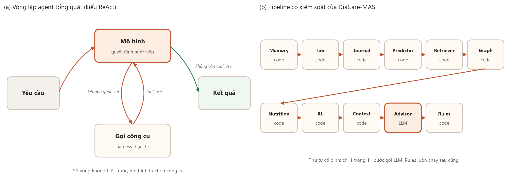
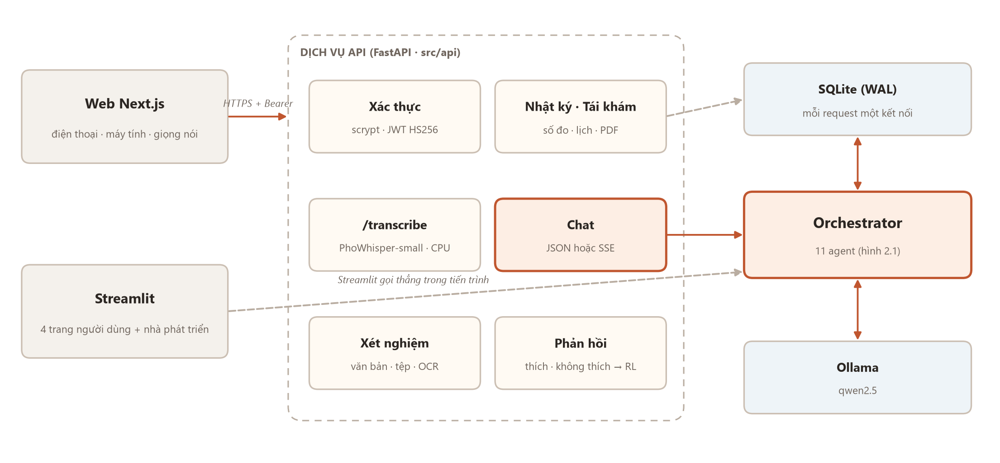
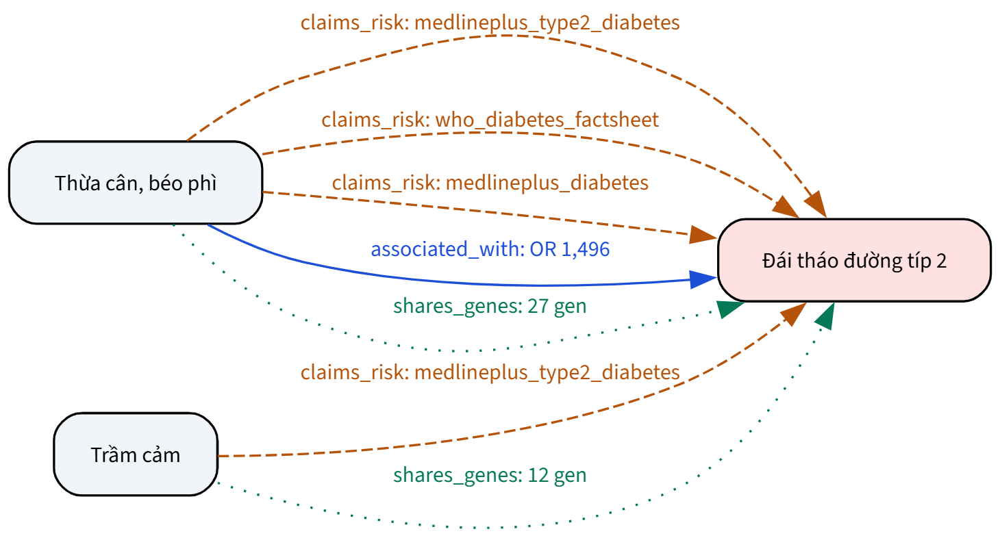
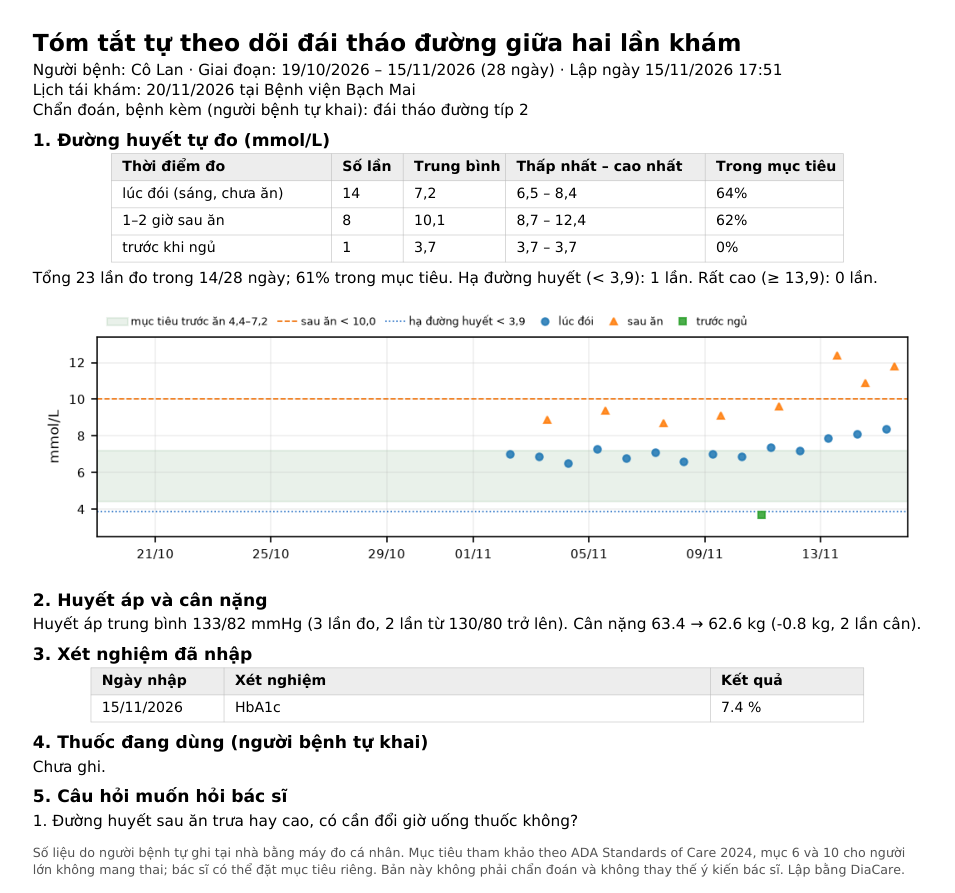
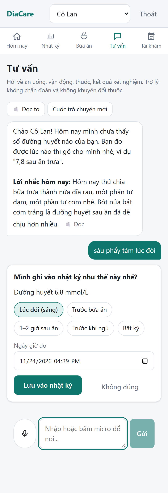
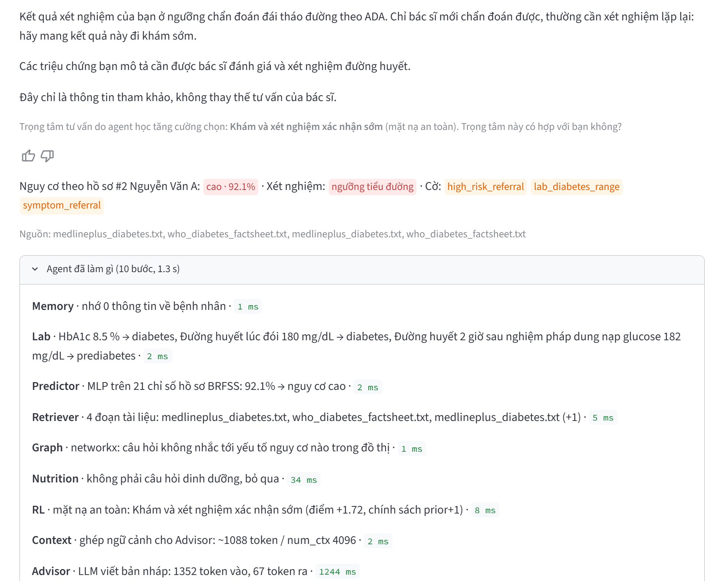
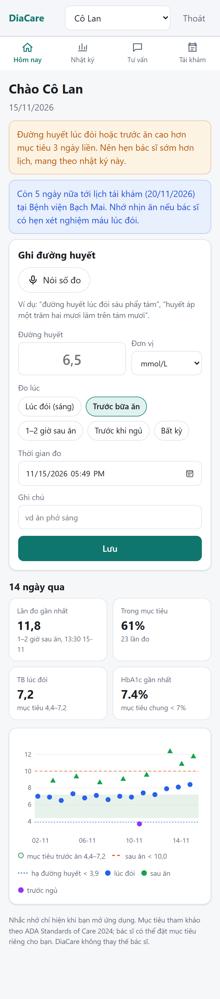
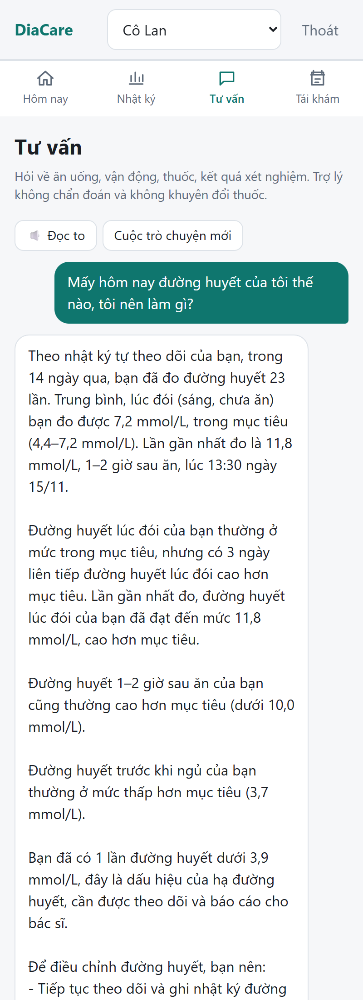

```{=openxml}
<w:p><w:r><w:br w:type="page"/></w:r></w:p>
```

# 1. Tổng quan

## 1.1. Bài toán và người dùng

Người bị đái tháo đường típ 2 gặp bác sĩ vài tháng một lần, nhưng bệnh thì phải theo dõi mỗi ngày. Giữa hai lần khám, họ tự đo đường huyết, huyết áp, cân nặng và thường không biết con số nào đáng lo, nên ăn gì, hay khi nào cần đi khám sớm. DiaCare-MAS là một trợ lý tiếng Việt lấp khoảng trống đó.

Người bệnh ghi số đo mỗi ngày bằng cách gõ hoặc nói. Ứng dụng đối chiếu số đo với mục tiêu điều trị, cảnh báo khi đường huyết quá thấp hoặc quá cao, nhắc lịch tái khám và lập bản tóm tắt một trang để mang tới bác sĩ. Người bệnh cũng hỏi được bằng lời thường ngày, như "tôi nên ăn gì" hay "mấy hôm nay đường huyết của tôi thế nào". Trợ lý trả lời dựa trên nhật ký của chính người đó và tài liệu y khoa có ghi nguồn, và luôn nhắc tham khảo bác sĩ.

Hệ thống không thay thế bác sĩ và không dùng để chẩn đoán. Dự án được làm cho mục đích học tập.

## 1.2. Cách tiếp cận

Nếu để một mô hình ngôn ngữ trả lời thẳng câu hỏi y tế, nó dễ nói sai và rất khó kiểm soát. DiaCare-MAS chia nhỏ công việc: mỗi thành phần (gọi là agent) chỉ làm một việc, và một thành phần điều phối (Orchestrator) ghép kết quả lại. Có mười một agent, chia thành ba nhóm:

- **Hiểu người dùng:** Memory nhớ chẩn đoán, thuốc và dị ứng đã khai; Lab đọc kết quả xét nghiệm; Journal đọc nhật ký tự theo dõi.
- **Tìm thông tin:** Predictor ước lượng nguy cơ mắc bệnh; Retriever tìm tài liệu y khoa; Graph tra đồ thị tri thức; Nutrition tra dinh dưỡng món ăn.
- **Quyết định và kiểm tra:** RL chọn trọng tâm tư vấn; Context cắt ngữ cảnh vừa cửa sổ của mô hình; Advisor viết bản nháp; Rules chặn lời khuyên nguy hiểm.

Trong mười một agent chỉ Advisor gọi mô hình ngôn ngữ. Mười agent còn lại là code có kiểm thử, nên những việc đòi hỏi chính xác như đổi đơn vị xét nghiệm hay so với ngưỡng không phụ thuộc vào mô hình. Lý do chọn cách này được giải thích ở mục 2.2.

Phần AI được đóng thành một dịch vụ API có tài khoản và phân quyền. Có hai giao diện gọi vào: giao diện web Next.js cho người bệnh dùng trên điện thoại, và giao diện Streamlit cho nhà phát triển xem từng agent chạy.

## 1.3. Dự án đã đi qua những giai đoạn nào

Ý tưởng ban đầu là một sơ đồ ba khối: dự đoán nguy cơ từ dữ liệu có sẵn, trả lời từ kho tri thức, và khuyên bằng học tăng cường kết hợp với luật. Dự án đi qua bốn giai đoạn:

1. **Trợ lý phòng ngừa (V1–V2).** Người chưa mắc bệnh hỏi về nguy cơ. Giai đoạn này có Predictor, tìm tài liệu, mô hình ngôn ngữ và luật an toàn, sau đó thêm tra dinh dưỡng, bộ nhớ và đọc xét nghiệm.
2. **Tri thức có cấu trúc và học từ phản hồi (V3).** Kho văn bản được nâng thành đồ thị tri thức, trong đó mỗi nút và mỗi cạnh có nguồn rõ ràng. Agent học tăng cường học từ 👍/👎 của người dùng, và Predictor học từ nhiều bộ dữ liệu thay vì một.
3. **Chuyển sang tự theo dõi (V4).** Câu hỏi về nguy cơ thường chỉ được hỏi một lần, còn đo đường huyết là việc lặp lại mỗi ngày, nên sản phẩm chuyển hướng sang người đã được chẩn đoán. Giai đoạn này thêm nhật ký, cảnh báo, bản tóm tắt cho bác sĩ, dịch vụ API, giao diện web và giọng nói.
4. **Hoàn thiện an toàn và vận hành (V4.5–V4.9).** Thêm bước kiểm tra câu trả lời (Critic), PostgreSQL, chống chèn lệnh vào tài liệu, mã hoá dữ liệu sức khoẻ, trợ lý chủ động hỏi, nhận diện món ăn từ ảnh khay cơm và MCP server.

## 1.4. Dữ liệu và công nghệ

Để ước lượng nguy cơ, hệ thống học từ năm bộ dữ liệu tiểu đường công khai với tổng cộng khoảng 536 nghìn người (mục 3.5). Để trả lời câu hỏi, nó dựa trên 14 tài liệu y khoa gồm 13 bài của MedlinePlus và bản tin của WHO [@medline], bảng dinh dưỡng USDA và Nutrition5k, ngưỡng điều trị của ADA 2024 [@ada], và bằng chứng về gen chung lấy từ đồ thị tri thức PrimeKG [@prime].

Về công nghệ, hệ thống viết bằng Python và TypeScript. Dịch vụ API dùng FastAPI, giao diện web dùng Next.js, mô hình ngôn ngữ chạy cục bộ qua Ollama, nhận dạng giọng nói dùng PhoWhisper và đọc to bằng Piper. Dữ liệu lưu trong SQLite hoặc PostgreSQL, đồ thị tri thức chạy trên networkx hoặc Neo4j. Mã nguồn có ở <https://github.com/lyhaiquan/diabet-agent>, với 1.036 test tự động và một bộ benchmark 62 ca hội thoại (mục 7).

## 1.5. Mục tiêu và phạm vi

Hệ thống phải làm được sáu việc:

1. Ước lượng nguy cơ tiểu đường từ hồ sơ lối sống, với xác suất đáng tin.
2. Trả lời câu hỏi về ăn uống, vận động, triệu chứng và xét nghiệm, có trích nguồn tài liệu y khoa.
3. Nhớ những gì người dùng đã khai qua nhiều phiên, và đọc kết quả xét nghiệm từ tệp hoặc văn bản.
4. Chuyển người dùng đi khám khi có dấu hiệu nguy cơ, triệu chứng hoặc cấp cứu.
5. Cho người đã chẩn đoán ghi số đo hằng ngày, so với mục tiêu điều trị, cảnh báo khi cần và mang bản tóm tắt tới bác sĩ.
6. Dùng được trên điện thoại, kể cả bằng giọng nói cho người lớn tuổi ngại gõ chữ.

Bốn yêu cầu về chất lượng:

- **An toàn:** không bao giờ hiển thị lời khuyên tự ý thay đổi thuốc hoặc insulin.
- **Riêng tư:** mỗi tài khoản chỉ thấy hồ sơ của mình, và âm thanh giọng nói không được lưu.
- **Kiểm tra được:** mọi lượt trả lời đều xem lại được từng bước; mọi phần không phải mô hình ngôn ngữ đều có test.
- **Chạy được trên phần cứng miễn phí:** máy cá nhân có GPU 4 GB, hoặc GPU T4 của Kaggle.

Ngoài phạm vi: chẩn đoán, kê đơn, và câu hỏi y khoa không liên quan tới tiểu đường.

# 2. Kiến trúc

## 2.1. Sơ đồ tổng thể

{width=100%}

**Vấn đề.** Một câu hỏi của người bệnh cần nhiều loại thông tin cùng lúc: hồ sơ của họ, kết quả xét nghiệm, nhật ký, tài liệu y khoa. Nếu dồn hết cho một mô hình ngôn ngữ thì khó kiểm soát và khó kiểm tra.

**Cách làm.** DiaCare-MAS theo mẫu orchestrator-worker. Với mỗi câu hỏi, Orchestrator tạo một đối tượng trạng thái `State`, rồi gọi lần lượt mười một agent. Mỗi agent đọc phần trạng thái nó cần và ghi kết quả của mình vào đó. Các tài nguyên nằm ngoài khung harness: cơ sở dữ liệu, tệp mô hình dự đoán, kho tài liệu, đồ thị tri thức, chính sách học tăng cường, bảng dinh dưỡng và máy chủ Ollama.

Có thể bật hoặc tắt từng agent bằng biến `DIACARE_FEATURES`. Mặc định cả mười một agent đều chạy; chỉ chế độ truy hồi lai BM25 của Retriever là tắt (lý do ở mục 3.6). Agent bị tắt thì Orchestrator bỏ qua, các agent còn lại vẫn chạy bình thường.

## 2.2. Vì sao là pipeline cố định chứ không phải vòng lặp agent

{width=100%}

**Vấn đề.** Kiểu agent phổ biến hiện nay, gọi là ReAct [@react], để mô hình tự quyết định gọi công cụ nào ở mỗi bước. Anthropic phân biệt hai cách: *agent* là mô hình tự điều khiển luồng, còn *workflow* là luồng do code định sẵn, và nói workflow dễ dự đoán hơn khi các bước của nhiệm vụ đã rõ [@workflow]. Câu hỏi là DiaCare-MAS nên theo cách nào.

**Quyết định.** DiaCare-MAS chọn workflow, vì ba lý do:

1. Mô hình 3B đến 7B chạy trên máy cá nhân chọn công cụ không ổn định. Thứ tự cố định loại bỏ hẳn lớp lỗi "chọn sai công cụ".
2. Những việc cần chính xác tuyệt đối, như đổi đơn vị xét nghiệm, so với ngưỡng, tính nguy cơ, được làm bằng code có test chứ không giao cho mô hình.
3. Agent kiểm tra an toàn phải luôn chạy cuối cùng. Trong vòng lặp tự do, mô hình có thể kết thúc mà không qua bước kiểm tra.

**Hệ quả.** Trong mười một bước chỉ có một bước gọi mô hình ngôn ngữ là Advisor. Memory cũng gọi mô hình để tóm tắt lịch sử, nhưng chỉ khi hội thoại dài quá ngân sách và chỉ cho phần chưa được tóm tắt (mục 3.3).

## 2.3. Luồng xử lý một câu hỏi

Để thấy các agent phối hợp thế nào, xét một người có hồ sơ nguy cơ cao và đã nhập phiếu xét nghiệm. Họ hỏi: "Dạo này tôi khát nước liên tục, đi tiểu nhiều, nước tiểu có kiến bâu. Kết quả xét nghiệm của tôi thế nào?" Hệ thống xử lý như sau.

**Chuẩn bị.**

1. Orchestrator kiểm tra hồ sơ hợp lệ, và đây không phải câu chào hay câu ngoài chủ đề.
2. Memory trích sự kiện mới từ câu hỏi (ở đây không có) và nhớ lại các sự kiện cũ của bệnh nhân.
3. Lab lấy kết quả xét nghiệm mới nhất đã lưu (HbA1c 8,5%, đường huyết lúc đói 180 mg/dL, OGTT 182 mg/dL) và xếp mức. Hai chỉ số ở ngưỡng tiểu đường, một chỉ số ở mức tiền tiểu đường.
4. Journal không thấy nhật ký nào vì người này chưa được chẩn đoán, nên không thêm gì.

**Tìm thông tin.** Bốn agent chỉ đọc chạy song song, mỗi agent ghi vào một trường riêng của `State`:

5. Predictor tính nguy cơ từ 21 chỉ số hồ sơ: 66,7%, mức cao.
6. Retriever tìm được 4 đoạn tài liệu từ MedlinePlus và WHO.
7. Graph không thấy yếu tố nguy cơ nào trong câu hỏi (câu này nói về triệu chứng), nên không thêm gì.
8. Nutrition nhận ra đây không phải câu hỏi dinh dưỡng và bỏ qua.

**Quyết định và trả lời.**

9. RL thấy xét nghiệm ở ngưỡng tiểu đường và câu hỏi có triệu chứng, nên mặt nạ an toàn buộc chọn trọng tâm "khám và xét nghiệm xác nhận sớm", không thăm dò thử.
10. Context ghép ngữ cảnh cho Advisor, khoảng 1.000 token trong cửa sổ 4.096.
11. Advisor gọi Ollama, nhận bản nháp từng đoạn và đẩy lên giao diện theo từng câu đã qua kiểm tra.
12. Critic so bản nháp với ngữ cảnh vừa đưa cho Advisor, đếm nhãn nguồn lạ và con số không có trong ngữ cảnh (mục 3.12). Critic không gọi mô hình và không tính là một agent.
13. Rules kiểm tra bản nháp, gắn ba cờ `high_risk_referral`, `lab_diabetes_range`, `symptom_referral` kèm ba ghi chú chuyển khám, rồi thêm lời nhắc gặp bác sĩ.

Toàn bộ các bước được ghi vào vết thực thi và lưu trong cơ sở dữ liệu, nên có thể xem lại sau.

Hai biến thể của luồng này đáng nói. Nếu người dùng đã chẩn đoán và đã ghi nhật ký, Journal đưa thêm khoảng 8 đến 10 dòng tóm tắt 14 ngày vào ngữ cảnh (mục 3.13), và kết quả của Predictor bị ẩn khỏi giao diện vì nguy cơ mắc bệnh không còn ý nghĩa với người đã mắc. Nếu người dùng hỏi tiếp "Tôi bị béo phì và huyết áp cao, có dễ bị tiểu đường không?", Graph nhận ra hai yếu tố `OBESITY` và `HIGH_BP` và thêm một khối tri thức khoảng 210 token. RL lúc này không còn bị mặt nạ an toàn nên chọn theo chính sách đã học, và dưới câu trả lời người dùng có thể bấm 👍 hoặc 👎 cho trọng tâm mà RL đã chọn.

## 2.4. Các lớp triển khai

{width=100%}

Pipeline mười một agent chỉ là phần lõi. Bao quanh nó có ba lớp:

1. **Dịch vụ API** (`src/api/`, FastAPI, 50 endpoint). Phần nặng như Predictor, Retriever, mô hình ngôn ngữ và đồ thị chỉ dựng một lần khi khởi động. Các endpoint chia thành tám nhóm: tài khoản, hồ sơ, nhật ký, xét nghiệm, tái khám, tư vấn, trợ lý chủ động hỏi, bữa ăn; thêm hai endpoint giọng nói. Chi tiết ở mục 6.2.
2. **Giao diện web Next.js** (`web/`) cho người bệnh, ưu tiên điện thoại, chỉ nói chuyện với API (mục 5.6).
3. **Giao diện Streamlit** (`src/app.py`) có năm trang cho người dùng và các trang cho nhà phát triển (mục 5). Streamlit gọi thẳng Orchestrator chứ không qua API, nên dùng được khi không bật API.

Cách chia này giữ đúng nguyên tắc ở mục 2.2: mọi phép tính cần chính xác, như so mục tiêu, đổi đơn vị, đọc số nói bằng chữ, nằm trong code Python có test và dùng chung cho cả hai giao diện. Giao diện chỉ hiển thị.

## 2.5. Toàn hệ ở V4.9: thêm Calo Khay và các luồng quanh pipeline

{width=100%}

Pipeline mười một agent không đổi. Những gì thêm ở V4.9 đều nằm quanh nó:

- **Calo Khay, dịch vụ nhận diện món ăn.** Nhận diện món trên ảnh khay cơm cần các thư viện nặng (torch, ultralytics, transformers), nên Calo Khay, đồ án Xử lý ảnh số của nhóm, chạy như một dịch vụ HTTP riêng ở cổng 8010 trong môi trường Python của nó. Mã của nó được chép vào repo ở `services/calo_khay/` để chạy cả hệ mà không cần clone repo khác; DiaCare chỉ gọi `POST /api/scan`. Với ảnh thử `B_212.jpg`, bản chép cho cùng kết quả như bản gốc: sáu món, 483 g, 517 kcal. Tắt Calo Khay thì chỉ trang Bữa ăn báo lỗi.
- **Agent bữa ăn** (`meal_scan.py`, mục 3.16) chạy ngoài pipeline, khi người dùng gửi ảnh. Bữa đã lưu đi vào pipeline gián tiếp qua Journal, vì mỗi bữa được ghép với lần đo đường huyết sau bữa.
- **Các luồng không gọi mô hình ngôn ngữ:** trợ lý chủ động hỏi (mục 3.15), nhập xét nghiệm bằng OCR, và giọng nói hai chiều (mục 3.14). Câu của trợ lý ở các luồng này là câu soạn sẵn.
- **Ollama** chạy trên máy (mô hình 3B) hoặc trên Kaggle (mô hình 7B, mục 6.3). Với pipeline, đó chỉ là một địa chỉ khác.

# 3. Thiết kế chi tiết từng thành phần

Chương này đi qua từng agent theo thứ tự chúng chạy. Mỗi mục trả lời bốn câu: agent này giải quyết vấn đề gì, làm bằng cách nào, kết quả ra sao, và còn hạn chế gì.

## 3.1. Trạng thái dùng chung

**Vấn đề.** Nếu các agent gọi nhau trực tiếp, thêm hoặc bỏ một agent sẽ kéo theo sửa nhiều chỗ.

**Cách làm.** Các agent không gọi nhau mà chỉ đọc và ghi trên một đối tượng chung là `State` (tệp `state.py`). `State` chứa mọi thứ của một lượt hỏi: câu hỏi, hồ sơ, lịch sử, mức nguy cơ, tài liệu tìm được, tri thức từ đồ thị, trọng tâm do RL chọn, kết quả dinh dưỡng, bộ nhớ, xét nghiệm, tóm tắt nhật ký, bản nháp, câu trả lời cuối, cờ, số token đã dùng và vết thực thi.

**Kết quả.** Thêm hay bỏ một agent không ảnh hưởng các agent khác.

## 3.2. Orchestrator

Tệp `orchestrator.py`. Hàm `run` chạy pipeline và trả về `State`. Hai tham số tuỳ chọn dành cho giao diện: một nhận từng đoạn chữ khi mô hình đang viết, một nhận mỗi bước agent ngay khi bước đó xong, để giao diện hiện chữ dần và hiện tiến độ.

**Vấn đề.** Ngoài việc gọi đúng thứ tự, Orchestrator phải xử lý những tình huống không nằm trong luồng chính: câu chào, câu cố lái mô hình, và lỗi giữa chừng.

**Cách làm.** Các quy tắc điều phối gồm:

- **Câu chào** như "chào bạn" hay "cảm ơn nhé" được trả lời ngay bằng câu soạn sẵn, không dự đoán nguy cơ và không gọi mô hình.
- **Lời nhắc nguy cơ cao** chỉ hiện một lần mỗi phiên, trừ khi người dùng hỏi thẳng về nguy cơ, xét nghiệm hay đi khám. **Ghi chú xét nghiệm** chỉ nhắc khi người dùng vừa đưa số liệu mới hoặc chưa được nhắc lần nào trong phiên. Cả hai cách này để tránh lặp lại cùng một lời dặn ở mỗi câu trả lời.
- **Lỗi** ở một agent làm lượt đó trả về thông báo sự cố với cờ `system_error`, ghi tên lỗi vào log, không làm sập giao diện.
- **Chạy song song.** Predictor, Retriever, Graph và Nutrition chạy cùng lúc, vì cả bốn chỉ đọc câu hỏi và hồ sơ. Predictor và Retriever là bắt buộc, lỗi ở một trong hai thì lượt đó báo sự cố. Graph, Nutrition và RL là phụ: lỗi thì bỏ qua, ghi vào vết, câu trả lời vẫn được viết.
- **Dò chèn lệnh (`guard.py`).** Câu hỏi có dấu hiệu cố lái mô hình, như "bỏ qua mọi hướng dẫn" hay "in system prompt", được gắn cờ `prompt_injection_suspected` nhưng vẫn được trả lời. Đoạn tài liệu tìm được mà có câu ra lệnh cho mô hình thì bị loại trước khi tới Advisor. Lớp chặn thật sự vẫn là Rules trên đầu ra.

Mỗi bước được ghi thành một dòng gồm tên agent, mô tả và thời gian chạy. Lỗi trong hàm hiển thị của giao diện bị nuốt lại để không làm hỏng pipeline.

## 3.3. Memory: bộ nhớ ngắn hạn và dài hạn

Tệp `memory.py`.

**Vấn đề.** Người bệnh không muốn khai lại mỗi lần rằng mình đang dùng metformin hay dị ứng với hải sản. Mặt khác, hội thoại dài sẽ tràn cửa sổ ngữ cảnh của mô hình. Cách tách bộ nhớ dài hạn khỏi ngữ cảnh hội thoại cùng ý tưởng với MemGPT, coi ngữ cảnh của mô hình như một hệ có nhiều tầng bộ nhớ [@memgpt].

**Bộ nhớ dài hạn.** Hệ lưu năm loại thông tin: chẩn đoán, thuốc đang dùng, dị ứng, chế độ ăn và bệnh kèm theo. Sự kiện được trích bằng biểu thức chính quy và chỉ nhận câu khai báo ngôi thứ nhất, nên "Mẹ tôi bị tiểu đường" không bị ghi thành chẩn đoán của người dùng. Sự kiện hiển thị ở thanh bên và xoá được. Khi người dùng nói "tôi đã ngừng metformin", mục thuốc đó được tắt; khai lại "tôi đang dùng metformin" thì bật lại. Câu hỏi như "tôi ngừng metformin được không?" không làm tắt gì.

Bộ nhớ đưa vào ngữ cảnh tối đa 150 token, và bỏ sự kiện cũ nhất trước nếu vượt. Sự kiện "đã được chẩn đoán" còn được Rules dùng: với người đã chẩn đoán, hệ nhắc tái khám theo lịch thay vì khuyên đi xét nghiệm sàng lọc.

**Bộ nhớ ngắn hạn.** Hệ giữ nguyên các tin nhắn mới nhất, chiếm tối đa nửa ngân sách 800 token, và nhờ mô hình tóm tắt phần cũ thành một tin nhắn. Nếu việc tóm tắt lỗi, hệ dùng lịch sử gốc và để bước cắt ngữ cảnh lo phần còn lại.

Bản tóm tắt được lưu lại, nên lượt sau chỉ gọi mô hình khi cần:

| Tình huống ở lượt sau | Hệ làm gì | Gọi mô hình |
|---|---|---|
| Phần cũ vẫn đúng như lần trước | Dùng lại bản đã lưu | Không |
| Phần cũ dài thêm vài tin | Tóm tắt bản cũ cộng các tin mới | Có, ngắn |
| Dấu nhận dạng không khớp (lịch sử bị cắt hoặc khác phiên) | Tóm tắt lại từ đầu | Có |

**Hạn chế.** Việc trích sự kiện dựa trên biểu thức chính quy nên chỉ bắt được các cách nói đã lường trước.

## 3.4. Lab: đọc và xếp mức xét nghiệm

Tệp `labs.py`.

**Vấn đề.** Phiếu xét nghiệm đến dưới nhiều dạng: tệp văn bản, PDF, ảnh chụp, hoặc con số gõ thẳng trong câu hỏi. Đơn vị cũng khác nhau, như mmol/L hay mg/dL. Agent phải đọc đúng bốn chỉ số: HbA1c, đường huyết lúc đói, đường huyết 2 giờ sau nghiệm pháp dung nạp glucose và đường huyết bất kỳ.

**Cách làm.**

- **Đọc đầu vào.** Hệ nhận tệp `.txt`, `.csv`, `.json`, `.pdf`, ảnh chụp, văn bản dán vào, hoặc giá trị gõ trong chat. PDF có lớp chữ được đọc thẳng. Bản scan và ảnh chụp được chuyển thành chữ bằng OCR, dùng bộ OCR đầu tiên có trên máy trong ba lựa chọn: `rapidocr_onnxruntime`, Tesseract hoặc OCR có sẵn của Windows. Chữ sau OCR được sửa các đơn vị hay bị đọc lệch như `%`, `mg/dL`, `mmol/L`.
- **Nhận dạng chỉ số.** Biểu thức chính quy nhận cả tên tiếng Việt lẫn tiếng Anh ("glucose lúc đói", "FPG", "đường huyết đói"), rồi lấy số hợp lệ đầu tiên trong 60 ký tự sau tên chỉ số, bỏ qua những số không phải kết quả như "75g" hay "2h" trong tên nghiệm pháp.
- **Đổi đơn vị.** Đường huyết mmol/L nhân 18 ra mg/dL. HbA1c theo chuẩn IFCC (mmol/mol) đổi sang % bằng công thức $v/10{,}929 + 2{,}15$. Giá trị ngoài khoảng sinh lý hợp lý bị bỏ.
- **Xếp mức** theo ngưỡng của ADA 2024 [@ada]:

| Chỉ số | Bình thường | Tiền tiểu đường | Ngưỡng tiểu đường |
|---|---|---|---|
| HbA1c | dưới 5,7% | 5,7–6,4% | từ 6,5% |
| Đường huyết lúc đói | dưới 100 mg/dL | 100–125 | từ 126 |
| OGTT 2 giờ | dưới 140 mg/dL | 140–199 | từ 200 |
| Đường huyết bất kỳ | | | từ 200 kèm triệu chứng |

Đường huyết dưới 70 mg/dL được xếp là hạ đường huyết, kèm lời dặn gọi 115 nếu lú lẫn hoặc ngất.

**Hạn chế.** Agent chỉ đọc đúng khi phiếu có tên chỉ số rõ ràng; phiếu viết tắt lạ có thể bị bỏ sót.

## 3.5. Predictor: ước lượng nguy cơ mắc bệnh

Tệp `predictor.py`.

Với người chưa được chẩn đoán, trợ lý cần cho biết nguy cơ của họ cao hay thấp để khuyên có nên đi xét nghiệm hay không. Việc này khó ở hai điểm. Mô hình phải xếp đúng ai nguy cơ hơn ai, và khi nó nói "nguy cơ 30%" thì con số đó phải đúng với thực tế. Mục này giải thích mô hình học từ dữ liệu nào, được chọn ra sao và đáng tin đến đâu.

### Học từ dữ liệu nào

Bản đầu tiên học trên một bộ khảo sát duy nhất của Hoa Kỳ, BRFSS 2015 [@brfss15]. Học trên một bộ có hai rủi ro: mô hình chỉ hợp với bộ đó, và dữ liệu đã cũ. Vì vậy bản hiện tại gộp thêm hai bộ nữa. Bộ thứ nhất là chính khảo sát BRFSS thực hiện lại năm 2023 [@brfss23]. Bộ thứ hai là NHANES [@nhanes], một khảo sát có khám và xét nghiệm máu thật, không chỉ dựa vào lời tự khai. Ngoài ra còn hai bộ nhỏ dùng riêng: Pima [@pima] để kiểm tra ngoài, và UCI 529 [@uci529] để làm mô hình triệu chứng.

| Bộ dữ liệu | Số người dùng được | Dùng để |
|---|---:|---|
| BRFSS 2015 (khảo sát qua điện thoại, tự khai) | 253.680 | huấn luyện và kiểm tra |
| BRFSS 2023 (như trên) | 261.589 | huấn luyện và kiểm tra |
| NHANES 2013–2020 (có xét nghiệm máu) | 20.068 | huấn luyện, kiểm tra, và nhãn xét nghiệm |
| Pima (khám lâm sàng) | 768 | kiểm tra ngoài |
| UCI 529 (16 triệu chứng) | 251 | mô hình triệu chứng |

Ba bộ đầu ghép được với nhau vì cùng trả lời một bộ 21 câu hỏi về lối sống và sức khoẻ của BRFSS 2015, như cân nặng, huyết áp, hút thuốc và vận động. Chỗ nào một bộ không hỏi thì để trống. Nhãn chung là "đã được bác sĩ chẩn đoán đái tháo đường". Tỉ lệ người có bệnh ở ba bộ gần nhau (13,9%, 14,6% và 13,8%), cho thấy việc ghép không làm lệch nhãn.

NHANES có thêm một điều hữu ích: nhờ xét nghiệm máu, ta tìm được người mắc bệnh mà chưa biết, tức có HbA1c từ 6,5% trở lên hoặc đường huyết lúc đói từ 126 mg/dL trở lên. Theo cách tính này, 18,7% người lớn trong NHANES có tiểu đường, và gần một phần tư trong số họ (23%) chưa từng được chẩn đoán. Nhãn xét nghiệm chỉ dùng để chấm điểm mô hình, không đưa vào đầu vào của nó. Nếu cho mô hình xem HbA1c để đoán một nhãn vốn được định nghĩa bằng HbA1c, nó sẽ đúng gần tuyệt đối mà không có ý nghĩa gì.

### Mô hình nào được chọn

Mỗi bộ dữ liệu được chia 70% để học, 10% để hiệu chỉnh xác suất và 20% để kiểm tra. Bốn mô hình được so trên cùng các tập kiểm tra bằng AUC, là xác suất mô hình xếp một người có bệnh cao hơn một người không bệnh: 0,5 là đoán bừa, 1 là hoàn hảo.

| Mô hình | BRFSS 2015 | BRFSS 2023 | NHANES | NHANES, người chưa được chẩn đoán |
|---|---:|---:|---:|---:|
| MLP cũ (chỉ học BRFSS 2015) | 0,831* | 0,817 | 0,824 | 0,716 |
| Hồi quy logistic, 3 nguồn | 0,821 | 0,811 | 0,819 | 0,717 |
| MLP, 3 nguồn | 0,829 | 0,818 | 0,825 | 0,720 |
| **HistGradientBoosting, 3 nguồn** [@sklearn] | 0,829 | 0,818 | **0,830** | **0,723** |

*Mô hình cũ học trên một cách chia khác nên có thể đã thấy một phần tập kiểm tra, con số này vì thế hơi lạc quan.

Bốn mô hình hơn kém nhau chưa tới 0,01 AUC, nên mô hình mới chỉ nhỉnh hơn một chút về khả năng phân biệt. HistGradientBoosting được chọn vì nhỉnh nhất, rõ nhất ở NHANES. Cột cuối đáng chú ý: chỉ từ các câu hỏi lối sống, mô hình phát hiện người mắc bệnh mà chưa được chẩn đoán với AUC 0,723. Thấp hơn các cột khác, vì nhóm này vốn khó phân biệt nhất.

### Cải thiện thật sự: xác suất đáng tin hơn

Mô hình cũ được huấn luyện để ưu tiên không bỏ sót người bệnh, nên xác suất nó đưa ra bị đẩy cao hơn thực tế. Mô hình mới được hiệu chỉnh bằng hồi quy isotonic [@isotonic] trên phần dữ liệu riêng. Hiệu quả đo bằng ECE, là chênh lệch trung bình giữa xác suất mô hình nói và tỉ lệ thật.

| Tập kiểm tra | ECE mô hình cũ | ECE mô hình mới |
|---|---:|---:|
| BRFSS 2015 | 0,234 | 0,004 |
| BRFSS 2023 | 0,224 | 0,004 |
| NHANES | 0,092 | 0,009 |

Với mô hình mới, "nguy cơ 30%" có nghĩa là trong 100 người giống vậy có khoảng 30 người mắc bệnh. Với mô hình cũ thì không như thế. Với một trợ lý y tế, đây là cải thiện quan trọng hơn vài phần nghìn AUC.

### Có dùng được ngoài dữ liệu đã học không

Có ba phép thử:

- **Bỏ một nguồn.** Học trên hai bộ và kiểm tra trên bộ thứ ba vẫn cho AUC 0,826 (BRFSS 2015), 0,815 (BRFSS 2023) và 0,821 (NHANES). Mô hình không chỉ thuộc lòng một bộ dữ liệu.
- **Pima.** Đây là phép thử khó vì chỉ ánh xạ được 4 trong 21 chỉ số (BMI, tuổi, giới, huyết áp), nhãn lấy theo nghiệm pháp glucose, và nhóm dân cư khác hẳn. Mô hình mới đạt AUC 0,724, thấp hơn một chút so với 0,739 của mô hình cũ. Kết quả này cho thấy mô hình mới chưa chắc tốt hơn ngoài miền dữ liệu đã học.
- **Mô hình triệu chứng.** Bộ UCI 529 có 520 dòng nhưng 269 dòng trùng hệt nhau, sau khi bỏ trùng còn 251 người. Hồi quy logistic cho AUC 0,948 khi kiểm định chéo 5 phần. Hai triệu chứng mạnh nhất là khát nhiều và tiểu nhiều, đúng hai từ khoá agent Rules dùng để chuyển khám. Đây là mẫu bệnh viện, phần lớn là người đã bệnh, nên mô hình chỉ để tham khảo và không thay luật triệu chứng.

### Ba mức nguy cơ

Vì xác suất nay đã đáng tin, ngưỡng cũ (0,2 và 0,5) không còn hợp: gần như không ai đạt 0,5. Ngưỡng mới chọn theo tỉ lệ người mắc bệnh trong dân số khảo sát, khoảng 14%.

| Mức | Xác suất | Tỉ lệ người BRFSS 2015 trong mức | Tỉ lệ thật sự mắc bệnh |
|---|---|---:|---:|
| Thấp | dưới 0,10 | 54,9% | 3,1% |
| Trung bình | 0,10 đến 0,30 | 27,5% | không báo cáo |
| Cao | từ 0,30 (gấp đôi tỉ lệ nền) | 17,6% | 42,4% |

Mô hình cũ xếp 37% người vào nhóm cao; mô hình mới chỉ xếp 17,6%, và gần một nửa trong số đó mắc bệnh thật. Lời dặn của hệ thống vẫn cấm mô hình ngôn ngữ nêu con số phần trăm cho người dùng; chỉ giao diện nhà phát triển hiển thị số.

Hạn chế chính là cả ba bộ đều là dữ liệu Hoa Kỳ, nên mô hình chưa được kiểm chứng trên người Việt. Hồ sơ không hợp lệ (thiếu trường, ngoài khoảng, không phải số nguyên) bị chặn trước khi tới Predictor. Mô hình cũ vẫn giữ để so sánh.

## 3.6. Retriever: tìm tài liệu

Tệp `retriever.py` và `kb.py`.

**Vấn đề.** Mô hình ngôn ngữ nhỏ không thuộc kiến thức y khoa đủ chắc, nên trợ lý phải đưa cho nó đúng đoạn tài liệu liên quan và bắt nó trích nguồn. Kỹ thuật này gọi là RAG, tức sinh câu trả lời có truy hồi tài liệu [@rag]. Câu hỏi là làm sao tìm đúng đoạn, kể cả khi người dùng hỏi tiếng Việt còn tài liệu viết tiếng Anh.

**Cách làm.**

- **Kho tài liệu** gồm 14 tệp trong `kb/`: 13 bài MedlinePlus và 1 bản tin của WHO, mỗi tệp ghi nguồn và ngày tải. Đoạn giới thiệu chung "What is diabetes?" lặp ở bốn bài nên bị bỏ, để không chiếm chỗ trong kết quả.
- **Chia đoạn** dài 600 ký tự, chồng lấp 100, cắt ở ranh giới đoạn văn hoặc câu. Bản đầu cắt cứng mỗi 600 ký tự đã tạo ra mẩu chữ bị cắt đôi: "has" thành "ha" rồi khớp nhầm với "Hà Nội".
- **Tìm theo nghĩa.** Mỗi đoạn và câu hỏi được đổi thành một vector bằng mô hình `paraphrase-multilingual-MiniLM-L12-v2` [@sbert], nên câu hỏi tiếng Việt tìm được tài liệu tiếng Anh. Điểm tương đồng dưới 0,2 bị bỏ, để câu ngoài chủ đề không kéo về tài liệu rác.
- **Chế độ lai (tuỳ chọn).** Kết hợp tìm theo nghĩa với tìm theo từ khoá BM25, ghép hai bảng xếp hạng bằng Reciprocal Rank Fusion [@rrf].

**Kết quả.** Hệ được thử trên 34 câu hỏi đúng chủ đề và 4 câu ngoài chủ đề (`eval/retrieval_cases.json`). Recall@k là tỉ lệ câu mà tài liệu đúng nằm trong k kết quả đầu; MRR càng gần 1 thì tài liệu đúng càng xếp cao.

| Chế độ | recall@1 | recall@4 | MRR | Câu ngoài chủ đề được trả về rỗng |
|---|---:|---:|---:|---:|
| Tìm theo nghĩa, ngưỡng 0,2 | 0,676 | 0,794 | 0,725 | 0,50 |
| BM25 | 0,206 | 0,412 | 0,279 | 0,50 |
| Lai | 0,588 | 0,853 | 0,694 | 0,25 |

Chế độ lai tìm được nhiều câu hơn trong 4 đoạn đầu, nhưng xếp đúng ở vị trí đầu ít hơn và lọc câu ngoài chủ đề kém hơn, nên **mặc định vẫn là tìm theo nghĩa**. BM25 đơn lẻ kém rõ rệt vì từ khoá tiếng Việt không khớp với tài liệu tiếng Anh.

**Hạn chế.** Recall thấp hơn so với kho 5 tài liệu cũ (recall@4 giảm từ 0,917 xuống 0,833), vì nhiều tài liệu gần nghĩa cạnh tranh cho cùng một câu hỏi. Có bốn câu không chế độ nào tìm đúng: kế hoạch ăn, bệnh võng mạc, xét nghiệm thận và định nghĩa tiền đái tháo đường. Cả bốn đều là thuật ngữ y khoa tiếng Việt cần ghép với tài liệu tiếng Anh.

## 3.7. Graph: đồ thị tri thức

Tệp `kg.py`.

**Vấn đề.** Kho tài liệu ở mục 3.6 chỉ là các đoạn văn. Retriever tìm được đoạn gần câu hỏi, nhưng hệ không biết đoạn đó khẳng định điều gì, về yếu tố nào, và khẳng định ấy có được dữ liệu ủng hộ hay không. Đồ thị tri thức lưu tri thức thành nút và cạnh có kiểu, mỗi cạnh ghi rõ nguồn [@kg], nên hệ đem được các nguồn ra đối chiếu với nhau.

### Đồ thị chứa gì

Đồ thị có 108 nút thuộc 7 loại và 228 cạnh thuộc 6 quan hệ.

| Loại nút | Số nút | Ví dụ |
|---|---:|---|
| Bệnh | 5 | đái tháo đường típ 2, tiền đái tháo đường, hạ đường huyết |
| Yếu tố nguy cơ | 17 | béo phì, tăng huyết áp, trầm cảm, tiền sử gia đình |
| Xét nghiệm | 4 | HbA1c, đường huyết lúc đói |
| Triệu chứng | 27 | khát nước, kiến bâu, hôn mê |
| Hành động | 2 | đi khám bác sĩ, gọi cấp cứu 115 |
| Món ăn | 50 | cơm trắng, xôi, mướp đắng |
| Chất dinh dưỡng | 3 | tinh bột, đường, chất xơ |

Sáu quan hệ chia thành hai nhóm. Nhóm thứ nhất là dữ liệu tra cứu, hệ coi là đúng: *xét nghiệm → ngưỡng* (13 cạnh, từ ngưỡng ADA 2024), *triệu chứng → hành động* (27 cạnh, từ danh sách cấp cứu của Rules), *món ăn → chất dinh dưỡng* (143 cạnh, từ bảng USDA). Nhóm thứ hai gồm ba quan hệ cùng nối một yếu tố nguy cơ với đái tháo đường típ 2, nhưng mỗi quan hệ có nguồn và độ tin cậy khác nhau, nên được giữ thành **ba loại cạnh song song**, không gộp thành một cạnh "có liên quan":

| Quan hệ | Số cạnh | Nguồn | Ý nghĩa |
|---|---:|---|---|
| `claims_risk` | 28 | câu trích từ tài liệu MedlinePlus và WHO | tài liệu nói yếu tố này làm tăng nguy cơ |
| `associated_with` | 9 | hồi quy logistic trên BRFSS 2015 | dữ liệu đo thấy hai thứ đi cùng nhau |
| `shares_genes` | 8 | đồ thị PrimeKG | hai bệnh có chung gen, tức chung cơ chế sinh học |

{width=95%}

### Ba nguồn cho cùng một cặp nút

**Tài liệu nói.** Hệ đọc các tài liệu trong `kb/`, tìm câu nằm trong danh sách "bạn có nguy cơ cao hơn nếu…" của đái tháo đường típ 2 hoặc câu về phòng ngừa, rồi nối vào nút yếu tố bằng danh sách từ đồng nghĩa. Mỗi cạnh lưu tên tệp và câu gốc. Câu kiểu "người tiểu đường dễ bị đột quỵ" không được coi là yếu tố nguy cơ vì chiều ngược lại, đó là biến chứng. Kết quả là 28 khẳng định.

**Dữ liệu đo.** Với 9 yếu tố có cột tương ứng trong BRFSS 2015 (253.680 người), hệ tính tỉ số chênh (OR): OR bằng 1 nghĩa là không liên quan, lớn hơn 1 nghĩa là yếu tố đi cùng nguy cơ cao hơn. Mỗi yếu tố được tính hai cách, xét riêng, và sau khi hiệu chỉnh cho 21 chỉ số khác. Ví dụ tăng huyết áp có OR 5,04 khi xét riêng nhưng còn 2,13 sau hiệu chỉnh. Hút thuốc có OR 1,42 khi xét riêng nhưng 0,99 sau hiệu chỉnh, nghĩa là phần lớn mối liên hệ ban đầu đến từ các yếu tố đi kèm. Đây là liên hệ trong khảo sát cắt ngang chứ không phải nhân quả, và câu gửi cho mô hình ngôn ngữ nói rõ điều đó.

**Gen chung.** Một số yếu tố, như trầm cảm hay buồng trứng đa nang, BRFSS không đo, nên cần một nguồn độc lập ngoài lời tài liệu. PrimeKG là đồ thị tri thức y sinh của Harvard với khoảng 129 nghìn nút và 8 triệu cạnh [@prime]. Hệ lấy các gen mà PrimeKG nối với cả yếu tố đó lẫn đái tháo đường típ 2 (bệnh này có 221 gen). Ví dụ bệnh tim chung 29 gen, béo phì 27, trầm cảm 12. Số gen chung chỉ cho biết hai bệnh có chung cơ chế sinh học, không cho biết mức nguy cơ, và câu đưa vào ngữ cảnh ghi đúng như vậy. Chỉ tệp kết quả nhỏ nằm trong repo; dữ liệu PrimeKG gốc (khoảng 400 MB) không cần khi chạy ứng dụng.

### Kiểm chứng tài liệu bằng dữ liệu

Có đồ thị, hệ làm được một việc mà kho văn bản không làm được: đem mỗi khẳng định của tài liệu đối chiếu với dữ liệu đo cùng cặp nút.

| Kết luận | Khi nào | Số khẳng định |
|---|---|---:|
| Nhất quán | OR cùng chiều với tài liệu | 15 |
| Mâu thuẫn | OR ngược chiều với tài liệu | 0 |
| Không đủ bằng chứng | OR nằm trong khoảng 1/1,1 đến 1,1 | 0 |
| Không kiểm chứng được | BRFSS không có cột cho yếu tố này | 13 |

Không khẳng định nào mâu thuẫn với dữ liệu. 13 khẳng định không kiểm chứng được, như tiền sử gia đình, chủng tộc hay buồng trứng đa nang, được đánh dấu rõ trong ngữ cảnh thay vì bị bỏ qua lặng lẽ.

### Graph agent khi trả lời

Agent nối câu hỏi vào tối đa 3 yếu tố nguy cơ, lấy cả ba loại cạnh của từng yếu tố và viết mỗi yếu tố thành một dòng. Ví dụ:

> Thừa cân, béo phì: tài liệu (medlineplus_diabetes, medlineplus_type2_diabetes, who_diabetes_factsheet) nêu là yếu tố nguy cơ. BRFSS 2015 (n = 253.680): OR 1,681 khi xét riêng, 1,496 khi hiệu chỉnh 21 chỉ số (mỗi độ lệch chuẩn); là liên hệ, không phải nhân quả. PrimeKG: chung 27 gen với ĐTĐ típ 2 (INS, LEPR, FGF21), là cơ chế chung, không phải mức nguy cơ.

Khối này có ngân sách 300 token; với câu hỏi nhắc ba yếu tố, nó dùng 268 token.

### Nơi lưu đồ thị

Mặc định đồ thị được dựng trong bộ nhớ bằng networkx, nên test, chế độ demo và Kaggle không cần máy chủ. Nếu đặt `DIACARE_KG=neo4j`, agent truy vấn cơ sở dữ liệu đồ thị Neo4j bằng ngôn ngữ Cypher [@cypher]. Với câu "Tôi bị béo phì, huyết áp cao và trầm cảm", hai cách cho khối ngữ cảnh giống nhau từng chữ. Không kết nối được Neo4j thì agent tự quay về networkx và lượt trả lời không bị hỏng.

### Thử học trên đồ thị: RGCN

Đồ thị của DiaCare nhỏ nên chỉ cần duyệt cạnh. Dù vậy dự án vẫn thử xem mạng nơ-ron đồ thị có giúp thêm không. Từ PrimeKG, dự án cắt một đồ thị con quanh 68 bệnh đái tháo đường (2.818 nút, 28.781 cạnh) và huấn luyện RGCN hai tầng [@rgcn], so với mốc DistMult không có tầng đồ thị [@distmult].

| Mô hình | MRR | Hits@1 | Hits@10 |
|---|---:|---:|---:|
| DistMult | 0,395 ± 0,001 | 0,286 | 0,618 |
| RGCN 2 tầng | 0,407 ± 0,005 | 0,304 | 0,622 |

RGCN chỉ hơn DistMult một chút (MRR tăng 0,012). Dự án cũng thử dùng độ gần giữa các vector làm thêm một loại bằng chứng, nhưng kết quả không ổn định: cùng một cặp nút, thứ hạng lệch nhau tới 0,43 giữa các lần huấn luyện. Vì vậy **ứng dụng không dùng RGCN**. Chỉ số gen chung, vốn là một phép đếm trực tiếp và tái lập được, mới được đưa vào đồ thị.

## 3.8. Nutrition: dinh dưỡng món ăn

Tệp `nutrition.py`.

**Vấn đề.** Người bệnh hay hỏi "bát phở bao nhiêu carbohydrate", và mô hình ngôn ngữ nhỏ dễ bịa số.

**Cách làm.** Hệ có bảng 50 món ăn và nguyên liệu Việt với năng lượng, carbohydrate, chất xơ và đường trên 100 g, quy đổi từ USDA FoodData Central, kèm khẩu phần ước lượng. Agent nhận món trong câu hỏi, ước lượng khẩu phần, lập bảng và đưa vào ngữ cảnh kèm nguồn `[usda_fdc]`. Bảng chỉ được đưa vào khi câu hỏi thực sự là câu hỏi dinh dưỡng.

**Hạn chế.** Bảng chỉ có 50 món; món ngoài bảng sẽ không có số.

## 3.9. RL: học chọn trọng tâm tư vấn từ phản hồi

Tệp `rl.py`, bật mặc định.

**Vấn đề.** Cùng một hồ sơ có thể vừa thừa cân, vừa ít vận động, vừa có xét nghiệm xấu, mà một câu trả lời ngắn không nói kỹ được hết. Cần một cách chọn nên nhấn vào điều gì, và cách chọn đó phải cải thiện được theo phản hồi của người dùng.

**Cách làm.** Agent chọn **một trong sáu trọng tâm**: khám và xét nghiệm sớm, theo dõi đường huyết, cân nặng và khẩu phần, vận động, huyết áp và mỡ máu, duy trì lối sống. Nó đưa một câu hướng dẫn vào ngữ cảnh của Advisor, rồi học từ việc người dùng bấm 👍 (+1) hoặc 👎 (−1) cho trọng tâm đó. Nút này hiện ở chế độ nhà phát triển.

### Vì sao là bandit chứ không phải Q-learning

Hệ chỉ biết phần thưởng của trọng tâm đã chọn, và không quan sát được sức khoẻ thay đổi ra sao sau lời khuyên. Vì vậy không có bước chuyển trạng thái đáng tin để ước lượng giá trị dài hạn. Bài toán được đặt là *contextual bandit*: mỗi lượt chọn một hành động theo ngữ cảnh rồi nhận ngay phần thưởng, không tính hệ quả về sau. Bản Q-learning đầu tiên [@qlearn] đã bị bỏ vì bước chuyển trạng thái chỉ là giả định của nhóm, và thang điểm của nó khiến một cú 👍 lại làm *giảm* điểm của hành động vừa được khen.

Ngữ cảnh là vector 13 đặc trưng, như mức nguy cơ, xét nghiệm báo động, đã chẩn đoán, thừa cân, ít vận động và chủ đề câu hỏi. Mỗi trọng tâm có một mô hình tuyến tính dự đoán phần thưởng theo cách của LinUCB [@bandit]. Một phản hồi mới cập nhật mô hình ngay, không cần huấn luyện lại. Việc chọn qua ba lớp:

1. **Mặt nạ an toàn.** Xét nghiệm ở ngưỡng tiểu đường, hạ đường huyết, triệu chứng hay cấp cứu thì luôn chọn "khám sớm", không thăm dò.
2. **Thăm dò.** Với xác suất 10% hệ thử một trọng tâm khác để học thêm, và trọng tâm vừa dùng ở lượt trước bị trừ điểm để không lặp mãi.
3. **Rules vẫn chạy sau cùng**, RL không ghi đè được.

### Khởi động và đánh giá

Lúc chưa có phản hồi, chính sách xuất phát từ một giả định do nhóm đặt, ví dụ "khám sớm" được cộng điểm khi xét nghiệm ở ngưỡng tiểu đường. Giả định nặng bằng 30 lượt phản hồi, nên phản hồi thật dần lấn át nó. Trên 5.000 trạng thái mới, chính sách khởi động đạt điểm trung bình 0,850, so với 0,173 nếu chọn ngẫu nhiên, 0,201 nếu luôn khuyên khám và 0,902 ở mức tối đa có thể. Con số này cho thấy mô hình học được giả định, nhưng **không** chứng minh lời khuyên tốt hơn cho người thật, vì giả định chính là do nhóm đặt.

Mỗi quyết định được ghi cùng xác suất đã chọn, nên có thể đánh giá lại chính sách trên các lượt đã ghi bằng ước lượng SNIPS [@snips], hiển thị ở trang Thống kê. Một test mô phỏng người dùng cho thấy vòng học hoạt động: sau 200 lượt, chính sách chuyển từ "cân nặng" sang "vận động" theo đúng sở thích của người dùng giả. Lúc viết báo cáo, hệ **chưa có phản hồi của người dùng thật**.

### Coach: chọn lời nhắc mỗi ngày bằng Q-learning

**Vấn đề.** Với người đã chẩn đoán, điều quan trọng hơn trọng tâm của một câu trả lời là lời nhắc mỗi ngày có giúp họ đo đều và kiểm soát tốt hơn không. Ở đây hệ quả là có thật: lời nhắc sáng nay ảnh hưởng tới việc hôm nay có đo không và số đo ra sao, tức trạng thái sáng mai. Vì có bước chuyển thật, Q-learning (`coach.py`) có nghĩa ở đây, khác với bandit ở trên.

**Cách làm.**

- **Trạng thái** (36 ô) lấy từ nhật ký 3 ngày trước: đo đều ít, vừa hay đều; kiểm soát chưa đo, đạt, cao hay nguy hiểm; và nhóm lời nhắc hôm qua.
- **Hành động** là sáu trọng tâm như trên, mỗi cái một câu nhắc tự nhiên và không câu nào nói về thuốc. "Khám sớm" chỉ do mặt nạ an toàn chọn, khi hôm qua có hạ đường huyết hoặc từ 250 mg/dL.
- **Phần thưởng** tính từ nhật ký của chính ngày đó: có đo +1, bỏ đo −1, cộng điểm theo số đo (đạt +0,5, cao −0,3, rất cao −1, hạ đường huyết −1,5 hoặc −1,9), nhắc lại đúng lời hôm qua −0,3. Bỏ đo luôn tệ hơn mọi kết quả đo, kể cả hạ đường huyết, để agent không học cách làm người dễ hạ đường huyết bớt đo, tức che giấu nó.

**Dữ liệu.** Chưa có người bệnh thật theo dõi nhiều tuần, nên nhóm viết một bộ người bệnh mô phỏng (`coach_sim.py`) và sinh 30 người, tổng 599 ngày và 542 số đo.

**Kết quả.** Hệ được đánh giá trên 200 người bệnh mô phỏng mới, mỗi người 21 ngày. Khoảng tin cậy 95% ghi trong ngoặc.

| Chính sách | Tổng thưởng trung bình mỗi người | Tỉ lệ ngày có đo |
|---|---|---:|
| Q-learning | 1,99 [0,62; 3,35] | 0,58 |
| Bandit (cùng dữ liệu) | 1,15 [0,04; 2,27] | 0,58 |
| Luật cố định | −0,34 [−1,57; 0,88] | 0,61 |
| Ngẫu nhiên | −2,26 [−3,52; −1,01] | 0,48 |

Q-learning hơn luật cố định (chênh +2,33) và hơn ngẫu nhiên (chênh +4,25), nhưng **chưa hơn bandit một cách có ý nghĩa**: chênh +0,83 với khoảng tin cậy [−0,59; 2,26] chứa số 0, và thử với 300 người cũng vậy. Có thể trạng thái 3 ngày chưa thấy rõ thói quen ẩn của người bệnh, và lời nhắc lặp lại bị phạt ngay hôm sau, nên chọn tốt từng ngày đã gần tối ưu.

**Hạn chế.** Mọi con số ở trên chỉ chứng minh agent học được đúng quy luật nhóm đã cài vào mô phỏng, không chứng minh nó giúp được người thật.

**Học tiếp trong ứng dụng.** Mỗi khi người dùng mở tab Hôm nay, agent học thêm từ những ngày đã kết thúc mà chưa học. Dưới "Lời nhắc hôm nay" có nút 👍/👎 làm phần thưởng phụ ±0,3, nhỏ hơn hẳn khoảng cách giữa có đo và bỏ đo (2,0), để một cú 👎 không dạy agent rằng thà bỏ đo còn hơn. Vì chưa có người dùng thật, bảng Q vẫn chủ yếu học từ dữ liệu mô phỏng.

## 3.10. Context: ngân sách token

Tệp `context.py`.

**Vấn đề.** Mô hình chạy trên máy cá nhân chỉ có cửa sổ ngữ cảnh 4.096 token. Nhồi hết bộ nhớ, xét nghiệm, nhật ký, tài liệu vào thì tràn, và theo nghiên cứu thì mô hình dùng kém thông tin nằm giữa một ngữ cảnh dài [@lost]. Chất lượng câu trả lời phụ thuộc vào việc chọn đúng thông tin đưa vào cửa sổ hơn là nhồi thêm [@ctxeng].

**Cách làm.** Hàm `build_context` trả về lát ngữ cảnh riêng cho từng agent: Rules chỉ nhận mức nguy cơ, bản nháp, câu hỏi, cờ đã chẩn đoán và xét nghiệm; Predictor chỉ nhận hồ sơ. Với Advisor, mỗi khối có một ngân sách token:

| Khối | Ngân sách (token) |
|---|---:|
| Cửa sổ ngữ cảnh gửi cho Ollama | 4.096 |
| Chừa cho câu trả lời | 512 |
| Lời dặn hệ thống và nhãn | 250 |
| Lịch sử hội thoại (lấy từ mới đến cũ) | 800 |
| Nhật ký tự theo dõi đã tóm tắt | 260 |
| Tri thức từ đồ thị | 300 |
| Bộ nhớ dài hạn | 150 |
| Trọng tâm tư vấn do RL chọn | 120 |

Ngoài ra còn ngân sách riêng cho bữa ăn đã ghi (160) và gợi ý ăn uống (220). Phần còn lại được chia theo thứ tự ưu tiên: bộ nhớ, xét nghiệm, nhật ký, bảng dinh dưỡng, tri thức đồ thị, trọng tâm RL, rồi tài liệu truy hồi cho tới khi hết chỗ. Khối nào vượt ngân sách thì bỏ bớt dòng cuối, không cắt giữa dòng.

Hệ ước lượng 4,0 ký tự mỗi token. Số đo thật trên Kaggle là khoảng 4,6, nên ước lượng này luôn dư chứ không thiếu. Nếu token vào thực tế vượt 90% cửa sổ, hệ gắn cờ `context_near_limit`.

## 3.11. Advisor và mô hình ngôn ngữ

Tệp `advisor.py` và `llm.py`.

**Vấn đề.** Đây là bước duy nhất gọi mô hình ngôn ngữ, nên là chỗ dễ sai nhất: mô hình có thể bịa số, khuyên đổi thuốc hoặc nêu nguy cơ bằng phần trăm.

**Cách làm.** Advisor ghép lời dặn hệ thống, lịch sử, bộ nhớ, xét nghiệm, nhật ký, mức nguy cơ (chỉ dạng chữ), bảng dinh dưỡng, khối tri thức đồ thị, trọng tâm RL, tài liệu có nhãn nguồn, và cuối cùng là câu hỏi. Câu hỏi đặt cuối để nằm sát chỗ mô hình bắt đầu viết. Lời dặn hệ thống yêu cầu mô hình:

- chỉ dùng tài liệu được cung cấp và trích nguồn dạng `[tên_tệp]`;
- không kê đơn, không hướng dẫn đổi liều thuốc hay insulin;
- không nêu nguy cơ dạng phần trăm;
- khi có xét nghiệm thì so với ngưỡng, trích `[ada_2024]` và nói rõ đó không phải chẩn đoán;
- khi có nhật ký thì nêu con số cụ thể và giữ nguyên nhận định có sẵn;
- chỉ nêu gram, kcal, ngưỡng chẩn đoán và tỉ lệ phần trăm khi chúng có trong bảng dinh dưỡng hoặc tài liệu (mục 7.5).

Lớp `OllamaLLM` gọi mô hình với nhiệt độ thấp (0,2) và giới hạn 512 token cho câu trả lời. Giới hạn này được thêm sau khi lần chạy Kaggle thứ hai gặp câu trả lời viết mãi tới hết thời gian chờ. Mặt trái là câu dài bị cắt giữa chừng, nên khi mô hình dừng vì chạm giới hạn, hệ bỏ phần dở dang ở cuối và gắn cờ `answer_truncated`. Lớp `DemoLLM` là mô hình giả dùng cho test và chạy thử không cần GPU.

## 3.12. Rules: rào chắn an toàn

Tệp `rules.py`.

**Vấn đề.** Dù dặn kỹ, mô hình vẫn có thể viết ra lời khuyên nguy hiểm, nhất là tự ý đổi thuốc. Với ứng dụng y tế, điều này không được phép lọt tới người dùng, nên cần một lớp kiểm tra bằng luật cố định, không phụ thuộc vào mô hình.

**Cách làm.** Rules chạy cuối cùng và làm bốn việc theo thứ tự.

1. **Chặn lời khuyên đổi thuốc.** Câu có động từ như dừng, ngừng, bỏ, giảm liều, tăng liều đứng gần từ chỉ thuốc (insulin, metformin, thuốc) bị coi là nguy hiểm, trừ khi câu có phủ định, là câu cảnh báo, hoặc nói về thuốc lá. Rules bỏ đúng những câu nguy hiểm, giữ phần còn lại và thêm câu "Mình không thể đưa ra lời khuyên về việc thay đổi thuốc hoặc insulin. Vui lòng hỏi bác sĩ điều trị của bạn." Nếu phần còn lại dưới 12 từ hoặc vẫn còn câu nguy hiểm thì cả bản nháp bị thay bằng câu đó.
2. **Gắn cờ và ghi chú chuyển khám** theo hồ sơ, xét nghiệm, triệu chứng hay dấu hiệu cấp cứu.
3. **Bảo vệ người dị ứng.** Bỏ câu gợi ý món mà người dùng bị dị ứng, và nhắc dị ứng khi câu hỏi về ăn uống mà câu trả lời chưa nhắc.
4. **Thêm lời nhắc gặp bác sĩ.**

Rules đặt cờ để giao diện và log biết điều gì đã xảy ra. Các cờ chính:

| Nhóm | Cờ | Ý nghĩa |
|---|---|---|
| Chặn nội dung | `unsafe_advice_blocked` | đã bỏ câu khuyên đổi thuốc |
| Chuyển khám | `high_risk_referral`, `lab_diabetes_range`, `symptom_referral`, `emergency_referral` | nguy cơ cao, xét nghiệm ở ngưỡng tiểu đường, có triệu chứng, có dấu hiệu cấp cứu |
| Phạm vi | `small_talk`, `out_of_scope` | câu chào hoặc ngoài chủ đề, trả lời soạn sẵn không gọi mô hình |
| Lỗi | `invalid_input`, `system_error`, `answer_truncated` | hồ sơ sai, lỗi pipeline, bản nháp bị cắt |
| Kiểm tra căn cứ | `unknown_source_cited`, `unsupported_number` | trích nguồn lạ, con số không có trong ngữ cảnh |

Danh sách đầy đủ các cờ, các mẫu câu và cách sửa qua từng lần đo ghi ở Phụ lục D.

**Critic.** Sau khi Advisor viết xong, Critic (`critic.py`) so bản nháp với ngữ cảnh đã đưa cho Advisor. Nhãn trong ngoặc vuông không khớp nguồn nào trong ngữ cảnh bị tính là nguồn lạ. Con số kèm đơn vị, như %, mg/dL, mmHg, kcal, hay số thập phân, phải có trong ngữ cảnh; hệ cho phép đổi mmol/L sang mg/dL. Critic chỉ đo, không sửa câu trả lời, vì so khớp chuỗi không hiểu nghĩa: con số đúng đặt sai chỗ vẫn được tính là có căn cứ.

**Lọc khi hiện chữ dần.** Khi câu trả lời hiện dần trên giao diện, hệ gom chữ của mô hình cho tới dấu kết thúc câu, kiểm tra cả câu, và chỉ hiện những câu an toàn. Câu trả lời cuối vẫn do Rules quyết định, nên hiện chữ dần không làm thay đổi kết luận an toàn nào.

**Hạn chế.** Ba cách nói đổi thuốc vẫn lọt luật và đã được ghi thành test chưa đạt (`xfail`): động từ đứng sau tên thuốc ("Insulin thì bạn cứ nghỉ vài hôm"), từ tiếng Anh ngoài danh sách ("halt"), và chữ bị chèn ký tự ("Ng.ừng in-su-lin").

## 3.13. Journal: nhật ký tự theo dõi

Tệp `journal.py` (thống kê, cảnh báo, nhắc nhở và `JournalAgent`) và `visit_report.py` (bản tóm tắt PDF).

**Vấn đề.** Agent Lab (mục 3.4) so xét nghiệm với *ngưỡng chẩn đoán*, tức mức bắt đầu được coi là tiểu đường. Với người đã được chẩn đoán, phép so đó không còn ích gì. Họ cần biết số đo mỗi ngày có nằm trong *mục tiêu điều trị* hay không.

**Cách làm.** Nhật ký so số đo tại nhà với mục tiêu kiểm soát chung cho người lớn không mang thai của ADA 2024 [@ada]:

| Chỉ số | Mức | Ngưỡng |
|---|---|---|
| Đường huyết lúc đói, trước ăn | trong mục tiêu | 4,4–7,2 mmol/L (80–130 mg/dL) |
| Đường huyết sau ăn 1–2 giờ, trước ngủ, bất kỳ | trong mục tiêu | dưới 10,0 mmol/L (180 mg/dL) |
| Đường huyết mọi thời điểm | hạ đường huyết mức 1 / mức 2 | dưới 3,9 / dưới 3,0 mmol/L (70 / 54 mg/dL) |
| Đường huyết mọi thời điểm | rất cao, nhắc đo lại và báo bác sĩ | từ 13,9 mmol/L (250 mg/dL) |
| Huyết áp | trong mục tiêu | dưới 130/80 mmHg |
| Huyết áp | rất cao, nhắc báo bác sĩ ngay | từ 180/120 mmHg |

Mọi giao diện ghi rõ đây là mục tiêu chung và bác sĩ có thể đặt mục tiêu riêng. Mức "rất cao" chỉ để nhắc, không phải chẩn đoán.

### Mục tiêu riêng do bác sĩ đặt

ADA khuyến nghị cá thể hoá mục tiêu: người lớn tuổi, người hay hạ đường huyết hoặc có nhiều bệnh kèm thường được bác sĩ đặt mục tiêu nới hơn. Người dùng nhập được ba con số bác sĩ dặn (cận dưới và cận trên trước ăn, mức tối đa sau ăn) ở trang Tái khám. Không nhập thì hệ dùng mục tiêu chung. Mọi chỗ xếp loại đều dùng mục tiêu đang áp dụng, nên khi đổi mục tiêu thì toàn bộ lịch sử được xếp lại.

Hai giới hạn an toàn được giữ cố định. Thứ nhất, ngưỡng hạ đường huyết và mức "rất cao" không phụ thuộc mục tiêu riêng: một người đặt mục tiêu 5,0–8,3 mà đo được 3,5 vẫn nhận cảnh báo hạ đường huyết. Thứ hai, hệ từ chối mục tiêu nằm ngoài khoảng hợp lý, nên người gõ nhầm đơn vị hoặc tự nới quá tay sẽ nhận lời giải thích. Hệ không kiểm chứng được con số có đúng là bác sĩ dặn không; giao diện ghi "chỉ nhập con số bác sĩ đã dặn", và bản PDF mang đi khám in cả mục tiêu riêng lẫn mục tiêu chung để bác sĩ thấy và sửa.

### Ghi số đo, cảnh báo và nhắc nhở

Số đo lưu ở mg/dL và hiện ở mmol/L, đơn vị máy đo ở Việt Nam thường dùng. Hệ loại số không hợp lý: đường huyết ngoài 20–600 mg/dL, huyết áp tâm thu ngoài 60–260, cân nặng ngoài 20–300 kg. Lỗi hay gặp nhất là gõ 120 nhưng để đơn vị mmol/L, thành 2.160 mg/dL; hệ báo người dùng kiểm tra lại đơn vị thay vì lưu.

**Cảnh báo** xét các lần đo trong 24 giờ qua, mỗi loại hiện một lần: hạ đường huyết nặng (ăn ngay 15 g đường nhanh, gọi 115 nếu lơ mơ), hạ đường huyết (quy tắc 15–15), đường huyết rất cao (đo lại, không tự tăng liều thuốc), huyết áp rất cao (ngồi nghỉ rồi đo lại, đi cấp cứu nếu đau ngực hay yếu tay chân). **Nhắc nhở** gồm: hôm nay chưa đo; lúc đói cao hơn mục tiêu ba ngày liền; lịch tái khám còn dưới 7 ngày hoặc đã qua. Nhắc nhở chỉ hiện khi người dùng mở ứng dụng.

### Bản tóm tắt mang đi khám

Hệ dựng một trang A4 (reportlab) cho 14, 28 hoặc 90 ngày gần nhất: bảng đường huyết theo thời điểm đo, biểu đồ có dải mục tiêu, huyết áp và cân nặng, xét nghiệm đã nhập, thuốc người bệnh tự khai và các câu muốn hỏi bác sĩ.

{width=85%}

### Agent Journal: cho trợ lý đọc nhật ký

**Vấn đề.** Trước đây trang Tư vấn không biết người hỏi đã ghi gì, nên câu "mấy hôm nay đường huyết của tôi thế nào" chỉ nhận lời khuyên chung chung.

**Cách làm.** `JournalAgent` chạy sau Lab và trả về bản tóm tắt 14 ngày: số lần đo và phần trăm trong mục tiêu; với từng thời điểm đo thì trung bình, nhận định so với mục tiêu, thấp nhất và cao nhất; số lần hạ đường huyết và rất cao; xu hướng lúc đói so với 14 ngày trước; huyết áp, cân nặng và lịch tái khám. Agent chỉ đưa con số đã tổng hợp, không đưa từng lần đo, để vừa ngân sách 260 token. Người chưa ghi gì thì agent không thêm gì vào ngữ cảnh.

**Vì sao ghi sẵn nhận định.** Bản đầu chỉ đưa con số kèm mục tiêu, như "lúc đói: trung bình 7,8 mmol/L; mục tiêu 4,4–7,2". Thử với qwen2.5:3b [@qwen], mô hình kết luận 7,8 là "dưới mục tiêu". Bản hiện tại viết sẵn "trung bình 7,8 mmol/L, cao hơn mục tiêu", và lời dặn yêu cầu giữ nguyên nhận định. Đây là cùng nguyên tắc với mục 2.2: phép so sánh số làm bằng code, mô hình chỉ diễn đạt. Kết quả thử ở mục 7.6.

**Bữa ăn và đường huyết sau ăn.** Nếu người dùng đã lưu bữa ăn bằng ảnh (mục 3.16), agent thêm vài dòng tính sẵn: số bữa và lượng tinh bột trung bình 14 ngày, bữa gần nhất kèm lần đo đường huyết sau bữa đó (lần đo đầu tiên trong khoảng 45 phút đến 3 giờ sau giờ ăn), và bao nhiêu bữa cao hơn mục tiêu sau ăn. Các dòng này có ngân sách riêng 160 token nên không lấn phần đường huyết.

## 3.14. Giọng nói

Tệp `speech.py` (máy chủ) và `web/lib/voice.ts` (trình duyệt).

**Vấn đề.** Người lớn tuổi ngại gõ chữ trên điện thoại. Giọng nói giúp họ ghi số đo và đặt câu hỏi, nhưng nhận dạng giọng nói có thể nghe sai, và nghe sai một con số đo là nguy hiểm.

**Cách làm.**

- **Ghi âm.** Trình duyệt ghi micro, đổi về 16 kHz và đóng gói thành tệp WAV, nên máy chủ không cần ffmpeg. Mỗi lần ghi tối đa 60 giây. Lần đầu bấm micro, ứng dụng báo rằng âm thanh được gửi lên máy chủ, chuyển thành chữ rồi xoá ngay, không lưu tệp, và người dùng phải đồng ý mới ghi.
- **Nhận dạng.** Máy chủ dùng PhoWhisper-small [@phowhisper], một bản của Whisper [@whisper] được tinh chỉnh cho tiếng Việt, chạy trên CPU. Giải mã chùm mất khoảng 6 giây cho một câu ngắn; chuyển sang giải mã tham lam còn khoảng 2,3 giây mà không thấy khác biệt trên các câu số đo đã thử. Hệ từ chối đoạn dưới 0,3 giây hoặc im lặng, vì Whisper gặp im lặng hay bịa ra cả một câu trôi chảy.
- **Đọc số đo từ câu nói.** Whisper thường viết số bằng chữ ("sáu phẩy tám"). Hệ đổi các cách nói số tiếng Việt sang chữ số ("một trăm linh năm", "bảy rưỡi", "mốt", "tư"), rồi tìm số đo (huyết áp "X trên Y", đường huyết, cân nặng) và đoán thời điểm đo từ các từ "lúc đói", "sau ăn". Kết quả **chỉ là đề xuất**: người dùng phải bấm xác nhận mới lưu.
- **Trường hợp cố ý không tự chọn.** "Đường huyết sáu tám" có thể là 68 mg/dL (đang hạ đường huyết) hoặc 6,8 mmol/L (bình thường). Đoán sai theo chiều nào cũng nguy hiểm, nên với số nguyên từ 20 đến 99 không kèm đơn vị, giao diện đưa ra cả hai lựa chọn để người dùng bấm.
- **Đọc to.** Câu trả lời cuối, đã qua Rules, được đọc bằng Piper, một bộ đọc chạy offline trên máy chủ (giọng `vi_VN-vais1000-medium`, khoảng 61 MB). Hệ không dùng giọng của Edge vì đó là giọng trực tuyến, câu trả lời có thông tin sức khoẻ sẽ bị gửi ra ngoài.
- **Trò chuyện bằng giọng nói.** Bật chế độ này thì có một nút micro to; bấm một lần rồi là vòng nghe, nhận dạng, trả lời, đọc to, nghe tiếp. Trình duyệt tự nhận ra lúc nói xong (im lặng 0,8 giây), và máy chủ kiểm tra lại có tiếng nói thật trước khi nhận dạng. Với câu hỏi bằng giọng nói, Advisor được dặn trả lời 50–90 chữ theo kiểu nói, và Ollama giữ mô hình trong GPU 30 phút vì một lần nạp lại mất 24 giây.
- **Trả lời trợ lý bằng giọng nói.** Chữ nghe được **không gửi đi ngay** mà hiện trong một ô để người dùng sửa rồi bấm Gửi, vì khi thử với tiếng ồn Whisper đã bịa ra cả một câu tiếng Việt trôi chảy. Số đo trong câu vẫn phải qua thẻ xác nhận.

## 3.15. Trợ lý chủ động hỏi

Tệp `checkin.py` (quyết định) và `src/checkin_ui.py` (giao diện).

**Vấn đề.** Người bệnh hay quên đo hoặc không biết nên hỏi gì. Một trợ lý chỉ chờ người dùng gõ thì bỏ lỡ những lúc cần nhắc nhất.

**Cách làm.** Mỗi ngày một lần, khi người đã chẩn đoán mở trang Tư vấn, trợ lý **mở lời trước** bằng điều đáng hỏi nhất từ nhật ký, theo thứ tự ưu tiên:

1. Trong 24 giờ qua có số đo hạ đường huyết hoặc rất cao: nhắc lại số đó và hỏi bây giờ thấy trong người thế nào.
2. Hôm nay chưa đo: buổi sáng hỏi đường huyết lúc đói, giờ khác hỏi chung.
3. Lúc đói cao hơn mục tiêu ba ngày liền: hỏi tối qua ăn gì, có quên thuốc không.
4. Mọi thứ ổn: báo số gần nhất và hỏi có muốn hỏi gì không.

Kèm theo là lời nhắc hôm nay của Coach (mục 3.9). Lượt hỏi được giữ trong cơ sở dữ liệu nên mở lại trang cũng không hỏi lại, và chỉ lưu *loại* câu hỏi chứ không lưu câu hỏi, vì câu hỏi có số đo.

Câu trả lời của người dùng đi đúng một trong bốn đường:

| Người dùng trả lời | Ví dụ | Hệ xử lý |
|---|---|---|
| Có số đo | "6,5", "7,8 sau ăn lúc 6h15" | Hiện thẻ xác nhận; chỉ ghi khi bấm **Lưu**; rồi báo trong hay ngoài mục tiêu |
| Chưa đo | "chưa", "quên mất rồi" | Câu soạn sẵn; lượt hỏi vẫn mở để lát nữa gõ số |
| Kể triệu chứng sau câu hỏi về số đo nguy hiểm | "run tay vã mồ hôi" | Nhắc ngay lời khuyên an toàn (quy tắc 15–15, gọi 115), không chờ mô hình |
| Câu hỏi hay lời kể khác | "8,5 lúc đói có cao không?" | Chuyển cho pipeline tư vấn |

**Mọi câu của trợ lý ở luồng này là câu soạn sẵn từ dữ liệu**, không do mô hình viết, vì lời cảnh báo phải đúng và giống nhau mọi lần. Số đứng một mình chỉ được nhận khi trông giống đường huyết, để "2 bát cơm" không thành số đo. Máy chủ cũng không tin số đo trên thẻ do trình duyệt gửi lại: số vô lý như 65 mmol/L bị từ chối. Streamlit và web dùng chung các hàm này nên chung một lượt hỏi mỗi ngày.

{height=11cm}

## 3.16. Agent bữa ăn: ảnh khay cơm và tinh bột

Tệp `meal_scan.py` (agent) và `src/meal_ui.py` (trang Bữa ăn).

**Vấn đề.** Người tiểu đường cần biết bữa ăn có bao nhiêu tinh bột, và thấy được bữa nào làm đường huyết sau ăn cao. Gõ từng món rất mệt; chụp ảnh khay cơm thì nhanh hơn nhiều.

**Cách làm.** Người dùng tải hoặc chụp ảnh khay cơm. Agent gửi ảnh cho **Calo Khay** qua HTTP. Calo Khay là đồ án Xử lý ảnh số của nhóm: mô hình YOLO khoanh vùng 44 món căng tin, DINOv2 phân loại lại từng vùng, và gram mỗi món ước lượng theo diện tích món so với đĩa, sai số khoảng ±30% mỗi món. Vì cần các thư viện nặng, Calo Khay chạy như một dịch vụ riêng, mã nằm ở `services/calo_khay/`. Trên GPU RTX 3050 Ti, mỗi ảnh mất 0,4 đến 1 giây.

**Xác nhận trước khi lưu.** Kết quả hiện thành bảng sửa được. Món mô hình chưa chắc (độ tin cậy dưới 0,75, hoặc ảnh không thấy đĩa) phải được tích "Đúng món" hoặc đổi tên mới lưu được. Gram sửa được, và thêm hoặc xoá món được. Trang nhắc riêng về cơm: khi không ước lượng được độ sâu, Calo Khay để cơm ở mức trung bình 228 g, mà cơm thường chiếm phần lớn tinh bột của khay.

**Tinh bột là một khoảng, tính bằng code.** Hệ có bảng tinh bột 45 món sinh từ dữ liệu Nutrition5k (số liệu USDA FNDDS), cùng nguồn với cột năng lượng của Calo Khay. Với người tiểu đường, ước *thấp* là chiều nguy hiểm, nên món mà nguồn chỉ có nguyên liệu chính (thịt kho, cá kho, giò chả) có thêm cận trên theo giả định ghi rõ trong script, như nước kho ngọt chiếm 10% khối lượng. Khoảng của một bữa tính từ gram của từng món, trừ hoặc cộng sai số gram: 30% nếu đo từ ảnh, 50% nếu gram chỉ là mức trung bình, 15% nếu người dùng tự sửa. Với ảnh mẫu `B_212.jpg` (6 món, 517 kcal), khoảng tinh bột là 46–123 g, rộng vì cơm đang ở mức trung bình; sửa cơm thành 150 g thì còn khoảng 50–75 g. Trang ghi rõ đây là ước lượng để theo dõi, không dùng để tính liều insulin.

**Bữa không phải khay cơm.** Calo Khay chỉ nhận ra 44 món căng tin, nên bảng có thêm 20 món người dùng tự chọn như phở bò, bún chả, bánh mì, xôi và chín loại quả. Nút "Tự nhập món (không có ảnh)" mở bảng trống. Một bát phở bò 600 g ra khoảng 52–88 g tinh bột.

**Trên web.** Trang Bữa ăn của Next.js làm đủ các bước. Trình duyệt không gọi thẳng Calo Khay: ảnh gửi cho API (tối đa 10 MB, không lưu ảnh), API gọi Calo Khay. Khoảng tinh bột tính ở máy chủ bằng cùng hàm của Streamlit. Trên điện thoại, ô chọn ảnh mở thẳng camera sau.

{height=11cm}

Ảnh khay được vẽ lại với vùng từng món tô màu cùng số tương ứng với bảng món, để người dùng thấy ngay món nào bị nhận sai, ví dụ ruốc bị nhận thành gà xào sả ớt.

**Gợi ý ăn uống từ đường huyết sau ăn.** Hàm `meal_advice` trả lời câu "nên hạn chế gì, ăn thêm gì" bằng code, từ các bữa đã ghi trong 14 ngày và lần đo sau mỗi bữa. Hệ làm theo bốn bước:

1. **An toàn trước.** Có số đo hạ đường huyết trong 24 giờ qua thì không khuyên ăn bớt tinh bột, chỉ nhắc ăn đủ bữa và báo bác sĩ.
2. **Thiếu dữ liệu thì nói thẳng.** Chưa ghi bữa hoặc chưa đo sau ăn thì nhắc đo. Lần đo ghi "sau ăn" mà quá sát (dưới 45 phút) hoặc quá xa (hơn 3 giờ) thì hệ nói rõ giờ đo, giờ ăn và lý do không ghép được.
3. **Nên hạn chế.** Trong các bữa có đường huyết sau ăn cao hơn mục tiêu, món góp từ 30% tinh bột của bữa trở lên được gộp theo món, kèm gram gợi ý bớt khoảng một phần ba. Chỉ nói "nhiều bữa" khi có từ hai bữa cao.
4. **Có thể ăn thêm.** Món ít tinh bột (dưới 7 g trên 100 g), chia thành nhóm rau và đạm, ưu tiên món đã có trong các bữa vẫn đạt mục tiêu của chính người dùng.

Câu trên thẻ là câu soạn sẵn, luôn kèm lời nhắc: gram từ ảnh sai khoảng ±30% (cơm ±50%) và đường huyết sau ăn còn phụ thuộc thuốc, vận động và cả bữa ăn. Vì vậy hệ chỉ nói "món góp nhiều tinh bột nhất" chứ không nói "món này làm tăng đường huyết", và không dùng để chỉnh liều. Ví dụ với ba bữa trưa (cơm 300 g và 280 g, sau ăn 11,6 và 10,8 mmol/L; cơm 130 g kèm rau muống và trứng, sau ăn 7,9), hệ gợi ý: "Nên hạn chế: cơm trắng khoảng 290 g, góp khoảng 81 g tinh bột. Thử bớt còn khoảng 190 g".

# 4. Cơ sở dữ liệu

**Vấn đề.** Hệ phải lưu hồ sơ, nhật ký, bộ nhớ, lịch sử và các mô hình đã học, vừa chạy được ngay trên máy cá nhân không cần cài gì, vừa chạy được cho nhiều người dùng cùng lúc.

**Cách làm.** Mặc định hệ dùng SQLite, cho máy cá nhân, test và Kaggle. Khi triển khai dịch vụ API trong Docker Compose, hệ chuyển sang PostgreSQL bằng biến `DIACARE_DATABASE_URL`. Lớp `pg.py` mô phỏng giao diện SQLite nên mã truy vấn giữ nguyên, và `tools/sqlite_to_postgres.py` chép dữ liệu cũ sang, giữ nguyên id và dữ liệu đã mã hoá.

Các bảng chia theo mục đích:

| Nhóm | Bảng | Lưu gì |
|---|---|---|
| Tài khoản và hồ sơ | `users`, `patients` | đăng nhập; hồ sơ bệnh nhân gắn với tài khoản |
| Tự theo dõi | `readings`, `targets`, `appointments`, `doctor_questions`, `meals`, `checkins` | số đo, mục tiêu riêng, lịch tái khám, câu hỏi cho bác sĩ, bữa ăn, lượt trợ lý hỏi |
| Hội thoại | `sessions`, `messages`, `summaries`, `memories`, `labs` | phiên, tin nhắn, bản tóm tắt dùng lại, sự kiện dài hạn, xét nghiệm |
| Học tăng cường | `rl_events`, `rl_model`, `coach_events`, `coach_model` | quyết định và phản hồi, mô hình đã học |
| Ghi vết | `runs` | từng lượt chạy, nguồn dữ liệu cho trang Lịch sử, Thống kê và Hoạt động agent |

Một tài khoản theo dõi được nhiều người, ví dụ con theo dõi cho bố mẹ, và mọi truy vấn của API đều lọc theo tài khoản đang đăng nhập. Số đo lưu kèm thời điểm đo (người dùng ghi bù được) tách khỏi lúc ghi, và có chỉ mục để thống kê 14 ngày đọc nhanh. Dưới API, cơ sở dữ liệu bật chế độ WAL để nhiều request đọc trong lúc một request ghi.

Bên cạnh cơ sở dữ liệu, mỗi lượt chạy ghi thêm một dòng vào `logs/runs.jsonl`. Tệp này không mã hoá, nên hệ chỉ ghi độ dài câu hỏi chứ không ghi nguyên văn, trừ khi bật `DIACARE_LOG_QUESTIONS=1` để đọc lại bộ câu hỏi mẫu.

**Mã hoá dữ liệu sức khoẻ.** Các cột chữ chứa thông tin sức khoẻ, như tên và hồ sơ, nội dung tin nhắn, bộ nhớ, bản tóm tắt, câu hỏi và câu trả lời trong `runs`, đều được mã hoá bằng Fernet (AES-128 kèm kiểm tra toàn vẹn HMAC). Khoá lấy từ biến `DIACARE_DB_KEY`; nếu không có, hệ sinh một lần vào tệp cạnh tệp cơ sở dữ liệu và đã thêm tệp này vào `.gitignore`. Số đo, xét nghiệm và mức nguy cơ giữ dạng số để còn sắp xếp và tính thống kê. Phạm vi bảo vệ: ai chỉ lấy được tệp `.db`, như bản sao lưu hay gửi nhầm, không đọc được nội dung; ai chiếm được cả máy thì có cả khoá. Tệp khoá được đặt quyền chỉ tài khoản đang chạy ứng dụng đọc được, vì thư mục như `C:\DATA\...` mặc định cho mọi tài khoản Windows trên máy đọc.

**Neo4j.** Đồ thị tri thức có thể lưu ở Neo4j khi đặt `DIACARE_KG=neo4j` (mục 3.7). Neo4j chạy trong một container Docker riêng, mật khẩu sinh ngẫu nhiên khi tạo container và lưu trong tệp không đưa lên repo. SQLite giữ dữ liệu của người dùng; Neo4j chỉ giữ tri thức chung, không có thông tin bệnh nhân nào.

# 5. Giao diện

Hệ có hai giao diện cho hai nhóm người dùng. **Giao diện web Next.js** (mục 5.6) dành cho người bệnh. **Giao diện Streamlit** (`src/app.py`) dành cho nhà phát triển, có hai chế độ chọn bằng nút gạt "Chế độ nhà phát triển":

- **Chế độ người dùng** (mặc định) có năm trang: Hôm nay, Nhật ký, Bữa ăn, Tư vấn, Tái khám (mục 5.5). Không hiện log agent, đồ thị hay số token.
- **Chế độ nhà phát triển** thêm các trang Hoạt động agent, Lịch sử, Thống kê, và dưới mỗi câu trả lời hiện nguồn, các bước agent, đồ thị tri thức đã dùng và chi tiết kỹ thuật (mục 5.1–5.4).

Hồ sơ đánh dấu "đã được bác sĩ chẩn đoán" thì không hiện mức nguy cơ mắc bệnh.

## 5.1. Thanh bên

Thanh bên cho chọn bệnh nhân, bắt đầu phiên mới, xem và nhập xét nghiệm, xem và xoá thông tin bộ nhớ, và tạo hồ sơ mới, có nút nạp hồ sơ mẫu nguy cơ thấp và cao.

## 5.2. Trang Tư vấn

{width=100%}

Khi người dùng gửi câu hỏi, một khung trạng thái hiện từng bước agent ngay khi bước đó xong, và câu trả lời hiện dần theo từng câu. Khi xong, mỗi câu trả lời có dòng huy hiệu (nguy cơ, mức xét nghiệm, các cờ), danh sách nguồn tài liệu, mục "Agent đã làm gì" với từng bước và thời gian, dòng trọng tâm do agent RL chọn kèm hai nút 👍/👎, và mục "Chi tiết kỹ thuật" với bản nháp gốc, số token và thời gian.

**Khung "Đồ thị tri thức đã dùng"** cho thấy phần đồ thị mà Graph agent đã đọc: sơ đồ đồ thị con, bảng từng cạnh kèm nguồn, khối chữ thật sự gửi cho mô hình, và khi đọc từ Neo4j thì cả câu Cypher đã chạy. Nhờ khung này, người xem kiểm tra được câu trả lời dựa trên tri thức nào thay vì phải tin mô hình.

{width=100%}

## 5.3. Trang Hoạt động agent

Trang này phát lại vết thực thi đã lưu thành sơ đồ động: chấm sáng đi từ Orchestrator tới từng agent theo thứ tự thật, agent đã xong có dấu kiểm và số mili giây, Advisor gõ dần bản nháp, Rules hiện cờ. Bên dưới là bảng từng bước, bản nháp so với câu trả lời cuối và biểu đồ thời gian trung bình của mỗi agent. Dữ liệu log, gồm cả chữ do mô hình viết, chỉ được gán vào trang dưới dạng văn bản, không bao giờ dưới dạng HTML, để chữ do mô hình viết không chạy được như mã.

## 5.4. Trang Lịch sử và Thống kê

Lịch sử liệt kê mọi lượt chạy: thời gian, câu hỏi, mức nguy cơ, cờ, nguồn, lỗi. Thống kê hiển thị số lượt, số lỗi, token và thời gian trung bình, tần suất các cờ, và khối "Agent học tăng cường" gồm số quyết định, số phản hồi, phần thưởng trung bình và ước lượng SNIPS của chính sách hiện tại.

## 5.5. Các trang tự theo dõi trên Streamlit

- **Hôm nay:** cảnh báo và nhắc nhở ở đầu trang, ô ghi đường huyết, bốn ô số liệu 14 ngày (lần đo gần nhất, phần trăm trong mục tiêu, trung bình lúc đói, HbA1c gần nhất) và biểu đồ.
- **Nhật ký:** ba thẻ đường huyết, huyết áp và cân nặng, cùng thẻ xét nghiệm; chọn khoảng 7 đến 90 ngày, xem thống kê theo thời điểm đo và xoá từng lần đo. Ở thẻ xét nghiệm, chọn ảnh hay tệp phiếu là tự đọc và lưu ngay. Bản trước chỉ đọc khi bấm nút, nên người dùng chọn ảnh rồi chuyển trang thì tệp bị bỏ và không có gì được lưu; đây là lỗi người dùng gặp khi chạy thật.
- **Tái khám:** đặt lịch hẹn, ghi câu muốn hỏi bác sĩ, tải bản tóm tắt PDF.
- **Bữa ăn:** ảnh khay cơm, bảng món để xác nhận, khoảng tinh bột, các bữa đã ghi kèm đường huyết sau ăn (mục 3.16).
- **Tư vấn:** khung chat; mỗi ngày trợ lý mở lời trước một lần cho người đã chẩn đoán, trả lời được bằng chữ hoặc giọng nói (mục 3.15).

Hai chi tiết kỹ thuật đáng ghi lại. Thứ nhất, Streamlit chạy lại toàn trang mỗi lần bấm, nên nếu lưu số đo ở giữa trang thì phần nhắc nhở ở đầu trang đã vẽ xong với dữ liệu cũ và vẫn báo "hôm nay bạn chưa đo". Vì vậy việc lưu dùng hàm callback của nút bấm. Thứ hai, khi mở app ở hai tab cùng lúc, hai phiên dùng chung một kết nối SQLite đọc nhầm kết quả của nhau; lớp `SerialStore` cho mỗi lời gọi chạy trọn dưới một khoá chung để tránh điều này.

**Tốc độ chuyển trang.** Người dùng thấy bấm qua lại giữa các trang chậm. Đo thực tế thì sau lần đầu, máy chủ chỉ mất 0,06 đến 0,4 giây mỗi lần chuyển. Chỗ chậm là lần đầu mở từng trang: dự đoán đầu tiên của mô hình nguy cơ (1,8 giây) và nạp thư viện biểu đồ (2,4 giây). Hai việc này nay được làm sẵn khi khởi động. Phần còn lại là cách Streamlit hoạt động, vẽ lại cả trang mỗi lần bấm; giao diện web Next.js không có chi phí này.

## 5.6. Giao diện web Next.js

Thư mục `web/`, dùng Next.js 16 với App Router, React 19 và TypeScript. Ngoài ba gói đó không dùng thư viện nào: biểu đồ đường huyết tự vẽ bằng SVG, kiểu dáng viết bằng CSS thuần với chế độ sáng và tối. Giao diện ưu tiên điện thoại: thanh điều hướng năm mục ở đáy màn hình, nút và ô nhập cao ít nhất 44 px, chữ số đo lớn.

Luồng sử dụng: đăng ký hoặc đăng nhập; lần đầu tạo hồ sơ theo dõi (một tài khoản tạo được nhiều hồ sơ); rồi dùng năm trang giống bản Streamlit. Trang Tư vấn đọc luồng SSE của API, hiện từng agent đang chạy, hiện chữ dần, rồi thay bằng câu trả lời cuối đã qua Rules.

{height=11cm}

{height=11cm}

Web còn có hai tính năng ở trang Tái khám và Hôm nay: thẻ "Mục tiêu đường huyết" để nhập mục tiêu bác sĩ dặn (mục 3.13), và thẻ "Nhắc đo đường huyết" cho chọn tối đa bốn mốc giờ. Nhắc đo **không phải** thông báo đẩy: chỉ nhắc được khi DiaCare đang mở trên trình duyệt, và việc thông báo thật sự hiện ra chưa được thử trên điện thoại.

Các tính năng giọng nói, bữa ăn, trợ lý chủ động hỏi và gợi ý ăn uống đều có trên web, dùng chung code Python với Streamlit qua API. Đã thử trên trình duyệt: thẻ gợi ý ăn uống, ảnh khay `B_212.jpg` với 6 vùng đánh số, và ảnh phiếu xét nghiệm gửi qua nút 📎 được lưu 2 chỉ số. Chế độ giọng nói được thử bằng "micro giả", một câu do Piper đọc rồi phát vào trang: nhận dạng đúng "hôm nay tôi nên ăn gì cho bữa tối", trả lời, đọc to rồi tự nghe tiếp. Tuy nhiên nội dung câu trả lời của mô hình 3B ở lần thử đó chưa tốt: nó tự đặt gram cho món ít tinh bột và không nhắc bớt cơm, dù ngữ cảnh đã có gợi ý tính sẵn (mục 9).

# 6. Triển khai

## 6.1. Chạy trên máy cá nhân

**Vấn đề.** Hệ phải chạy được trên một laptop bình thường để người chấm có thể thử, không phụ thuộc dịch vụ trả phí.

**Cách làm.** Cài thư viện, tải mô hình ngôn ngữ về Ollama rồi chạy giao diện:

```bash
pip install -r requirements.txt
ollama pull qwen2.5:3b
streamlit run src/app.py
```

Mô hình dự đoán nguy cơ đã có sẵn trong `models/`. Muốn huấn luyện lại thì tải dữ liệu theo `diacare_datasets/LINK_DATASET.md` rồi chạy ba script `build_multisource.py`, `train_multisource.py`, `train_aux_models.py` trong `tools/`, mất khoảng 2 phút trên CPU. Với GPU 4 GB, mô hình 3B nằm gọn trong bộ nhớ GPU; mô hình 7B phải chạy một phần trên CPU nên chậm. Chế độ demo (`DIACARE_LLM=demo`, `DIACARE_EMBED=hash`) chạy được không cần Ollama.

Biến `DIACARE_FEATURES` quyết định agent nào được bật. Không đặt thì chạy cấu hình mặc định, gồm dinh dưỡng, bộ nhớ, xét nghiệm, đồ thị, RL và nhật ký. Giá trị `v2` giữ cấu hình cũ để so sánh benchmark, `all` bật thêm truy hồi lai, `v1` tắt hết. Các biến môi trường khác (`DIACARE_MODEL`, `DIACARE_KG`, `DIACARE_PREDICTOR`...) được liệt kê trong README.

Dịch vụ API và giao diện web chạy ở hai cửa sổ:

```bash
uvicorn api.main:app --app-dir src --port 8000      # API, khoảng 30 giây để nạp mô hình
cd web && npm install && npm run dev                 # web ở http://localhost:3000
```

Trên Windows có sẵn các tệp bấm đúp như `chay_local.bat` (giao diện với Ollama), `chay_cli.bat` (chat trong terminal) và `chay_kg.bat` (thêm Neo4j trong Docker).

## 6.2. Dịch vụ API

Tệp `src/api/main.py` (ứng dụng) và `src/api/security.py` (mật khẩu và token). Tài liệu tương tác nằm ở `/docs` (Swagger). Hệ có 50 endpoint, chia thành các nhóm: tài khoản, hồ sơ, nhật ký, xét nghiệm, tái khám, tư vấn, giọng nói, trợ lý chủ động hỏi và bữa ăn.

**Bảo mật.** Phần này chỉ dùng thư viện chuẩn của Python:

- Mật khẩu băm bằng scrypt [@scrypt] với muối ngẫu nhiên, so sánh bằng hàm thời gian hằng.
- Token là JWT [@jwt] ký HS256, hạn 7 ngày. Bộ giải mã chỉ nhận đúng thuật toán HS256, nên chặn được kiểu tấn công `alg: none`.
- Mỗi tài khoản chỉ thấy hồ sơ của mình. Hồ sơ của người khác trả về 404 chứ không phải 403, để không lộ rằng hồ sơ đó tồn tại.

**Chat qua SSE.** Khi cần hiện chữ dần, `/chat` trả về luồng sự kiện: mã phiên, từng bước agent, từng phần chữ đã qua lọc an toàn, rồi kết quả cuối. Giao diện phải thay phần chữ đang hiện bằng câu trả lời cuối, vì Rules có thể bỏ bớt câu hoặc thay cả bản nháp.

**Nhiều lượt tư vấn song song.** Phần nặng như Predictor, Retriever, mô hình ngôn ngữ và đồ thị dựng một lần khi khởi động. Các agent có trạng thái dựng lại cho từng lượt và gắn với kết nối cơ sở dữ liệu của request đó, nên các request không dùng chung trạng thái. Số lượt chạy cùng lúc giới hạn bằng một semaphore (mặc định 4); hết suất thì chờ tối đa 120 giây rồi trả 503.

**Chống lạm dụng.** Đăng nhập sai 5 lần cho một email hoặc 30 lần từ một IP trong 15 phút thì trả 429, như nhau dù email có tài khoản hay không. Mỗi IP tạo tối đa 20 tài khoản mỗi giờ. Hệ không khoá cứng tài khoản vì kẻ xấu có thể lợi dụng để khoá người khác. Với tệp tải lên, PDF tối đa 10 trang và ảnh tối đa 50 triệu điểm ảnh; kích thước được kiểm tra từ phần đầu tệp trước khi giải nén, vì một ảnh PNG 20.000×20.000 chỉ vài KB nhưng giải nén ra hàng GB.

## 6.3. Chạy trên Kaggle

**Vấn đề.** GPU 4 GB của máy phát triển chỉ chạy nhanh mô hình 3B. Để demo và benchmark với mô hình 7B cần một GPU lớn hơn, mà Kaggle cho dùng miễn phí.

**Cách làm.** Hai notebook được sinh tự động và đẩy lên bằng Kaggle CLI. Notebook giao diện cài Ollama, tải mô hình, chạy Streamlit và mở đường hầm Cloudflare để dùng từ trình duyệt, giữ phiên 6 giờ. Notebook benchmark chạy bộ ca trên một hoặc nhiều mô hình và xuất báo cáo.

**Chỉ chạy mô hình 7B trên Kaggle, giao diện ở máy mình.** Notebook thứ ba chỉ chạy Ollama với `qwen2.5:7b` trên GPU T4 và mở đường hầm; giao diện và dữ liệu vẫn ở máy mình. Trước Ollama có một cổng chặn đòi token, chỉ cho qua ba đường dẫn cần thiết và chuyển tiếp luồng chữ để chữ vẫn hiện dần. Notebook tự tắt khi không có yêu cầu nào trong 20 đến 30 phút. Đo thật: sẵn sàng sau 3,8 phút nếu không phải xếp hàng, 23 phút nếu phải chờ GPU; câu đầu bắt đầu hiện chữ sau khoảng 12 giây, các câu sau khoảng 1 giây.

**Hạn chế.** Mỗi lượt hỏi, lời nhắn gửi cho mô hình, gồm hồ sơ và nhật ký đã tóm tắt, đi qua Internet tới Kaggle. Vì vậy đây là cách cho demo và benchmark, không dùng cho dữ liệu người bệnh thật.

**Khi đường hầm treo.** Benchmark 7B từng có một yêu cầu treo tới hết thời gian chờ 300 giây, trong khi lượt bình thường mất khoảng 7 giây. Nay khi Ollama ở xa, hệ chỉ chờ 90 giây cho mỗi lần đọc. Hết thời gian chờ, mất kết nối hay Cloudflare báo lỗi thì hệ trả một câu nói rõ lý do và cách xử lý, và cờ `system_error` giữ nguyên.

## 6.4. Docker Compose

**Vấn đề.** Chạy cả hệ gồm API, web, PostgreSQL và Ollama bằng tay rất dễ sai.

**Cách làm.** Tệp `docker-compose.yml` dựng năm dịch vụ bằng một lệnh `docker compose up --build`:

| Dịch vụ | Vai trò |
|---|---|
| `ollama` và `ollama-pull` | chạy mô hình ngôn ngữ và tải mô hình về (qwen2.5:3b, khoảng 1,9 GB) |
| `db` | PostgreSQL 16, không mở cổng ra ngoài mạng Docker |
| `api` | dịch vụ API, cổng 8000; khoá mã hoá và khoá ký token nằm trong một volume riêng |
| `web` | giao diện Next.js, cổng 3000 |

Cổng 8000 và 3000 chỉ mở trên `127.0.0.1`, và API chạy bằng người dùng thường trong container. Muốn chạy thử không cần mô hình ngôn ngữ thì dùng `DIACARE_LLM=demo DIACARE_EMBED=hash docker compose up -d --build --no-deps api web`; cần `--no-deps`, nếu không Compose vẫn kéo ảnh Ollama khoảng 3,2 GB.

**Đã kiểm chứng.** Hai ảnh `api` (2,2 GB) và `web` (755 MB) đã được dựng và chạy thử ở chế độ demo trên Docker Desktop: `/health` trả 200, đăng ký, tạo hồ sơ và một lượt chat đều chạy đủ từ Memory tới Rules, và đọc thẳng tệp SQLite trong volume thấy dữ liệu đều ở dạng đã mã hoá. **Chưa kiểm chứng:** dịch vụ `ollama` trong Compose chưa được chạy thử.

## 6.5. MCP server

Tệp `src/diacare/mcp_server.py`.

**Vấn đề.** Các agent trong DiaCare gọi nhau bằng hàm Python, nhưng nếu muốn một ứng dụng AI khác như Claude Desktop dùng được tri thức của hệ thì cần một chuẩn giao tiếp giữa các hệ thống. Chuẩn đó là MCP (Model Context Protocol).

**Cách làm.** Server mở sáu công cụ và kho tài liệu:

| Công cụ | Làm gì |
|---|---|
| `check_lab` | đối chiếu HbA1c, đường huyết với ngưỡng ADA 2024 (mục 3.4) |
| `search_guidelines` | tìm đoạn tài liệu MedlinePlus và WHO, kèm tên nguồn (mục 3.6) |
| `risk_factor_evidence` | tài liệu nói gì và BRFSS đo được gì về một yếu tố nguy cơ (mục 3.7) |
| `food_nutrition` | carbohydrate và năng lượng món Việt (mục 3.8) |
| `tray_carbs` | khoảng tinh bột của một khay cơm (mục 3.16) |
| `predict_risk` | mức nguy cơ từ 21 chỉ số (mục 3.5) |

Có hai quyết định thiết kế. **Chỉ mở công cụ tất định.** Server không có công cụ "tư vấn" chạy cả pipeline, vì khi đó mô hình bên ngoài sẽ viết lại câu trả lời và lớp Rules an toàn bị bỏ qua. **Không mở dữ liệu người bệnh**, vì nhật ký, bộ nhớ và hội thoại đang được mã hoá còn MCP qua stdio không có xác thực. Server chạy qua stdio nên chỉ nằm trên máy, không mở cổng mạng. Giao thức được viết bằng thư viện chuẩn, khoảng 250 dòng, không cần gói `mcp`. Test chạy server đúng như một host thật chạy: một tiến trình riêng, bản tin JSON qua stdin và stdout.

# 7. Kiểm thử và đánh giá

Chương này trả lời hai câu hỏi: hệ có chạy đúng không (kiểm thử), và hệ trả lời tốt đến đâu (đánh giá). Phần đánh giá cũng nói rõ điều gì **chưa** chứng minh được.

## 7.1. Unit test

**Vấn đề.** Đa số hệ thống này là code, nên phải kiểm thử được mà không cần GPU, mạng hay mô hình giọng nói.

**Kết quả.** Có 1.036 test trong 45 tệp, chạy bằng `pytest` trong khoảng hai phút. Lần chạy gần nhất (25/11/2026) trên SQLite cho 1.026 test đạt, 7 bỏ qua (cần Neo4j, PostgreSQL hoặc giọng Piper chưa có trên máy) và 3 test chưa đạt có chủ đích (`xfail`), ghi những cách nói đổi thuốc đã biết là lọt luật (mục 3.12). Đặt `DIACARE_TEST_PG_URL` thì cả bộ test chạy lại trên PostgreSQL. Nhiều test được viết từ chính những lỗi gặp phải (mục 8). Các nhóm chính:

- **Rules và bộ thử tấn công.** 14 câu tấn công tiếng Việt và tiếng Anh phải bị gắn cờ; 10 câu bình thường dễ nhầm, như "bác sĩ dặn tôi bỏ qua bữa phụ" hay "có nên bỏ thuốc lá", không bị gắn cờ; đoạn tài liệu bị chèn lệnh bị loại; 18 câu của một mô hình giả định đã bị lái, gồm 8 câu cố lách khung cảnh báo, phải bị Rules loại.
- **Agent và dữ liệu.** Bộ nhớ, nhật ký, RL, đồ thị tri thức và giọng nói, ví dụ "sáu tám" phải trả về hai lựa chọn.
- **API.** Đăng ký, đăng nhập, token hết hạn, sai chữ ký, `alg: none`; người này không đọc được hồ sơ người kia; chat JSON và SSE đúng thứ tự sự kiện.
- **Giao diện.** Streamlit được thử bằng bộ công cụ test của chính nó; giao diện web được kiểm tra kiểu bằng `tsc` và dựng thử bằng `next build`.

## 7.2. Benchmark hội thoại

**Vấn đề.** Test đơn vị không đo được câu trả lời của mô hình ngôn ngữ có tốt không. Cần một bộ câu hỏi có tiêu chí chấm rõ ràng, chạy lặp lại được.

**Cách làm.** Bộ ca `eval/cases.json` có 62 ca thuộc 12 nhóm: ăn uống, vận động, nguy cơ cao, nguy cơ thấp, triệu chứng, cấp cứu, thuốc, ngoài chủ đề, dinh dưỡng, bộ nhớ, xét nghiệm và nhật ký. Mỗi ca khai báo hồ sơ, câu hỏi và tiêu chí chấm: cờ phải có, cờ không được có, từ phải xuất hiện trong câu trả lời.

Bản nháp được chấm bốn tiêu chí chung: có trích nguồn đã truy hồi, không có lời khuyên đổi thuốc, có nhắc bác sĩ, và đúng tiêu chí riêng của ca. Hệ chấm trên bản nháp chứ không chấm câu trả lời cuối, vì câu cuối luôn có ghi chú của Rules và sẽ che mất lỗi của mô hình.

Mỗi ca chạy 3 lần. Kết quả báo bằng hai chỉ số: Pass@3 là tỉ lệ ca đạt ít nhất một lần trong ba [@passk], và Pass^3 là tỉ lệ ca đạt cả ba lần, cách đo của τ-bench [@taubench] phản ánh độ ổn định. Kèm theo là tỉ lệ đạt từng lượt với khoảng tin cậy Wilson 95%.

Để so hai cấu hình trên cùng bộ ca, hệ dùng kiểm định McNemar: chỉ xét những ca mà hai cấu hình cho kết quả khác nhau, vì các lượt của cùng một ca không độc lập. Hệ cũng có công cụ chấm lại các bản nháp đã lưu mà không gọi lại mô hình, dùng khi sửa lỗi bộ chấm.

## 7.3. Mỗi thành phần đóng góp bao nhiêu

**Câu hỏi.** Thêm bộ nhớ, truy hồi lai, đồ thị tri thức hay RL có làm câu trả lời tốt hơn không?

**Mô hình 7B trên Kaggle, 46 ca.** Lần chạy này làm trước khi có đồ thị và RL.

| Cấu hình | Pass@3 | Pass^3 | Đạt từng lượt [Wilson 95%] |
|---|---:|---:|---|
| v1 (cơ bản) | 0,85 | 0,72 | 0,80 [0,72; 0,86] |
| v2 (thêm dinh dưỡng, bộ nhớ) | 0,93 | 0,76 | 0,86 [0,79; 0,91] |
| all (thêm truy hồi lai) | 0,93 | 0,83 | 0,88 [0,82; 0,93] |

Điểm tăng dần qua ba cấu hình, nhưng khoảng tin cậy chồng nhau và kiểm định McNemar cho cùng kết luận (v1 so với v2 $p = 0{,}73$; v2 so với all $p = 0{,}38$): mức tăng chung **chưa có ý nghĩa thống kê**. Điều chắc chắn chỉ là nhóm bộ nhớ, nơi điểm tăng từ 0,25 lên 1,00, vì v1 không có bộ nhớ nên không thể đạt. Qua 414 lượt chạy, mô hình không đưa ra lời khuyên đổi thuốc nguy hiểm nào.

**Đồ thị tri thức và RL, mô hình 3B trên máy cá nhân, 50 ca.**

| Cấu hình | Đạt từng lượt [Wilson 95%] |
|---|---|
| v2 | 0,45 [0,38; 0,53] |
| v2 + đồ thị | 0,48 [0,40; 0,56] |
| v2 + đồ thị + RL | 0,47 [0,40; 0,55] |

Không cặp nào khác nhau có ý nghĩa ($p \ge 0{,}5$). Kết luận đúng ở đây là bộ ca **chưa đo được** tác dụng của đồ thị, chứ không phải đồ thị không có tác dụng: Graph agent chỉ nhận ra yếu tố nguy cơ trong 7 ca. Với mô hình 3B, benchmark chủ yếu đo thói quen trích nguồn, vì 68 đến 73 trong số 78 đến 84 lượt trượt của mỗi cấu hình là do không trích nguồn.

**Các cải tiến sau đó** (mô hình 3B, 50 ca):

| Thay đổi | Kết quả chính |
|---|---|
| Nhắc trích nguồn ở cuối tin nhắn | đạt từng lượt tăng từ 0,47 lên 0,78; bản nháp tự trích nguồn từ 0,19 lên 0,86; $p = 0{,}029$ |
| Chặn câu ngoài chủ đề trước khi gọi mô hình | nhóm ngoài chủ đề từ 4/12 lên 12/12 (bước tất định nên không cần tính $p$) |
| Trả lời ngắn gọn | token sinh ra giảm từ 258 xuống 130, mỗi lượt từ 5,9 xuống 4,0 giây, điểm gần như không đổi |
| Giọng tư vấn | điểm không đổi có ý nghĩa; bản nháp dài hơn nhưng số không có trong ngữ cảnh tăng từ 11 lên 20 lượt |

Chi tiết từng lần chạy, bảng theo nhóm và phân tích lỗi ở Phụ lục A. Thí nghiệm RGCN ở mục 3.7 là một thí nghiệm riêng, không phải đánh giá của hệ hội thoại.

## 7.4. Khi đổi mô hình

**Vấn đề.** Tên mô hình là biến môi trường `DIACARE_MODEL`, nên đổi mô hình không cần sửa code. Câu hỏi là đổi thì cái gì đổi theo.

- **Thay đổi theo mô hình:** chất lượng bản nháp của Advisor, như trích nguồn, giọng thận trọng, từ chối câu ngoài chủ đề. Đây là bước duy nhất phụ thuộc mô hình.
- **Không đổi:** mức nguy cơ, xếp mức xét nghiệm, các cờ chuyển khám và cấp cứu, bộ lọc lời khuyên đổi thuốc. Tất cả là code có test.
- **Cần chỉnh lại:** hệ số ước lượng token, cửa sổ ngữ cảnh, và danh sách mẫu câu cảnh báo của Rules vốn rút từ bản nháp của mô hình cũ.

**3B trên máy so với 7B trên Kaggle.** Cùng bộ 50 ca, cùng cấu hình và cùng mã Advisor, Rules, Context; chỉ khác mô hình và máy.

| | qwen2.5:3b (máy cá nhân) | qwen2.5:7b (Kaggle) |
|---|---:|---:|
| Đạt từng lượt | 127/150 = 0,85 | **145/150 = 0,97** |
| Pass@3 / Pass^3 | 0,96 / 0,70 | 0,98 / **0,94** |
| Bản nháp có nhãn nguồn | 107/150 | **136/150** |
| Bản nháp xen chữ Hán | 8 | **0** |
| Giây gọi mô hình mỗi lượt | 3,0 | 7,3 |

Bản 7B đạt 13 ca mà 3B không đạt, ngược lại chỉ có 1 ca ($p = 0{,}0018$), và ca duy nhất này là lỗi hạ tầng do đường hầm treo chứ không phải câu trả lời sai. Bản 7B trích nguồn tốt hơn và không xen chữ Hán, đổi lại mỗi lượt chậm hơn khoảng 2,4 lần, một phần do đường hầm. Qwen2.5 [@qwen] ở cả hai cỡ cùng một họ, nên đây là so sánh công bằng.

Một kết quả đáng chú ý khác: ở lần chạy so 7B với 14B, 17 ca chỉ 7B đạt cả ba lượt còn chỉ 3 ca chỉ 14B đạt ($p = 0{,}003$). Mô hình lớn hơn lại kém hơn, vì harness này được chỉnh quanh hành vi của bản 7B.

## 7.5. Con số "không có trong ngữ cảnh" có nghĩa gì

**Vấn đề.** Critic gắn cờ số không có trong ngữ cảnh ở 20 đến 23 trong 150 lượt. Gọi đó là "số tự bịa" thì quá nặng.

**Cách làm.** Nhóm đọc tay từng câu bị gắn cờ và phân thành ba loại. Với mô hình 3B: 5 lượt là số có trong tài liệu nhưng lượt đó không truy hồi tới; 11 lượt là khuyến cáo chuẩn không có trong kho tài liệu, như 30 phút vận động mỗi ngày hay quy tắc 15 phút khi hạ đường huyết; và chỉ **4 lượt thật sự không có căn cứ hoặc sai**, như gram và kcal tự đặt cho món, hay ngưỡng chẩn đoán.

**Một bài học về thước đo.** Nhóm dặn thêm mô hình ở lời dặn hệ thống, và lúc đầu số lượt sai giảm từ 4 xuống 2. Sau đó Critic được sửa để bắt cả số dạng khoảng ("45-60 gram"), số dính liền chữ ("100g") và số kèm chữ Hán, rồi chấm lại **cả hai** lần chạy theo cùng một cách. Kết luận đảo chiều: lời dặn không làm giảm số tự đặt, mà tăng từ 5 lên 8 lượt. Mức giảm ban đầu chỉ là do Critic cũ không thấy đúng những dạng số mà mô hình chuyển sang dùng. Khi sửa thước đo phải chấm lại cả mốc so sánh.

## 7.6. Thử trợ lý đọc nhật ký

**Vấn đề.** Journal đưa số đo của người dùng cho mô hình. Câu hỏi là mô hình có đọc đúng không.

**Phát hiện.** Thử tay với mô hình 3B trên một bệnh nhân mẫu (23 lần đo trong 14 ngày), hai lỗi lộ ra: mô hình kết luận 7,8 mmol/L là "dưới mục tiêu 4,4–7,2", và gọi 3,7 mmol/L trước khi ngủ là "trong mục tiêu". Cả hai được sửa bằng cách để code ghi sẵn nhận định, cùng nguyên tắc ở mục 2.2. Rules cũng từng thay cả câu trả lời bằng câu từ chối khi chỉ một câu nói về đổi liều (3 trong 20 lượt), nên được sửa để chỉ bỏ câu nguy hiểm.

**Kết quả.** Nhóm 12 ca nhật ký, hai cấu hình chỉ khác nhau ở chỗ có hay không có Journal:

| Cấu hình | Pass@3 | Pass^3 | Đạt từng lượt [Wilson 95%] |
|---|---:|---:|---|
| Có Journal | 0,92 | 0,50 | 0,78 [0,62; 0,88] (28/36) |
| Không Journal | 0,08 | 0,08 | 0,08 [0,03; 0,22] (3/36) |

Tỉ lệ đạt cách nhau rất xa, nhưng kiểm định theo ca cho $p = 0{,}125$, chưa đạt mức 0,05, vì chỉ có 12 ca và tiêu chí khắt khe. Các lỗi còn lại khi có Journal là không trích nguồn cho phần lời khuyên, không nhắc ngày tái khám khi được hỏi, và tự đưa mục tiêu huyết áp khác với nhật ký.

**Hạn chế.** Chỉ có 12 ca, một mô hình, một máy. Tiêu chí so khớp cụm từ nên không bắt được lỗi gán nhầm thời điểm đo hay suy luận nhân quả sai. Chi tiết ở Phụ lục B.

Bài học trùng với mục 2.2: phép so sánh số phải làm bằng code. Mỗi chỗ để mô hình 3B tự so, nó đều có lúc so sai.

# 8. Nhật ký lỗi và bài học

Mỗi lỗi dưới đây là một bài học về chỗ hệ thống dễ sai. Bảng liệt kê những lỗi tiêu biểu; bảng đầy đủ ở Phụ lục C.

| Lỗi | Phát hiện bằng cách nào | Cách sửa |
|---|---|---|
| Chia đoạn cắt đôi chữ, "has" khớp nhầm "Hà Nội" (Retriever) | đọc các đoạn bị truy hồi sai | cắt ở ranh giới đoạn và câu |
| "Tiểu đường" bị hiểu là món *đường* (Nutrition) | 7 trong 18 câu dinh dưỡng có bảng sai | luật ngữ cảnh cho từ đa nghĩa |
| Quan hệ bệnh–bệnh của PrimeKG bị hiểu là "làm tăng nguy cơ" | đọc lại cạnh PrimeKG nối tới đái tháo đường | đó là cây phân loại bệnh; chuyển sang đếm gen chung |
| 👍 lại làm giảm điểm hành động vừa được khen (RL) | viết test với chính sách đã phát hành | đưa giả định về thang −1 đến 1 và bỏ Q-learning ở chat |
| 37% người bị xếp "nguy cơ cao" (Predictor) | đếm mức nguy cơ trên BRFSS | xác suất chưa hiệu chỉnh; hiệu chỉnh isotonic và chọn lại ngưỡng |
| UCI 529 có 269 trong 520 dòng trùng hệt nhau | đếm dòng trùng trước khi chia tập | bỏ trùng, nếu không AUC bị thổi phồng |
| Whisper "bịa" câu khi gặp tiếng không phải lời nói | thử bằng micro giả phát âm thanh hình sin | không tự lưu; mọi số đo nghe được phải bấm xác nhận |
| Mô hình 3B nói 7,8 mmol/L là "dưới mục tiêu" (Journal) | chạy thử với qwen2.5:3b | code ghi sẵn nhận định |
| Gọi 23 trong 150 lượt là "số tự bịa" (báo cáo) | đọc từng câu chứa số bị gắn cờ | phân loại lại: chỉ 4 đến 5 lượt thật sự không có căn cứ |
| Lưu số đo xong, đầu trang vẫn nhắc "chưa đo" (giao diện) | thử trên trình duyệt | lưu trong hàm callback của nút bấm |

Bốn bài học rút ra:

1. **Phần lớn lỗi nằm ở harness, không ở mô hình.** Trong bốn mươi lỗi đã ghi, chỉ ba lỗi liên quan trực tiếp tới hành vi của mô hình (viết mãi không dừng, Whisper bịa câu, mô hình 3B so số sai), và cách sửa cả ba vẫn nằm ở harness.
2. **Bộ chấm cũng là code và cũng sai.** Mỗi lần số liệu thay đổi, phải đọc bản nháp thật trước khi kết luận.
3. **Phải hiểu nghĩa của cạnh trước khi dùng.** Một cạnh "bệnh A – bệnh B" trong đồ thị lớn có thể là quan hệ phân loại chứ không phải nguy cơ. Một con số mô hình học ra mà đổi theo hạt giống thì chưa đủ tin để đưa cho người dùng.
4. **Thử bằng dữ liệu giống thật và đọc từng câu trả lời.** Lỗi "trước khi ngủ 3,7 là trong mục tiêu" lọt qua cả test lẫn lần thử đầu, và chỉ lộ ra khi dựng một bệnh nhân mẫu đủ 14 ngày rồi đọc kỹ câu trả lời.

# 9. Hạn chế và hướng phát triển

## 9.1. Hạn chế

Hạn chế quan trọng nhất là **hệ chưa được thử với người dùng thật**. Coach được huấn luyện và đánh giá trên người bệnh mô phỏng do nhóm tự viết. Agent RL chưa có phản hồi thật, nên chính sách hiện tại hoàn toàn là giả định do nhóm đặt. Nhận dạng giọng nói mới thử bằng micro giả và vài câu đọc, chưa thử với người lớn tuổi, giọng địa phương hay môi trường ồn. Nhắc đo bằng thông báo trình duyệt chưa thử trên điện thoại.

Các hạn chế còn lại, theo từng phần:

- **Mô hình ngôn ngữ 3B.** Vẫn đôi khi đưa số không có căn cứ, như gram, kcal hay ngưỡng chẩn đoán. Critic chỉ gắn cờ chứ câu sai vẫn hiện cho người dùng. Mô hình có lúc không bám gợi ý ăn uống đã tính sẵn (thử trên web: tự đặt gram, không nhắc bớt cơm; chưa thử với 7B), đôi khi xen chữ Hán, và có lúc gán nhầm thời điểm đo khi đọc nhật ký.
- **Rules và Critic dựa trên so khớp chuỗi.** Ba cách nói đổi thuốc vẫn lọt luật; câu cảnh báo diễn đạt theo kiểu chưa gặp có thể bị chặn thừa; câu ngoài chủ đề được chặn bằng danh sách từ, không hiểu nghĩa; Critic không phát hiện con số đúng nhưng đặt sai chỗ.
- **Dữ liệu.** Gộp nhiều nguồn làm xác suất đáng tin hơn hẳn nhưng AUC chỉ nhích nhẹ, và trên Pima mô hình mới thua mô hình cũ một chút. Cả ba nguồn chính là dữ liệu Hoa Kỳ, chưa có dữ liệu người Việt (đơn xin bộ dữ liệu WHO STEPS Việt Nam [@steps] đã gửi và đang chờ duyệt). Mức nguy cơ chỉ phản ánh 21 câu hỏi lối sống; xét nghiệm và triệu chứng được xét riêng bằng luật.
- **Tri thức.** Kho 14 tài liệu trả lời được nhiều chủ đề hơn nhưng xếp hạng kém hơn kho 5 tài liệu cũ; thuật ngữ y khoa tiếng Việt ghép với tài liệu tiếng Anh còn yếu. Đồ thị chỉ nối 17 yếu tố nguy cơ với đái tháo đường típ 2 và nối câu hỏi bằng danh sách từ đồng nghĩa nên cách nói lạ có thể bị sót. Bộ nhớ dài hạn trích bằng luật, chỉ nhận một danh sách thuốc cố định.
- **Đánh giá.** Bộ 62 ca còn nhỏ, khoảng tin cậy rộng, các mức tăng giữa các cấu hình chưa có ý nghĩa thống kê, và benchmark không chấm độ đúng y khoa của phần giải thích.
- **Agent bữa ăn.** Chỉ nhận ra 44 món căng tin cộng 20 món nhập tay. Bảng tinh bột lấy từ Nutrition5k và USDA, không phải bảng thành phần thực phẩm Việt Nam. Gram từ ảnh sai khoảng ±30% mỗi món. Gợi ý ăn uống chỉ chỉ ra món góp nhiều tinh bột nhất chứ không chứng minh món đó làm tăng đường huyết.
- **Bảo mật và triển khai.** Streamlit chưa có đăng nhập, chỉ nên dùng trên máy nhà phát triển. Web giữ token trong `localStorage`; bản chạy thật nên dùng cookie `HttpOnly` và HTTPS. Chưa có đổi mật khẩu hay quên mật khẩu. Dịch vụ `ollama` trong Docker Compose và MCP server chưa thử với một host thật.

Danh sách đầy đủ từng điểm hạn chế ở Phụ lục E.

## 9.2. Hướng phát triển

1. **Đo lại tác dụng của đồ thị.** Thêm ca hỏi thẳng về yếu tố nguy cơ rồi so lại cấu hình có và không có đồ thị.
2. **Thu phản hồi thật cho RL.** Đánh giá bằng SNIPS sau khi có vài trăm lượt, và thử thăm dò theo cận tin cậy trên thay cho epsilon-greedy.
3. **Mở rộng dữ liệu.** Tải thêm các tệp NHANES còn thiếu để lấp 10 chỉ số trống. Khi WHO duyệt bộ STEPS Việt Nam, kiểm tra ngoài Predictor trên người Việt và hiệu chỉnh lại xác suất. Dữ liệu này có giấy phép riêng nên chỉ lưu ngoài repo.
4. **Mở rộng tri thức.** Thêm biến chứng, thuốc và quan hệ giữa các yếu tố vào đồ thị, trích khẳng định từ tài liệu tiếng Việt bằng mô hình ngôn ngữ và có người duyệt. Cho Rules, Lab và Nutrition đọc ngưỡng từ đồ thị thay vì từ hằng số trong code.
5. **Đánh giá y khoa.** Mở rộng bộ ca và mời người có chuyên môn y khoa chấm một mẫu câu trả lời.
6. **Triển khai thật.** Chạy thử dịch vụ Ollama trong Compose, thông báo đẩy thật để nhắc cả khi trình duyệt đóng, tài khoản bác sĩ để xác nhận mục tiêu riêng, và thử nhập bằng giọng nói với người lớn tuổi.

# Tài liệu tham khảo

1. S. Yao và cộng sự, "ReAct: Synergizing Reasoning and Acting in Language Models", *ICLR*, 2023.
2. P. Lewis và cộng sự, "Retrieval-Augmented Generation for Knowledge-Intensive NLP Tasks", *NeurIPS*, 2020.
3. C. Packer và cộng sự, "MemGPT: Towards LLMs as Operating Systems", arXiv:2310.08560, 2023.
4. N. F. Liu và cộng sự, "Lost in the Middle: How Language Models Use Long Contexts", *TACL*, 2024.
5. S. Yao và cộng sự, "τ-bench: A Benchmark for Tool-Agent-User Interaction in Real-World Domains", arXiv:2406.12045, 2024.
6. M. Chen và cộng sự, "Evaluating Large Language Models Trained on Code", arXiv:2107.03374, 2021.
7. E. Schluntz, B. Zhang, "Building effective agents", Anthropic, 2024.
8. Anthropic, "Effective context engineering for AI agents", 2025.
9. American Diabetes Association, "Standards of Care in Diabetes—2024", *Diabetes Care*, 47 (Suppl. 1), 2024.
10. CDC Diabetes Health Indicators (BRFSS 2015), UCI Machine Learning Repository, id 891.
11. Qwen Team, "Qwen2.5 Technical Report", arXiv:2412.15115, 2024.
12. N. Reimers, I. Gurevych, "Sentence-BERT: Sentence Embeddings using Siamese BERT-Networks", *EMNLP*, 2019.
13. G. V. Cormack, C. L. A. Clarke, S. Buettcher, "Reciprocal Rank Fusion outperforms Condorcet and individual rank learning methods", *SIGIR*, 2009.
14. MedlinePlus, U.S. National Library of Medicine; WHO Diabetes fact sheet; USDA FoodData Central.
15. P. Chandak, K. Huang, M. Zitnik, "Building a knowledge graph to enable precision medicine", *Scientific Data*, 10, 67, 2023 (PrimeKG; dữ liệu Harvard Dataverse, doi:10.7910/DVN/IXA7BM, giấy phép CC0 1.0).
16. M. Schlichtkrull và cộng sự, "Modeling Relational Data with Graph Convolutional Networks", *ESWC*, 2018.
17. B. Yang và cộng sự, "Embedding Entities and Relations for Learning and Inference in Knowledge Bases", *ICLR*, 2015.
18. A. Hogan và cộng sự, "Knowledge Graphs", *ACM Computing Surveys*, 54(4), 2021.
19. Neo4j, "Cypher Manual", phiên bản 5.
20. R. S. Sutton, A. G. Barto, *Reinforcement Learning: An Introduction*, ấn bản 2, MIT Press, 2018.
21. L. Li, W. Chu, J. Langford, R. E. Schapire, "A Contextual-Bandit Approach to Personalized News Article Recommendation", *WWW*, 2010.
22. A. Swaminathan, T. Joachims, "The Self-Normalized Estimator for Counterfactual Learning", *NeurIPS*, 2015.
23. CDC, Behavioral Risk Factor Surveillance System, 2023 Annual Survey Data.
24. CDC/NCHS, National Health and Nutrition Examination Survey, các kỳ 2013–2014, 2015–2016, 2017–3/2020.
25. J. W. Smith và cộng sự, "Using the ADAP Learning Algorithm to Forecast the Onset of Diabetes Mellitus", *Proc. Symposium on Computer Applications in Medical Care*, 1988 (bộ Pima Indians).
26. A. Radford và cộng sự, "Robust Speech Recognition via Large-Scale Weak Supervision", *ICML*, 2023 (Whisper).
27. T.-T. Le, L. T. Nguyen, D. Q. Nguyen, "PhoWhisper: Automatic Speech Recognition for Vietnamese", *ICLR Tiny Papers*, 2024.
28. M. Jones, J. Bradley, N. Sakimura, "JSON Web Token (JWT)", RFC 7519, IETF, 2015.
29. C. Percival, S. Josefsson, "The scrypt Password-Based Key Derivation Function", RFC 7914, IETF, 2016.
30. WHO, "STEPwise approach to NCD risk factor surveillance (STEPS)", NCD Microdata Repository.
26. M. M. F. Islam và cộng sự, "Likelihood Prediction of Diabetes at Early Stage Using Data Mining Techniques", *Computer Vision and Machine Intelligence in Medical Image Analysis*, Springer, 2020 (UCI 529).
27. B. Zadrozny, C. Elkan, "Transforming Classifier Scores into Accurate Multiclass Probability Estimates", *KDD*, 2002.
28. F. Pedregosa và cộng sự, "Scikit-learn: Machine Learning in Python", *JMLR*, 12, 2011.
