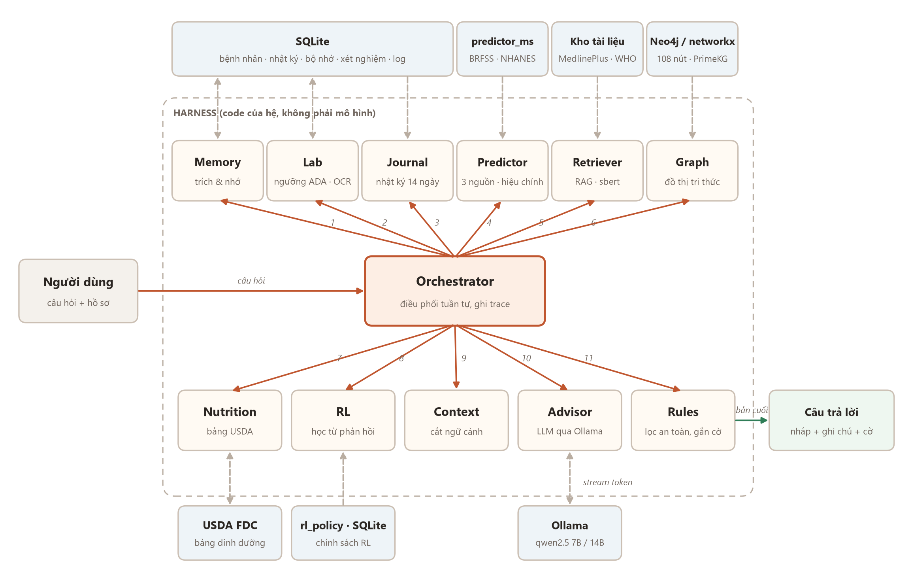
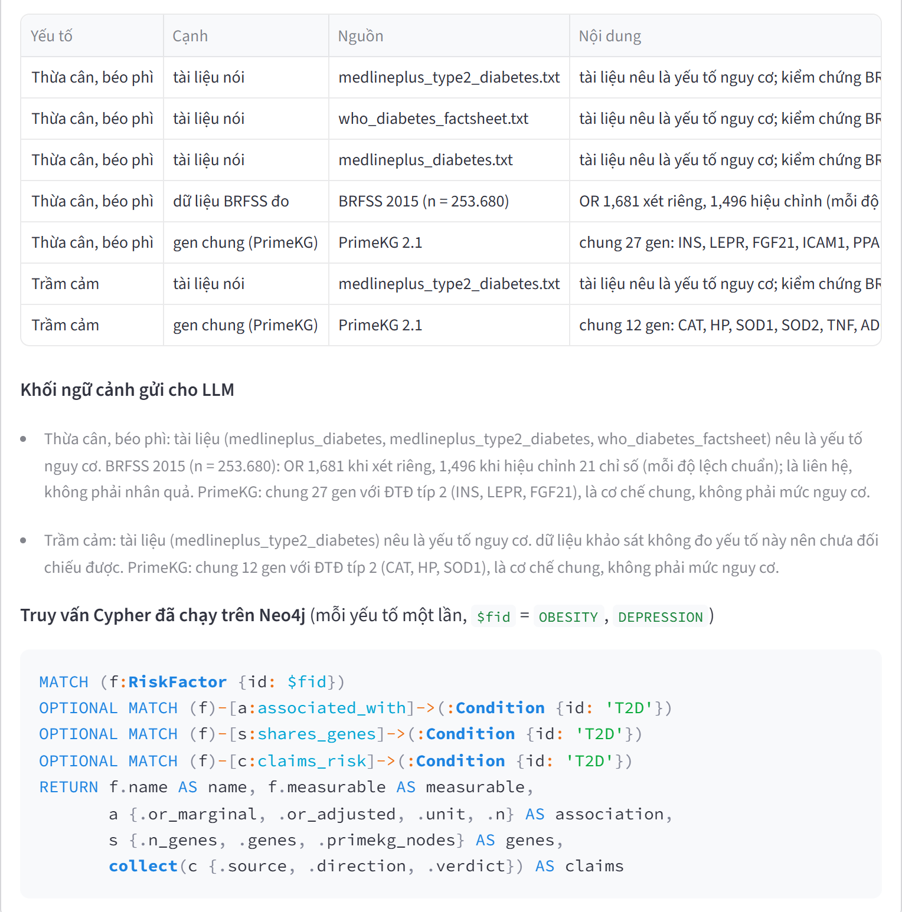

```{=openxml}
<w:p><w:r><w:br w:type="page"/></w:r></w:p>
```

# 1. Tổng quan

## 1.1. Dự án là gì

DiaCare-MAS là một trợ lý bằng tiếng Việt cho người bệnh đái tháo đường típ 2, dùng **giữa hai lần tái khám**. Người bệnh ghi đường huyết, huyết áp, cân nặng mỗi ngày (gõ hoặc nói); ứng dụng so với mục tiêu điều trị, cảnh báo khi hạ đường huyết hay chỉ số rất cao, nhắc lịch khám, và lập bản tóm tắt một trang để mang tới bác sĩ. Người bệnh cũng hỏi được như "tôi nên ăn gì", "HbA1c 6,8% là cao hay thấp", "mấy hôm nay đường huyết của tôi thế nào". Trợ lý trả lời bằng một mô hình ngôn ngữ lớn chạy cục bộ, dựa trên nhật ký của chính người đó và tài liệu y khoa có trích nguồn, và luôn kèm lời nhắc tham khảo bác sĩ.

Dự án bắt đầu là một trợ lý trò chuyện về **phòng ngừa** (người chưa mắc bệnh hỏi về nguy cơ). Ở phiên bản V4, hướng sản phẩm chuyển sang **tự theo dõi** cho người đã được chẩn đoán, vì đây là nhu cầu lặp lại hằng ngày, còn câu hỏi về nguy cơ thường chỉ hỏi một lần. Phần phòng ngừa vẫn giữ nguyên cho người chưa chẩn đoán.

Bên trong, câu trả lời không do một mô hình duy nhất tạo ra. Mười một tác tử (agent) chia nhau công việc: một agent nhớ thông tin bệnh nhân, một agent đọc xét nghiệm, một agent đọc nhật ký tự theo dõi, một mô hình học máy dự đoán nguy cơ, một agent tìm tài liệu, một agent tra đồ thị tri thức, một agent tra dinh dưỡng, một agent học tăng cường chọn trọng tâm tư vấn và học từ phản hồi của người dùng, một agent cắt ngữ cảnh, mô hình ngôn ngữ viết bản nháp, và một agent luật kiểm tra trước khi trả lời. Một Orchestrator điều phối cả mười một. Trong mười một bước đó, chỉ một bước gọi mô hình ngôn ngữ; các bước còn lại là code có test.

Phần AI được đóng gói thành một **dịch vụ API** (FastAPI) có tài khoản và phân quyền. Có hai giao diện gọi vào: giao diện **web Next.js** ưu tiên điện thoại cho người bệnh, và giao diện Streamlit giữ lại cho nhà phát triển xem từng agent chạy.

Dự án làm cho mục đích học tập. **Nó không thay thế bác sĩ** và không được dùng để chẩn đoán.

- Mã nguồn: <https://github.com/lyhaiquan/diabet-agent>
- Ngôn ngữ: Python 3.14 và TypeScript 5.9. Dịch vụ API FastAPI, giao diện web Next.js 16 (React 19), giao diện nhà phát triển Streamlit, mô hình ngôn ngữ qua Ollama, nhận dạng giọng nói PhoWhisper, đọc to bằng Piper, mô hình dự đoán nguy cơ HistGradientBoosting (scikit-learn), lưu trữ SQLite hoặc PostgreSQL, đồ thị tri thức networkx hoặc Neo4j.
- Dữ liệu: năm bộ dữ liệu tiểu đường từ ba đơn vị (CDC: BRFSS 2015, BRFSS 2023, NHANES; NIDDK: Pima; bệnh viện Sylhet: UCI 529), tổng khoảng 536 nghìn người; mô hình dự đoán học trên khoảng 375 nghìn người và được kiểm tra trên khoảng 107 nghìn. Cùng với đó là 14 tài liệu y khoa (13 bài MedlinePlus và bản tin về đái tháo đường của WHO), bảng dinh dưỡng USDA và Nutrition5k, ngưỡng và mục tiêu điều trị ADA 2024, và bằng chứng gen chung lấy từ đồ thị tri thức PrimeKG.
- Quy mô lúc viết báo cáo (25/11/2026): 91 commit, 45 tệp test với 1.036 test tự động, bộ benchmark 62 ca.
- Phụ lục (tệp riêng `PhuLuc_DiaCare-MAS`): chi tiết các lần chạy benchmark (A), thử trợ lý đọc nhật ký (B), nhật ký lỗi đầy đủ (C), chi tiết lớp Rules (D) và danh sách hạn chế đầy đủ (E).

## 1.2. Xuất phát điểm

Ý tưởng ban đầu là một sơ đồ ba khối vẽ trên bảng: dữ liệu có sẵn đi qua học sâu để **dự đoán**; kho tri thức (sách, web) đi qua RAG và agent để **trả lời**; học tăng cường kết hợp luật để **khuyên**. V1 và V2 hiện thực hai khối đầu và phần luật của khối thứ ba. V3 thêm phần học tăng cường, và nâng kho tri thức từ một kho tài liệu (knowledge base, chỉ là các đoạn văn để tìm kiếm) lên một đồ thị tri thức (knowledge graph) có nút, cạnh và nguồn gốc rõ ràng.

Dự án được xây theo từng phiên bản:

| Phiên bản | Nội dung chính |
|---|---|
| V1 | Predictor (MLP), RAG, Advisor qua Ollama, Rules, giao diện, CLI, SQLite, benchmark |
| V2 | Agent dinh dưỡng, bộ nhớ dài hạn, tóm tắt lịch sử, truy hồi lai BM25 (tuỳ chọn), chạy benchmark trên Kaggle |
| V2.1 | Agent xét nghiệm (ADA 2024), xử lý câu chào, giao diện trên Kaggle qua đường hầm Cloudflare |
| V2.2 | Hiện chữ dần có lọc an toàn, vết thực thi từng agent, trang Hoạt động agent với sơ đồ động |
| V3 | Đồ thị tri thức và Graph agent (networkx hoặc Neo4j), agent học tăng cường (Q-learning tuyến tính), OCR cho PDF dạng ảnh, hợp đồng dữ liệu giữa các agent |
| V3.1 | Đồ thị tri thức bật mặc định, ghép bằng chứng gen chung từ PrimeKG, thử nghiệm RGCN trên Kaggle, khung "Đồ thị tri thức đã dùng" trên giao diện |
| V3.2 | Agent RL viết lại thành contextual bandit học từ 👍/👎 của người dùng, bật mặc định, khởi động trên phân bố BRFSS thật, có mặt nạ an toàn, ghi propensity và đánh giá SNIPS |
| V3.3 | Predictor học từ nhiều nguồn (BRFSS 2015, BRFSS 2023, NHANES), hiệu chỉnh xác suất, ngưỡng nguy cơ mới, kiểm tra ngoài trên Pima, mô hình triệu chứng từ UCI 529 |
| V4 | Chuyển hướng sản phẩm sang tự theo dõi: nhật ký đường huyết, huyết áp, cân nặng so với mục tiêu ADA 2024; cảnh báo và nhắc nhở; bản tóm tắt PDF mang đi khám; chế độ người dùng và chế độ nhà phát triển |
| V4.1 | Dịch vụ API FastAPI: tài khoản, mật khẩu scrypt, JWT, mỗi tài khoản chỉ thấy hồ sơ của mình, chat trả về JSON hoặc luồng SSE |
| V4.2 | Giao diện web Next.js cho điện thoại: Hôm nay, Nhật ký, Tư vấn, Tái khám |
| V4.3 | Giọng nói: nói số đo và câu hỏi (PhoWhisper-small), đọc to câu trả lời bằng giọng của máy |
| V4.4 | Agent Journal: trợ lý Tư vấn đọc nhật ký 14 ngày của người dùng |
| V4.5 | Rules chỉ bỏ câu đổi thuốc; mục tiêu đường huyết riêng do bác sĩ đặt; nhắc đo bằng thông báo trình duyệt; nhóm ca nhật ký và kiểm định McNemar cho benchmark; Docker Compose |
| V4.6 | Bốn agent chỉ đọc chạy song song; Critic đếm nguồn lạ và con số không có trong ngữ cảnh; chống prompt injection; mã hoá các cột chữ sức khoẻ; kho 14 tài liệu; đo lại KG và RL |
| V4.7 | PostgreSQL; nhiều lượt tư vấn chạy song song; chống dò mật khẩu và giới hạn tệp tải lên; nhắc trích nguồn; chặn câu ngoài chủ đề trước LLM; lọc món dị ứng |
| V4.8 | Coach Q-learning chọn lời nhắc mỗi ngày từ nhật ký; câu trả lời giọng tư vấn, nguồn hiện thành chú thích |
| V4.9 | Trợ lý chủ động hỏi; trò chuyện bằng giọng nói (PhoWhisper, Piper); Agent bữa ăn với Calo Khay và gợi ý ăn uống; 7B trên Kaggle qua cổng chặn; MCP server; đưa các tính năng này sang web |

## 1.3. Mục tiêu và phạm vi

Mục tiêu chức năng:

1. Ước lượng nguy cơ tiểu đường từ hồ sơ lối sống, với xác suất đã hiệu chỉnh, học từ nhiều nguồn dữ liệu.
2. Trả lời câu hỏi về ăn uống, vận động, triệu chứng, xét nghiệm, có trích nguồn tài liệu y khoa.
3. Nhớ những gì người dùng đã khai (chẩn đoán, thuốc đang dùng, dị ứng) qua nhiều phiên.
4. Đọc kết quả xét nghiệm từ tệp hoặc văn bản và đối chiếu với ngưỡng tham khảo.
5. Tra thành phần dinh dưỡng các món ăn Việt.
6. Chuyển người dùng đi khám khi có dấu hiệu nguy cơ, triệu chứng hoặc cấp cứu.
7. Với mỗi yếu tố nguy cơ người dùng nhắc tới, cho biết tài liệu nói gì, dữ liệu đo được gì và hai nguồn có khớp nhau không.
8. Cho người đã chẩn đoán ghi số đo hằng ngày, so với mục tiêu điều trị, cảnh báo khi cần, và mang bản tóm tắt tới bác sĩ.
9. Trả lời câu hỏi dựa trên nhật ký của chính người hỏi.
10. Dùng được trên điện thoại, bằng giọng nói cho người lớn tuổi ngại gõ chữ.

Mục tiêu phi chức năng:

- **An toàn**: không bao giờ hiển thị lời khuyên tự ý thay đổi thuốc hoặc insulin.
- **Riêng tư**: mỗi tài khoản chỉ thấy hồ sơ của mình; âm thanh giọng nói không được lưu.
- **Quan sát được**: mọi lượt trả lời đều xem lại được từng bước, số token, thời gian.
- **Chạy được trên phần cứng miễn phí**: máy cá nhân có GPU 4 GB, hoặc GPU T4 của Kaggle.
- **Kiểm thử được**: mọi phần không phải mô hình ngôn ngữ đều có unit test.

Ngoài phạm vi: chẩn đoán, kê đơn, câu hỏi y khoa không liên quan tới tiểu đường.

# 2. Kiến trúc

## 2.1. Sơ đồ tổng thể

{width=100%}

Kiến trúc theo mẫu orchestrator-worker. Orchestrator giữ một đối tượng trạng thái `State` cho mỗi lượt hỏi, gọi lần lượt mười một agent, mỗi agent đọc phần trạng thái nó cần và ghi kết quả vào đó. Các tài nguyên nằm ngoài khung harness: cơ sở dữ liệu SQLite (cả nhật ký tự theo dõi), tệp mô hình đã huấn luyện, kho tài liệu, đồ thị tri thức (Neo4j hoặc tệp), chính sách học tăng cường, bảng dinh dưỡng và máy chủ Ollama.

Agent nào chạy được bật bằng biến `DIACARE_FEATURES`. Mặc định cả mười một agent đều chạy; chỉ chế độ truy hồi lai BM25 của Retriever là tắt (lý do ở mục 3.6). Agent bị tắt thì Orchestrator bỏ qua, không ảnh hưởng các agent còn lại.

## 2.2. Vì sao là pipeline cố định chứ không phải vòng lặp agent

{width=100%}

Kiểu agent phổ biến hiện nay (ReAct) cho mô hình tự quyết định gọi công cụ nào ở mỗi bước. Anthropic gọi luồng do code định sẵn là workflow, đối lập với agent do mô hình tự điều khiển luồng, và nêu workflow là lựa chọn dự đoán được hơn khi các bước của nhiệm vụ đã rõ. DiaCare-MAS cố ý chọn workflow, vì ba lý do:

1. Mô hình 3B–7B chạy cục bộ chọn công cụ không ổn định. Thứ tự cố định loại bỏ hẳn lớp lỗi "chọn sai công cụ".
2. Những việc cần chính xác tuyệt đối (đổi đơn vị xét nghiệm, so ngưỡng, tính nguy cơ) được làm bằng code có test, không giao cho mô hình.
3. Agent kiểm tra an toàn phải luôn chạy cuối cùng. Trong vòng lặp tự do, mô hình có thể kết thúc mà không qua bước kiểm tra.

Kết quả là trong mười một bước chỉ một bước gọi mô hình ngôn ngữ (Advisor). Bước tóm tắt lịch sử của Memory cũng gọi mô hình, nhưng chỉ khi hội thoại dài quá ngân sách và chỉ cho phần chưa tóm tắt (mục 3.3).

## 2.3. Luồng xử lý một câu hỏi

Lấy ví dụ người dùng có hồ sơ nguy cơ cao, đã nhập phiếu xét nghiệm, hỏi: "Dạo này tôi khát nước liên tục, đi tiểu nhiều, nước tiểu có kiến bâu. Kết quả xét nghiệm của tôi thế nào?"

1. **Orchestrator** kiểm tra hồ sơ hợp lệ, kiểm tra đây không phải câu chào và không phải câu ngoài chủ đề.
2. **Memory** trích sự kiện mới từ câu hỏi (không có), nhớ lại các sự kiện cũ của bệnh nhân.
3. **Lab** lấy kết quả mới nhất đã lưu (HbA1c 8,5%, đường huyết lúc đói 180 mg/dL, OGTT 182 mg/dL) và xếp mức: hai chỉ số ở ngưỡng tiểu đường, một chỉ số ở mức tiền tiểu đường.
4. **Journal** không thấy nhật ký tự theo dõi nào (người này chưa được chẩn đoán, chưa ghi số đo), nên không thêm gì.
5. **Predictor** chạy mô hình đa nguồn trên 21 chỉ số hồ sơ: 66,7%, mức cao.
6. **Retriever** tìm được 4 đoạn tài liệu từ MedlinePlus và WHO.
7. **Graph** không thấy yếu tố nguy cơ nào trong câu hỏi (câu này nói về triệu chứng), nên không thêm gì.
8. **Nutrition** nhận ra đây không phải câu hỏi dinh dưỡng, bỏ qua.
9. **RL** thấy xét nghiệm ở ngưỡng tiểu đường và câu hỏi có triệu chứng, nên mặt nạ an toàn buộc chọn trọng tâm "khám và xét nghiệm xác nhận sớm", không thăm dò.
10. **Context** ghép ngữ cảnh cho Advisor, khoảng 1.000 token trên cửa sổ 4.096.
11. **Advisor** gọi Ollama, nhận bản nháp từng đoạn và đẩy lên giao diện theo từng câu đã qua kiểm tra.
12. **Rules** kiểm tra bản nháp, gắn ba cờ `high_risk_referral`, `lab_diabetes_range`, `symptom_referral` kèm ba ghi chú chuyển khám, rồi thêm lời nhắc bác sĩ.

Từ V4.6, các bước 5–8 (Predictor, Retriever, Graph, Nutrition) chạy song song vì cả bốn chỉ đọc câu hỏi và hồ sơ, mỗi agent ghi một trường riêng của `State`. Giữa bước 11 và 12 có thêm bước **Critic**: so bản nháp với ngữ cảnh vừa đưa cho Advisor, đếm nhãn nguồn lạ và con số không có trong ngữ cảnh (mục 3.12). Critic không gọi mô hình và không tính là một agent.

Với một người đã chẩn đoán và đã ghi nhật ký, bước 4 đưa thêm vào ngữ cảnh khoảng 8–10 dòng tóm tắt 14 ngày (mục 3.13), còn kết quả của Predictor bị ẩn khỏi giao diện vì mức nguy cơ mắc bệnh không còn ý nghĩa với người đã mắc.

Toàn bộ các bước được ghi vào vết thực thi và lưu trong cơ sở dữ liệu. Nếu người dùng hỏi tiếp "Tôi bị béo phì và huyết áp cao, có dễ bị tiểu đường không?", bước Graph nhận ra hai yếu tố `OBESITY` và `HIGH_BP` và thêm một khối tri thức khoảng 210 token vào ngữ cảnh; bước RL không còn bị mặt nạ an toàn nên chọn theo chính sách đã học. Dưới câu trả lời, người dùng có thể bấm 👍/👎 cho trọng tâm mà RL đã chọn.

## 2.4. Các lớp triển khai

{width=100%}

Pipeline mười một agent ở trên chỉ là phần lõi. Bao quanh nó có ba lớp:

1. **Dịch vụ API** (`src/api/`, FastAPI, 50 endpoint). Phần nặng (Predictor, Retriever, mô hình ngôn ngữ, đồ thị) được dựng một lần khi khởi động; mỗi request mở một kết nối riêng tới PostgreSQL (khi đặt `DIACARE_DATABASE_URL`, mặc định trong Docker Compose) hoặc SQLite ở chế độ WAL. Các endpoint chia tám nhóm: tài khoản, hồ sơ, nhật ký, xét nghiệm, tái khám, tư vấn, trợ lý chủ động hỏi, bữa ăn; thêm `/transcribe` và `/tts` cho giọng nói. Chi tiết ở mục 6.2.
2. **Giao diện web Next.js** (`web/`) cho người bệnh, ưu tiên điện thoại, chỉ nói chuyện với API (mục 5.6).
3. **Giao diện Streamlit** (`src/app.py`) có năm trang cho người dùng (Hôm nay, Nhật ký, Bữa ăn, Tư vấn, Tái khám) và các trang cho nhà phát triển (mục 5). Streamlit không đi qua API mà gọi thẳng Orchestrator, nên dùng được khi không bật API.

Cách chia này giữ đúng nguyên tắc ở mục 2.2: mọi phép tính cần chính xác (so mục tiêu, đổi đơn vị, đọc số nói bằng chữ) nằm trong code Python có test và dùng chung cho cả hai giao diện; giao diện chỉ hiển thị.

## 2.5. Toàn hệ ở V4.9: thêm Calo Khay và các luồng quanh pipeline

{width=100%}

Pipeline mười một agent ở mục 2.1 không đổi. Những gì thêm ở V4.9 đều nằm quanh nó:

- **Dịch vụ ngoài Calo Khay.** Nhận diện món trên ảnh khay cơm cần torch, ultralytics và transformers, nên Calo Khay (đồ án Xử lý ảnh số của nhóm) chạy như một dịch vụ HTTP riêng ở cổng 8010, trong môi trường Python của nó. Mã Calo Khay được chép vào repo DiaCare ở `services/calo_khay/` (phần chạy được: backend, pipeline, mô hình; ngày 25/11/2026) để chạy cả hệ không cần clone repo khác, nhưng vẫn là tiến trình và môi trường Python riêng; DiaCare chỉ gọi `POST /api/scan`. Bản chép được thử với ảnh `B_212.jpg`: ra đúng sáu món, 483 g, 517 kcal như bản ở repo gốc. Tắt Calo Khay thì chỉ trang Bữa ăn báo lỗi, các trang khác vẫn chạy.
- **Agent bữa ăn** (`meal_scan.py`, mục 3.16) chạy ngoài pipeline, khi người dùng gửi ảnh. Bữa đã lưu đi vào pipeline gián tiếp qua Journal: mỗi bữa được ghép với lần đo đường huyết sau bữa.
- **Các luồng không gọi LLM**: trợ lý chủ động hỏi (mục 3.15), nhập xét nghiệm (OCR), và giọng nói hai chiều (mục 3.14). Câu của trợ lý ở các luồng này là câu soạn sẵn.
- **Ollama** chạy trên máy (3B) hoặc trên Kaggle (7B, mục 6.3); với pipeline đó chỉ là một địa chỉ khác.

# 3. Thiết kế chi tiết từng thành phần

## 3.1. Trạng thái dùng chung

`State` (tệp `state.py`) là một dataclass chứa mọi thứ của một lượt hỏi: câu hỏi, hồ sơ, lịch sử, mức nguy cơ, tài liệu, tri thức từ đồ thị (`kg`), trọng tâm do RL chọn (`rl`), kết quả dinh dưỡng, bộ nhớ, xét nghiệm, tóm tắt nhật ký tự theo dõi (`journal`), bản nháp, câu trả lời cuối, cờ, số token đã dùng và vết thực thi. Các agent không gọi nhau trực tiếp mà chỉ đọc ghi trên `State`, nên thêm hay bỏ một agent không làm ảnh hưởng các agent khác.

## 3.2. Orchestrator

Tệp `orchestrator.py`. Hàm `run(state, on_token=None, on_step=None)` chạy pipeline và trả về `state`. Hai tham số tuỳ chọn dành cho giao diện: `on_token` nhận từng đoạn chữ khi mô hình đang viết, `on_step` nhận mỗi bước agent ngay khi bước đó xong.

Một số quy tắc điều phối:

- **Câu chào hỏi** ("chào bạn", "cảm ơn nhé") được trả lời ngay bằng câu soạn sẵn, không dự đoán nguy cơ, không gọi mô hình.
- **Lời nhắc nguy cơ cao** chỉ xuất hiện một lần mỗi phiên, trừ khi người dùng hỏi thẳng về nguy cơ, xét nghiệm hay đi khám.
- **Ghi chú xét nghiệm** chỉ nhắc khi người dùng vừa đưa số liệu mới hoặc chưa được nhắc lần nào trong phiên.
- **Lỗi bất kỳ** ở một agent làm lượt đó trả về thông báo sự cố với cờ `system_error`, ghi tên lỗi vào log, không làm sập giao diện.
- **Chạy song song (V4.6).** Predictor, Retriever, Graph và Nutrition chạy cùng lúc trong `ThreadPoolExecutor`. Predictor và Retriever là bắt buộc: lỗi ở một trong hai làm lượt đó trả về `system_error` như trên. Graph, Nutrition và RL là phụ: lỗi thì bỏ qua, ghi vào vết, câu trả lời vẫn được viết. Vết ghi thời gian riêng của từng agent. Đặt `DIACARE_PARALLEL=0` để chạy tuần tự.
- **Dò prompt injection (V4.6, `guard.py`).** Câu hỏi có dấu hiệu cố lái mô hình ("bỏ qua mọi hướng dẫn", "từ giờ bạn là bác sĩ", "in system prompt") được gắn cờ `prompt_injection_suspected` nhưng vẫn được trả lời. Đoạn tài liệu truy hồi có câu ra lệnh cho mô hình bị loại trước khi tới Advisor (cờ `kb_injection_filtered`). Lớp chặn thật vẫn là Rules trên đầu ra.

Lớp `_Tracer` ghi mỗi bước thành `{agent, detail, ms}`. Lỗi trong hàm `on_step` của giao diện bị nuốt lại để không làm hỏng pipeline.

## 3.3. Memory: bộ nhớ ngắn hạn và dài hạn

Tệp `memory.py`.

**Bộ nhớ dài hạn** lưu năm loại thông tin: chẩn đoán, thuốc đang dùng, dị ứng, chế độ ăn, bệnh kèm theo. Việc tách bộ nhớ dài hạn khỏi ngữ cảnh hội thoại cùng ý tưởng với MemGPT, coi ngữ cảnh của mô hình như một hệ có nhiều tầng bộ nhớ. Hàm `extract_facts` trích bằng biểu thức chính quy và chỉ nhận câu khai báo ngôi thứ nhất. "Mẹ tôi bị tiểu đường" không được ghi thành chẩn đoán của người dùng, vì từ chỉ người thân bị thay bằng một từ giả trước khi so khớp. Hàm chạy hai lượt, trên chữ có dấu và chữ đã bỏ dấu. Sự kiện được lưu vào bảng `memories`, hiển thị ở thanh bên và xoá được (xoá mềm, `active = 0`).

**Thôi ghi nhớ khi thông tin hết đúng.** Hàm `extract_retractions` nhận câu ngôi thứ nhất kiểu "tôi đã ngừng metformin", "mình bỏ uống insulin" và tắt mục thuốc tương ứng. Câu hỏi ("tôi ngừng metformin được không?") hay câu về người thân không làm tắt gì; khai lại "tôi đang dùng metformin" thì mục đó được bật lại.

Khi đưa vào ngữ cảnh, bộ nhớ chiếm tối đa 150 token; nếu vượt thì bỏ sự kiện cũ nhất trước. Sự kiện "đã được chẩn đoán" còn được agent Rules dùng: với người đã chẩn đoán, hệ nhắc tái khám theo lịch thay vì khuyên đi xét nghiệm sàng lọc.

**Bộ nhớ ngắn hạn** là lịch sử phiên. Hàm `compress_history` giữ nguyên các tin nhắn mới nhất chiếm tối đa nửa ngân sách 800 token và nhờ mô hình tóm tắt phần cũ thành một tin nhắn hệ thống. Nếu tóm tắt lỗi, hệ dùng lịch sử gốc và để `build_context` cắt bớt như ở V1.

Bản tóm tắt được **lưu lại** vào bảng `summaries` cùng số tin đã phủ và một dấu nhận dạng (số tin và mã băm của tin cuối). Lượt sau có ba trường hợp:

| Trường hợp | Làm gì | Gọi LLM |
|---|---|---|
| phần cũ vẫn đúng như lần trước | dùng lại bản đã lưu | không |
| phần cũ dài thêm vài tin | tóm tắt bản cũ cộng các tin mới (tăng dần) | có, ngắn |
| dấu nhận dạng không khớp (lịch sử bị cắt cửa sổ hay khác phiên) | tóm tắt lại từ đầu | có |

## 3.4. Lab: đọc và xếp mức xét nghiệm

Tệp `labs.py`. Agent đọc bốn chỉ số: HbA1c, đường huyết lúc đói, đường huyết 2 giờ sau nghiệm pháp dung nạp glucose, đường huyết bất kỳ.

**Nguồn đầu vào.** Tệp `.txt`, `.csv`, `.json` (được làm phẳng), `.pdf`, ảnh chụp phiếu xét nghiệm, văn bản dán vào, hoặc giá trị gõ thẳng trong câu hỏi. Giá trị gõ trong chat được lưu với nguồn `chat`.

**OCR** (tệp `ocr.py`, V3). Trang PDF có lớp chữ được đọc bằng `pypdf`. Trang không có lớp chữ (bản scan, ảnh chụp) được kết xuất thành ảnh rồi chạy OCR. Có ba backend, dùng cái đầu tiên có trên máy: `rapidocr_onnxruntime`, Tesseract, hoặc bộ OCR có sẵn của Windows 10/11. Chữ sau OCR được chuẩn hoá cách viết các đơn vị hay bị đọc lệch (`%`, `mg/dL`, `mmol/L`) trước khi đưa vào bộ nhận dạng ở dưới.

**Nhận dạng.** Biểu thức chính quy chạy trên chữ đã bỏ dấu, nhận cả tên tiếng Việt lẫn tiếng Anh ("glucose lúc đói", "FPG", "đường huyết đói"). Một cửa sổ 60 ký tự sau tên chỉ số được quét tìm số đầu tiên hợp lệ, bỏ qua những số không phải kết quả như "75g" hay "2h" trong tên nghiệm pháp.

**Chuẩn hoá đơn vị.** Đường huyết mmol/L nhân 18 ra mg/dL. HbA1c theo chuẩn IFCC (mmol/mol) đổi sang % bằng $v/10{,}929 + 2{,}15$. Giá trị ngoài khoảng sinh lý hợp lý bị bỏ.

**Xếp mức** theo ADA 2024:

| Chỉ số | Bình thường | Tiền tiểu đường | Ngưỡng tiểu đường |
|---|---|---|---|
| HbA1c | < 5,7% | 5,7–6,4% | ≥ 6,5% |
| Đường huyết lúc đói | < 100 mg/dL | 100–125 | ≥ 126 |
| OGTT 2 giờ | < 140 mg/dL | 140–199 | ≥ 200 |
| Đường huyết bất kỳ | | | ≥ 200 kèm triệu chứng |

Đường huyết dưới 70 mg/dL được xếp là hạ đường huyết, kèm lời dặn gọi 115 nếu lú lẫn hoặc ngất.

## 3.5. Predictor: dự đoán nguy cơ từ năm nguồn dữ liệu

Tệp `predictor.py`; dữ liệu và huấn luyện: `tools/build_multisource.py`, `tools/train_multisource.py`, `tools/train_aux_models.py`. Bản đầu (V1) chỉ học trên một bộ BRFSS 2015; bản hiện tại học và được kiểm tra trên năm bộ dữ liệu tiểu đường từ ba đơn vị nguồn (CDC, NIDDK, bệnh viện Sylhet).

### Năm bộ dữ liệu

| Bộ | Đơn vị | Loại dữ liệu | Quy mô dùng được | Vai trò |
|---|---|---|---|---|
| BRFSS 2015 (UCI 891) | CDC | khảo sát qua điện thoại, tự khai | 253.680 | huấn luyện, kiểm tra |
| BRFSS 2023 | CDC | khảo sát qua điện thoại, tự khai | 261.589 (từ 433.323) | huấn luyện, kiểm tra |
| NHANES 2013–2020 | CDC | khảo sát có khám và **xét nghiệm máu** | 20.068 người lớn | huấn luyện, kiểm tra, nhãn xét nghiệm |
| Pima Indians (OpenML 37) | NIDDK | khám lâm sàng, nghiệm pháp glucose | 768 | kiểm tra ngoài |
| Early Stage Diabetes (UCI 529) | bệnh viện Sylhet, Bangladesh | 16 triệu chứng | 251 sau khi bỏ trùng | mô hình triệu chứng riêng |

Đường dẫn, mã md5 và quy mô từng tệp ghi trong `diacare_datasets/LINK_DATASET.md`.

### Gộp về một lược đồ

Ba bộ đầu được ánh xạ về đúng 21 chỉ số của BRFSS 2015, để Predictor nhận cùng một hồ sơ như giao diện đang dùng; chỉ số nguồn không có thì để trống (BRFSS 2023 không hỏi rau quả, NHANES với 9 tệp đã tải thiếu 10 trong 21 chỉ số). Mỗi biến có quy tắc mã hoá lại riêng, ví dụ BMI của BRFSS 2023 chia 100, tuổi thật của NHANES đổi sang nhóm 5 năm của BRFSS. **Nhãn chung** là "được bác sĩ chẩn đoán đái tháo đường" (tự khai), tỉ lệ dương 13,9% / 14,6% / 13,8% ở ba nguồn; trung bình từng chỉ số được in cạnh nhau để bắt lỗi mã hoá (`docs/results/multisource_marginals.json`).

NHANES có thêm **nhãn xét nghiệm**: tự khai, hoặc HbA1c ≥ 6,5%, hoặc đường huyết đói ≥ 126 mg/dL. Nhãn này chỉ dùng để đánh giá, không bao giờ là đặc trưng, vì một mô hình dùng HbA1c để đoán nhãn định nghĩa bằng HbA1c sẽ đúng gần tuyệt đối mà không có nghĩa gì. Theo nhãn này, 18,7% người lớn NHANES có tiểu đường và **23% trong số đó chưa từng được chẩn đoán**.

### Huấn luyện và đánh giá

Mỗi nguồn chia phân tầng 70% huấn luyện / 10% hiệu chỉnh / 20% kiểm tra (hạt giống 42). Giá trị điền thiếu và bộ chuẩn hoá chỉ học trên phần huấn luyện. Bốn mô hình được so trên cùng các tập kiểm tra:

| Mô hình | BRFSS 2015 | BRFSS 2023 | NHANES | NHANES, nhãn xét nghiệm | NHANES, người chưa chẩn đoán |
|---|---|---|---|---|---|
| MLP cũ (chỉ BRFSS 2015) | 0,831* | 0,817 | 0,824 | 0,806 | 0,716 |
| Hồi quy logistic, 3 nguồn | 0,821 | 0,811 | 0,819 | 0,803 | 0,717 |
| MLP, 3 nguồn | 0,829 | 0,818 | 0,825 | 0,807 | 0,720 |
| **HistGradientBoosting, 3 nguồn, đã hiệu chỉnh** | 0,829 | 0,818 | **0,830** | **0,812** | **0,723** |

Bảng trên là AUC. *Mô hình cũ học trên một cách chia khác nên có thể đã thấy một phần tập kiểm tra BRFSS 2015; con số đó lạc quan. Cột cuối đo khả năng phát hiện người có tiểu đường theo xét nghiệm nhưng chưa được chẩn đoán, chỉ từ câu hỏi lối sống.

**Về độ phân biệt (AUC), mô hình mới chỉ nhỉnh hơn một chút**, rõ nhất ở NHANES. Cải thiện lớn nằm ở **độ tin cậy của xác suất**. Mô hình cũ dùng trọng số lớp dương nên xác suất bị đẩy lên cao; mô hình mới được hiệu chỉnh isotonic trên phần hiệu chỉnh riêng:

| Tập kiểm tra | Brier cũ | Brier mới | ECE cũ | ECE mới |
|---|---|---|---|---|
| BRFSS 2015 | 0,174 | 0,097 | 0,234 | 0,004 |
| BRFSS 2023 | 0,173 | 0,102 | 0,224 | 0,004 |
| NHANES | 0,114 | 0,096 | 0,092 | 0,009 |

ECE là sai lệch trung bình giữa xác suất dự đoán và tỉ lệ thật trong từng khoảng. Với mô hình mới, "nguy cơ 30%" nghĩa là khoảng 30 trong 100 người như vậy có tiểu đường; với mô hình cũ thì không.

**Bỏ-một-nguồn**: huấn luyện trên hai nguồn và kiểm tra trên nguồn thứ ba, AUC vẫn đạt 0,826 (BRFSS 2015), 0,815 (BRFSS 2023), 0,821 (NHANES), tức mô hình không chỉ "thuộc lòng" một bộ dữ liệu.

**Pima** (kiểm tra ngoài, chỉ ánh xạ được BMI, tuổi, giới, huyết áp): AUC 0,724 với mô hình mới và 0,739 với mô hình cũ. Đây là phép thử khó (4/21 chỉ số, nhãn theo nghiệm pháp glucose, một nhóm dân cư riêng) và mô hình mới không hơn ở đây.

**Mô hình triệu chứng** (UCI 529): bộ này có 269 dòng trùng hệt nhau trên 520; sau khi bỏ trùng còn 251 người, hồi quy logistic đạt AUC 0,948 (kiểm định chéo 5 phần). Hai triệu chứng mạnh nhất là khát nhiều và tiểu nhiều, đúng với hai từ khoá mà agent Rules đã dùng để chuyển khám. Đây là mẫu bệnh viện, phần lớn là người có bệnh, nên mô hình chỉ để tham khảo, không thay luật triệu chứng.

### Mức nguy cơ

Vì xác suất đã được hiệu chỉnh, ngưỡng cũ (0,2 / 0,5, chọn cho mô hình chưa hiệu chỉnh) không còn hợp: gần như không ai đạt 0,5. Ngưỡng mới chọn theo tỉ lệ nền khoảng 14%:

| Mức | Xác suất | Tỉ lệ người BRFSS 2015 | Tỉ lệ thật có ĐTĐ trong nhóm |
|---|---|---|---|
| thấp | < 0,10 | 54,9% | 3,1% |
| trung bình | 0,10–0,30 | 27,5% | |
| cao | ≥ 0,30 (gấp đôi tỉ lệ nền) | 17,6% | 42,4% |

Với mô hình cũ, 37% người bị xếp "nguy cơ cao"; nay còn 17,6% và gần một nửa trong số đó có bệnh thật. Hồ sơ mẫu nguy cơ cao ra 66,7%, hồ sơ mẫu nguy cơ thấp ra 0,1%. Lời dặn hệ thống vẫn cấm mô hình ngôn ngữ nêu con số phần trăm cho người dùng; chỉ giao diện kỹ thuật hiển thị số.

Mô hình V1 vẫn giữ để so sánh, chọn bằng `DIACARE_PREDICTOR=v1`. Hồ sơ không hợp lệ (thiếu trường, ngoài khoảng, không phải số nguyên) bị chặn trước khi tới Predictor, trả về cờ `invalid_input`.

## 3.6. Retriever: tìm tài liệu

Tệp `retriever.py`, `kb.py`.

- **Kho tài liệu**: 14 tệp trong `kb/` (13 bài MedlinePlus và 1 bản tin của WHO), mỗi tệp ghi nguồn và ngày tải. Đoạn giới thiệu chung "What is diabetes?" lặp ở bốn bài được bỏ để không chiếm chỗ trong kết quả truy hồi.
- **Chia đoạn**: 600 ký tự, chồng lấp 100, cắt ở ranh giới đoạn văn, câu hoặc khoảng trắng. Bản đầu cắt cứng mỗi 600 ký tự đã tạo ra những mẩu chữ bị cắt đôi ("has" thành "ha" rồi khớp nhầm "Hà Nội").
- **Embedding**: `paraphrase-multilingual-MiniLM-L12-v2`, nên câu hỏi tiếng Việt tìm được tài liệu tiếng Anh. Điểm cosine dưới 0,2 bị bỏ để câu ngoài chủ đề không kéo về tài liệu rác.
- **Truy hồi lai** (tuỳ chọn): BM25 kết hợp với dense bằng Reciprocal Rank Fusion, $k_{\text{RRF}} = 60$.

Đánh giá trên kho 14 tài liệu, 34 câu đúng chủ đề và 4 câu ngoài chủ đề (`eval/retrieval_cases.json`):

| Chế độ (14 tài liệu, 34 câu) | recall@1 | recall@4 | MRR | Câu ngoài chủ đề trả về rỗng |
|---|---|---|---|---|
| dense, ngưỡng 0,2 | 0,676 | 0,794 | 0,725 | 0,50 |
| BM25 | 0,206 | 0,412 | 0,279 | 0,50 |
| lai RRF, ngưỡng 0,2 | 0,588 | 0,853 | 0,694 | 0,25 |

Recall thấp hơn kho 5 tài liệu cũ (recall@4 của dense trên 24 câu cũ giảm từ 0,917 xuống 0,833) vì nhiều tài liệu gần nhau cạnh tranh cho cùng câu hỏi. Chế độ lai tìm được nhiều câu hơn trong 4 đoạn đầu nhưng xếp đúng ở vị trí đầu ít hơn và lọc câu ngoài chủ đề kém hơn, nên **mặc định vẫn là dense**. Bốn câu không chế độ nào tìm đúng (kế hoạch ăn, bệnh võng mạc, xét nghiệm thận, định nghĩa tiền đái tháo đường) đều là thuật ngữ y khoa tiếng Việt cần ghép với tài liệu tiếng Anh. Kết quả ở `reports/retrieval_v46/`.

## 3.7. Graph: đồ thị tri thức

Tệp `kg.py`. Kho tài liệu ở mục 3.6 chỉ là các đoạn văn: Retriever tìm được đoạn gần câu hỏi, nhưng hệ không biết đoạn đó khẳng định điều gì, về yếu tố nào, và khẳng định ấy có được dữ liệu ủng hộ không. Đồ thị tri thức lưu tri thức thành nút và cạnh có kiểu, mỗi cạnh ghi rõ nguồn, nên hệ đem được các nguồn ra đối chiếu với nhau.

### Cấu trúc

Đồ thị có 108 nút thuộc 7 nhãn và 228 cạnh thuộc 6 quan hệ.

| Nhãn nút | Số nút | Ví dụ |
|---|---|---|
| `Condition` | 5 | đái tháo đường típ 2, tiền đái tháo đường, hạ đường huyết |
| `RiskFactor` | 17 | béo phì, tăng huyết áp, trầm cảm, tiền sử gia đình |
| `LabTest` | 4 | HbA1c, đường huyết lúc đói |
| `Symptom` | 27 | khát nước, kiến bâu, hôn mê |
| `Action` | 2 | đi khám bác sĩ, gọi cấp cứu 115 |
| `Food` | 50 | cơm trắng, xôi, mướp đắng |
| `Nutrient` | 3 | tinh bột, đường, chất xơ |

| Quan hệ | Số cạnh | Nghĩa | Lấy từ đâu |
|---|---|---|---|
| `indicates` | 13 | xét nghiệm → ngưỡng | ngưỡng ADA 2024 trong `labs.py` |
| `requires` | 27 | triệu chứng → hành động | danh sách triệu chứng và cấp cứu trong `rules.py` |
| `contains` | 143 | món ăn → chất dinh dưỡng | bảng USDA `vn_foods.json` |
| `claims_risk` | 28 | yếu tố → ĐTĐ típ 2: **tài liệu nói** | câu trích từ tài liệu MedlinePlus, WHO trong `kb/` |
| `associated_with` | 9 | yếu tố → ĐTĐ típ 2: **dữ liệu đo** | hồi quy logistic trên BRFSS 2015 (`tools/build_kg_stats.py`) |
| `shares_genes` | 8 | yếu tố → ĐTĐ típ 2: **gen chung** | PrimeKG 2.1 (`tools/primekg_subgraph.py`) |

Ba quan hệ đầu là dữ liệu tra cứu, hệ coi là đúng. Ba quan hệ sau đều nối một yếu tố nguy cơ tới nút đái tháo đường típ 2, nhưng có độ tin cậy khác nhau nên được giữ thành **ba loại cạnh song song**, không gộp thành một cạnh "có liên quan".

{width=95%}

### Ba nguồn cho cùng một cặp nút

**Tài liệu nói** (`claims_risk`). Hàm `extract_claims` đọc các tài liệu trong `kb/`, tìm câu nằm trong danh sách "bạn có nguy cơ cao hơn nếu..." của đái tháo đường típ 2, hoặc câu về phòng ngừa, rồi nối câu vào nút yếu tố bằng danh sách từ đồng nghĩa. Mỗi cạnh lưu tên tệp, câu gốc và chiều (tăng hay giảm nguy cơ). Danh sách nguy cơ của đái tháo đường thai kỳ bị bỏ qua, và câu kiểu "người tiểu đường dễ bị đột quỵ" không được coi là yếu tố nguy cơ vì chiều quan hệ ngược lại (đó là biến chứng). Kết quả: 28 khẳng định.

**Dữ liệu đo** (`associated_with`). Với 9 yếu tố có cột tương ứng trong BRFSS 2015 (253.680 người), script tính hai tỉ số chênh (OR): `or_marginal` khi xét riêng yếu tố đó, và `or_adjusted` trong mô hình logistic có đủ 21 chỉ số. Ví dụ tăng huyết áp có OR 5,04 khi xét riêng và 2,13 sau hiệu chỉnh; hút thuốc 1,42 khi xét riêng nhưng 0,99 sau hiệu chỉnh, nghĩa là phần lớn mối liên hệ đến từ các yếu tố đi kèm. Đây là liên hệ trong dữ liệu khảo sát cắt ngang, không phải nhân quả, và câu gửi cho mô hình ngôn ngữ nói rõ điều này.

**Gen chung** (`shares_genes`). Với các yếu tố mà BRFSS không đo (trầm cảm, buồng trứng đa nang...), hệ cần một nguồn độc lập ngoài lời tài liệu. PrimeKG là đồ thị tri thức y sinh của Harvard (Chandak và cộng sự, 2023) với khoảng 129 nghìn nút và 8 triệu cạnh. Script lấy các gen mà PrimeKG nối với cả yếu tố lẫn đái tháo đường típ 2 (đái tháo đường típ 2 có 221 gen). Kết quả: bệnh tim chung 29 gen, béo phì 27, trầm cảm 12, đột quỵ 8, rối loạn mỡ máu 6, tăng huyết áp 4, buồng trứng đa nang 4, hút thuốc 1. Số gen chung chỉ nói hai bệnh **có chung cơ chế sinh học**, không phải mức nguy cơ, và câu đưa vào ngữ cảnh ghi đúng như vậy. Chỉ tệp kết quả nhỏ `kb/graph/primekg_shared_genes.json` nằm trong repo; dữ liệu PrimeKG gốc (khoảng 400 MB) không cần khi chạy ứng dụng.

### Kiểm chứng tài liệu bằng dữ liệu

Hàm `verify_claim` đem mỗi cạnh `claims_risk` đối chiếu với cạnh `associated_with` cùng cặp nút và cho một trong bốn kết luận:

| Kết luận | Khi nào | Số khẳng định |
|---|---|---|
| nhất quán | OR cùng chiều với tài liệu | 15 |
| mâu thuẫn | OR ngược chiều với tài liệu | 0 |
| không đủ bằng chứng | OR nằm trong khoảng [1/1,1; 1,1] | 0 |
| không kiểm chứng được | BRFSS không có cột cho yếu tố này | 13 |

Không khẳng định nào mâu thuẫn với dữ liệu. 13 khẳng định không kiểm chứng được (tiền sử gia đình, chủng tộc, đái tháo đường thai kỳ, buồng trứng đa nang...) được đánh dấu rõ trong ngữ cảnh thay vì bị bỏ qua lặng lẽ. Với "ít vận động", BRFSS đo chiều ngược (`PhysActivity`, có vận động), nên OR nhỏ hơn 1 lại là kết luận nhất quán.

### Graph agent khi trả lời

Hàm `link_factors` nối câu hỏi tiếng Việt (có dấu hay không dấu) vào nút yếu tố nguy cơ. Với tối đa 3 yếu tố, agent lấy cả ba loại cạnh của từng yếu tố và viết mỗi yếu tố thành một dòng, ví dụ:

> Thừa cân, béo phì: tài liệu (medlineplus_diabetes, medlineplus_type2_diabetes, who_diabetes_factsheet) nêu là yếu tố nguy cơ. BRFSS 2015 (n = 253.680): OR 1,681 khi xét riêng, 1,496 khi hiệu chỉnh 21 chỉ số (mỗi độ lệch chuẩn); là liên hệ, không phải nhân quả. PrimeKG: chung 27 gen với ĐTĐ típ 2 (INS, LEPR, FGF21), là cơ chế chung, không phải mức nguy cơ.

Khối này có nhãn nguồn `[kg]` và ngân sách 300 token (câu hỏi nhắc ba yếu tố hiện dùng 268 token).

### Hai nơi lưu: networkx và Neo4j

Mặc định đồ thị được dựng trong bộ nhớ bằng networkx từ các tệp nguồn, nên test, chế độ demo và Kaggle không cần máy chủ. Đặt `DIACARE_KG=neo4j` thì Graph agent truy vấn Neo4j 5 qua giao thức bolt; `tools/kg_neo4j.py` (hoặc `chay_kg.bat`) bật Neo4j trong Docker và nạp đồ thị từ `DB_diabet.cypher`, tệp do `to_cypher()` sinh ra và chỉ dùng `MERGE` nên chạy lại không tạo nút trùng. Với câu "Tôi bị béo phì, huyết áp cao và trầm cảm", hai backend cho ra khối ngữ cảnh giống nhau từng chữ. Không kết nối được Neo4j thì agent in cảnh báo và tự quay về networkx, không làm hỏng lượt trả lời.

### Thử nghiệm RGCN trên PrimeKG

Đồ thị của DiaCare nhỏ (108 nút) nên các phép duyệt cạnh là đủ. Để thử học trên đồ thị quan hệ, dự án cắt từ PrimeKG một đồ thị con quanh 68 bệnh đái tháo đường (2.818 nút, 28.781 cạnh, 20 loại quan hệ, chia 80/10/10 theo cặp nút; bỏ cạnh thuốc–thuốc vì chiếm khoảng 80%), rồi huấn luyện RGCN hai tầng (Schlichtkrull và cộng sự, 2018; `tools/kg_rgcn.py`, viết bằng PyTorch thuần) trên GPU T4 của Kaggle, 600 epoch, 3 hạt giống, so với mốc DistMult không có tầng đồ thị:

| Mô hình | MRR | Hits@1 | Hits@10 | Giây |
|---|---|---|---|---|
| DistMult | 0,395 ± 0,001 | 0,286 | 0,618 | 34 |
| RGCN 2 tầng | 0,407 ± 0,005 | 0,304 | 0,622 | 61 |

RGCN chỉ hơn DistMult một chút (MRR +0,012). Dự án cũng thử dùng độ gần embedding giữa yếu tố DiaCare và nút đái tháo đường làm thêm một loại bằng chứng, nhưng kết quả không ổn định (phân vị của cùng một cặp nút lệch nhau tới 0,43 giữa các hạt giống). Vì vậy **ứng dụng không dùng embedding RGCN**; chỉ số gen chung (phép đếm trực tiếp, tái lập được) mới được đưa vào đồ thị.

## 3.8. Nutrition: dinh dưỡng món ăn

Tệp `nutrition.py`, dữ liệu `data/nutrition/vn_foods.json` gồm 50 món ăn và nguyên liệu Việt với năng lượng, carbohydrate, chất xơ, đường trên 100 g, quy đổi từ USDA FoodData Central, kèm khẩu phần ước lượng.

Agent nhận món ăn trong câu hỏi, ước lượng khẩu phần, tạo bảng và đưa vào ngữ cảnh kèm nguồn `[usda_fdc]`. Bảng chỉ được đưa vào khi câu hỏi thực sự là câu hỏi dinh dưỡng.

Khó khăn chính là từ đa nghĩa. Lần chạy benchmark thứ ba cho thấy 7 trên 18 câu có bảng dinh dưỡng bị chèn sai: "tiểu đường" bị nhận thành món *đường*, "giá vàng" thành *giá đỗ*. Bản sửa xét hai từ trước và sau (đã bỏ dấu) của các từ một âm tiết dễ trùng nghĩa: đường (tiểu đường, đường huyết), giá (giá vàng, đánh giá), cá (cá nhân), cam (cam kết), lạc (lạc quan, liên lạc), nhãn (nhãn thuốc), vải.

## 3.9. RL: học chọn trọng tâm tư vấn từ phản hồi

Tệp `rl.py`, bật mặc định. Cùng một hồ sơ có thể vừa thừa cân, vừa ít vận động, vừa có xét nghiệm xấu; một câu trả lời ngắn không nói kỹ được hết. Agent RL chọn **một trong sáu trọng tâm** (khám và xét nghiệm sớm, theo dõi đường huyết, cân nặng và khẩu phần, vận động, huyết áp và mỡ máu, duy trì lối sống), đưa một câu hướng dẫn vào ngữ cảnh của Advisor (ngân sách 120 token), rồi **học từ việc người dùng chấm trọng tâm đó** bằng 👍/👎 (phần thưởng $r = \pm 1$; từ V4.8 nút này chỉ hiện ở chế độ nhà phát triển).

### Bài toán và mô hình

Agent chỉ biết phần thưởng của hành động nó đã chọn, và hệ không quan sát được sức khoẻ thay đổi ra sao sau lời khuyên, nên không có bước chuyển trạng thái đáng tin để ước lượng giá trị dài hạn. Bài toán vì vậy được đặt là **contextual bandit** ($\gamma = 0$), với trạng thái là vector 13 đặc trưng $\phi(s)$ (mức nguy cơ, xét nghiệm báo động, tiền tiểu đường, đã chẩn đoán, thừa cân, ít vận động, chủ đề câu hỏi...). Bản Q-learning trước đó bị bỏ vì bước chuyển trạng thái chỉ là giả định của nhóm, và thang điểm của nó khiến một cú 👍 lại *hạ* điểm hành động vừa được khen.

Mỗi hành động có một mô hình hồi quy ridge tuyến tính dự đoán phần thưởng, như LinUCB (Li và cộng sự, 2010):

$$\hat r_a(s) = w_a^\top \phi(s), \qquad w_a = A_a^{-1} b_a, \qquad A_a = \lambda I + \sum \phi\phi^\top, \quad b_a = \sum r\,\phi$$

Một phản hồi chỉ cộng $\phi\phi^\top$ vào $A_a$ và $r\phi$ vào $b_a$ nên học trực tuyến tức thì; mô hình lưu ở bảng `rl_model`. Chọn hành động theo ba lớp: (1) **mặt nạ an toàn**: xét nghiệm ở ngưỡng tiểu đường, hạ đường huyết, triệu chứng hay cấp cứu thì luôn chọn "khám sớm", không thăm dò; (2) **epsilon-greedy** với $\varepsilon = 0{,}1$ (cả sáu trọng tâm đều an toàn nên thăm dò không gây hại), trọng tâm vừa dùng ở lượt trước bị trừ 0,25 điểm để không lặp mãi; (3) **Rules** vẫn chạy sau cùng, RL không ghi đè được. Mỗi quyết định được ghi vào `rl_events` cùng xác suất đã chọn (propensity).

### Khởi động và đánh giá

Lúc chưa có phản hồi, chính sách xuất phát từ một **tiên nghiệm** do nhóm đặt (ví dụ "khám sớm" được +1 khi xét nghiệm ở ngưỡng tiểu đường), quy về thang $[-1, 1]$ giống 👍/👎, trên trạng thái lấy theo tần suất thật của 253.680 người BRFSS 2015 và chủ đề của 50 câu benchmark. Độ nặng của tiên nghiệm bằng 30 lượt phản hồi nên phản hồi thật dần lấn át nó. Trên 5.000 trạng thái mới, chính sách khởi động đạt điểm trung bình 0,850, so với 0,173 (chọn ngẫu nhiên), 0,201 (luôn khuyên khám) và 0,902 (cận trên): mô hình học được tiên nghiệm, nhưng bảng này **không** chứng minh lời khuyên tốt hơn cho người thật, vì tiên nghiệm do nhóm đặt.

Vì mỗi quyết định có propensity, chính sách được đánh giá lại trên các lượt đã ghi bằng ước lượng SNIPS (Swaminathan và Joachims, 2015), hiện ở trang Thống kê. Một test mô phỏng người dùng chứng minh vòng học hoạt động: sau 200 lượt, chính sách chuyển từ "cân nặng" sang "vận động" theo đúng sở thích của người dùng giả. Lúc viết báo cáo, hệ **chưa có phản hồi của người dùng thật**.

### Coach Q-learning: lời nhắc mỗi ngày (V4.8)

Từ V4.8, **agent học tăng cường chính của hệ là Coach Q-learning** (`src/diacare/coach.py`), chọn lời nhắc mỗi ngày cho người đã chẩn đoán; bandit ở trên vẫn chọn trọng tâm trong khung chat ($\gamma = 0$). Ở Coach, cả trạng thái lẫn phần thưởng tính từ **nhật ký đường huyết thật** bằng các hàm của `diacare.journal`: lời nhắc sáng nay ảnh hưởng tới việc hôm nay có đo không và số đo ra sao, tức trạng thái sáng mai. Bước chuyển $s_t \to s_{t+1}$ là có thật nên $\gamma > 0$ có nghĩa.

- **Trạng thái** (36 ô) từ nhật ký 3 ngày trước: đo đều (ít / vừa / đều) × kiểm soát (chưa đo / đạt / cao / nguy hiểm) × nhóm lời nhắc hôm qua (không / theo dõi / lối sống).
- **Hành động**: 6 trọng tâm như bandit, mỗi trọng tâm một câu nhắc tự nhiên, không câu nào về thuốc. "Khám sớm" chỉ do mặt nạ an toàn chọn (hôm qua có hạ đường huyết hoặc ≥ 250 mg/dL).
- **Phần thưởng** tính từ nhật ký của chính ngày đó: có đo $+1$, bỏ đo $-1$, cộng điểm các số đo (đạt $+0{,}5$, cao $-0{,}3$, rất cao $-1$, hạ đường huyết $-1{,}5$ / $-1{,}9$), nhắc lại đúng lời hôm qua $-0{,}3$. Bỏ đo luôn tệ hơn mọi kết quả đo, kể cả hạ đường huyết, để agent không học cách làm người dễ hạ đường huyết bớt đo (tức che giấu nó).
- **Học**: $Q(s,a) \leftarrow Q(s,a) + \alpha\,[r + \gamma \max_{a'} Q(s',a') - Q(s,a)]$, $\alpha = 0{,}1$, $\gamma = 0{,}9$, quét lại các ngày đã ghi 200 lượt.
- **Dữ liệu**: chưa có người bệnh thật theo dõi nhiều tuần, nên nhóm viết bộ **người bệnh mô phỏng** (`src/diacare/coach_sim.py`) và sinh 30 người bệnh, tổng 599 ngày, 542 số đo (`data/rl_demo/`).

Đánh giá trên **200 người bệnh mô phỏng mới** (hạt giống khác, 21 ngày mỗi người):

| Chính sách | Tổng thưởng TB / người [KTC 95%] | Tỉ lệ ngày có đo |
|---|---|---|
| Q-learning, $\gamma = 0{,}9$ | 1,99 [0,62; 3,35] | 0,58 |
| Bandit, $\gamma = 0$ (cùng dữ liệu) | 1,15 [0,04; 2,27] | 0,58 |
| Luật cố định | −0,34 [−1,57; 0,88] | 0,61 |
| Ngẫu nhiên | −2,26 [−3,52; −1,01] | 0,48 |

Q-learning hơn luật cố định (+2,33 [1,01; 3,65]) và hơn ngẫu nhiên (+4,25 [2,79; 5,71]) nhưng **chưa hơn bandit $\gamma = 0$ một cách có ý nghĩa** (+0,83 [−0,59; 2,26]); thử với 300 người bệnh cũng vậy. Lý do có thể là trạng thái 3 ngày không thấy rõ thói quen ẩn của người bệnh và lời nhắc lặp lại bị phạt ngay hôm sau, nên chọn tốt từng ngày đã gần tối ưu. Mọi số ở đây chỉ chứng minh agent học được đúng quy luật nhóm đã cài vào mô phỏng, không chứng minh giúp được người thật.

**Học tiếp từ nhật ký trong ứng dụng.** Mỗi khi mở tab Hôm nay, agent học tiếp từ những ngày đã kết thúc của người đó mà chưa học (`learn_from_journal`), mỗi ngày một lần; bảng Q lưu ở `coach_model`. Từ V4.9, dưới "Lời nhắc hôm nay" có nút 👍/👎 là **phần thưởng phụ** $\pm 0{,}3$, nhỏ hơn hẳn khoảng cách giữa có đo và bỏ đo (2,0) để một cú 👎 không dạy agent rằng thà bỏ đo còn hơn (API: `POST .../nudge/feedback`). Chưa có người dùng thật nên bảng Q vẫn chủ yếu học từ dữ liệu mô phỏng.

## 3.10. Context: ngân sách token

Tệp `context.py`. Hàm `build_context(agent, state)` trả về lát ngữ cảnh riêng cho từng agent. Ngữ cảnh được giữ ngắn vì mô hình dùng kém thông tin nằm giữa một ngữ cảnh dài (Lost in the Middle), và vì chất lượng câu trả lời phụ thuộc vào việc chọn đúng thông tin đưa vào cửa sổ hơn là nhồi thêm (context engineering). Với Advisor, các hằng số ngân sách:

| Hằng số | Giá trị | Ý nghĩa |
|---|---|---|
| `num_ctx` | 4.096 | cửa sổ ngữ cảnh gửi cho Ollama |
| `ANSWER_RESERVE_TOKENS` | 512 | chừa cho câu trả lời, bằng giới hạn `num_predict` |
| `SYSTEM_RESERVE_TOKENS` | 250 | lời dặn hệ thống và nhãn |
| `HISTORY_TOKEN_BUDGET` | 800 | lịch sử hội thoại, lấy từ mới đến cũ |
| `MEMORY_TOKEN_BUDGET` | 150 | bộ nhớ dài hạn |
| `JOURNAL_TOKEN_BUDGET` | 260 | nhật ký tự theo dõi đã tóm tắt |
| `MEAL_TOKEN_BUDGET` | 160 | bữa ăn đã ghi và đường huyết sau ăn (V4.9), ngân sách riêng |
| `ADVICE_TOKEN_BUDGET` | 220 | gợi ý ăn uống tính sẵn (V4.9), chỉ có khi đã ghi bữa ăn |
| `KG_TOKEN_BUDGET` | 300 | tri thức từ đồ thị, tối đa 3 yếu tố |
| `RL_TOKEN_BUDGET` | 120 | trọng tâm tư vấn do RL chọn |
| `CHARS_PER_TOKEN` | 4,0 | hệ số ước lượng; đo thật trên Kaggle khoảng 4,6 |

Phần còn lại được chia theo thứ tự ưu tiên: bộ nhớ, xét nghiệm, nhật ký, bảng dinh dưỡng, tri thức đồ thị, trọng tâm RL, rồi tài liệu truy hồi cho tới khi hết chỗ. Khối vượt ngân sách thì bỏ bớt dòng cuối, không cắt giữa dòng. Ước lượng dùng 4,0 ký tự mỗi token, thấp hơn số đo thật (khoảng 4,6) nên luôn dư chứ không thiếu; nếu token vào thực tế vượt 90% cửa sổ, hệ gắn cờ `context_near_limit`.

Agent Rules chỉ nhận mức nguy cơ, bản nháp, câu hỏi, cờ đã chẩn đoán và xét nghiệm. Predictor chỉ nhận hồ sơ.

## 3.11. Advisor và mô hình ngôn ngữ

Tệp `advisor.py`, `llm.py`. Advisor ghép lời dặn hệ thống, lịch sử hội thoại, rồi bộ nhớ, xét nghiệm, nhật ký, mức nguy cơ (chỉ dạng chữ), bảng dinh dưỡng, khối `[kg]`, trọng tâm RL, tài liệu có nhãn nguồn và cuối cùng là câu hỏi (đặt cuối để nằm sát chỗ mô hình bắt đầu viết). Lời dặn hệ thống yêu cầu: chỉ dùng tài liệu được cung cấp và trích nguồn dạng `[tên_tệp]`; không kê đơn, không hướng dẫn đổi liều thuốc hay insulin; không nêu nguy cơ dạng phần trăm; khi có xét nghiệm thì so với ngưỡng, trích `[ada_2024]` và nói rõ không phải chẩn đoán; khi có nhật ký thì nêu con số cụ thể và giữ nguyên nhận định có sẵn thay vì tự so lại; chỉ nêu gram, kcal, ngưỡng chẩn đoán, tỉ lệ phần trăm khi có trong bảng dinh dưỡng hoặc tài liệu (mục 7.4b).

Lớp `OllamaLLM` gọi `/api/chat` với nhiệt độ 0,2, `num_ctx` 4.096 và `num_predict` 512. Giới hạn `num_predict` được thêm sau khi lần chạy Kaggle thứ hai gặp câu trả lời viết mãi tới hết thời gian chờ; mặt trái là câu dài bị cắt giữa chừng. Từ V4.6, khi Ollama báo dừng vì chạm giới hạn (`done_reason: length`), `trim_incomplete` bỏ phần dở dang ở cuối (giữ tới dấu kết thúc câu cuối, không nhầm số thập phân như 7.8) và lượt đó gắn cờ `answer_truncated`. Khi có `on_token`, lớp này bật chế độ stream và đọc từng dòng JSON của Ollama. Lớp `DemoLLM` là mô hình giả, dùng cho test và chạy thử không cần GPU.

## 3.12. Rules: rào chắn an toàn

Tệp `rules.py`. Agent làm bốn việc theo thứ tự:

1. **Chặn lời khuyên đổi thuốc.** Câu có động từ kiểu dừng, ngừng, bỏ, giảm liều, tăng liều đứng gần từ chỉ thuốc (insulin, metformin, thuốc) bị coi là nguy hiểm, trừ khi câu có phủ định, là câu cảnh báo, hoặc nói về thuốc lá. Rules chỉ bỏ những câu nguy hiểm, giữ nguyên phần còn lại, rồi thêm câu "Mình không thể đưa ra lời khuyên về việc thay đổi thuốc hoặc insulin. Vui lòng hỏi bác sĩ điều trị của bạn." Nếu phần còn lại dưới 12 từ, hoặc vẫn còn câu nguy hiểm, toàn bộ bản nháp được thay bằng câu đó. Câu có "điều chỉnh liều" đi với tên thuốc mà không nhắc bác sĩ, chuyên gia hay dược sĩ thì được giữ nguyên và kèm một lời nhắc (cờ `dose_adjust_note`), vì so khớp từ không phân biệt được ai là người chỉnh liều. Cách nhận câu cảnh báo theo vị trí cụm từ, và các mẫu đã sửa qua từng lần đo, ghi ở Phụ lục D.

Danh sách cờ:

| Cờ | Khi nào bật |
|---|---|
| `unsafe_advice_blocked` | bản nháp có lời khuyên thay đổi thuốc, câu đó đã bị bỏ (hoặc cả bản nháp bị thay) |
| `dose_adjust_note` | bản nháp nhắc tới điều chỉnh liều mà không nhắc bác sĩ; đã thêm lời nhắc, không xoá gì |
| `high_risk_referral` | nguy cơ cao, chưa nhắc trong phiên hoặc người dùng hỏi về nguy cơ |
| `diagnosed_followup` | người dùng đã khai được chẩn đoán |
| `lab_diabetes_range` | có chỉ số ở ngưỡng tiểu đường |
| `lab_prediabetes_range` | có chỉ số ở mức tiền tiểu đường |
| `lab_low_glucose` | đường huyết dưới 70 mg/dL |
| `symptom_referral` | câu hỏi có triệu chứng |
| `emergency_referral` | câu hỏi có dấu hiệu cấp cứu |
| `small_talk` | câu chào hỏi, trả lời ngay |
| `out_of_scope` | câu ngoài chủ đề, trả câu từ chối soạn sẵn, không gọi LLM |
| `recipe_request` | câu xin công thức nấu ăn (đi kèm `out_of_scope`) |
| `allergen_removed` | đã bỏ câu gợi ý món người dùng bị dị ứng |
| `allergy_reminder` | câu hỏi về ăn uống, câu trả lời chưa nhắc dị ứng: thêm câu nhắc |
| `invalid_input` | hồ sơ không hợp lệ |
| `system_error` | lỗi trong pipeline |
| `context_near_limit` | token vào vượt 90% cửa sổ |
| `history_summarized` | lịch sử đã được tóm tắt |
| `answer_truncated` | bản nháp chạm giới hạn 512 token, đã bỏ câu dở dang ở cuối (V4.6) |
| `prompt_injection_suspected` | câu hỏi có dấu hiệu cố lái mô hình (V4.6); vẫn trả lời |
| `kb_injection_filtered` | đã loại đoạn tài liệu có câu ra lệnh cho mô hình (V4.6) |
| `unknown_source_cited` | bản nháp trích nhãn nguồn không có trong ngữ cảnh (Critic, V4.6) |
| `unsupported_number` | bản nháp có con số kèm đơn vị không tìm thấy trong ngữ cảnh (Critic, V4.6) |

**Bộ thử tấn công.** Ba cách nói đổi thuốc vẫn lọt luật và được ghi thành test `xfail`: động từ đứng sau tên thuốc ("Insulin thì bạn cứ nghỉ vài hôm"), từ tiếng Anh ngoài danh sách ("halt"), và chữ bị chèn ký tự ("Ng.ừng in-su-lin").

**Critic (V4.6, `critic.py`).** Sau khi Advisor viết xong, Critic so bản nháp với ngữ cảnh đã đưa cho Advisor. Nhãn trong ngoặc vuông không khớp nguồn nào trong ngữ cảnh bị tính là nguồn lạ. Con số kèm đơn vị (%, mg/dL, mmol/L, mmHg, kcal, kg, g, ml, phút, giờ) hoặc số thập phân phải xuất hiện trong ngữ cảnh, được phép đổi mmol/L sang mg/dL (nhân 18, sai số 3%). Số đếm như "3 bữa", "2 lần" không bị xét. Kết quả là `state.grounding` (số con số có căn cứ trên số con số đã xét, danh sách nguồn lạ) và hai cờ ở bảng trên. Critic chỉ đo, không sửa câu trả lời, vì so khớp chuỗi không hiểu nghĩa: con số đúng đặt sai chỗ vẫn được tính là có căn cứ, còn con số đúng mà ngữ cảnh viết theo cách khác thì bị tính là không có căn cứ.

**Lọc khi stream.** Lớp `SafeStream` gom các đoạn chữ của mô hình cho tới dấu kết thúc câu, kiểm tra cả câu, và chỉ đẩy lên giao diện những câu an toàn. Gặp câu nguy hiểm thì bỏ qua câu đó và hiện tiếp các câu sau, có áp lớp lọc hẹp như trên để câu không hiện thoáng qua rồi mất. Câu trả lời cuối vẫn do Rules quyết định, nên streaming không làm thay đổi kết luận an toàn nào.

## 3.13. Journal: nhật ký tự theo dõi

Tệp `journal.py` (thống kê, cảnh báo, nhắc nhở và `JournalAgent`), `visit_report.py` (bản tóm tắt PDF).

### So với mục tiêu điều trị, không so với ngưỡng chẩn đoán

Agent Lab (mục 3.4) đối chiếu xét nghiệm với **ngưỡng chẩn đoán**: đường huyết lúc đói từ 126 mg/dL là ở ngưỡng tiểu đường. Với người đã được chẩn đoán, phép so đó không còn ích gì. Nhật ký vì vậy so số đo tại nhà với **mục tiêu kiểm soát** chung cho người lớn không mang thai của ADA 2024 (mục 6 về đường huyết, mục 10 về huyết áp):

| Chỉ số | Mức | Ngưỡng |
|---|---|---|
| Đường huyết lúc đói, trước ăn | trong mục tiêu | 4,4–7,2 mmol/L (80–130 mg/dL) |
| Đường huyết 1–2 giờ sau ăn, trước ngủ, bất kỳ | trong mục tiêu | dưới 10,0 mmol/L (180 mg/dL) |
| Đường huyết mọi thời điểm | hạ đường huyết mức 1 / mức 2 | dưới 3,9 / dưới 3,0 mmol/L (70 / 54 mg/dL) |
| Đường huyết mọi thời điểm | rất cao, nhắc đo lại và báo bác sĩ | từ 13,9 mmol/L (250 mg/dL) |
| Huyết áp | trong mục tiêu | dưới 130/80 mmHg |
| Huyết áp | rất cao, nhắc báo bác sĩ ngay | từ 180/120 mmHg |

Mọi giao diện đều ghi rõ đây là mục tiêu chung và bác sĩ có thể đặt mục tiêu riêng. Mức "rất cao" chỉ để nhắc, không phải chẩn đoán.

### Mục tiêu riêng do bác sĩ đặt

ADA khuyến nghị cá thể hoá mục tiêu: người lớn tuổi, người hay hạ đường huyết hoặc có nhiều bệnh kèm thường được bác sĩ đặt mục tiêu nới hơn. Từ V4.5, người dùng nhập được ba con số bác sĩ dặn (cận dưới và cận trên trước ăn, mức tối đa sau ăn) ở trang Tái khám; bảng `targets` lưu một dòng cho mỗi hồ sơ, không có dòng nghĩa là dùng mục tiêu chung. Hàm `resolve_targets` trả về mục tiêu đang áp dụng và mọi chỗ xếp loại đều nhận nó làm tham số (thông báo khi ghi số đo, thống kê, cờ "cao 3 ngày liền", dải mục tiêu trên biểu đồ và PDF, bản tóm tắt cho trợ lý). Số đo cũ không lưu kèm nhãn, nên đổi mục tiêu thì toàn bộ lịch sử được xếp lại.

Hai giới hạn an toàn được giữ cố định:

- Ngưỡng hạ đường huyết (dưới 3,9 và dưới 3,0 mmol/L) và mức "rất cao" (từ 13,9 mmol/L) không phụ thuộc mục tiêu riêng. Một người đặt mục tiêu 5,0–8,3 mà đo được 3,5 vẫn nhận cảnh báo hạ đường huyết.
- `validate_targets` chỉ nhận cận dưới trước ăn trong 3,9–7,2, cận trên trong 5,0–10,0, mức sau ăn trong 7,8–13,3 mmol/L, cận trên cao hơn cận dưới ít nhất 1,0 và mức sau ăn không thấp hơn cận trên trước ăn. Người dùng gõ nhầm đơn vị hoặc tự nới mục tiêu quá tay sẽ bị từ chối kèm lời giải thích.

Hệ thống không kiểm chứng được con số có đúng là bác sĩ dặn hay không; giao diện ghi rõ "chỉ nhập con số bác sĩ đã dặn" và bản PDF mang đi khám in cả mục tiêu riêng lẫn mục tiêu chung để bác sĩ thấy và sửa.

### Ghi số đo

Số đo được lưu ở mg/dL, giao diện hiện mmol/L (đơn vị máy đo ở Việt Nam thường dùng). Hàm kiểm tra loại bỏ số không hợp lý: đường huyết ngoài 20–600 mg/dL, huyết áp tâm thu ngoài 60–260, tâm trương lớn hơn tâm thu, cân nặng ngoài 20–300 kg. Lỗi hay gặp nhất là gõ 120 nhưng để đơn vị mmol/L (thành 2.160 mg/dL); hệ báo người dùng kiểm tra lại đơn vị thay vì lưu. Thời điểm đo được ghi bù được nhưng không được ở tương lai. Ngày tính theo giờ Việt Nam (UTC+7), và mọi hàm nhận tham số `now=` để test với một mốc thời gian cố định.

### Cảnh báo và nhắc nhở

Cảnh báo xét các lần đo trong 24 giờ qua, mỗi loại hiện một lần, mới nhất trước: hạ đường huyết nặng (ăn ngay 15 g đường nhanh, gọi 115 nếu lơ mơ), hạ đường huyết (quy tắc 15–15), đường huyết rất cao (đo lại, không tự tăng liều thuốc), huyết áp rất cao (ngồi nghỉ rồi đo lại, đi cấp cứu nếu kèm đau ngực hay yếu tay chân). Nhắc nhở gồm: hôm nay chưa đo; lúc đói hoặc trước ăn cao hơn mục tiêu ở mọi ngày có đo trong 3 ngày qua; lịch tái khám còn dưới 7 ngày, là hôm nay, hoặc đã qua. Nhắc nhở chỉ hiện khi người dùng mở ứng dụng; hệ chưa gửi thông báo khi ứng dụng đóng.

### Bản tóm tắt mang đi khám

`build_visit_pdf` dựng một trang A4 bằng reportlab cho 14, 28 hoặc 90 ngày gần nhất: bảng đường huyết theo thời điểm đo, biểu đồ có dải mục tiêu, huyết áp và cân nặng, xét nghiệm đã nhập, thuốc người bệnh tự khai, và các câu muốn hỏi bác sĩ. Phông DejaVu được nhúng để giữ dấu tiếng Việt; mọi chuỗi do người dùng nhập đều được thoát ký tự trước khi đưa vào trang.

{width=85%}

### Agent Journal: cho trợ lý đọc nhật ký

Trước V4.4, trang Tư vấn không biết người hỏi đã ghi những gì, nên câu "mấy hôm nay đường huyết của tôi thế nào" chỉ nhận được lời khuyên chung chung. `JournalAgent.collect(patient_id)` chạy sau Lab và trả về một bản tóm tắt 14 ngày gồm:

- số lần đo, số ngày có đo, phần trăm trong mục tiêu;
- với từng thời điểm đo: trung bình, nhận định so với mục tiêu, số lần trong mục tiêu, thấp nhất, cao nhất;
- số lần hạ đường huyết và rất cao; xu hướng lúc đói so với 14 ngày trước đó; cờ "cao 3 ngày liền"; lần đo gần nhất;
- huyết áp trung bình, thay đổi cân nặng trong 30 ngày, lịch tái khám sắp tới.

Agent chỉ đưa con số đã tổng hợp, không đưa từng lần đo, để vừa ngân sách 260 token. Người chưa ghi gì thì agent trả về rỗng và bước này không thêm gì vào ngữ cảnh.

**Vì sao ghi sẵn nhận định.** Bản đầu tiên chỉ đưa con số kèm mục tiêu, ví dụ "lúc đói: trung bình 7,8 mmol/L; mục tiêu 4,4–7,2". Thử với qwen2.5:3b, mô hình kết luận 7,8 là "dưới mục tiêu". Bản hiện tại viết sẵn "trung bình 7,8 mmol/L, cao hơn mục tiêu (4,4–7,2 mmol/L)", và lời dặn hệ thống yêu cầu giữ nguyên nhận định. Đây là cùng nguyên tắc với mục 2.2: phép so sánh số làm bằng code, mô hình chỉ diễn đạt. Kết quả thử nghiệm ở mục 7.5.

**Bữa ăn và đường huyết sau ăn (V4.9).** Nếu người dùng đã lưu bữa ăn bằng ảnh (mục 3.16), `JournalAgent` thêm vài dòng tính sẵn: số bữa và lượng tinh bột trung bình 14 ngày; bữa gần nhất kèm **lần đo đường huyết sau bữa đó** (lần đo đầu tiên trong khoảng 45 phút đến 3 giờ sau giờ ăn đã ghi); và bao nhiêu bữa cao hơn mục tiêu sau ăn, cùng lượng tinh bột của các bữa cao so với các bữa trong mục tiêu. Các dòng này có **ngân sách riêng** 160 token (`MEAL_TOKEN_BUDGET`) nên không lấn phần đường huyết, và benchmark không có bữa ăn nên ngữ cảnh của benchmark không đổi.

## 3.14. Giọng nói

Tệp `speech.py` (máy chủ) và `web/lib/voice.ts` (trình duyệt). Giọng nói nhắm tới người lớn tuổi ngại gõ chữ trên điện thoại.

**Ghi âm.** Trình duyệt ghi micro bằng Web Audio, ghép các khung lại, đổi tần số lấy mẫu về 16 kHz bằng `OfflineAudioContext`, rồi tự đóng gói thành tệp WAV PCM 16 bit. Nhờ vậy máy chủ không cần ffmpeg để giải mã các định dạng nén. Mỗi lần ghi tối đa 60 giây. Lần đầu bấm micro, ứng dụng hiện thông báo rằng âm thanh được gửi lên máy chủ, chuyển thành chữ rồi xoá ngay, không lưu tệp; người dùng phải đồng ý mới ghi.

**Nhận dạng.** Endpoint `POST /transcribe` nhận tệp tối đa 4 MB, kiểm tra định dạng, từ chối đoạn dưới 0,3 giây hoặc im lặng, rồi chạy PhoWhisper-small của VinAI (mô hình Whisper được tinh chỉnh cho tiếng Việt, giấy phép BSD-3) trên CPU. Mô hình được nạp ở lần gọi đầu và chạy thử một đoạn ngắn để làm nóng. Giải mã chùm (beam search) mất khoảng 6 giây cho một câu ngắn; chuyển sang giải mã tham lam (`num_beams=1`) còn khoảng 2,3 giây mà không thấy khác biệt trên các câu số đo đã thử.

**Đọc số đo từ câu nói.** Whisper trả về chữ, thường viết số bằng chữ: "đường huyết lúc đói sáu phẩy tám". Hàm `words_to_numbers` đổi các cách nói số tiếng Việt sang chữ số ("một trăm linh năm", "bảy rưỡi", "hai mươi lăm", "mốt", "tư"), rồi `parse_spoken_reading` tìm một trong ba loại số đo (huyết áp "X trên Y", đường huyết, cân nặng) và đoán thời điểm đo từ các từ "lúc đói", "sau ăn", "trước khi ngủ". Kết quả **chỉ là đề xuất**: giao diện hiện chữ nghe được và số đo đề xuất, người dùng phải bấm xác nhận mới lưu.

Có một trường hợp hệ cố ý không tự chọn. Câu "đường huyết sáu tám" không nói đơn vị: có thể là 68 mg/dL (đang hạ đường huyết) hoặc 6,8 mmol/L (bình thường). Đoán sai theo chiều nào cũng nguy hiểm, nên với số nguyên từ 20 tới 99 không kèm đơn vị, giao diện đưa ra cả hai lựa chọn để người dùng bấm.

**Đọc to.** Câu trả lời của trang Tư vấn được đọc bằng `speechSynthesis` của trình duyệt với giọng tiếng Việt có sẵn trên máy, tốc độ 0,95. Chỉ đọc câu trả lời cuối đã qua Rules, không đọc bản nháp đang stream; tên tệp nguồn và ký hiệu markdown được bỏ trước khi đọc. Máy không có giọng tiếng Việt thì ứng dụng hướng dẫn cách cài. Chế độ trò chuyện bằng giọng nói (bên dưới) không dùng cách này mà đọc bằng Piper trên máy chủ.

**Trả lời trợ lý chủ động hỏi bằng giọng nói (V4.9).** Khi trợ lý đang chờ câu trả lời (mục 3.15), trang Tư vấn có ô ghi âm; âm thanh được nhận dạng bằng cùng PhoWhisper-small và không lưu lại. Chữ nghe được **không gửi đi ngay** mà hiện trong một ô để người dùng sửa rồi bấm Gửi, vì khi thử với tiếng ồn, Whisper "bịa" ra cả một câu tiếng Việt trôi chảy. Sau khi bấm Gửi, câu đi đúng đường của câu gõ chữ, nên số đo vẫn phải qua thẻ xác nhận.

**Trò chuyện bằng giọng nói (V4.9).** Bật "Trò chuyện bằng giọng nói" ở trang Tư vấn (Streamlit và web) thì hiện một nút micro to; bấm một lần rồi là vòng nghe → nhận dạng → trả lời → đọc to → nghe tiếp (`voice_ui.py`, `web/components/VoiceChat.tsx`). Trình duyệt tự nhận ra lúc nói xong (đo mức ồn nền, kết thúc câu sau 0,8 giây im lặng); máy chủ kiểm tra lại có tiếng nói thật (`has_speech`) trước khi chạy PhoWhisper, vì gặp im lặng Whisper trả về một câu trôi chảy không ai nói. Câu trả lời được đọc bằng **Piper** (`tts.py`, giọng `vi_VN-vais1000-medium`, khoảng 61 MB, chạy offline) chứ không dùng `speechSynthesis`, vì máy phát triển chạy Windows không có giọng tiếng Việt cục bộ, còn giọng của Edge là giọng trực tuyến nên câu trả lời có thông tin sức khoẻ sẽ bị gửi ra ngoài. Khi câu hỏi đến từ giọng nói, Advisor được dặn trả lời 50–90 chữ theo kiểu nói (`VOICE_REMINDER`) và Ollama giữ mô hình trong GPU 30 phút (`keep_alive`), vì một lần nạp lại đo được mất 24 giây. Câu kể có số đo ("vừa đo đường huyết 7,2", "tôi nặng 62 ký") hiện thẻ xác nhận như khi trợ lý hỏi, còn câu hỏi ("đường huyết 7,2 có cao không?") vẫn sang tư vấn. Âm thanh ở mọi chỗ đều không được lưu.

## 3.15. Trợ lý chủ động hỏi

Tệp `checkin.py` (quyết định) và `src/checkin_ui.py` (giao diện). Mỗi ngày một lần, khi người đã chẩn đoán mở trang Tư vấn, trợ lý **mở lời trước** thay vì đợi người dùng gõ. Nó chọn một điều đáng hỏi nhất từ nhật ký, theo thứ tự ưu tiên:

1. trong 24 giờ qua có số đo hạ đường huyết hoặc rất cao: nhắc lại số đó và hỏi bây giờ thấy trong người thế nào;
2. hôm nay chưa đo: buổi sáng (4–10 giờ) hỏi đường huyết lúc đói, giờ khác hỏi chung;
3. lúc đói cao hơn mục tiêu 3 ngày liền: hỏi tối qua ăn gì, có quên thuốc không;
4. mọi thứ ổn: báo số gần nhất và hỏi có muốn hỏi gì không.

Kèm theo là lời nhắc hôm nay của Coach Q-learning (mục 3.9), cùng lời với tab Hôm nay. Lượt hỏi giữ bằng một dòng trong bảng `checkins` (khoá `(patient_id, day)`), không chỉ trong bộ nhớ phiên, nên chạy lại trang hay mở tab khác cũng không hỏi lại. Bảng này không mã hoá nên chỉ lưu **loại** câu hỏi, không lưu câu hỏi (vốn có số đo).

Câu trả lời của người dùng đi đúng **một** trong bốn đường:

| Câu trả lời | Ví dụ | Xử lý |
|---|---|---|
| có số đo | "6,5", "7,8 sau ăn lúc 6h15", "tối qua 9 giờ đo 8,1" | hiện thẻ xác nhận (giá trị, đơn vị, thời điểm đo, ngày giờ); chỉ ghi khi bấm **Lưu**; rồi báo trong hay ngoài mục tiêu, kèm lời khuyên an toàn soạn sẵn nếu nguy hiểm |
| chưa đo | "chưa", "quên mất rồi", "không kịp đo" | câu soạn sẵn; lượt hỏi vẫn mở để lát nữa gõ số |
| kể triệu chứng sau câu hỏi về số đo nguy hiểm | "không ổn, run tay vã mồ hôi" | nhắc ngay lời khuyên an toàn soạn sẵn (quy tắc 15–15, gọi 115), không chờ LLM |
| câu hỏi hay lời kể khác | "8,5 lúc đói có cao không?", "tối qua ăn 2 bát cơm" | chuyển cho pipeline tư vấn như mọi câu hỏi |

**Mọi câu của trợ lý ở đây là câu soạn sẵn từ dữ liệu**, không do LLM viết, vì lời cảnh báo phải đúng và giống nhau mọi lần. Phần này không chạy trong `orchestrator.run`, nên benchmark không đổi. Số đứng một mình ("tối qua 9 giờ đo 8,1") chỉ được nhận khi trông giống đường huyết (số thập phân, có đơn vị, hoặc số nguyên 40–400) để "2 bát cơm" không thành số đo; ngày giờ đo đoán từ câu không bao giờ ở tương lai. Trả lời bằng giọng nói: mục 3.14.

**Dùng chung cho Streamlit và web (V4.9).** Phần gắn với kho dữ liệu nằm trong bốn hàm của `checkin.py`: `open_for_day` (giành lượt hỏi của ngày), `handle_reply` (chọn một trong bốn đường; với số đo chỉ trả về **thẻ**, chưa lưu gì), `save_reading` (kiểm tra lại giá trị bằng đúng hàm kiểm tra của trang Nhật ký rồi mới lưu) và `cancel_card`. `checkin_ui.py` của Streamlit và bốn endpoint `POST .../checkin/open|reply|save|cancel` cùng gọi các hàm này, nên hai giao diện chung một lượt hỏi mỗi ngày. Máy chủ không tin số đo trên thẻ do trình duyệt gửi lại: số vô lý (65 mmol/L) bị trả 422.

{height=11cm}

## 3.16. Agent bữa ăn: ảnh khay cơm và tinh bột

Tệp `meal_scan.py` (agent) và `src/meal_ui.py` (trang **Bữa ăn**). Người dùng tải hoặc chụp ảnh khay cơm; agent gửi ảnh cho dịch vụ **Calo Khay** qua HTTP (`POST /api/scan`). Calo Khay là đồ án Xử lý ảnh số của nhóm: YOLO26s-seg đã tinh chỉnh khoanh vùng 44 món căng tin, DINOv2 phân loại lại từng vùng, YOLOE tìm đĩa, và gram mỗi món ước lượng theo diện tích món so với đĩa (sai số khoảng ±30% mỗi món). Calo Khay cần torch, ultralytics và transformers nên chạy như **một dịch vụ riêng** trong môi trường của nó (`chay_calo_khay.bat`, cổng 8010, SQLite, chạy được không cần mạng); DiaCare chỉ gọi HTTP. Mã của nó nằm ở `services/calo_khay/` trong repo. Trên GPU RTX 3050 Ti, mỗi ảnh mất 0,4–1 giây.

**Xác nhận trước khi lưu.** Kết quả hiện thành bảng sửa được: món mô hình chưa chắc (độ tin cậy dưới 0,75, hoặc ảnh không thấy đĩa) phải được tích "Đúng món" hoặc đổi tên theo gợi ý thì mới lưu được; gram sửa được; thêm hoặc xoá món được. Trang nhắc riêng về **cơm**: khi không bật ước lượng độ sâu, Calo Khay để cơm ở mức trung bình 228 g, mà cơm thường chiếm phần lớn tinh bột của khay.

**Tinh bột là một khoảng, tính bằng code.** Bảng `data/nutrition/calo_khay_carb.csv` (45 lớp) do `tools/build_carb_table.py` sinh từ cột carb của Nutrition5k `ingredients_metadata` (Thames và cộng sự, CVPR 2021; số liệu USDA FNDDS), cùng nguồn với cột kcal của Calo Khay. Với người tiểu đường, ước **thấp** là chiều nguy hiểm, nên món mà nguồn chỉ có nguyên liệu chính (thịt kho, cá kho, giò chả...) có thêm **cận trên** theo giả định ghi rõ trong script (nước kho ngọt 10% khối lượng, bột độn 10%...). Khoảng của một bữa:

$$\text{thấp} = \sum_i g_i (1 - e_i)\,c_i, \qquad \text{cao} = \sum_i g_i (1 + e_i)\,\bar c_i$$

với $g_i$ gram, $c_i$ carb chính, $\bar c_i$ carb cận trên, sai số gram $e_i$ = 30% (đo từ ảnh), 50% (gram "trung bình", như cơm 228 g khi không có độ sâu) hoặc 15% (người dùng tự sửa). Đồ uống ghi "chưa tính". Ví dụ ảnh mẫu `B_212.jpg`: 6 món, khoảng 46–123 g tinh bột (rộng vì cơm đang để mức trung bình), 517 kcal; sửa cơm thành 150 g thì còn khoảng 50–75 g. Trang ghi rõ đây là ước lượng để theo dõi, không dùng để tính liều insulin.

**Bữa không phải khay cơm (V4.9).** Calo Khay chỉ nhận ra 44 món căng tin, nên bảng tinh bột có thêm 20 món người dùng tự chọn (phở bò, bún bò, bún chả, bánh cuốn, bánh mì, cháo, mì gói, xôi, khoai lang, ngô, yến mạch và chín loại quả), sinh bằng cùng script và nguồn: mỗi món là hỗn hợp mục Nutrition5k theo một khẩu phần điển hình ghi trong cột ghi chú. Nút "Tự nhập món (không có ảnh)" mở bảng trống; món tự thêm được coi là đã xác nhận và tính sai số gram ±15%. Một bát phở bò 600 g ra khoảng 52–88 g tinh bột.

**Trên web (V4.9).** Trang **Bữa ăn** của Next.js làm đủ các bước. Trình duyệt không gọi thẳng Calo Khay: ảnh gửi cho API (`POST /meals/scan`, tối đa 10 MB, không lưu ảnh), API gọi Calo Khay; khoảng tinh bột tính ở máy chủ (`POST .../meals/estimate`) bằng đúng hàm của Streamlit. Trên điện thoại, ô chọn ảnh mở thẳng camera sau; mỗi món là một khung riêng vì bảng nhiều cột làm ô tên món bị ép còn một chữ ở bề rộng 400 px (lỗi thấy được nhờ ảnh chụp).

{height=11cm}

**Vùng món trên ảnh và ảnh trong ô chat (V4.9).** Ảnh khay được vẽ lại với vùng từng món tô màu cùng số tương ứng với bảng món, để người dùng thấy ngay món nào bị nhận sai (ví dụ ruốc bị nhận thành gà xào sả ớt). Ảnh đính kèm ở ô chat được thử đọc chữ (OCR) trước: đọc ra chỉ số xét nghiệm thì lưu như phiếu xét nghiệm, không thì chuyển sang trang Bữa ăn để nhận diện món.

**Gợi ý ăn uống từ đường huyết sau ăn (V4.9).** Hàm `meal_advice` (trong `meal_scan.py`) trả lời câu "nên hạn chế gì, ăn thêm gì" bằng code, từ các bữa đã ghi trong 14 ngày và lần đo sau mỗi bữa:

1. *An toàn trước.* Có số đo hạ đường huyết trong 24 giờ qua thì không khuyên ăn bớt tinh bột, chỉ nhắc ăn đủ bữa và báo bác sĩ.
2. *Thiếu dữ liệu thì nói thẳng.* Chưa ghi bữa hoặc chưa đo sau ăn thì nhắc đo, kèm khung giờ nên đo; lần đo ghi "sau ăn" mà quá sát (dưới 45 phút) hoặc quá xa (hơn 3 giờ) bữa gần nhất thì nói rõ giờ đo, giờ ăn và lý do không được ghép (`_timing_hints`). Phiếu xét nghiệm không được tính vì không biết lấy máu lúc nào so với bữa ăn.
3. *Nên hạn chế.* Trong các bữa có đường huyết sau ăn cao hơn mục tiêu, món góp từ 30% tinh bột của bữa trở lên được gộp theo món, kèm gram trung bình, phần trăm tinh bột của bữa và gram gợi ý (bớt một phần ba, làm tròn 10 g). Chỉ nói "nhiều bữa" khi có từ hai bữa cao.
4. *Có thể ăn thêm.* Món ít tinh bột (dưới 7 g/100 g) trong bảng, chia nhóm rau và đạm; ưu tiên món đã có trong các bữa vẫn trong mục tiêu của chính người dùng.

Kết quả hiện thành thẻ "Gợi ý ăn uống" ở trang Hôm nay và Bữa ăn (Streamlit), trang Bữa ăn trên web (`GET .../meals/advice`), và được Journal agent thêm vào ngữ cảnh của Advisor với ngân sách riêng (`ADVICE_TOKEN_BUDGET`). Câu trên thẻ là câu soạn sẵn, luôn kèm lời nhắc: gram từ ảnh sai khoảng ±30% (cơm ±50%) và đường huyết sau ăn còn phụ thuộc thuốc, vận động, cả bữa, nên hệ chỉ nói "món góp nhiều tinh bột nhất" chứ không nói "món này làm tăng đường huyết", và không dùng để chỉnh liều. Ví dụ với ba bữa trưa (cơm 300 g và 280 g, sau ăn 11,6 và 10,8 mmol/L; cơm 130 g kèm rau muống và trứng, sau ăn 7,9): "Nên hạn chế: cơm trắng khoảng 290 g, góp khoảng 81 g tinh bột (95% tinh bột của 2 bữa cao). Thử bớt còn khoảng 190 g".

**Nối với đường huyết.** Bữa đã lưu ở bảng `meals` (danh sách món mã hoá như ghi chú). Bảng "Các bữa đã ghi" có cột "Đường huyết sau ăn" (lần đo 45 phút–3 giờ sau bữa); trong khoảng đó mà chưa đo thì trang nhắc đo. Các dòng này cũng vào ngữ cảnh của trang Tư vấn (mục 3.13).

# 4. Cơ sở dữ liệu

Tệp `db.py`, chạy trên SQLite (mặc định khi chạy trên máy, test, Kaggle) hoặc PostgreSQL (dịch vụ API trong Docker Compose, bật bằng `DIACARE_DATABASE_URL`). Lớp `pg.py` mô phỏng phần sqlite3 mà `db.py` dùng nên mã truy vấn giữ nguyên (đổi `?` thành `%s`, `lastrowid` thành `RETURNING id`, `REAL` thành `DOUBLE PRECISION`...); `tools/sqlite_to_postgres.py` chép dữ liệu cũ sang, giữ nguyên id và dữ liệu đã mã hoá, kèm tệp khoá. Các bảng chính:

| Bảng | Nội dung | Cột chính |
|---|---|---|
| `users` | tài khoản đăng nhập (V4.1) | `email`, `password_hash`, `name` |
| `patients` | hồ sơ bệnh nhân | `name`, `profile_json`, `user_id` |
| `readings` | nhật ký tự đo (V4) | `patient_id`, `kind` (glucose, bp, weight), `value`, `value2`, `unit`, `context`, `measured_at`, `note` |
| `appointments` | lịch tái khám; lịch mới thay lịch cũ nhưng lịch cũ vẫn giữ | `patient_id`, `date`, `place`, `note` |
| `targets` | mục tiêu đường huyết riêng do bác sĩ đặt (V4.5); mỗi hồ sơ tối đa một dòng | `patient_id`, `pre_lo`, `pre_hi`, `post_max` (mg/dL), `note` |
| `doctor_questions` | câu muốn hỏi bác sĩ | `patient_id`, `text`, `done` |
| `sessions` | phiên hội thoại | `patient_id` |
| `messages` | tin nhắn | `session_id`, `role`, `content` |
| `memories` | sự kiện dài hạn | `patient_id`, `kind`, `content`, `active` |
| `labs` | kết quả xét nghiệm | `patient_id`, `test`, `value`, `unit`, `source` |
| `summaries` | bản tóm tắt lịch sử, dùng lại giữa các lượt | `session_id`, `upto_message_index`, `content`, `anchor` |
| `runs` | log từng lượt chạy | `question`, `risk`, `flags_json`, `sources_json`, `draft`, `final`, `usage_json`, `error`, `trace_json` |
| `rl_events` | quyết định của agent RL và phản hồi | `state_json`, `action`, `propensity`, `mode`, `policy_version`, `reward`, `rated_at` |
| `rl_model` | mô hình RL đã học tới hiện tại (một dòng) | `model_json` |
| `coach_events` | lời nhắc Q-learning mỗi ngày (V4.8) | `patient_id`, `day`, `state_json`, `action`, `learned_reward`, `feedback` (👍/👎, V4.9) |
| `coach_model` | bảng Q đã học tiếp (một dòng) | `model_json` |
| `checkins` | lượt trợ lý chủ động hỏi, mỗi người một lượt mỗi ngày (V4.9) | `patient_id`, `day`, `session_id`, `topic_json` (chỉ loại câu hỏi), `status` |
| `meals` | bữa ăn quét ảnh đã xác nhận (V4.9) | `patient_id`, `eaten_at`, `slot`, `items_json` (mã hoá), `carb_g`, `carb_low`, `carb_high`, `kcal` |

Bảng `runs` là nguồn dữ liệu cho các trang Lịch sử, Thống kê và Hoạt động agent; khi mở một cơ sở dữ liệu cũ, hệ tự thêm các cột mới bằng `ALTER TABLE`. Song song, mỗi lượt chạy được ghi một dòng JSON vào `logs/runs.jsonl`; tệp này không mã hoá nên từ V4.9 chỉ ghi độ dài câu hỏi (`question_chars`), không ghi nguyên văn (đặt `DIACARE_LOG_QUESTIONS=1` khi chạy bộ câu hỏi mẫu cần đọc lại).

Cột `patients.user_id` nối hồ sơ với tài khoản: một tài khoản theo dõi được nhiều người (ví dụ con theo dõi cho bố mẹ), và mọi truy vấn của API đều lọc theo tài khoản đang đăng nhập. Số đo được lưu kèm `measured_at` (thời điểm đo, người dùng ghi bù được) tách khỏi `created_at` (lúc ghi), có chỉ mục theo `(patient_id, measured_at)` để thống kê 14 ngày đọc nhanh. Khi chạy dưới API, cơ sở dữ liệu được bật chế độ WAL để nhiều request đọc trong lúc một request ghi.

**Mã hoá cột (V4.6, `crypto.py`).** Các cột chữ chứa thông tin sức khoẻ (tên và hồ sơ, nội dung tin nhắn, trí nhớ, bản tóm tắt, câu hỏi và câu trả lời trong `runs`, câu hỏi cho bác sĩ, các cột ghi chú) được mã hoá bằng Fernet (AES-128-CBC kèm HMAC-SHA256), giá trị có tiền tố `enc1:`; dòng cũ chưa mã hoá vẫn đọc được. Khoá lấy từ biến `DIACARE_DB_KEY`, nếu không có thì sinh một lần vào tệp `<tên DB>.key` cạnh tệp DB (đã thêm vào `.gitignore`). Số đo, xét nghiệm và mức nguy cơ giữ dạng số để còn sắp xếp và tính thống kê. Phạm vi bảo vệ: ai chỉ lấy được tệp `.db` (bản sao lưu, gửi nhầm) không đọc được nội dung; ai chiếm được cả máy thì có cả khoá. Tệp khoá mã hoá và khoá ký token được đặt quyền chỉ người dùng đang chạy đọc/ghi được (`chmod 600` trên Linux, `icacls` trên Windows), vì thư mục như `C:\DATA\...` thừa kế quyền đọc cho mọi tài khoản Windows trên máy.

Nơi lưu thứ hai là **Neo4j**, dùng cho đồ thị tri thức khi đặt `DIACARE_KG=neo4j` (mục 3.7). Neo4j chạy trong container Docker riêng `diacare-neo4j`, cổng 7475 cho Neo4j Browser và 7688 cho bolt; dữ liệu nằm ở thư mục `neo4j_data/`. Mật khẩu được sinh ngẫu nhiên khi tạo container và lưu trong `neo4j.local.json`, tệp này không đưa lên repo. SQLite giữ dữ liệu của người dùng; Neo4j chỉ giữ tri thức chung, không có thông tin bệnh nhân nào.

# 5. Giao diện

Hệ có hai giao diện. Giao diện web Next.js (mục 5.6) dành cho người bệnh. Giao diện Streamlit (`src/app.py`) có hai chế độ, chọn bằng nút gạt "Chế độ nhà phát triển" ở thanh bên hoặc biến `DIACARE_DEV=1`:

- **Chế độ người dùng** (mặc định): năm trang Hôm nay, Nhật ký, Bữa ăn, Tư vấn, Tái khám (mục 5.5). Không hiện log agent, đồ thị hay số token.
- **Chế độ nhà phát triển**: thêm các trang Hoạt động agent, Lịch sử, Thống kê, và dưới mỗi câu trả lời hiện huy hiệu, nguồn, các bước agent, đồ thị tri thức đã dùng, chi tiết kỹ thuật (mục 5.1–5.4).

Các trang chọn bằng nút radio. Không dùng tab vì ô nhập chat của Streamlit chỉ ghim được xuống đáy màn hình khi nằm ở cấp ngoài cùng. Hồ sơ đánh dấu "đã được bác sĩ chẩn đoán" thì không hiện mức nguy cơ mắc bệnh.

## 5.1. Thanh bên

Thanh bên cho chọn bệnh nhân, bắt đầu phiên mới, xem và nhập kết quả xét nghiệm, xem và xoá thông tin bộ nhớ, tạo hồ sơ mới (có nút nạp hồ sơ mẫu nguy cơ thấp và cao).

## 5.2. Trang Tư vấn

{width=100%}

Khi người dùng gửi câu hỏi, một khung trạng thái hiện từng bước agent ngay khi bước đó xong, và câu trả lời hiện dần theo từng câu. Khi xong, mỗi câu trả lời có:

- dòng huy hiệu: nguy cơ theo hồ sơ (ghi rõ bệnh nhân nào và phần trăm), mức xét nghiệm, các cờ;
- dòng giải thích khi hồ sơ nguy cơ thấp nhưng xét nghiệm hoặc triệu chứng xấu;
- danh sách nguồn tài liệu;
- mục "Agent đã làm gì" với từng bước và thời gian;
- dòng "Trọng tâm tư vấn do agent học tăng cường chọn" kèm hai nút 👍/👎; bấm một lần là agent học ngay và hiện thông báo phiên bản chính sách mới, chấm rồi thì chỉ hiện kết quả đã chấm;
- mục "Đồ thị tri thức đã dùng" khi câu hỏi nhắc tới yếu tố nguy cơ (xem dưới);
- mục "Chi tiết kỹ thuật" với bản nháp gốc của mô hình, bảng dinh dưỡng nếu có, số token và thời gian.

**Khung "Đồ thị tri thức đã dùng"** cho thấy phần đồ thị mà Graph agent đã đọc để trả lời câu hỏi đó: sơ đồ đồ thị con (yếu tố bên trái, đái tháo đường típ 2 bên phải, ba loại cạnh tô ba màu), bảng liệt kê từng cạnh kèm nguồn, khối chữ thật sự gửi cho mô hình ngôn ngữ, và khi đọc từ Neo4j thì cả câu Cypher đã chạy. Nhờ khung này, người xem kiểm tra được câu trả lời dựa trên tri thức nào thay vì phải tin mô hình.

{width=100%}

## 5.3. Trang Hoạt động agent

Trang này đọc vết thực thi đã lưu và phát lại thành sơ đồ động: chấm sáng đi từ Orchestrator tới từng agent theo thứ tự thật, agent đã xong có dấu kiểm và số mili giây, Advisor gõ dần bản nháp, Rules hiện cờ. Có nút phát lại, dừng, chọn tốc độ. Bên dưới là bảng từng bước, bản nháp so với câu trả lời cuối, và biểu đồ thời gian trung bình của mỗi agent.

Sơ đồ là một trang HTML với SVG và JavaScript thuần (tệp `flowviz.py`), nhúng bằng `st.iframe`. Dùng iframe vì `st.html` của Streamlit lọc mất cả SVG lẫn script. Dữ liệu log, gồm cả chữ do mô hình viết, chỉ được gán vào trang bằng `textContent`, không bao giờ dưới dạng HTML.

## 5.4. Trang Lịch sử và Thống kê

Lịch sử liệt kê mọi lượt chạy: thời gian, câu hỏi, mức nguy cơ, cờ, nguồn, lỗi. Thống kê hiển thị số lượt, số lỗi, token vào và ra trung bình, thời gian trung bình, biểu đồ tần suất các cờ, và khối "Agent học tăng cường": số quyết định, số phản hồi, phần thưởng trung bình đã nhận, ước lượng SNIPS của chính sách hiện tại, phần thưởng theo từng trọng tâm.

## 5.5. Các trang tự theo dõi trên Streamlit

- **Hôm nay**: cảnh báo và nhắc nhở ở đầu trang, ô ghi đường huyết (số lớn, chọn thời điểm đo bằng nút bấm), bốn ô số liệu 14 ngày (lần đo gần nhất, phần trăm trong mục tiêu, trung bình lúc đói, HbA1c gần nhất) và biểu đồ.
- **Nhật ký**: ba thẻ đường huyết, huyết áp và cân nặng, xét nghiệm; chọn khoảng 7, 14, 30 hoặc 90 ngày; bảng thống kê theo thời điểm đo; danh sách từng lần đo có nút xoá. Ở thẻ Xét nghiệm, chọn ảnh hay tệp phiếu là tự đọc và lưu ngay (V4.9). Bản trước chỉ đọc tệp khi bấm nút "Nhập kết quả" nằm dưới ô gõ chữ; người dùng chọn ảnh rồi chuyển trang thì Streamlit bỏ tệp đang chọn và không có gì được lưu (lỗi người dùng gặp khi chạy thật).

**Tốc độ chuyển trang (V4.9).** Người dùng thấy bấm qua lại giữa các trang chậm. Đo trên bản sao cơ sở dữ liệu thật, sau lần đầu, phía máy chủ chỉ mất 0,06–0,4 giây mỗi lần chuyển, trình duyệt khoảng 0,5 giây. Chỗ chậm là lần đầu mở từng trang: dự đoán đầu tiên của mô hình nguy cơ (1,8 giây), nạp thư viện altair (2,4 giây) và trình duyệt tải phần giao diện của Streamlit (2–6 giây, chỉ lần đầu mỗi tab). Hai việc phía máy chủ nay được làm sẵn khi khởi động (`_warm_up` trong `app.py`), và ảnh biểu đồ đường huyết được nhớ theo số liệu và ngày (`st.cache_data`). Phần còn lại là cách Streamlit hoạt động (vẽ lại cả trang mỗi lần bấm); giao diện web Next.js không có chi phí này.

Streamlit dùng chung một đối tượng Store (một kết nối SQLite) cho mọi phiên, nhưng mỗi phiên chạy trên một luồng riêng. Mở app ở hai tab cùng lúc thì con trỏ của luồng này đọc nhầm kết quả của luồng kia (`IndexError`, `InterfaceError`). Lớp `SerialStore` (`src/ui_common.py`) cho mỗi lời gọi phương thức của Store chạy trọn dưới một khoá chung.
- **Tái khám**: đặt lịch hẹn, ghi câu muốn hỏi bác sĩ, tải bản tóm tắt PDF.
- **Bữa ăn** (V4.9): ảnh khay cơm, bảng món để xác nhận, khoảng tinh bột, các bữa đã ghi kèm đường huyết sau ăn (mục 3.16).
- **Tư vấn**: ngoài khung chat, mỗi ngày trợ lý mở lời trước một lần cho người đã chẩn đoán, trả lời được bằng chữ hoặc giọng nói (mục 3.15).

Giờ đo ghi bù được nhưng không được ở tương lai (cho phép lệch đồng hồ 5 phút, `journal.validate_when`). API chặn từ đầu; form Streamlit thì chưa, cho tới khi một lần đo ghi giờ 19:06 lúc mới 16:08 làm thẻ gợi ý ăn uống tính sai (V4.9).

Lưu số đo dùng hàm callback của nút bấm chứ không xử lý sau khi bấm. Lý do: Streamlit chạy lại toàn trang từ trên xuống, nên nếu lưu ở giữa trang thì phần nhắc nhở ở đầu trang đã vẽ xong với dữ liệu cũ và vẫn báo "hôm nay bạn chưa đo".

## 5.6. Giao diện web Next.js

Thư mục `web/`, Next.js 16.4 với App Router, React 19.3, TypeScript 5.9. Ngoài ba gói đó không dùng thư viện nào: biểu đồ đường huyết tự vẽ bằng SVG và co theo bề rộng màn hình, kiểu dáng viết bằng CSS thuần với biến màu cho cả chế độ sáng và tối. Giao diện ưu tiên điện thoại: thanh điều hướng năm mục ở đáy màn hình (bốn mục trước V4.9), nút và ô nhập cao ít nhất 44 px, chữ số đo lớn.

Luồng sử dụng: đăng ký hoặc đăng nhập; lần đầu tạo hồ sơ theo dõi (một tài khoản tạo được nhiều hồ sơ, chọn ở thanh trên cùng); rồi dùng năm trang giống bản Streamlit (Hôm nay, Nhật ký, Bữa ăn, Tư vấn, Tái khám; trang Bữa ăn và trợ lý chủ động hỏi có từ V4.9). Token JWT được giữ trong `localStorage`. Trang Tư vấn đọc luồng SSE của API bằng `fetch` (vì `EventSource` không gửi được yêu cầu POST kèm token), hiện từng agent đang chạy, hiện chữ dần, rồi thay bằng câu trả lời cuối đã qua Rules.

{height=11cm}

{height=11cm}

Hai bổ sung ở V4.5 (chưa có trong các ảnh chụp ở trên):

- **Thẻ "Mục tiêu đường huyết" ở trang Tái khám.** Hiện mục tiêu đang dùng, cho nhập ba con số bác sĩ dặn và quay lại mục tiêu chung; máy chủ kiểm tra giới hạn (mục 3.13).
- **Thẻ "Nhắc đo đường huyết" ở trang Hôm nay.** Chọn tối đa bốn mốc giờ; tới giờ mà trong hai giờ trước đó chưa có số đo nào thì trình duyệt hiện thông báo (qua một service worker tối thiểu, `public/sw.js`). Giờ nhắc lưu trong `localStorage` theo từng hồ sơ. Đây **không phải** thông báo đẩy: chỉ nhắc được khi DiaCare đang mở trên trình duyệt, và việc thông báo thật sự hiện ra chưa được thử trên điện thoại.

**Đưa tính năng V4.9 của Streamlit sang web (25/11/2026).** Năm phần trước đó chỉ có ở Streamlit được làm thêm cho web, dùng chung code Python qua API:

- *Phiếu xét nghiệm chọn là tự lưu* (trang Nhật ký), cùng lỗi đã sửa ở Streamlit.
- *Thẻ gợi ý ăn uống* (component `MealAdviceCard`, `GET .../meals/advice`) ở trang Hôm nay và Bữa ăn; tải lại khi vừa ghi số đo hay bữa ăn.
- *Ảnh khay có vùng món đánh số*: `POST /meals/scan` trả thêm `annotated_png` (ảnh do `meal_scan.annotate` vẽ, toạ độ đa giác không gửi cho trình duyệt); mỗi món trên danh sách có ô số cùng màu với vùng trên ảnh.
- *Nút 📎 ở ô chat* (`POST /patients/{id}/photo`): ảnh đọc ra chỉ số xét nghiệm thì lưu (`labs.import_photo`, dùng chung với Streamlit), không thì nhận diện món và mở trang Bữa ăn với kết quả đó (truyền qua `sessionStorage`).
- *Trò chuyện bằng giọng nói* (component `VoiceChat`): cùng cách nhận ra lúc nói xong như `voice_ui.py`; `/transcribe?voice=true` bỏ đoạn chỉ có tiếng ồn và đổi số đọc bằng chữ; `/chat` nhận `"voice": true` để Advisor trả lời ngắn; câu trả lời đọc bằng `POST /tts` (Piper trên máy chủ).

Đã thử trên trình duyệt với API và DB nháp: thẻ gợi ý, ảnh khay `B_212.jpg` có 6 vùng đánh số, ảnh phiếu xét nghiệm gửi qua 📎 được lưu 2 chỉ số. Chế độ giọng nói được thử bằng "micro giả" (một câu do Piper đọc, phát vào trang thay cho micro): nhận dạng đúng "hôm nay tôi nên ăn gì cho bữa tối", trả lời, đọc to rồi tự nghe tiếp. Nội dung câu trả lời của mô hình 3B ở lần thử đó chưa tốt (tự đặt gram cho các món ít tinh bột, không nhắc bớt cơm) dù ngữ cảnh có gợi ý tính sẵn (mục 9).

Bổ sung V4.9: trang Hôm nay hiện **"Lời nhắc hôm nay"** của Coach Q-learning (component `DailyNudge`) kèm nút 👍/👎 (mục 3.9); trang Tư vấn có trợ lý chủ động hỏi với thẻ xác nhận số đo (component `CheckinCard`, mục 3.15); thêm trang **Bữa ăn** (mục 3.16). Ảnh chụp bằng `docs/report/shots_web_v49.py` (Playwright, trên DB nháp, không gọi LLM).

# 6. Triển khai

## 6.1. Chạy trên máy cá nhân

```bash
pip install -r requirements.txt
ollama pull qwen2.5:3b
streamlit run src/app.py
```

Mô hình đã huấn luyện có sẵn trong `models/`. Muốn huấn luyện lại Predictor: tải dữ liệu theo `diacare_datasets/LINK_DATASET.md`, rồi chạy `python tools/build_multisource.py`, `python tools/train_multisource.py`, `python tools/train_aux_models.py` (khoảng 2 phút trên CPU).

Với GPU 4 GB (RTX 3050 Ti), mô hình 3B nằm gọn trong bộ nhớ GPU; mô hình 7B phải chạy một phần trên CPU nên chậm. Chế độ demo (`DIACARE_LLM=demo`, `DIACARE_EMBED=hash`) chạy được không cần Ollama.

Các biến môi trường chính: `DIACARE_LLM`, `DIACARE_MODEL`, `DIACARE_NUM_CTX`, `DIACARE_EMBED`, `DIACARE_KB`, `DIACARE_DB`, `DIACARE_KG` (`memory` hoặc `neo4j`), `DIACARE_RL_EPSILON`, `DIACARE_PREDICTOR` (`multisource` mặc định hoặc `v1`), `DIACARE_DEV` (chế độ nhà phát triển của Streamlit), và `DIACARE_FEATURES`:

| Giá trị | Agent được bật |
|---|---|
| không đặt, hoặc `default` | nutrition, memory, labs, kg, rl, journal |
| `v2` | nutrition, memory, labs (nhãn cũ, không KG, không RL, không journal; giữ để so sánh benchmark) |
| `all` hoặc `v3` | thêm hybrid |
| `v1` | tắt hết |
| danh sách | ví dụ `v2,kg,rl,journal` |

Thêm `journal` vào mặc định không làm thay đổi kết quả benchmark cũ: các ca benchmark không có nhật ký nên agent Journal không thêm gì vào ngữ cảnh.

Dịch vụ API và giao diện web chạy ở hai cửa sổ:

```bash
uvicorn api.main:app --app-dir src --port 8000      # API, khoảng 30 giây để nạp mô hình
cd web && npm install && npm run dev                 # web ở http://localhost:3000
```

Biến riêng của API: `DIACARE_API_SECRET` (khoá ký token; không đặt thì tự sinh vào `data/api_secret.key`), `DIACARE_CORS`, `DIACARE_ASR` (`demo` để test), `HF_HOME` (thư mục mô hình giọng nói, khoảng 970 MB). Web đọc địa chỉ API từ `NEXT_PUBLIC_API_URL`.

Trên Windows có sẵn các tệp bấm đúp: `chay_local.bat` (giao diện với Ollama, đủ mười một agent, đồ thị tri thức trong bộ nhớ), `chay_cli.bat` (chat trong terminal), `chay_kg.bat` (bật thêm Neo4j trong Docker và cho Graph agent đọc từ đó). Huấn luyện lại chính sách khởi động: `python tools/build_rl_states.py` (cần tệp BRFSS) rồi `python tools/train_rl.py`.

## 6.2. Dịch vụ API

Tệp `src/api/main.py` (ứng dụng), `src/api/security.py` (mật khẩu và token). Hàm `create_app(db_path, parts, secret, clock, ...)` dựng ứng dụng; các tham số cho phép test truyền cơ sở dữ liệu tạm, mô hình ngôn ngữ giả và đồng hồ cố định. Tài liệu tương tác ở `/docs` (Swagger), có nút Authorize dùng luồng OAuth2 password.

| Nhóm | Endpoint chính |
|---|---|
| Tài khoản | `POST /auth/register`, `POST /auth/token`, `GET /me` |
| Hồ sơ | `GET/POST /patients`, `GET/PATCH /patients/{id}`, `GET/DELETE .../memories` |
| Nhật ký | `POST .../readings/glucose`, `.../bp`, `.../weight`; `GET/DELETE .../readings`, `GET .../today` (kèm lời nhắc Q-learning), `POST .../nudge/feedback`, `GET .../summary?days=14`, `GET/PUT/DELETE .../targets` |
| Xét nghiệm | `GET/POST .../labs` (văn bản), `POST .../labs/file` (ảnh, PDF, tối đa 10 MB), `POST .../photo` (ảnh ở ô chat: phiếu xét nghiệm thì lưu, không thì nhận diện món) |
| Tái khám | `GET/PUT .../appointment`, `GET/POST .../questions`, `GET .../visit-report.pdf` |
| Tư vấn | `POST .../chat`, `GET .../sessions`, `GET .../sessions/{sid}/messages`, `POST /feedback/{event_id}` |
| Giọng nói | `POST /transcribe` (`?voice=true` cho chế độ trò chuyện), `POST /tts` (đọc bằng Piper, trả WAV) |
| Trợ lý chủ động hỏi (V4.9) | `POST .../checkin/open`, `.../checkin/reply`, `.../checkin/save`, `.../checkin/cancel` |
| Bữa ăn (V4.9) | `GET /meals/dishes`, `POST /meals/scan` (kèm `annotated_png`), `POST .../meals/estimate`, `GET/POST .../meals`, `DELETE .../meals/{mid}`, `GET .../meals/advice` |

**Bảo mật.** Chỉ dùng thư viện chuẩn của Python, không thêm gói ngoài:

- Mật khẩu băm bằng scrypt (`hashlib.scrypt`) với muối ngẫu nhiên, lưu dạng `scrypt$n$r$p$muối$băm` để đổi tham số sau này mà không làm hỏng mật khẩu cũ. So sánh bằng hàm thời gian hằng.
- Token là JWT HS256 tự viết khoảng 40 dòng, hạn 7 ngày. Bộ giải mã chỉ nhận đúng `alg` là HS256 (chặn kiểu tấn công `alg: none`), bắt buộc có `sub` và `exp`, so chữ ký bằng `hmac.compare_digest`.
- Mỗi tài khoản chỉ thấy hồ sơ của mình. Hồ sơ của người khác trả về 404 chứ không phải 403, để không lộ rằng hồ sơ đó tồn tại.
- Khoá ký được đọc khi ứng dụng khởi động chứ không phải lúc import, để test và công cụ tạo tài liệu import được ứng dụng mà không cần khoá.

**Chat qua SSE.** Với `"stream": true`, `/chat` trả về luồng sự kiện: `session` (mã phiên), `step` (mỗi agent vừa xong), `token` (phần chữ mới đã qua `SafeStream`), rồi `done` (kết quả cuối) hoặc `error`. Giao diện phải thay phần chữ đang hiện bằng câu trả lời trong `done`, vì Rules có thể bỏ bớt câu hoặc thay cả bản nháp. Các lượt chat chạy lần lượt dưới một khoá, vì Ollama trên một GPU cũng chỉ trả lời từng câu một và agent RL cần cập nhật mô hình tuần tự.

**Mỗi request một kết nối.** Phần nặng (`Parts`: Predictor, Retriever, mô hình ngôn ngữ, đồ thị, chính sách RL khởi động) dựng một lần. Các agent có trạng thái (Memory, Lab, Journal, RL) được dựng lại cho từng lượt bằng `orchestrator_from_parts` và gắn với kết nối DB của request đó, nên không có trạng thái dùng chung giữa các request.

**Nhiều lượt tư vấn song song (V4.7).** Trước đây mọi lượt tư vấn chạy tuần tự dưới một khoá chung của cả dịch vụ. Bỏ khoá đó cần sửa hai chỗ dùng chung giữa các luồng (số token của lượt vừa gọi và `compress_history.last_mode`, nay lưu riêng từng luồng bằng `threading.local`). Số lượt chạy cùng lúc giới hạn bằng semaphore `DIACARE_CHAT_CONCURRENCY` (mặc định 4); hết suất thì chờ tối đa 120 giây rồi trả 503. Hai lượt trong cùng một phiên vẫn chạy lần lượt. Phản hồi 👍/👎 đọc-sửa-ghi mô hình RL dưới khoá `rl-model` (advisory lock của PostgreSQL hoặc khoá trong tiến trình). Test kiểm chứng bằng một LLM giả có barrier hai bên: barrier chỉ qua được khi hai lượt thật sự cùng ở trong LLM.

**Chống lạm dụng (V4.7).** Đăng nhập sai 5 lần cho một email hoặc 30 lần từ một IP trong 15 phút thì trả 429 kèm `Retry-After`, như nhau dù email có tài khoản hay không; mỗi IP tạo tối đa 20 tài khoản mỗi giờ; không khoá cứng tài khoản vì kẻ xấu có thể lợi dụng để khoá người khác. Tệp xét nghiệm tải lên: PDF tối đa 10 trang; ảnh tối đa 50 triệu điểm ảnh, kiểm tra kích thước từ phần đầu tệp trước khi giải nén (một PNG 20000×20000 chỉ vài KB nhưng giải nén ra hàng GB); vượt giới hạn trả 413.

## 6.3. Chạy trên Kaggle

Hai notebook được sinh tự động bằng script và đẩy lên bằng Kaggle CLI:

- **Notebook giao diện** (`kaggle/build_app_notebook.py`): giải nén mã nguồn nhúng sẵn, cài thư viện, cài Ollama với `OLLAMA_KEEP_ALIVE=-1`, tải mô hình, chạy thử một câu, khởi động Streamlit, tải `cloudflared` và mở đường hầm `*.trycloudflare.com`, rồi giữ phiên trong 6 giờ. Ô đầu tiên in mã commit của mã nguồn để người dùng biết mình đang chạy phiên bản nào.
- **Notebook benchmark** (`kaggle/build_notebook.py`): chạy bộ ca trên một hoặc nhiều mô hình và cấu hình, xuất báo cáo Markdown, JSON và biểu đồ.

Notebook nhận biết hai chế độ chạy qua biến `KAGGLE_KERNEL_RUN_TYPE`. Khi đẩy từ dòng lệnh, Kaggle chạy ở chế độ nền (Batch); notebook giao diện khi đó chỉ chạy kiểm tra rồi dừng, không mở đường hầm. Giao diện thật chỉ mở khi người dùng bấm Run All trong trình duyệt.

**Chỉ chạy mô hình 7B trên Kaggle, giao diện ở máy mình (V4.9).** GPU 4 GB của máy phát triển chỉ chạy nhanh bản 3B. Notebook thứ ba (`kaggle/build_ollama_notebook.py`) chỉ chạy Ollama với `qwen2.5:7b` trên GPU T4 và mở đường hầm Cloudflare; giao diện và dữ liệu vẫn ở máy mình. Trước Ollama là một **cổng chặn** (`ollama_gate.py`, thư viện chuẩn) đòi `Authorization: Bearer <token>`, chỉ cho qua `/api/chat`, `/api/tags`, `/api/version` và chuyển tiếp luồng NDJSON để chữ vẫn hiện dần. Toàn bộ chạy bằng Kaggle CLI (`python tools/kaggle_llm.py up` / `down`, hoặc `chay_kaggle.bat`); token sinh một lần, lưu ở `kaggle/ollama_token.local` (không lên git); notebook tự tắt khi không có yêu cầu nào trong 20–30 phút. Đo thật: sẵn sàng sau 3,8 phút khi không phải xếp hàng, 23 phút khi phải chờ GPU; câu đầu bắt đầu hiện chữ sau khoảng 12 giây, các câu sau khoảng 1 giây. Mỗi lượt hỏi, lời nhắn gửi cho mô hình (gồm hồ sơ và nhật ký đã tóm tắt) đi qua Internet tới Kaggle, nên đây là cách cho demo và benchmark, không dùng cho dữ liệu người bệnh thật.

**Khi đường hầm treo (V4.9).** Benchmark 7B có một yêu cầu treo hết thời gian chờ 300 giây, trong khi lượt bình thường mất khoảng 7 giây. Nay khi Ollama ở xa, `OllamaLLM` chỉ chờ 90 giây cho mỗi lần đọc (đổi bằng `DIACARE_OLLAMA_TIMEOUT`); hết thời gian chờ, mất kết nối hay Cloudflare trả 502/503/504/530 đều thành lỗi `LLMUnavailable` với một câu cho người dùng nói rõ lý do và cách xử lý, cờ `system_error` giữ nguyên.

## 6.4. Docker Compose

Tệp `docker-compose.yml` ở gốc repo dựng năm dịch vụ bằng một lệnh `docker compose up --build`:

| Dịch vụ | Ảnh | Ghi chú |
|---|---|---|
| `ollama` | `ollama/ollama` | chỉ mở trong mạng Docker; model nằm trong volume `ollama-models` |
| `ollama-pull` | `ollama/ollama` | chạy một lần rồi thoát: tải model (`DIACARE_MODEL`, mặc định qwen2.5:3b, khoảng 1,9 GB) |
| `db` | `postgres:16-alpine` | không mở cổng ra ngoài mạng Docker; dữ liệu trong volume `pg-data`; mật khẩu lấy từ `POSTGRES_PASSWORD` trong tệp `.env` (không lên git) |
| `api` | `Dockerfile` (python 3.13-slim, torch bản CPU) | cổng 8000; kết nối `db` qua `DIACARE_DATABASE_URL`; khoá mã hoá DB và khoá ký token trong volume `diacare-data`; mô hình Hugging Face trong volume `hf-cache` |
| `web` | `web/Dockerfile` (node 22, dựng hai tầng) | cổng 3000; `NEXT_PUBLIC_API_URL` được ghi vào mã lúc dựng |

Vài quyết định đáng ghi lại:

- API tìm Ollama qua biến mới `DIACARE_OLLAMA_URL` (trong Compose là `http://ollama:11434`); không đặt thì vẫn là `localhost:11434` như trước.
- `scikit-learn` được ghim đúng bản 1.8.0 trong `requirements-api.txt`, vì tệp `predictor_ms.joblib` được lưu bằng bản này.
- Cổng 8000 và 3000 chỉ mở trên `127.0.0.1`. API chạy bằng người dùng thường trong container. Khoá ký token không nằm trong tệp Compose: để trống thì hệ tự sinh vào volume, muốn tự đặt thì khai báo trong `.env`.
- Phụ thuộc của `api` vào `ollama` đặt `required: false`, nên chạy thử không cần mô hình ngôn ngữ được bằng `DIACARE_LLM=demo DIACARE_EMBED=hash docker compose up -d --build --no-deps api web`. Cần `--no-deps`: không có cờ này, Compose vẫn kéo ảnh `ollama/ollama` (khoảng 3,2 GB) dù không chạy nó.

**Tình trạng kiểm chứng (V4.6).** Hai ảnh `api` (2,2 GB) và `web` (755 MB) đã được dựng và chạy thử ở chế độ demo trên Docker Desktop 28.3: `/health` trả 200; đăng ký, tạo hồ sơ và một lượt chat đều chạy đủ các bước từ Memory tới Rules; đọc thẳng tệp SQLite trong volume thấy dữ liệu đều ở dạng `enc1:...`. Dịch vụ `ollama` (ảnh 3,2 GB và model 1,9 GB) chưa được chạy thử trong Compose.

Volume `diacare-data` gắn vào `/app/var` (khoá mã hoá DB và khoá ký token) từ V4.6, tách khỏi bảng dinh dưỡng trong ảnh; đã thử nâng cấp trên volume cũ: token cũ và hồ sơ cũ vẫn dùng được.

## 6.5. MCP server

Tệp `src/diacare/mcp_server.py`. **MCP** (Model Context Protocol) là chuẩn mở để ứng dụng AI (Claude Desktop, Claude Code, VS Code...) gọi công cụ và đọc dữ liệu bên ngoài. Bên trong DiaCare, các agent gọi nhau bằng hàm Python và dùng chung `State`; MCP là chuẩn giao tiếp **giữa các hệ thống**. Server mở sáu công cụ và kho tài liệu:

| Công cụ | Làm gì |
|---|---|
| `check_lab` | đối chiếu HbA1c, đường huyết với ngưỡng ADA 2024 (mục 3.4) |
| `search_guidelines` | tìm đoạn tài liệu MedlinePlus/WHO trong `kb/`, kèm tên nguồn (mục 3.6) |
| `risk_factor_evidence` | tài liệu nói gì và BRFSS đo được gì về một yếu tố nguy cơ (mục 3.7) |
| `food_nutrition` | carb, kcal món Việt trong câu (mục 3.8) |
| `tray_carbs` | khoảng tinh bột của một khay cơm (mục 3.16) |
| `predict_risk` | mức nguy cơ từ 21 chỉ số BRFSS (mục 3.5) |

Tài liệu trong `kb/` mở dưới dạng resource `kb://<tên tệp>`, chỉ đọc được tệp có trong danh sách (đường dẫn kiểu `kb://../data/...` bị từ chối).

Hai quyết định thiết kế. **Chỉ mở công cụ tất định**: không có công cụ "tư vấn" chạy cả pipeline, vì khi đó mô hình bên ngoài sẽ viết lại câu trả lời và **lớp Rules an toàn bị bỏ qua**. **Không mở dữ liệu người bệnh** (nhật ký, trí nhớ, hội thoại), vì chúng đang được mã hoá trong DB và MCP qua stdio không có xác thực. Server chạy qua **stdio** nên chỉ nằm trên máy, không mở cổng mạng. Giao thức (JSON-RPC 2.0, mỗi dòng một bản tin: `initialize`, `tools/list`, `tools/call`, `resources/list`, `resources/read`, `ping`) được viết bằng thư viện chuẩn, khoảng 250 dòng, không cần gói `mcp`; stdout chỉ dành cho bản tin, mọi thứ thư viện in ra bị chuyển sang stderr. Lỗi do đầu vào (không đọc được xét nghiệm, hồ sơ thiếu chỉ số) trả về như kết quả có `isError` để mô hình đọc được, không phải lỗi giao thức. Test chạy server như host thật chạy: một tiến trình riêng, bản tin JSON qua stdin/stdout. Khai báo cho Claude Desktop:

```json
{"mcpServers": {"diacare": {"command": "python", "args": ["-m", "diacare.mcp_server"],
                            "env": {"PYTHONPATH": "C:/DATA/diacare-mas/src"}}}}
```

# 7. Kiểm thử và đánh giá

## 7.1. Unit test

1.036 test trong 45 tệp, chạy bằng `pytest` trong khoảng hai phút, không cần GPU, mạng hay mô hình giọng nói. Lần chạy gần nhất (V4.9, 25/11/2026) trên SQLite: 1.026 đạt, 7 bỏ qua (1 test đọc Neo4j khi máy không chạy Neo4j, 5 test riêng cho PostgreSQL khi không đặt `DIACARE_TEST_PG_URL`, 1 test cần giọng Piper đã tải), 3 `xfail` ghi các cách nói lọt luật đã biết (mục 3.12). Đặt `DIACARE_TEST_PG_URL` thì cả bộ test chạy lại trên PostgreSQL (đã chạy với PostgreSQL 16 trong WSL). Nhiều test được viết từ chính những lỗi gặp phải (mục 8). Các nhóm test chính:

- **Rules và bộ thử tấn công** (`test_rules`, `test_injection`): 14 câu tấn công tiếng Việt và tiếng Anh phải bị gắn cờ, 10 câu bình thường dễ nhầm ("bác sĩ dặn tôi bỏ qua bữa phụ", "có nên bỏ thuốc lá") không bị gắn cờ; đoạn tài liệu bị chèn lệnh bị loại; 18 câu của một mô hình giả định đã bị lái (gồm 8 câu cố lách khung cảnh báo) phải bị Rules loại.
- **Agent và dữ liệu**: bộ nhớ (tắt thông tin thuốc khi đã ngừng, dùng lại bản tóm tắt mà không gọi mô hình), nhật ký (phân loại theo mục tiêu, bắt lỗi gõ 120 với đơn vị mmol/L, cờ "cao 3 ngày liền", PDF đọc lại được), RL (mặt nạ an toàn, propensity, mỗi phản hồi chỉ học một lần), đồ thị tri thức (trích khẳng định, bốn loại kết luận, Cypher chỉ dùng `MERGE`), giọng nói (giải mã WAV, đọc số bằng chữ, và "sáu tám" phải trả về hai lựa chọn).
- **API** (`TestClient`, mô hình giả, đồng hồ cố định): đăng ký, đăng nhập, token hết hạn, sai chữ ký, `alg: none`; người này không đọc được hồ sơ người kia (404); chat JSON và SSE đúng thứ tự sự kiện; phản hồi chỉ chấm được một lần.
- **Giao diện** (`streamlit.testing.v1.AppTest`): tạo bệnh nhân, chat, nhập xét nghiệm, chuyển trang, xem trang Hoạt động agent. Giao diện web được kiểm tra kiểu bằng `tsc` và dựng thử bằng `next build`.

## 7.2. Benchmark hội thoại

Bộ ca `eval/cases.json` có 62 ca thuộc 12 nhóm: ăn uống, vận động, nguy cơ cao, nguy cơ thấp, triệu chứng, cấp cứu, thuốc, ngoài chủ đề, dinh dưỡng, bộ nhớ, xét nghiệm, nhật ký. Mỗi ca khai báo hồ sơ, lịch sử (nếu cần), câu hỏi, và các tiêu chí: cờ phải có, cờ không được có, từ phải xuất hiện trong bản nháp, từ phải xuất hiện trong câu trả lời cuối.

Bản nháp được chấm bốn tiêu chí chung: có trích nguồn đã truy hồi (hoặc `[usda_fdc]`, `[ada_2024]` khi có dữ liệu tương ứng), không có lời khuyên đổi thuốc, có nhắc bác sĩ, và đúng tiêu chí riêng của ca. Chấm trên bản nháp chứ không chấm câu trả lời cuối, vì câu cuối luôn có ghi chú của Rules và sẽ che mất lỗi của mô hình.

Mỗi ca chạy $k = 3$ lần. Báo cáo gồm Pass@3 (ca đạt ít nhất một lần, cách đo pass@k), Pass^3 (ca đạt cả ba lần, cách đo của τ-bench), tỉ lệ đạt từng lượt với khoảng tin cậy Wilson 95%, số token, độ trễ trung bình, trung vị và phân vị 95.

Công cụ `eval/rescore.py` chấm lại các bản nháp đã lưu bằng bộ chấm hiện tại mà không gọi lại mô hình, dùng khi sửa lỗi bộ chấm.

**Ca có nhật ký (V4.5).** Mười hai ca nhóm `journal` khai báo thêm trường `journal` (số đo đường huyết, huyết áp, cân nặng, số ngày tới lịch tái khám); trước mỗi lượt, bộ chạy tạo một hồ sơ mới và ghi các số đo này vào cơ sở dữ liệu của agent Journal. Tiêu chí riêng dùng trường `draft_groups`: mỗi nhóm cụm từ cần ít nhất một cụm xuất hiện trong bản nháp (một nhóm cho con số, một nhóm cho nhận định). Tắt agent Journal thì các ca này chạy như người chưa ghi nhật ký, nên so được hai cấu hình trên cùng bộ ca (mục 7.5). Các ca được sinh bằng `tools/add_journal_cases.py`.

**So sánh cặp bằng McNemar.** `eval/compare.py` nhận hai tệp kết quả chạy trên cùng bộ ca, lập bảng 2×2 theo ca (một ca đạt khi đạt cả $k$ lượt) và tính kiểm định McNemar chính xác hai phía trên các ca lệch nhau. Không ghép cặp theo từng lượt, vì các lượt của cùng một ca không độc lập.

## 7.3. Kết quả ablation harness

Chi tiết từng lần chạy (bảng theo nhóm, phân tích lỗi, các lần sửa) ở **Phụ lục A**; ở đây chỉ nêu kết quả chính.

**Kaggle, GPU T4, qwen2.5:7b, 46 ca × 3 lượt, đã chấm lại.** Lần chạy này làm trước khi có đồ thị tri thức và RL, nên cả ba cấu hình đều không có Graph agent hay RL:

| Cấu hình | Pass@3 | Pass^3 | Đạt từng lượt [Wilson 95%] | Token vào TB | Giây TB |
|---|---|---|---|---|---|
| v1 | 0,85 | 0,72 | 0,80 [0,72; 0,86] | 658 | 6,4 |
| v2 (+ dinh dưỡng, bộ nhớ) | 0,93 | 0,76 | 0,86 [0,79; 0,91] | 705 | 6,8 |
| all (+ truy hồi lai) | 0,93 | 0,83 | 0,88 [0,82; 0,93] | 729 | 6,8 |

Nhóm bộ nhớ tăng từ 0,25 lên 1,00. Khoảng tin cậy còn chồng nhau và kiểm định McNemar theo ca trên 46 ca chung cho cùng kết luận (v1 so với v2 $p = 0{,}73$; v2 so với all $p = 0{,}38$; v1 so với all $p = 0{,}27$): mức tăng chung **chưa có ý nghĩa thống kê**; điều chắc chắn chỉ là nhóm bộ nhớ, nơi v1 không thể đạt vì không có bộ nhớ. Qua 414 lượt chạy, mô hình không đưa ra lời khuyên đổi thuốc nguy hiểm nào.

**Đồ thị tri thức và agent RL (V4.6).** Máy cá nhân, `qwen2.5:3b`, kho 14 tài liệu, 50 ca × 3 lượt (bỏ nhóm nhật ký), $\varepsilon = 0$:

| Cấu hình | Pass@3 | Pass^3 | Đạt từng lượt [Wilson 95%] |
|---|---|---|---|
| v2 | 0,56 | 0,36 | 0,45 [0,38; 0,53] (68/150) |
| v2,kg | 0,60 | 0,34 | 0,48 [0,40; 0,56] (72/150) |
| v2,kg,rl | 0,56 | 0,38 | 0,47 [0,40; 0,55] (71/150) |

Không cặp nào khác nhau có ý nghĩa (McNemar $p \ge 0{,}5$). Bộ ca gần như không chạm tới đồ thị (Graph agent chỉ nhận ra yếu tố nguy cơ trong 21/150 lượt, 7 ca), nên kết luận đúng là bộ ca này **chưa đo được** tác dụng của đồ thị, không phải đồ thị không có tác dụng. Với 3B, benchmark chủ yếu đo thói quen trích nguồn: 68–73 trong 78–84 lượt trượt của mỗi cấu hình là do không trích nguồn.

**Các cải tiến sau đó** (qwen2.5:3b, cấu hình `v2,kg,rl`, 50 ca × 3 lượt):

| Thay đổi | Kết quả chính |
|---|---|
| Nhắc trích nguồn ở cuối tin nhắn (V4.7) | đạt từng lượt 0,47 → 0,78; bản nháp tự trích nguồn 0,19 → 0,86; McNemar $p = 0{,}029$ |
| Chặn câu ngoài chủ đề trước khi gọi LLM (V4.7) | nhóm ngoài chủ đề 4/12 → 12/12 (bước tất định, nên không tính $p$) |
| Trả lời ngắn gọn (V4.7) | token sinh TB 258 → 130, mỗi lượt 5,9 → 4,0 giây, điểm gần như không đổi ($p = 0{,}61$); lọc món dị ứng bỏ đúng 3 câu gợi ý tôm |
| Giọng tư vấn (V4.8) | 131 → 127/150 ($p = 0{,}42$); bản nháp dài hơn (90 → 133 chữ), số không có trong ngữ cảnh tăng 11 → 20 lượt |

Kết quả RGCN ở mục 3.7 là một thí nghiệm riêng trên PrimeKG, không phải đánh giá của hệ hội thoại.

## 7.4. Khi đổi model

Tên model là biến môi trường `DIACARE_MODEL`; đổi model không cần sửa code. Khi đổi:

- **Thay đổi theo model**: chất lượng bản nháp của Advisor (trích nguồn, giọng thận trọng, từ chối câu ngoài chủ đề). Đây là bước duy nhất phụ thuộc model.
- **Không đổi theo model**: mức nguy cơ (Predictor), xếp mức xét nghiệm, các cờ chuyển khám và cấp cứu, bộ lọc lời khuyên đổi thuốc. Tất cả là code có test.
- **Cần chỉnh lại**: hệ số `CHARS_PER_TOKEN`, `num_ctx`, danh sách mẫu câu cảnh báo của Rules (rút từ bản nháp của model cũ), và việc tắt chế độ "suy nghĩ" ở các model có tính năng này.
- **Đánh đổi phần cứng**: qwen2.5:3b vừa GPU 4 GB; 7B cần chia một phần sang CPU trên máy đó; 14B (khoảng 9 GB) vừa một GPU T4 16 GB.

Kiểm định McNemar trên lần chạy `2026-11-05_kaggle_run4_7b_vs_14b` (50 ca): 17 ca chỉ qwen2.5:7b đạt cả ba lượt, 3 ca chỉ 14b đạt, $p = 0{,}003$. Đây là khác biệt duy nhất có ý nghĩa thống kê trong các phép so sánh đã làm, và nó ngược với trực giác "mô hình lớn hơn thì tốt hơn": harness này được chỉnh quanh hành vi của bản 7B.

**3B trên máy so với 7B trên Kaggle (V4.9).** Cùng bộ 50 ca × 3 lượt, cùng cấu hình `v2,kg,rl` và cùng mã Advisor, Rules, Context; chỉ khác mô hình và máy. Bản 7B chạy trên GPU T4 của Kaggle qua cổng chặn và đường hầm (mục 6.3), phần còn lại của hệ chạy trên máy.

| | qwen2.5:3b (máy, RTX 3050 Ti) | qwen2.5:7b (Kaggle T4, qua đường hầm) |
|---|---|---|
| Đạt từng lượt | 127/150 = 0,85 | **145/150 = 0,97** [0,92; 0,99] |
| Pass@3 / Pass^3 | 0,96 / 0,70 | 0,98 / **0,94** |
| Bản nháp có nhãn nguồn | 107/150 | **136/150** |
| Số không có trong ngữ cảnh (Critic) | 20 lượt | 23 lượt |
| Bản nháp xen chữ Hán | 8 | **0** |
| Giây LLM mỗi lượt (trung bình) | 3,0 | 7,3 |

McNemar theo ca (đạt cả ba lượt): 13 ca chỉ 7B đạt, 1 ca chỉ 3B đạt, $p = 0{,}0018$. Ca "chỉ 3B đạt" là một lượt mà yêu cầu qua đường hầm treo tới hết thời gian chờ, tức lỗi hạ tầng chứ không phải câu trả lời sai. 7B trích nguồn tốt hơn và không xen chữ Hán; đổi lại mỗi lượt chậm hơn khoảng 2,4 lần, một phần do đường hầm. Chi tiết ở `docs/results/2026-11-24_7b_kaggle/`.

## 7.4b. Số "không có trong ngữ cảnh" (V4.9)

Critic gắn cờ số không có trong ngữ cảnh ở 20–23/150 lượt, nhưng gọi đó là "số tự bịa" là quá nặng. Phân loại tay theo câu, với 3B: 5 lượt là số có trong `kb/` nhưng lượt đó không truy hồi tới, 11 lượt là khuyến cáo chuẩn không có trong `kb/` (30 phút vận động mỗi ngày, quy tắc 15 phút khi hạ đường huyết, ngủ 7–9 giờ), và chỉ **4 lượt thật sự không có căn cứ hoặc sai** (gram, kcal tự đặt cho món; ngưỡng chẩn đoán; tỉ lệ phần trăm gán nhầm nguồn). Với 7B là 3, 15 và 5 lượt. Prompt hệ thống được dặn thêm hai chỗ đó (mục 3.11).

Sau khi sửa Critic để bắt cả số dạng khoảng ("45-60 gram"), số dính liền chữ ("100g") và số kèm chữ Hán, rồi chấm lại **cả hai** lần chạy theo cùng một cách, kết luận **đảo chiều**: lời dặn không làm giảm số tự đặt (gram, kcal tự đặt cho món tăng 5 → 8 lượt). Cải thiện "4 → 2" ban đầu là do Critic cũ không thấy đúng những dạng số mà mô hình chuyển sang dùng. Bài học: khi sửa thước đo phải chấm lại cả mốc so sánh. Bảng phân loại, bảng trước/sau và cách chấm lại ở Phụ lục A; chi tiết ở `docs/results/2026-11-24_numfix_3b/`.

## 7.5. Thử trợ lý đọc nhật ký

Chi tiết ở **Phụ lục B**. Khi thử tay với qwen2.5:3b trên một bệnh nhân mẫu (23 lần đo trong 14 ngày), hai lỗi của mô hình lộ ra: (1) khi chỉ được đưa con số kèm mục tiêu, mô hình kết luận 7,8 mmol/L là "dưới mục tiêu 4,4–7,2"; (2) dòng "trước khi ngủ" không có nhận định nên 3,7 mmol/L bị gọi là "trong mục tiêu". Cả hai được sửa bằng cách để code ghi sẵn nhận định, cùng nguyên tắc ở mục 2.2. Ngoài ra Rules từng thay cả câu trả lời bằng câu từ chối khi chỉ một câu nói về đổi liều (3/20 lượt), nên được sửa để chỉ bỏ câu nguy hiểm (mục 3.12).

Benchmark nhóm `journal` (12 ca × 3 lượt, qwen2.5:3b), hai cấu hình chỉ khác agent Journal:

| Cấu hình | Pass@3 | Pass^3 | Đạt từng lượt [Wilson 95%] |
|---|---|---|---|
| có Journal | 0,92 | 0,50 | 0,78 [0,62; 0,88] (28/36) |
| không Journal | 0,08 | 0,08 | 0,08 [0,03; 0,22] (3/36) |

Theo ca: 6 ca chỉ đạt khi có Journal, 1 ca chỉ đạt khi không có; McNemar chính xác $p = 0{,}125$, chưa đạt mức 0,05 vì chỉ có 12 ca và tiêu chí khắt khe, dù tỉ lệ đạt từng lượt cách nhau rất xa. Các lỗi còn lại khi có Journal: không trích nguồn cho phần lời khuyên, không nhắc ngày tái khám khi được hỏi, và tự đưa mục tiêu huyết áp khác với nhật ký (120/80 thay cho 130/80). Hạn chế: 12 ca, một mô hình, một máy; tiêu chí so khớp cụm từ nên không bắt được lỗi gán nhầm thời điểm đo hay suy luận nhân quả sai. Kết quả đầy đủ ở `docs/results/2026-11-15_journal_3b/`.

Bài học giống mục 2.2: phép so sánh số phải làm bằng code. Mỗi chỗ để mô hình 3B tự so, nó đều có lúc so sai.

# 8. Nhật ký lỗi và bài học

| Lỗi | Nằm ở đâu | Cách phát hiện | Cách sửa |
|---|---|---|---|
| Chia đoạn cắt đôi chữ, "has" khớp nhầm "Hà Nội" | Retriever | đọc các đoạn bị truy hồi sai | cắt ở ranh giới đoạn, câu, khoảng trắng |
| Mô hình viết mãi tới hết thời gian chờ | Advisor | lần chạy Kaggle thứ hai | giới hạn `num_predict` 512 |
| "Tiểu đường" bị hiểu là món đường | Nutrition | 7/18 câu dinh dưỡng có bảng sai | luật ngữ cảnh cho từ đa nghĩa |
| "Kiến bâu" không được coi là triệu chứng | Rules | người dùng thử nghiệm phản ánh | thêm cách nói dân gian và mẫu câu nói vòng |
| Quan hệ bệnh–bệnh của PrimeKG bị hiểu là "làm tăng nguy cơ" | đồ thị tri thức | đọc lại cạnh PrimeKG nối tới đái tháo đường | đó là cây phân loại bệnh MONDO; chuyển sang đếm gen chung |
| 👍 lại làm giảm điểm hành động vừa được khen | RL | viết test với chính sách đã phát hành | đưa tiên nghiệm về thang $[-1, 1]$, $\gamma = 0$ |
| 37% người bị xếp "nguy cơ cao" | Predictor | đếm mức nguy cơ trên BRFSS khi khởi động RL | xác suất chưa hiệu chỉnh do trọng số lớp; hiệu chỉnh isotonic, chọn lại ngưỡng |
| UCI 529 có 269/520 dòng trùng hệt nhau | dữ liệu | đếm dòng trùng trước khi chia tập | bỏ trùng trước khi kiểm định chéo, nếu không AUC bị thổi phồng |
| Whisper "bịa" ra câu khi gặp tiếng không phải lời nói | giọng nói | thử bằng micro giả phát âm thanh hình sin | không bao giờ tự lưu; mọi số đo nghe được phải bấm xác nhận |
| Mô hình 3B nói 7,8 mmol/L là "dưới mục tiêu 4,4–7,2" | Journal | chạy thử với qwen2.5:3b | code ghi sẵn nhận định, mô hình chỉ diễn đạt |
| Một câu đổi liều làm Rules thay cả câu trả lời | Rules | thử trợ lý đọc nhật ký 20 lượt (3 lượt bị thay) | chỉ bỏ câu nguy hiểm, giữ phần còn lại |
| Gọi 23/150 lượt là "số tự bịa" | báo cáo | đọc từng câu chứa số bị gắn cờ | phân loại lại: 4–5 lượt thật sự không có căn cứ (mục 7.4b) |
| Lưu số đo xong, đầu trang vẫn nhắc "hôm nay chưa đo" | giao diện Streamlit | thử trên trình duyệt | lưu trong callback của nút, trước khi trang vẽ lại |

Bốn bài học rút ra:

1. **Phần lớn lỗi nằm ở harness, không ở mô hình.** Trong bốn mươi lỗi đã ghi (bảng đầy đủ ở Phụ lục C), chỉ ba lỗi liên quan trực tiếp tới hành vi của mô hình (viết mãi, Whisper bịa câu, mô hình 3B so số sai), và cách sửa cả ba vẫn nằm ở harness.
2. **Bộ chấm cũng là code và cũng sai.** Mỗi lần số liệu thay đổi, phải đọc bản nháp thật trước khi kết luận.
3. **Phải hiểu nghĩa của cạnh trước khi dùng.** Một cạnh "bệnh A – bệnh B" trong đồ thị lớn có thể là quan hệ phân loại chứ không phải quan hệ nguy cơ. Một con số mô hình học ra mà đổi theo hạt giống thì chưa đủ tin để đưa cho người dùng.
4. **Thử bằng dữ liệu giống thật, đọc từng câu trả lời.** Lỗi "trước khi ngủ 3,7 là trong mục tiêu" lọt qua cả test lẫn lần thử đầu, và chỉ lộ ra khi dựng một bệnh nhân mẫu đủ 14 ngày để chụp ảnh cho báo cáo rồi đọc kỹ câu trả lời.

# 9. Hạn chế và hướng phát triển

**Hạn chế hiện tại**

- **Chưa có người dùng thật.** Coach Q-learning được huấn luyện và đánh giá trên người bệnh mô phỏng do nhóm tự viết (và trên đó không hơn bandit $\gamma = 0$); agent RL chưa có phản hồi thật nên chính sách hiện tại hoàn toàn là tiên nghiệm do nhóm đặt; phiếu 👍/👎 cho lời nhắc (mức 0,3) chưa kiểm chứng. Nhận dạng giọng nói mới thử bằng micro giả và vài câu đọc, chưa thử với người lớn tuổi, giọng địa phương hay môi trường ồn; nhắc đo bằng thông báo trình duyệt chưa thử trên điện thoại thật và chỉ hoạt động khi DiaCare đang mở.
- **Mô hình ngôn ngữ 3B.** Vẫn đôi khi đưa số không có căn cứ (gram, kcal của món, ngưỡng chẩn đoán; mục 7.4b) và Critic chỉ gắn cờ chứ câu sai vẫn hiện cho người dùng; có lúc không bám gợi ý ăn uống đã tính sẵn (thử trên web 25/11: tự đặt gram, không nhắc bớt cơm; chưa thử với 7B); đôi khi xen chữ Hán (0–9 bản nháp mỗi lần chạy 150 lượt) mà benchmark không chấm; có lúc gán nhầm thời điểm đo hay suy luận nhân quả sai khi đọc nhật ký.
- **Rules và Critic dựa trên so khớp chuỗi.** Ba cách nói đổi thuốc vẫn lọt luật (mục 3.12); câu cảnh báo diễn đạt theo kiểu chưa gặp vẫn có thể bị chặn thừa; luật tiếng Việt tốt nhất với chữ có dấu; câu ngoài chủ đề được chặn bằng danh sách từ, không hiểu nghĩa; Critic không phát hiện con số đúng đặt sai chỗ và chưa xét câu khẳng định không có con số; câu "điều chỉnh liều insulin nếu cần" chỉ được kèm lời nhắc vì không phân biệt được ai chỉnh liều.
- **Dữ liệu.** Gộp nhiều nguồn làm xác suất đáng tin hơn hẳn nhưng AUC chỉ nhích nhẹ, và trên Pima mô hình mới thua mô hình cũ một chút; NHANES thiếu 10/21 chỉ số, BRFSS 2023 thiếu rau quả; cả ba nguồn chính là dữ liệu Mỹ, chưa có dữ liệu người Việt (đơn xin bộ WHO STEPS Việt Nam 2015 đã gửi tới kho dữ liệu NCD của WHO và đang chờ duyệt). Mức nguy cơ chỉ phản ánh 21 câu hỏi lối sống; xét nghiệm và triệu chứng được xét riêng bằng luật, chưa gộp thành một điểm chung.
- **Tri thức.** Kho 14 tài liệu trả lời được nhiều chủ đề hơn nhưng xếp hạng kém hơn kho 5 tài liệu; thuật ngữ y khoa tiếng Việt ghép với tài liệu tiếng Anh còn yếu. Đồ thị chỉ nối 17 yếu tố nguy cơ với đái tháo đường típ 2 (28 khẳng định trích bằng luật từ 3 tệp tiếng Anh) và nối câu hỏi vào yếu tố bằng danh sách từ đồng nghĩa nên cách nói lạ có thể bị sót. Bộ nhớ dài hạn trích bằng luật: danh sách thuốc cố định 6 loại, chỉ nhận thuốc đầu trong "metformin và insulin", mới tự tắt được thông tin thuốc.
- **Đánh giá.** Bộ 62 ca còn nhỏ, khoảng tin cậy rộng, các mức tăng giữa v1, v2 và all chưa có ý nghĩa thống kê (mục 7.3); benchmark chỉ chạm tới đồ thị ở 7/50 ca và không chấm độ đúng y khoa của phần giải thích.
- **Agent bữa ăn.** Chỉ nhận ra 44 món căng tin cộng 20 món nhập tay (khẩu phần điển hình do nhóm giả định); bảng tinh bột lấy từ Nutrition5k/USDA, không phải Bảng thành phần thực phẩm Việt Nam, nhiều món có cận trên dựa trên tỉ lệ giả định; gram từ ảnh sai khoảng ±30% mỗi món, cơm còn để mức trung bình; gợi ý ăn uống chỉ chỉ ra món góp nhiều tinh bột nhất chứ không chứng minh món đó làm tăng đường huyết, và phần "có thể ăn thêm" chỉ dựa vào bảng tinh bột (`kb/` chưa có hướng dẫn "đĩa ăn"); Calo Khay giữ ảnh đã quét 24 giờ trong `data/calo_khay/tmp`, không mã hoá; chụp bằng camera điện thoại chưa thử.
- **Bảo mật và triển khai.** Streamlit chưa có đăng nhập (chỉ nên dùng trên máy nhà phát triển, đã ép nghe trên `127.0.0.1`); web giữ token trong `localStorage` (bản chạy thật nên dùng cookie `HttpOnly` và HTTPS); chưa có đổi mật khẩu hay quên mật khẩu; giới hạn đăng nhập sai đếm trong bộ nhớ của một tiến trình; mỗi request mở một kết nối mới, chưa dùng pool; mục tiêu riêng do người dùng tự nhập theo lời bác sĩ, hệ không kiểm chứng được và mới có cho đường huyết; dịch vụ `ollama` và `db` trong Docker Compose chưa chạy thử; MCP server chưa thử với một host thật (Claude Desktop).

Danh sách đầy đủ từng điểm hạn chế ở Phụ lục E.

**Hướng phát triển**

1. Thêm ca hỏi thẳng về yếu tố nguy cơ (béo phì, tăng huyết áp, trầm cảm...) rồi đo lại `v2` so với `v2,kg`.
2. Cho Rules, Lab và Nutrition đọc ngưỡng, triệu chứng và bảng dinh dưỡng từ đồ thị thay vì từ hằng số trong code, để đồ thị là nguồn sự thật duy nhất.
3. Mở rộng đồ thị: biến chứng, thuốc, quan hệ giữa các yếu tố; trích khẳng định từ tài liệu tiếng Việt bằng mô hình ngôn ngữ, có người duyệt.
4. Tải thêm các tệp NHANES còn thiếu (sức khoẻ tổng quát, rượu bia, bảo hiểm, thu nhập) để lấp 10 chỉ số trống; tìm dữ liệu sàng lọc tiểu đường của Việt Nam để kiểm tra ngoài.
5. Mở rộng bộ ca và mời người có chuyên môn y khoa chấm một mẫu câu trả lời.
6. Thu phản hồi thật cho agent RL, đánh giá bằng SNIPS sau khi có đủ vài trăm lượt; thử thăm dò theo cận tin cậy trên (LinUCB) thay cho epsilon-greedy.
7. Phân biệt ai điều chỉnh liều (người dùng tự làm hay bác sĩ làm) bằng phân tích cú pháp hoặc một bộ phân loại nhỏ, thay cho lời nhắc chung hiện nay; mở rộng nhóm ca nhật ký và chạy trên qwen2.5:7b để so với 3B.
8. Khi WHO duyệt bộ STEPS Việt Nam: kiểm tra ngoài Predictor trên người Việt và hiệu chỉnh lại xác suất. Dữ liệu này có giấy phép riêng nên chỉ lưu ngoài repo, không công bố cả dữ liệu dẫn xuất.
9. Chạy thử cả dịch vụ Ollama trong Compose; thông báo đẩy thật (Web Push với khoá VAPID và bộ hẹn giờ phía máy chủ) để nhắc cả khi trình duyệt đóng; tài khoản bác sĩ để xác nhận mục tiêu riêng; thử nhập bằng giọng nói với người lớn tuổi.

# Tài liệu tham khảo

1. S. Yao và cộng sự, "ReAct: Synergizing Reasoning and Acting in Language Models", *ICLR*, 2023.
2. P. Lewis và cộng sự, "Retrieval-Augmented Generation for Knowledge-Intensive NLP Tasks", *NeurIPS*, 2020.
3. C. Packer và cộng sự, "MemGPT: Towards LLMs as Operating Systems", arXiv:2310.08560, 2023.
4. N. F. Liu và cộng sự, "Lost in the Middle: How Language Models Use Long Contexts", *TACL*, 2024.
5. S. Yao và cộng sự, "τ-bench: A Benchmark for Tool-Agent-User Interaction in Real-World Domains", arXiv:2406.12045, 2024.
6. M. Chen và cộng sự, "Evaluating Large Language Models Trained on Code", arXiv:2107.03374, 2021.
7. E. Schluntz, B. Zhang, "Building effective agents", Anthropic, 2024.
8. Anthropic, "Effective context engineering for AI agents", 2025.
9. American Diabetes Association, "Standards of Care in Diabetes—2024", *Diabetes Care*, 47 (Suppl. 1), 2024.
10. CDC Diabetes Health Indicators (BRFSS 2015), UCI Machine Learning Repository, id 891.
11. Qwen Team, "Qwen2.5 Technical Report", arXiv:2412.15115, 2024.
12. N. Reimers, I. Gurevych, "Sentence-BERT: Sentence Embeddings using Siamese BERT-Networks", *EMNLP*, 2019.
13. G. V. Cormack, C. L. A. Clarke, S. Buettcher, "Reciprocal Rank Fusion outperforms Condorcet and individual rank learning methods", *SIGIR*, 2009.
14. MedlinePlus, U.S. National Library of Medicine; WHO Diabetes fact sheet; USDA FoodData Central.
15. P. Chandak, K. Huang, M. Zitnik, "Building a knowledge graph to enable precision medicine", *Scientific Data*, 10, 67, 2023 (PrimeKG; dữ liệu Harvard Dataverse, doi:10.7910/DVN/IXA7BM, giấy phép CC0 1.0).
16. M. Schlichtkrull và cộng sự, "Modeling Relational Data with Graph Convolutional Networks", *ESWC*, 2018.
17. B. Yang và cộng sự, "Embedding Entities and Relations for Learning and Inference in Knowledge Bases", *ICLR*, 2015.
18. A. Hogan và cộng sự, "Knowledge Graphs", *ACM Computing Surveys*, 54(4), 2021.
19. Neo4j, "Cypher Manual", phiên bản 5.
20. R. S. Sutton, A. G. Barto, *Reinforcement Learning: An Introduction*, ấn bản 2, MIT Press, 2018.
21. L. Li, W. Chu, J. Langford, R. E. Schapire, "A Contextual-Bandit Approach to Personalized News Article Recommendation", *WWW*, 2010.
22. A. Swaminathan, T. Joachims, "The Self-Normalized Estimator for Counterfactual Learning", *NeurIPS*, 2015.
23. CDC, Behavioral Risk Factor Surveillance System, 2023 Annual Survey Data.
24. CDC/NCHS, National Health and Nutrition Examination Survey, các kỳ 2013–2014, 2015–2016, 2017–3/2020.
25. J. W. Smith và cộng sự, "Using the ADAP Learning Algorithm to Forecast the Onset of Diabetes Mellitus", *Proc. Symposium on Computer Applications in Medical Care*, 1988 (bộ Pima Indians).
26. A. Radford và cộng sự, "Robust Speech Recognition via Large-Scale Weak Supervision", *ICML*, 2023 (Whisper).
27. T.-T. Le, L. T. Nguyen, D. Q. Nguyen, "PhoWhisper: Automatic Speech Recognition for Vietnamese", *ICLR Tiny Papers*, 2024.
28. M. Jones, J. Bradley, N. Sakimura, "JSON Web Token (JWT)", RFC 7519, IETF, 2015.
29. C. Percival, S. Josefsson, "The scrypt Password-Based Key Derivation Function", RFC 7914, IETF, 2016.
30. WHO, "STEPwise approach to NCD risk factor surveillance (STEPS)", NCD Microdata Repository.
26. M. M. F. Islam và cộng sự, "Likelihood Prediction of Diabetes at Early Stage Using Data Mining Techniques", *Computer Vision and Machine Intelligence in Medical Image Analysis*, Springer, 2020 (UCI 529).
27. B. Zadrozny, C. Elkan, "Transforming Classifier Scores into Accurate Multiclass Probability Estimates", *KDD*, 2002.
28. F. Pedregosa và cộng sự, "Scikit-learn: Machine Learning in Python", *JMLR*, 12, 2011.
